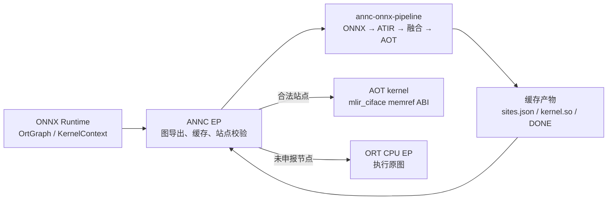
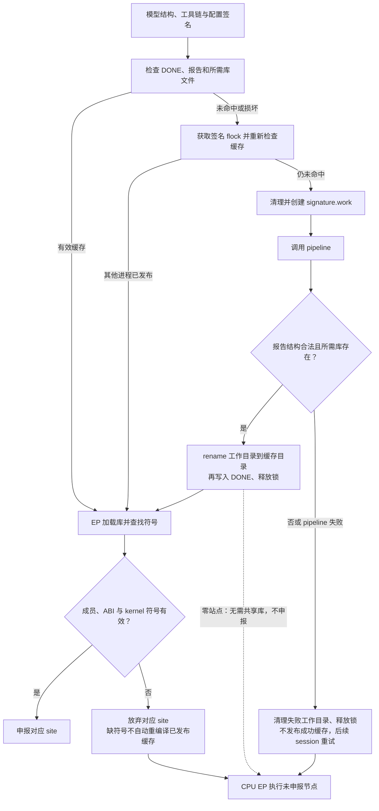
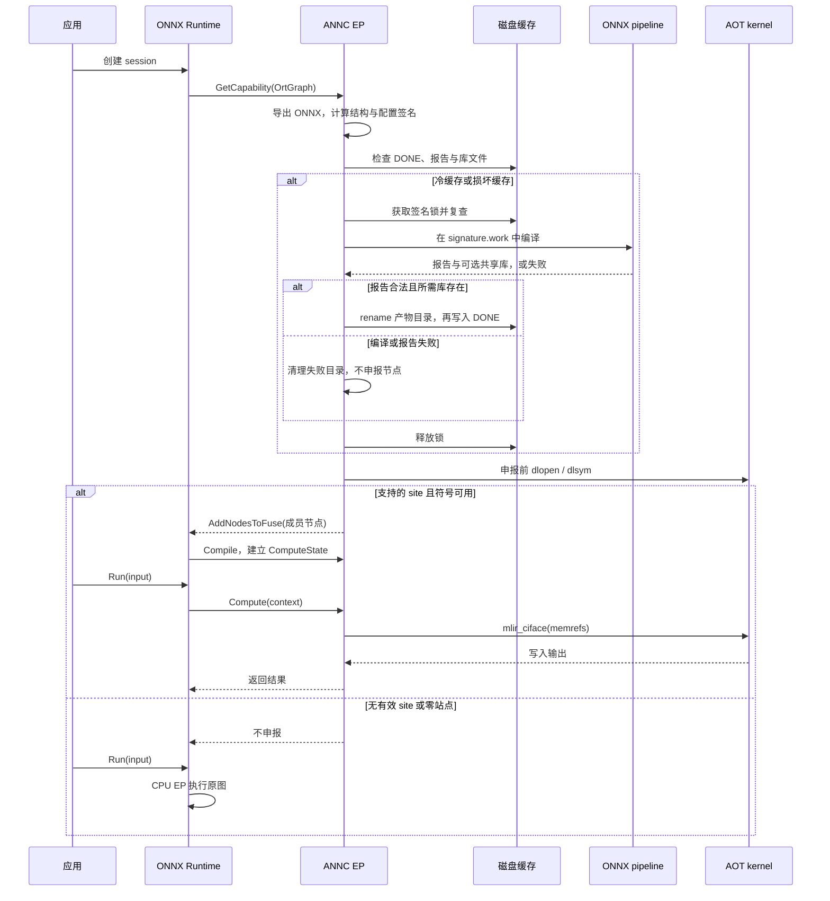
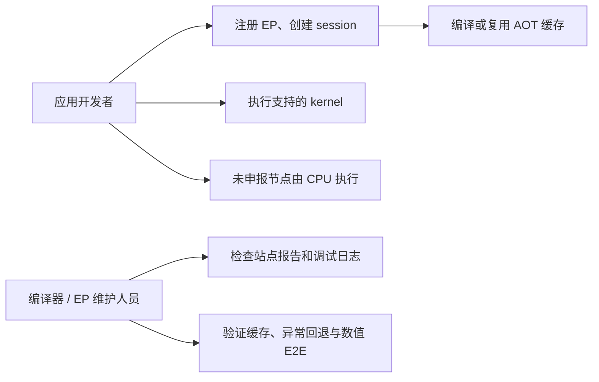

# ANNC ORT EP 与 ONNX Pipeline 运行时编译适配设计

> 文档编号：ANNC-ORT-EP-PIPELINE-001  
> 版本：v1.0  
> 日期：2026-10-13  
> 基线：MR2 `e4f64e0b`；当前实现 `b3513b7d`  
> 适用范围：AOT `tensordot_matmul` 接入闭环

## 0. 文档导读

本文面向 ANNC、ONNX Runtime EP、编译器工具链和测试维护人员，说明 MR2 之后新增的 ORT EP 与 ONNX pipeline 运行时编译链路。重点描述图导出、站点契约、缓存发布、EP 申报与 CPU 回退，以及已经验证的边界。四模型性能优化、普通 MatMul JIT 和 ORT 执行上下文扩展不属于本文实现范围。

## 1. 需求分析

### 1.1 原有机制

MR2 已提供 ONNX ModelProto 到 ATIR 的前端 `annc-onnx2atir`，但 ORT 图还不能直接进入 ANNC 工具链。ORT 的 `OrtGraph` 由宿主在 session 初始化时提供，图节点、initializer 和临时模型文件的生命周期由 EP 负责；ANNC 的融合和代码生成则由独立 pipeline 负责。两者之间缺少稳定的图格式、站点元数据和 kernel ABI。

### 1.2 问题

1. EP 无法把 ORT 图可靠地转换成可复现的 ONNX 输入。
2. pipeline 生成的融合站点无法精确映射回 ORT 节点，错误申报会导致错误执行。
3. 编译成本高，且缓存若发布半成品或忽略编译配置，会污染后续 session。
4. 编译、加载或 ABI 校验失败时，必须保留 ORT CPU EP 路径，不能使 session 创建失败。

### 1.3 目标与验收

| 目标 | 验收口径 |
|---|---|
| 图导出 | `OrtGraph` 导出为自包含 ONNX，保留节点、属性、initializer、输入输出顺序 |
| pipeline | 生成 `sites.json`，有站点时生成 `libannc_kernels.so` |
| EP 执行 | `GetCapability`、`Compile`、`Compute` 可完成真实 AOT site 执行 |
| 可靠性 | 缓存原子发布；损坏、失败、缺库、缺符号均 CPU fallback |
| 缓存隔离 | 模型结构、工具链和影响 codegen 的环境配置均参与签名 |
| 正确性 | 真实 `tensordot_matmul` 输出与 CPU EP 对照，最大绝对误差为 0.0 |

### 1.4 设计约束

- 保留 MR2 ONNX 前端目录、接口和测试，不以 dev 分支覆盖前端实现。
- EP 只申报能验证 ABI、成员节点和 kernel 符号的 site。
- 当前 EP 契约接受 AOT、`mlir_ciface` 的 `matmul` 和 `tensordot_matmul` site。普通 MatMul 的真实 pipeline 目前生成 JIT；正向 AOT MatMul 由测试 fixture 提供，真实编译闭环验证的是 `tensordot_matmul`。
- 不实现 ORT 线程池注入，也不扩展 `annc_execution_v2` 的 output/temp/error allocator。

## 2. 总体方案

### 2.1 核心思路

EP 在 `GetCapability` 阶段导出 ORT 图，并以模型结构、工具链和编译配置计算缓存签名。缓存未命中时，EP 调用 `annc-onnx-pipeline` 完成 ONNX 到 ATIR、融合分析和 AOT kernel 生成。pipeline 生成的 site 报告是申报边界的唯一来源；EP 对报告进行结构、ABI、成员节点和动态库符号校验后才调用 `AddNodesToFuse`。任何前置步骤失败都返回“不申报”，让 ORT 使用 CPU EP。

### 2.2 构建与运行开关

| 配置 | 作用 |
|---|---|
| `ANNC_ENABLE_ONNXRUNTIME_EP=ON` | 构建 `libannc_ep.so`，默认关闭 |
| `ANNC_ONNXRUNTIME_INCLUDE_DIR` | 指定 ORT 1.26.0 SDK 头文件 |
| `ANNC_EP_PIPELINE` | 指定 `annc-onnx-pipeline`，未设置时按插件目录和 PATH 查找 |
| `ANNC_EP_CACHE_DIR` | 指定 EP 缓存根目录 |
| `ANNC_EP_COMPILE=0` | 禁用运行时编译 |
| `ANNC_EP_COMPILE_TIMEOUT_S` | pipeline 超时时间，默认 600 秒 |
| `ANNC_EP_KEEP_TEMPS=1` | 保留编译工作目录用于诊断 |

### 2.3 总体框架



图 2-1 中，ORT 只负责提供图和执行上下文；EP 负责导出、缓存和申报；pipeline 负责编译与报告；ANNC kernel library 负责最终 AOT 调用。CPU fallback 表示所有失败路径都保持原图执行。

### 2.4 产物变换与缓存边界



冷缓存先在签名目录的临时工作目录中生成所有产物，校验报告及库文件存在性后，通过目录 rename 发布产物，再写入 `DONE`。热缓存检查 `DONE`、报告和非零站点的库文件；损坏报告或缺库按 cache miss 重试。动态库加载和符号校验在缓存读取之后、节点申报之前进行；缺符号会放弃对应 site，不会自动触发缓存重编译。零站点是合法成功结果，但不生成 `.so`。

## 3. 特性详细设计

### 3.1 OrtGraph 导出

`ExportGraphToModel` 将 ORT 图写入自包含 ONNX 文件。节点使用 `n<i>` 命名，节点输出使用 `t<i>_<p>` 命名，图输入和 initializer 使用 `in_<k>`、`w_<k>` 命名。`NameMaps` 同时记录导出名称和原图节点索引，使 pipeline 报告中的 `member_node_names` 可以回映射到 ORT 节点。

导出失败不产生可用缓存；导出的 ONNX initializer 保留原始 dtype、shape 和数据，保证 pipeline 看到的模型与 ORT 图一致。控制流子图不在本阶段导出。

关键实现文件为 `addons/onnxruntime/annc_ep_graph_export.cc` 和 `ort_graph_to_proto.*`。

### 3.2 Pipeline 与 site 契约

`annc-onnx-pipeline --model <model.onnx> --out-dir <dir>` 依次完成 ONNX 前端、ATIR 优化、融合 metadata 解析和 AOT kernel 编译。输出包括 `sites.json`，以及站点数大于零时的 `libannc_kernels.so`。

EP 读取的 site 至少包含以下信息：

| 字段 | 用途 |
|---|---|
| `pattern` | 选择 EP 支持的执行契约 |
| `kernel_name` | 查找共享库符号 |
| `execution_mode` / `abi` | 确认 AOT 和 `mlir_ciface` 调用约定 |
| `member_node_names` | 回映射并申报 ORT 节点集合 |
| `args` / `outputs` | 确认 rank、shape 和输出张量 |
| `kernel_arg_order` | 将 ORT 输入排列成 kernel 参数顺序 |

`ValidateSite` 拒绝未知 pattern、重复成员、空成员、非法 operand index 和不匹配的 rank/ABI。结构损坏的 JSON 报告使整次编译失败；结构合法但不被当前 EP 支持的 site 可以被丢弃，其他合法 site 仍可申报。

### 3.3 编译缓存与并发

缓存路径为 `$ANNC_EP_CACHE_DIR/v1/<签名前两位>/<签名>/`。签名由 缓存协议前缀 `annc-ep-cache-key-v1`、工具链与宿主信息、模型结构签名和以下配置组成：`ANNC_EP_PIPELINE`、`ANNC_GEMM_CONFIG`、`ANNC_GEMM`、`ANNC_KERNEL_LIB_PATH`、`ANNC_CLANG`、`LIBRARY_PATH`、`CPATH`、`C_INCLUDE_PATH`、`CPLUS_INCLUDE_PATH`。配置值采用长度前缀编码，避免换行或前缀相同造成碰撞。

同一签名使用 `flock` 单飞；每次 `Compile` 使用本签名的局部 work directory，避免并发模型互相覆盖。失败目录在释放锁前清理。发布顺序是先写完整产物，再校验报告和库文件存在性，随后目录 rename，最后写入 `DONE`。缺少 `DONE` 的目录不被热缓存接受。

### 3.4 EP 申报与执行

`GetCapabilityRuntimeCompileImpl` 按以下顺序工作：检查顶层图、导出模型、计算签名、读取或生成缓存、解析报告、校验 kernel 符号、映射成员节点、调用 `AddNodesToFuse`。EP 实例状态由 mutex 保护，driver 在 capability 调用内局部创建，避免不同 session 共享可变工作目录。

下面的时序图展示冷缓存、热缓存、符号校验和 CPU 回退在 session 初始化及推理期间的先后关系。



时序中，pipeline 失败发生在节点申报之前，因此不会破坏 ORT session；符号缺失发生在缓存读取之后，EP 只放弃对应 site，未申报节点仍由 CPU EP 执行。

`ComputeImpl` 从 `OrtKernelContext` 获取输入和输出，构造 MLIR C interface 所需的 memref 描述子，并调用 `_mlir_ciface_<kernel_name>`。当前真实闭环为 `tensordot_matmul`：动态 rank-3 输入、固定 rank-2 权重、rank-3 输出，kernel 参数顺序为 `[1, 0, 2]`。

### 3.5 失败回退

EP 遵循“不申报即回退”的策略：pipeline 不存在、工具链缺失、超时、返回非零、报告损坏、`.so` 缺失、符号缺失或 ABI 不匹配时，不调用 `AddNodesToFuse`。ORT 随后将原图交给 CPU EP。pipeline 返回零站点时发布无 `.so` 的合法缓存，后续 session 可快速确认没有可申报区域。

## 4. 特性验证效果

### 4.1 验证环境与方法

使用 ORT 1.26.0、AArch64 ANNC 工具链和启用 ONNX Runtime EP 的构建。测试通过 CTest 驱动 Python fixture，分别覆盖编译缓存、报告解析、动态库加载和 ORT 数值执行；真实端到端用例使用 16 节点 `tensordot_matmul` 模型，并与同输入 CPU EP 输出比较。

### 4.2 正确性与异常矩阵

当前 `AnncEp` 相关测试共 20/20 通过，覆盖 site 校验、冷/热缓存、缓存配置隔离、并发多模型、报告损坏、工具链或 pipeline 缺失、pipeline 失败、kernel 库/符号缺失、零站点和真实 AOT 闭环。真实用例两次 session 均输出 `(1,2,1)`，最大绝对误差为 `0.0`；第二次 session 命中缓存且不再调用 pipeline。

### 4.3 性能口径

本特性验收只证明运行时编译和 AOT 正确性，不把 batch=1 smoke 或缓存编译时间作为四模型性能结论。四模型 throughput、普通 MatMul JIT 和其他融合 pattern 需要按独立冻结协议评测。

## 5. 使用方法与用例

### 5.1 构建和最小验证

```bash
export ANNC_ONNXRUNTIME_INCLUDE_DIR=<ORT_ROOT>/include/onnxruntime/core/session
./build.sh --enable-ort-ep
ctest --test-dir build -R 'AnncEp' --output-on-failure
```

插件加载时使用绝对路径注册 `libannc_ep.so`，并确保 `ANNC_EP_PIPELINE` 与插件使用同一套 ANNC 工具链。目标 clang 需要的 GCC runtime 路径通过 `LIBRARY_PATH` 提供。

### 5.2 独立 pipeline 和调试

以下命令可检查工具链指纹，并在不启动 ORT 的情况下生成站点报告：

```bash
annc-onnx-pipeline --toolchain-info
annc-onnx-pipeline --model model.onnx --out-dir /tmp/annc-pipeline-out --verbose
```

输出目录中 `sites.json` 描述融合边界和 ABI；仅有非零站点时产生 `libannc_kernels.so`。EP 内的 `ANNC_EP_DEBUG=1` 可观察 cache hit、claimed/dropped 和首次操作数形状，`ANNC_EP_TIMING=1` 可观察输入识别、输出分配及 kernel 开销。

### 5.3 用例总览

下图按角色汇总注册 EP、复用缓存、执行 kernel、CPU 回退和诊断验证等使用方式。



应用开发者主要关注注册、推理和 CPU fallback；编译器与 EP 维护人员关注报告、缓存和异常矩阵验证。

### 5.4 适用性

| 场景 | 判断 |
|---|---|
| 已有 AOT site 且 ABI 与报告一致 | 推荐，EP 可透明接入 |
| 普通 MatMul JIT 或未实现 pattern | 当前不申报，使用 CPU EP |
| 控制流子图 | 当前不支持，使用 CPU EP |
| 需要四模型性能结论 | 使用独立性能任务和冻结协议 |

## 附：关键文件清单

| 文件 | 角色 |
|---|---|
| `addons/onnxruntime/annc_ep.cpp` | EP 注册、GetCapability、Compile、Compute |
| `addons/onnxruntime/annc_ep_compile.cc` | 导出后的编译、缓存、报告解析和库加载 |
| `addons/onnxruntime/annc_ep_site.cc` | site ABI 校验 |
| `addons/onnxruntime/annc_ep_graph_export.cc` | OrtGraph 导出 |
| `addons/onnxruntime/ort_graph_to_proto.*` | ONNX ModelProto 序列化 |
| `frontends/onnx/onnx-pipeline/annc-onnx-pipeline.cpp` | ONNX 到 AOT kernel pipeline |
| `addons/onnxruntime/tests/ep_aot_fixture.py` | 缓存和异常 fixture |
| `addons/onnxruntime/tests/ftdmm_aot_e2e.py` | 真实 pipeline 到 EP 数值闭环 |


## 源码与验证依据

上述源码结论对应 ANNC `b3513b7d`：`ExportGraphToModel` / `ModelSignature`、`CompileDriver::Compile` / `ReadReport`、`ValidateSite`、`GetCapabilityRuntimeCompileImpl` / `ComputeImpl`。20/20 结果来自 2026-10-13 当前 ANNC 工程的构建与 CTest 验证记录；本次为文档更新，未重新运行功能测试。
