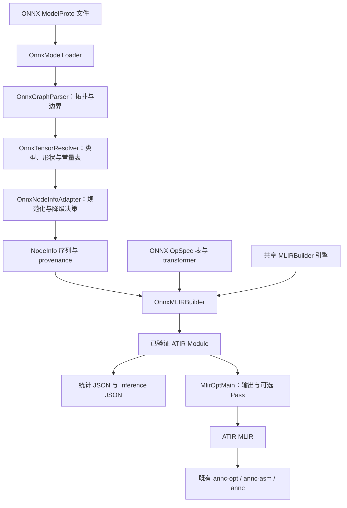

# ANNC ONNX → ATIR 前端设计文档（MR2）

> **文档编号**：ANNC-ONNX-FRONTEND-ARCH-001\
> **文档版本**：v1.0\
> **发布日期**：2026-10-08\
> **目标受众**：架构评审、编译器开发、框架集成和测试工程师\
> **文档密级**：公开

## 1 概述

### 1.1 背景与问题

ANNC 已具备 ATIR 图优化、算子融合和 AArch64 代码生成能力。接入 ONNX 的目标是把模型转换为同一套 ATIR，使这些能力能够被新框架复用，避免增加一套 ONNX 专属优化与后端。

现有 `MLIRBuilder` 已将节点校验、SSA 接线、Op 构造、属性映射、metadata 和诊断集中在共享引擎中，但其算子规格表来自 TensorFlow。直接复用该表会产生同名不同义的问题：ONNX `Sum` 是逐元素加法，TF `Sum` 是归约；ONNX `Gather` 的 axis 是属性，TF `GatherV2` 的 axis 是输入张量。ONNX 算子还存在 opset 间的属性、输入和默认值变化。

MR2 因此采用“共享构建引擎、独立框架规格表、显式规范化与降级”的方案，新增 `annc-onnx2atir`，完成 `.onnx` 到 ATIR 的导入。

### 1.2 目标与验收口径

| 目标 | 设计要求 | 验收依据 |
|---|---|---|
| 复用编译基础设施 | ONNX 适配停留在框架前端，共享 ATIR 与 builder | 独立前端目录、两处 builder 虚接口、TF/ONNX 表隔离测试 |
| 支撑目标计算子图 | 覆盖形状链、MatMul、部分逐元素和归约算子 | 算子规格表、前端 GTest、形状链 CLI 测试 |
| 保留类型和形状信息 | 区分静态维度、动态维度、未知 rank 和不可表示 dtype | `TensorDescriptor`、逐张量 inference 报告 |
| 导入过程可审计 | 节点映射或降级均有记录，统计与模块可对照 | provenance、守恒字段、退出码 0/2/1 |
| 隔离框架依赖 | ONNX 前端可按开关构建，不依赖 TF addon | CMake 注册、ONNX proto 生成流程、安装检查 |

本文的“mapped”表示前端为节点构造了表中指定的 ATIR 表达，并通过模块验证；它不等同于任意 dtype、shape 和属性组合都已获得数值等价证明，也不等同于后端可执行。

### 1.3 范围与非目标

MR2 实现默认域 `ai.onnx`、opset 13、无子图属性的 DAG 导入，覆盖目标融合子图所需的算子子集，输出 ATIR 与可选 JSON 报告。

以下能力不在本次实现范围内：

- 全量 ONNX 算子、所有 opset 的自动兼容，以及完整 ONNX checker。
- `If` / `Loop` / `Scan` 子图、模型内 local functions 和 external tensor data 的加载。
- ONNX Runtime Execution Provider、运行时图重写、融合 kernel 回接与端到端性能承诺。
- 新的 lowering 路径、目标后端或公共 Python API。
- 将 `atir.opaque` 当作可执行的 ONNX fallback；opaque 在本前端中用于保留图结构。

MR2 之后已增加独立的 ONNX Runtime EP 运行时编译接入层：它复用本文描述的 ONNX 前端，将 ORT `OrtGraph` 导出为自包含 ModelProto，再由 pipeline 生成 site 报告和 AOT kernel。该接入层的设计、缓存和回退契约见 [ANNC ORT EP 与 ONNX Pipeline 运行时编译适配设计](annc-ort-ep-pipeline-adaptation-design.md)。

## 2 总体方案

### 2.1 架构与数据流



前端先完成 ONNX 语义整理，再交给共享 builder 构造 `func.func @main`。报告针对初始构建模块生成；其后由 `MlirOptMain` 处理输出参数和用户指定的 Pass。

前端代码集中在 `frontends/onnx/onnx2atir/`，属于 ANNC 框架对接层。它不在 Pass 中嵌入 ONNX 解析，也不直接生成 AArch64 代码。

### 2.2 模块职责

| 文件 / 模块 | 职责 |
|---|---|
| `onnx_frontend.{h,cpp}` | 读取 ModelProto，提取 opset，整理输入、initializer、输出与拓扑 |
| `onnx_tensor_decoder.{h,cpp}` | dtype 名称转换，数值和字符串常量载荷解码 |
| `onnx_tensor_resolver.{h,cpp}` | 张量描述符、局部类型/形状推导与有限常量表 |
| `onnx_node_info_adapter.{h,cpp}` | 构造 NodeInfo、边界节点与 provenance，判定降级 |
| `onnx_op_spec_table.inc` | 默认域 ONNX 算子到 ATIR 的独立规格表 |
| `onnx_transformers.{h,cpp}` | 归约、Gather、Transpose、Not、Slice 的专用构造 |
| `onnx_mlir_builder.{h,cpp}` | 替换规格查找与强制 opaque 判定，继承共享构建引擎 |
| `annc-onnx2atir.cpp` | CLI 编排、报告、strict 检查、临时 bytecode 与 MLIR driver |

### 2.3 复用接缝与取舍

`OnnxMLIRBuilder` 只覆盖两处虚接口：`lookupSpec` 查询 ONNX 表；`shouldLowerToOpaque` 读取适配器写入的私有降级标记。公共引擎继续负责输入数量检查、类型构造、SSA 接线、buffer、属性、metadata 和模块验证。

`Reshape`、`Squeeze`、`Unsqueeze`、`Expand`、`Identity` 和 `MatMul` 复用既有 transformer；不同输入形式或默认值由 ONNX 适配器及专用 transformer 处理。

| 方案 | 取舍 |
|---|---|
| TF/ONNX 共用一张规格表 | 同名算子语义不同，存在静默错译风险，未采用 |
| 为 ONNX 复制 builder 和后端 | 重复 SSA、类型和属性处理，维护成本高，未采用 |
| 共享引擎，框架表与适配独立 | 复用已有机制，同时把语义差异留在前端，采用 |
| 首期支持多个 opset 的分版本规格表 | 扩大维护与验证范围，留待后续需求驱动 |

长期决策见 [ADR-011](../decisions/decisions.md#adr-011)；本文补充具体实现契约与现阶段限制。

## 3 模型、张量与图边界

### 3.1 模型加载与拓扑整理

loader 检查文件能否打开、protobuf 能否解析、模型是否包含 graph，并拒绝带 local functions 的模型。默认域 `""` 与 `"ai.onnx"` 统一用于 opset 判断，其余 domain 保留在模型记录中。

parser 采用 Kahn 算法排序。运行时输入保持 `graph.input` 顺序；dense initializer 保持声明顺序；图输出保持 `graph.output` 顺序。initializer 同时列为 graph input 时，前端选择常量解释，从运行时输入中排除。

缺少节点名时使用首个输出名；重复节点名追加 `__onnx_idx<i>`。诊断与 provenance 使用规范化后的名字，重复名字的原始拼写不作为独立恢复字段保存。空 optional input 名会被过滤，保留下来的输入保持相对顺序。

含子图属性的模型整体拒绝，避免只导入外层节点而遗漏内部计算。依赖环、自环、零输出节点、空 `op_type`、无名或重名 dense initializer 也会导致硬错误。

### 3.2 张量描述符与信息损失

`TensorDescriptor` 独立记录 dtype、`dtype_unsupported`、shape、`rank_known`、符号维度数、未知维度数与 `declared_in_file`。

| ONNX 信息 | 前端 / ATIR 表达 | 报告口径 |
|---|---|---|
| `dim_value` | 保留具体维度 | shape 中的整数 |
| `dim_param` | 转为动态维度 `-1` | shape 中的 `null`，并统计 `sym_dims` |
| 无 dim_value / dim_param | 转为动态维度 `-1` | shape 中的 `null`，并统计 `unknown_dims` |
| 已知 rank、部分维度未知 | 保留维度数量 | `rank_known=true` |
| 无 shape / rank 无法推导 | 不虚构 rank | `rank_known=false`；空 shape 不能据此解释为标量 |
| ATIR 无法承载的元素类型 | 设置 `dtype_unsupported` | 触发相应节点降级或 initializer 硬错误 |

ATIR 不保留 ONNX 符号维度的名字与相等约束。报告中的 `dynamic_dims` 统计最终动态维度，`sym_dims` 统计已记录的符号声明来源，两者并不等价。

resolver 对 initializer 和输入先建立描述符，再按拓扑进行一次局部推导，最后用文件中的 input/output/value_info 声明补齐缺口。已有推导结果优先；不可表示 dtype 不允许被另一份声明掩盖。该机制不进行完整的声明与推导冲突校验，也不通过固定点迭代重推所有下游节点。

### 3.3 常量解码与常量表

dtype 名称转换覆盖 `float32/64/16`、`bfloat16`、有符号/无符号 8/16/32/64 位整数、bool、string、complex64/128。类型能够表示不代表对应算术或后端已支持。

数值常量优先读取 `raw_data`；typed 字段按 dtype 重建字节载荷，子 32 位类型从 `int32_data` 窄化。字符串使用 `string_data`。解码器检查载荷字节数或字符串数量与张量元素数是否匹配，拒绝 external data。

当前 complex64/128 可走 raw 字节路径，其 typed 字段编码未实现。typed 数值重建通过主机布局复制，部署边界按现有小端平台使用（大端主机在编译期被显式拒绝，见 `onnx_tensor_decoder.h`）；未实现跨大小端转换。

`OnnxConstTable` 只收集 initializer 与 `Constant(value=tensor)` 的 INT32/INT64 整数载荷，以及单元素 FLOAT/DOUBLE 载荷，用于 axes/shape 等参数解析。它不计算 Shape、Cast、Gather、ReduceProd、Unsqueeze 或 Concat 的输出值；形状链中的这些节点会保留为计算节点，resolver 推导的是其张量类型与形状。该表不是通用 ONNX 解释器或全图常量折叠 Pass。

### 3.4 NodeInfo 与图输入输出

适配结果按运行时输入、dense initializer、稀疏 initializer、拓扑节点、图输出边界组织。输入成为 `@main` 参数；dense initializer 成为 `atir.constant`；稀疏 initializer 成为显式 opaque 生产者。

ONNX Constant 的节点名与输出张量名可以不同。为适配共享 builder 的常量寻址约定，Constant 的 `NodeInfo::name` 使用输出张量名，原节点名保留在 provenance，必要时附加 `tf.onnx_node` metadata。

每个图输出增加 `__annc_output_<i>` Identity 边界，并用 `tf.output_tensor` 保留真实张量名，复用已有融合端点约定。适配层的输出边界不保证优化后仍保留同名 Identity Op。

## 4 算子映射与语义适配

### 4.1 当前规格表

MR2 的 ONNX 表共有 **38 行规格、39 个算子名**，其中 `Sum` 与 `Add` 共用一行。下表列出表中目标；具体节点仍受 arity、dtype、属性与形状条件约束。

| 类别 | ONNX 算子 → ATIR |
|---|---|
| 常量 | `Constant` → `atir.constant` |
| 基本算术 | `Sum/Add` → `atir.Add`；`Sub` → `atir.Sub`；`Mul` → `atir.Mul`；`Div` → `atir.RealDiv`；`Mod` → `atir.FloorMod`；`Pow` → `atir.Pow` |
| 极值与激活 | `Min/Max` → `atir.Minimum/Maximum`；`Relu` → `atir.Relu`；`Sigmoid` → `atir.Logistic`；`Sqrt/Abs/Reciprocal` → 同名 ATIR Op |
| 比较与逻辑 | `Equal/Greater/Less/Not` → `atir.Compare`；`And` → `atir.And`；`Where` → `atir.Where` |
| 形状与维度 | `Shape/Cast/Reshape` → 同名 ATIR Op；`Squeeze` → `atir.Reshape`；`Unsqueeze` → `atir.ExpandDims`；`Transpose/Concat/Gather/Tile` → 同名 ATIR Op；`Expand` → `atir.broadcast`；`Slice` → `atir.Slice` |
| 矩阵与归约 | `MatMul` → `atir.MatMul`；`ReduceSum` → `atir.Sum`；`ReduceMean/GlobalAveragePool` → `atir.ReduceMean`；`ReduceProd` → `atir.Prod` |
| 其他 | `Identity` → `atir.Identity`；`Softmax` → `atir.Softmax` |

`Gemm`、`LeakyRelu`、`Or` 等没有表项，按 `NO_SPEC` 降级。MR2 没有 Gemm 分解实现，也没有新增 TensordotMatMul 融合与 kernel。

### 4.2 关键规范化

| 算子 | 实现方式与限制 |
|---|---|
| Sum / Add、Min / Max | Sum/Add 表项接受至少两个输入；单输入 Sum 降级。Min/Max 只接受两个输入，合法的更多输入形式仍降级 |
| Gather | axis 属性物化为整数常量 operand，默认 axis=0，`batch_dims=0`；接受 data 与 indices 两个原始输入 |
| Transpose | perm 属性物化为 operand 与 Op 属性；省略 perm 时按已知 rank 反转维度，无法确定 rank 时降级 |
| Squeeze | 不保留 axes operand，依据已解析输出 shape 构造 Reshape；输出 rank 未知时降级 |
| Unsqueeze | 复用单轴 ExpandDims；axes 必须能读取且只有一个值，多轴形式降级 |
| 归约 | ReduceSum 的 axes 来自 operand，ReduceMean/ReduceProd 从属性物化 axes；显式设置 keepdims，默认保留维度 |
| GlobalAveragePool | 转为对 `[2, rank)` 的 ReduceMean，并保留维度；要求输入 rank 已知且 ≥ 3（rank-2 输入没有可归约的空间维，按 `UNSUPPORTED_ATTR` 降级） |
| Slice | 参数须为可读常量，数据 shape 必须静态且 step=1；按负索引与截断规则转为 full-rank begin/size 常量 |
| Not | 构造标量 true，并用 `Compare(x, true, NE)` 表达布尔取反 |
| Softmax | 使用 ATIR 最后维语义；已知非最后轴降级，显式轴但无法确认 rank 时降级 |
| Mod | 仅按 `fmod=0` 选择 FloorMod；`fmod!=0` 降级，同时受整数 dtype 门禁限制 |

ReduceSum 在 `keepdims=0` 且 axes operand 不可读取时，无法可靠确定输出 rank，按 `SHAPE_UNKNOWN` 降级。未知 rank 不构成所有算子的统一降级条件；无需 rank 决定构造语义的部分节点仍可携带未知 rank。

### 4.3 dtype 门禁

ATIR 部分数值实现通过 float32 读取输入。为避免把整数除法、比较等误当作浮点语义，MR2 对整数输入的 `Div/Pow/Sqrt/Reciprocal/Abs/Min/Max/Mod/Equal/Greater/Less` 按 `UNSUPPORTED_DTYPE` 降级。

形状和索引链中的 `Add/Sub/Mul/Tile` 等暂未采用同一门禁。经过 float32 数值路径时，整数绝对值超过 `2^24` 存在精度损失风险；本次接入不补齐 ATIR 整数内核。`--strict` 只检查已识别的降级，不能证明这一风险已经消除。

### 4.4 属性与 metadata

ONNX 标量和列表属性复制到 `NodeInfo::attrs`。需要改变 ATIR 行为的属性通过 Direct 映射或 transformer 处理；`DocumentedDrop` 表示属性已被表声明，避免重复警告，并不自动赋予它数值语义。

共享 metadata 继续使用历史 `tf.name`、`tf.op`、`tf.input.N` 等字段名。ONNX 前端沿用该契约，不新增平行的 metadata 系统；这些字段名不表示原模型来自 TensorFlow。

`_onnx_fallback`、降级 reason 与规范化 Slice 窗口属于前端私有状态。以 `_` 开头的 typed attrs 在 mapped 与 opaque 路径均不进入 emitted metadata；机器可读降级原因由 stats/provenance 报告提供。

## 5 降级、硬错误与审计契约

### 5.1 两类失败边界

局部表达受限时，适配器设置私有降级标记并记录 reason，由共享 builder 构造带输入输出的 `atir.opaque`；正常完成但存在降级时退出 2。图结构或数据无法建立可靠表达、builder 验证失败、文件写入失败等情况退出 1。

| reason / 条件 | 当前处理 |
|---|---|
| `NO_SPEC` | 无表项或非默认 domain，逐节点 opaque |
| `UNSUPPORTED_DTYPE` | 不可表示的输出 dtype、已设门禁的整数算术、稀疏 initializer 等，逐项 opaque |
| `UNSUPPORTED_ATTR` | 已识别的不支持属性、arity、Constant 编码或 Slice/Unsqueeze/GlobalAveragePool 形式，逐节点 opaque |
| `SHAPE_UNKNOWN` | 特定构造所需 rank 或参数无法确定，逐节点 opaque |
| `OP_SET_MISMATCH` | 默认整体拒绝非 13 opset；relaxed 模式下敏感算子 opaque |
| 子图 / local function / 依赖环 | 整体拒绝，不能通过导入一部分节点维持正确账目 |
| dense initializer 解码失败 | 硬错误，包括 external data、不可表示 dtype 或载荷不匹配 |

头文件还定义了 `CONTROL_FLOW` 与 `INITIALIZER_DYNAMIC`；前者对应常规流程中更早发生的子图拒绝，后者当前未形成实际 reason 输出分支，不能据定义推断已实现相应能力。

### 5.2 opset 策略

默认只接受 `ai.onnx` opset 13；未声明默认域 opset 也无法通过该检查。

`--relaxed-opset` 允许继续导入其他版本，但只对固定集合 `Softmax/Unsqueeze/Squeeze/ReduceSum/Slice/Tile/Cast/Concat` 强制 `OP_SET_MISMATCH` 降级。其余节点继续使用 opset 13 表。该选项用于受控导入与审计，不是多版本兼容保证，尤其不覆盖 ReduceMean/ReduceProd 等全部 schema 漂移。

### 5.3 节点账目与模块账目

两套账目必须区分：`AdaptedGraph::nodes` 包含输入、dense initializer、稀疏 initializer、模型节点和输出边界；`provenance` 只包含模型节点与具名稀疏 initializer。普通 initializer、输入和图输出没有逐项 provenance 行。

| 字段 | 实际含义 |
|---|---|
| `graph.nodes` / `conservation.model_nodes` | 原模型 graph.node 数量 |
| `import_coverage.total_nodes` | 全部 provenance 行数，包含稀疏 initializer |
| `nodes_accounted` | 非稀疏 provenance 行数等于模型节点数 |
| `opaque_nodes_match` | 全部降级 provenance 行数等于初始模块中 opaque Op 数 |
| `initializer_constants` / `output_boundaries` | 适配层 dense initializer / 输出边界数量 |
| `constants_in_module` | 初始模块内实际 constant 数，包括 transformer 新增的辅助常量 |

因此不能直接把 `constants_in_module` 与 initializer 数比较，也不能在存在稀疏 initializer 时把 coverage 分母当作纯模型节点数。终端摘要会将稀疏降级单列。

守恒字段当前作为报告中的布尔结果供审计，CLI 没有依据它们单独决定退出码；验收脚本应显式断言两个字段均为 true。它们检查数量关系，不代替逐节点身份、属性和数值等价验证。

## 6 CLI 与输出接口

### 6.1 命令行

```bash
annc-onnx2atir model.onnx --quiet -o model.mlir \
  --dump-stats stats.json --dump-inference inference.json
```

| 参数 | 默认 / 行为 |
|---|---|
| `<model.onnx>` | 必填，作为首个位置输入传入 |
| `--dump-stats <path>` | 默认不输出；写覆盖、reason、provenance 和守恒报告 |
| `--dump-inference <path>` | 默认不输出；写逐张量 dtype / shape 报告 |
| `--strict` | 默认关闭；已有节点/稀疏降级或表项目标未注册时退出 1 |
| `--relaxed-opset` | 默认关闭；采用第 5.2 节的逐算子处理 |
| `--quiet` | 默认关闭；抑制非错误摘要，不保证抑制 builder warning |
| `--help` / `-h` | 显示前端帮助并退出 0 |
| `-o` 与其他 MLIR 参数 | 转交 `MlirOptMain`，使用其输出与 Pass 机制 |

默认摘要写到 stdout。需要从 stdout 获取纯 MLIR 时应使用 `--quiet`；输出文件由 MLIR driver 管理。脚本必须区分退出 2 与硬错误，不能把“有降级”当作全部映射成功。

| 退出码 | 含义 |
|---|---|
| 0 | driver 成功，且没有节点或稀疏 initializer 降级 |
| 2 | driver 成功，但存在上述降级 |
| 1 | 导入/构建/报告/driver 硬错误，或 strict 拒绝降级 |

### 6.2 报告与版本

ATIR module 写入 `module.state="atir"` 与 `annc.contract_version="1.0.0"`，两类 JSON 也写入相同 `contract_version` 和工具名。源码约定 MAJOR 表示报告形状不兼容，MINOR 表示新增，PATCH 表示措辞变化；MR2 没有实现报告版本协商或消费者校验。

| 输出 | 顶层结构 |
|---|---|
| stats | `contract_version`、`tool`、`model`、`graph`、`import_coverage`、`tensor_types`、`conservation`、`provenance` |
| inference | `contract_version`、`tool`、`dynamic_dim_marker`、`graph_inputs`、`initializers`、`tensors` |

stats 支持按 op、reason 以及 reason/op 交叉汇总；provenance 行含节点名、算子名、decision、kind 和适用时的 domain、atir_op、reason。inference 以张量名索引，动态维度为 `null`，未知 rank 由 `rank_known=false` 表达。

报告在 strict 检查和后续 MLIR Pass 之前写出：strict 失败时报告仍可能存在，ATIR 输出尚未生成；后续 Pass 失败时报告也不能证明最终输出成功。报告文件打开、flush 或写入失败均导致硬错误，当前没有三份输出的事务提交机制，也不检查输出路径相互冲突；MLIR、stats 和 inference 应使用不同路径。

## 7 构建、安装与集成影响

`ANNC_ENABLE_ONNX` 默认 ON，控制前端、proto 使用与前端 GTest；`BUILD_TESTING` 控制测试目标。顶层 CMake 在 ANNC 公共库注册之后进入 `frontends/`，工具安装到 `bin/annc-onnx2atir`，安装 RPATH 为 `$ORIGIN/../lib`。

ONNX schema 已存于仓库。`build.sh` 调用离线生成脚本，并按生成时 protoc 版本判断是否需要重生成。直接运行 CMake 前应自行生成源码；该前端 CMake 使用已生成的 `.pb.cc`，不自动调用 protoc。

依赖沿用 LLVM/MLIR、ANNC 公共库与系统 Protobuf；生成器应匹配 Protobuf C++ 版本，测试另需 GTest。ONNX Python 包只用于 pytest 生成测试模型，不是 C++ CLI 的运行依赖，当前未列入 `requirements.txt`。关闭 TF addon 后，构建不要求安装 TensorFlow Python 包，仍需公共 Python 绑定的构建依赖。

在项目支持的 Linux 构建环境中，可使用以下命令单独启用 ONNX 路径：

```bash
./build.sh --disable-tensorflow --install-prefix /opt/ANNC
```

手动构建时，应先安装公共 Python 构建依赖与 CLI 测试依赖，并向 CMake 显式传入 pip 安装包的发现路径。系统 Protobuf/protoc、GTest 等开发依赖仍需按项目构建要求准备：

```bash
python3 -m pip install pybind11==2.11.1 'nanobind>=2.4,<3' \
  onnx 'numpy<2' 'pytest>=8,<9'
bash frontends/onnx/protos/onnx_protos_minimal.sh -d "$PWD"
cmake -G Ninja -S . -B build \
  -DCMAKE_BUILD_TYPE=Release \
  -DANNC_ENABLE_TENSORFLOW=OFF \
  -DANNC_ENABLE_TENSORFLOW_ADDON=OFF \
  -DANNC_ENABLE_ONNX=ON -DBUILD_TESTING=ON \
  -Dpybind11_DIR="$(python3 -m pybind11 --cmakedir)" \
  -Dnanobind_DIR="$(python3 -c 'import nanobind, os; print(os.path.join(os.path.dirname(nanobind.__file__), "cmake"))')"
cmake --build build --target annc-onnx2atir annc-onnx2atir-frontend-test
ctest --test-dir build -R '^Onnx' --output-on-failure
ANNC_BUILD_DIR="$PWD/build" python3 -m pytest tests/test_onnx_frontend.py -v
```

MR2 新增 CLI 与报告接口，并同步修改 README、help、总体架构和 ADR。它不修改 ANNCOptimizer、ANNCFusedOp 或公共 Python 调用签名。Jenkins 的安装阶段按 ONNX 开关检查新工具是否存在。

## 8 测试设计与验收

### 8.1 已有覆盖

MR2 包含 **45 个 GTest 与 6 个 pytest 用例**。数量表示源码中的用例数量，不表示本次文档编写已运行通过。

| 测试层 | 数量 | 主要覆盖 |
|---|---:|---|
| OnnxTensorDecoder | 6 | dtype 名称、typed 载荷、窄化、external data 拒绝、raw 载荷长度 |
| OnnxGraphParser | 9 | 拓扑排序、控制流、环、自环、输入/initializer 重叠、结构错误 |
| OnnxTensorResolver | 5 | 形状链、符号维度、未知 rank、ReduceProd、Slice 长度 |
| OnnxNodeInfoAdapter | 20 | reason、opset、arity、dtype、稀疏数据、输出边界、initializer 顺序 |
| OnnxBuilder | 5 | TF/ONNX 表分离、属性生效、私有 metadata 过滤、opaque、常量构建 |
| CLI pytest | 6 | 形状链导入、未支持算子/退出 2、strict、控制流、opset、inference 报告 |

pytest 检查 `ANNC_BUILD_DIR`，否则依次尝试 `build-v2` 与 `build`，寻找 `bin/annc-onnx2atir`。缺少 ONNX Python 包或工具时会跳过，验收必须检查 skip，不能将跳过当作通过。

### 8.2 提交验收建议

提交环境应分别确认：ONNX 开关开/关的构建与安装行为、45 个定向 GTest、6 个 CLI 用例，以及 TF 开启配置下的既有 builder/前端回归。对计划用于融合的真实模型，还应检查 provenance、守恒字段与逐张量报告，再运行对应的融合和 kernel 数值验证。

当前测试主要验证导入结构和报告契约，没有建立通用 ONNX Runtime 数值对照或全算子端到端执行测试。CI 的 `RUN_TESTS` 默认关闭，现有 pytest 命令带 `|| true`，也没有运行前端 ctest；安装检查不能替代阻断式测试。现有 `ninja coverage` 的 gcovr filter 仍限定 Kernel，不能用作 ONNX 前端覆盖率指标。

本次文档编写环境为 Windows，未具备前端构建产物、ONNX Python 包和 NumPy。执行 `python -m pytest tests/test_onnx_frontend.py -q` 的结果为模块级跳过（`1 skipped`），未运行六个 CLI 用例；未执行 C++ 编译与数值验证。本文依据 MR2 源码和测试断言核对设计，提交验收结果应由具备依赖的构建环境补充。

## 9 可靠性、安全与已知限制

### 9.1 当前可靠性与安全边界

导入阶段只解析模型数据，不执行模型或加载模型提供的动态库，也不读取 external tensor data 文件。常量解码器拒绝 EXTERNAL 载荷：dense initializer 因此导致硬错误，Constant 节点可因解码失败降级为 opaque；带 local functions 的模型整体拒绝。

唯一临时 bytecode 文件由系统临时目录中的原子唯一命名创建，并由 scope-exit 清理，支持并发调用而不共用固定路径。JSON 写入检查 flush 错误，builder 执行 MLIR module verifier。

这些措施属于局部校验，不能替代完整 ONNX 模型合法性和资源边界校验。当前没有模型文件大小限制、tensor 元素数乘法的完整溢出/负维检查、全图张量名唯一性校验或来源鉴别。提交和部署应以符合 ONNX 规范、来源已确认的模型为输入。

### 9.2 需要公开的语义限制

| 限制 | 影响与评审要求 |
|---|---|
| opset 13 表与有限 relaxed 敏感集合 | 其他版本可能具有未被门禁覆盖的语义差异，应按算子核对 |
| `ReduceSum.noop_with_empty_axes` | 属性被声明但 resolver/transformer 未实现 noop 语义；空 axes 按全维归约处理，不能声称该组合忠实支持 |
| rank-1 MatMul | resolver 未实现该形式的形状推导，表项存在不代表全部 ONNX MatMul 形式受支持 |
| Expand 的动态 shape | 共享 transformer 从已解析输出 shape 构造 broadcastSizes，不传递 ONNX shape operand 的运行时值，不能据表项宣称任意动态 Expand 已支持 |
| 整数与非 F32 路径 | 类型导入范围宽于数值/后端范围；整数精度风险见第 4.3 节 |
| 局部推导与参数合法性 | 未完整校验 Reshape 的所有 `-1`/整除规则、Transpose perm 等，不是规范验证器 |
| optional input 空位过滤 | 共享输入序列不保留全部原始位置，不能据此宣称任意可选输入组合都受支持 |
| 任意属性与未知类型 | 目前针对已枚举分歧设门禁；metadata 保留、unknown dtype 或成功验证都不自动证明语义等价 |
| opaque 与运行时回接 | 保留拓扑不提供执行实现；未被融合吸收的 opaque 不能当作可运行 kernel |
| 非事务输出 | 报告可先于 strict 或后续 Pass 失败产生，消费者须结合退出码判断 |

后续扩展应从需求与测试出发：先明确新算子的 opset、dtype、shape 和属性语义，检索可复用的 ATIR/transformer，再补充表项、门禁、报告与数值验证。多 opset、整数内核、控制流和 ORT 回接应分别设计，避免将它们隐含纳入本次前端提交。

## 10 实现与评审索引

- [前端源码目录](../../frontends/onnx/onnx2atir/)
- [ONNX 算子规格表](../../frontends/onnx/onnx2atir/onnx_op_spec_table.inc)
- [共享 builder 接口](../../annc/include/Builder/MLIROpBuilder.h)与[实现](../../annc/lib/Builder/MLIROpBuilder.cpp)
- [前端 GTest](../../frontends/onnx/onnx2atir/test/onnx_frontend_test.cpp)与[CLI pytest](../../tests/test_onnx_frontend.py)
- [ONNX proto 生成脚本](../../frontends/onnx/protos/onnx_protos_minimal.sh)
- [ANNC 总体架构](../architecture/overview.md)与[ADR-011](../decisions/decisions.md#adr-011)
- ONNX Runtime 侧回接见[EP 执行上下文设计](ort-ep-execution-context-architecture-design.md)与 [ADR-013](../decisions/decisions.md#adr-012)
