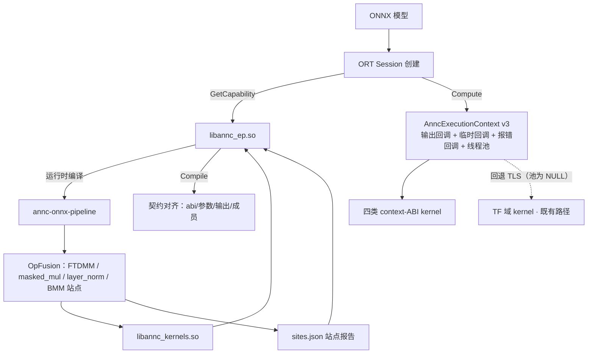

# ANNC ONNX Runtime EP 执行上下文设计文档（MR2）

> **文档编号**：ANNC-ORT-EXECCTX-ARCH-001\
> **文档版本**：v1.0\
> **发布日期**：2026-10-13\
> **目标受众**：架构评审、编译器开发、框架集成和测试工程师\
> **文档密级**：公开

## 1 概述

### 1.1 背景与问题

ANNC 的 Kernel C ABI 最初只有一种形态：`_mlir_ciface_*` 函数，宿主在调用前按融合元数据预分配输出张量，参数列表是固定的 MemRef 描述子指针。TensorFlow 侧由 `ANNCFusedOp` 承担宿主角色，并通过 TLS（`annc_set_current_threadpool`）把 TF intra-op 线程池注入 kernel。

ONNX Runtime 侧无法套用这两件事：

- **输出由 ORT 在内核执行中分配**：ORT 的 kernel 接口是 `KernelContext_GetOutput(ctx, slot, dims, rank, &out)`，输出形状往往只有读到输入数据（本特性载体 FTDMM 的输出 `[d0, d1, N]`）才能确定，宿主无法在调用前预分配。
- **线程池是回调而不是环境**：ORT 暴露的是 `KernelContext_ParallelFor(ctx, fn, total, num_batch, user_data)` 这一逐索引回调，ORT 进程中没有 ANNC 的 TLS 约定，插件若不显式接，kernel 只能串行。

与此同时，`annc_execution_v2` 调用约定（kernel 首参为执行上下文，输出经回调分配）在 TF 域融合 pattern 上已经存在，但它的上下文结构没有线程池字段——TF 靠 TLS 取池，ONNX 无 TLS 可取。这就是本特性的输入问题：**让 ONNX 侧有自己的执行状态与线程池，并把它放进执行上下文**。

### 1.2 目标与验收口径

| 目标 | 设计要求 | 验收依据 |
|---|---|---|
| 线程池随上下文传递 | `AnncExecutionContext` 扩展 v3，尾部携带宿主线程池句柄；v2 布局继续可用 | ABI 布局单测；`resolveThreadPool` 回退语义 |
| ONNX 侧执行状态完整 | 输出 / 临时 / 错误回调 + ORT 线程池适配器，逐次 Compute 构造 | 回调契约用例（slot/rank/dtype/重复分配/零字节临时/失败释放） |
| 站点按 ABI 分发 | EP 按站点报告的 `abi` 字段选择调用路径；v2 契约在申报前校验 | 站点校验单测；fixture 走真实 EP 全路径 |
| 首个 ONNX 可达载体 | FTDMM（tensordot_matmul）以上下文形态产出站点并经 EP 执行 | 真实 16 节点模型的端到端数值比对（冷编译 + 热缓存） |
| 不触碰 TF 执行流 | TF 域 kernel 的取池方式、TF addon 与 TLS 注入链零改动 | TF 域文件零 diff；TF 上下文池为空时回退 TLS |

### 1.3 范围与非目标

- 覆盖 ONNX 侧执行上下文、EP 分发、站点契约与 FTDMM 载体；不做 model-level 性能承诺（过订阅与 CPU 占用另测）。
- task019 已将 masked_mul / layer_norm / batched_matmul_add 迁入同一上下文协议；下文同步当前参数与调度契约，算子模式实现见 `OpFusion.cpp`。
- 不做 ORT EPContext（预编译上下文）、不改 TF 的 TLS 注入路径与 TF 域 kernel 的取池方式。

## 2 总体方案

### 2.1 架构与数据流



### 2.2 模块职责

| 组件 | 职责 | 关键接口 |
|---|---|---|
| `annc/include/Kernel/ExecutionContext.h` | ABI v3：上下文结构、版本规则、元素类型 | `AnncExecutionContext`、`ANNC_EXECUTION_V2_CONTEXT_SIZE` |
| `annc/include/Kernel/ExecutionContextUtils.h` | 取池与分配 helper | `validateContext`、`threadPool`、`resolveThreadPool`、`allocateOutput3DF32` |
| `addons/onnxruntime/annc_ep_execution.{h,cc}` | ONNX 执行状态：回调实现、线程池适配器、参数绑定规则、上下文调用 | `OnnxExecutionContext`、`OrtThreadPool`、`BindArgumentsToInputs`、`ComputeWithContext` |
| `addons/onnxruntime/annc_ep.cpp` | EP 生命周期：申报、编译、Compute 分发 | `ComputeImpl` 按 `abi` 分发；`ResolveContextInputs` |
| `addons/onnxruntime/annc_ep_site.cc` | 站点契约校验（两套 ABI） | `ValidateSite`（旧契约）与 `annc_execution_v2` 契约 |
| `addons/onnxruntime/annc_ep_compile.cc` | 运行时编译驱动与磁盘缓存 | `annc-onnx-pipeline` 调用、`sites.json` 读取、缓存发布 |
| `annc/lib/Dialect/Atir/Passes/OpFusion.cpp` | FTDMM pattern：16 节点块 → 上下文形态融合函数 | `annc.fusion.metadata`（abi/成员名单） |
| `annc/lib/Kernel/builtin_kernels/tensordot_matmul_*` | 首个上下文形态 kernel | `.Abi("annc_execution_v2")`、`(execution, input, weight)` |

### 2.3 复用接缝与取舍

- **一个上下文抽象，两条取池路径**：TF 与 ONNX 共用 ABI v3。TF 构造的上下文不携带池（聚合初始化零值为 NULL），`resolveThreadPool` 回退 TLS，TF 语义与改动前完全一致；ONNX 填池，kernel 从上下文取。分开做 ONNX 私有结构体要引入各自的尺寸判别与 helper，回归面大于收益，故共用。
- **站点报告是跨层契约**：EP 不重复做图分析，只消费 `annc-onnx-pipeline` 产出的 `sites.json`（schema `annc-ep-site-report/1`），在申报前完成全部校验，运行期不再兜底。
- **调用约定按 ABI 分发而非按算子**：上下文是 ABI 概念。同一 pattern 名可以有两种 ABI 形态的站点；EP 只看 `site.abi`。

## 3 执行上下文 ABI（v3）

### 3.1 结构与版本规则

```c
typedef struct AnncThreadPoolHandle AnncThreadPoolHandle; /* 不透明句柄 */

typedef struct {
  uint32_t struct_size;
  uint32_t abi_version;                 /* ANNC_EXECUTION_ABI_VERSION = 3 */
  AnncExecutionHandle* handle;
  AnncAllocateOutputCallback allocate_output;
  AnncAllocateTempCallback allocate_temp;
  AnncReportErrorCallback report_error;
  AnncThreadPoolHandle* thread_pool;    /* v3 新增；NULL = 未提供 */
} AnncExecutionContext;
```

`validateContext` 接受两种布局并拒绝其余组合（含“v2 版本号配 v3 尺寸”这类错配）：

- v3：`struct_size == sizeof(AnncExecutionContext)` 且 `abi_version == 3`；
- v2：`struct_size == ANNC_EXECUTION_V2_CONTEXT_SIZE`（= `offsetof(..., thread_pool)`）且 `abi_version == 2`。

读取 `thread_pool` 前必须先过尺寸/版本校验，保证旧宿主的小尺寸结构不会被越界读取。

### 3.2 取池语义

- `threadPool(context)`：只返回上下文携带的池；v2 形态或字段为 NULL 时返回 `nullptr`。
- `resolveThreadPool(context)`：上下文池优先，否则回退 `getCurrentThreadPool()`（TLS）。kernel spec 统一改用它之后，**TF 路径零改动**（TF 的池在 TLS、上下文池为空）。

### 3.3 跨 DSO 约束

`thread_pool` 指向 EP 内部实现的 `annc::threadpool::AnncThreadPool` 对象，kernel 按基类虚表调用；POD 尺寸/版本检查覆盖不到 C++ 虚表布局。**EP 与 kernel 必须同源构建**（同一棵树的头文件与库）。此约束已写入 `ExecutionContext.h` 字段注释。

## 4 ONNX 侧执行状态与线程池适配

### 4.1 回调与校验

`OnnxExecutionContext` 逐次 Compute 构造，语义对齐 TF 侧执行状态：

| 回调 | 实现 | 校验 |
|---|---|---|
| `allocate_output(handle, slot, desc)` | `KernelContext_GetOutput` + 张量类型复核 | slot 在站点声明的输出数内；rank 与契约一致；元素类型与 ORT 分配后的张量一致；重复分配 slot 拒绝 |
| `allocate_temp(handle, desc)` | `CreateCpuMemoryInfo(OrtArenaAllocator, OrtMemTypeDefault)` + `KernelContext_GetAllocator` + `AllocatorAlloc` | 逐次 Compute 分配、结束统一 `AllocatorFree` 并释放 allocator/mem_info；零字节临时不申请 allocator |
| `report_error(handle, status, msg)` | 记录**首个**错误 | 后续错误状态一律释放、不覆盖首错；Compute 返回时转 `OrtStatus` |
| `thread_pool` | `OrtThreadPool` 实例 | 见 4.2 |

### 4.2 线程池适配器

`OrtThreadPool` 实现 ANNC 的 `AnncThreadPool` 接口：

- `parallel_for(total, options, fn)`：启用且通过版本校验的原生路径，有 `cost_per_unit` 时调用 ORT 原生池的 `TryParallelFor`；只有 `grain_size` 时使用固定块调度；没有信号时回落到公开 `KernelContext_ParallelFor`。默认公开 API 路径按 cost/grain 估计批数，每 shard 回调一次并转成 ANNC 区间。
- `num_threads()`：原生池路径读取 ORT operator pool 的真实并行度；版本不匹配或 `ANNC_EP_NATIVE_POOL=0` 时禁用原生路径，公开路径使用硬件并发数限定的建议上界。已通过版本校验的空池返回并行度 1、直接串行。
- **降级**：`KernelContext_ParallelFor` 返回失败时释放该状态并在本线程内联执行整段 `fn(0, total)`——`parallel_for` 不允许失败。
- **嵌套**：thread_local 深度计数提供 `in_parallel_region()`；ANNC 的 `Parallel.cpp` 语义下，区内再次发起的 `parallel_for` 整段串行，不扇出。

原生池使用锁定版本的私有 ABI，必须链接宿主同源构建的归档。FTDMM/BMM 的可选 MLAS 路径仅在 `native_pool()` 非空时执行，其余情况为标量行路径。完整配置与回落条件见 [EP README](../../addons/onnxruntime/README.md)。

### 4.3 装配与调用

```text
state = OnnxExecutionContext{api, kernel_context, 站点声明的输出契约};
ctx   = AnncExecutionContext{sizeof, 3, &handle, AllocOutput, AllocTemp,
                             ReportError, /*thread_pool=*/&state.pool};
args  = {&ctx, memref(rank 0..4 描述子)…};      /* 每个声明参数一个 */
status = ((int32_t(*)(...))symbol)(args…);      /* 返回 i32 状态 */
错误检查：首错 → OrtStatus；返回非 0 → "kernel returned status %d"；
         站点声明的每个输出槽都必须已被分配。
```

MemRef 描述子按 `allocated == aligned == ORT 张量数据指针、offset = 0、行主序连续 strides` 构造——**本实现假设 ORT 交给 kernel 的张量是连续行主序**（ORT kernel 接口的通用约定），非连续视图不在支持范围。

## 5 站点契约与 EP 分发

### 5.1 两套站点契约

| ABI | 契约要求 |
|---|---|
| `mlir_ciface`（017 既有） | 输出 memref 参与调用、`kernel_arg_order` 指定参数顺序 |
| `annc_execution_v2`（本特性） | 无输出参数、`kernel_arg_order` 必须为空；参数 1–14 个、rank 0–4，重复 rank 或多输出要求名称已解析；输入 f32/i64、输出 f32；输出 ≥1 个且声明 rank/type（回调据此校验）；声明输出数必须等于融合子图输出数 |

EP 的 pattern 白名单为 `matmul`、`tensordot_matmul`、`masked_mul`、`layer_norm`、`batched_matmul_add`，并要求 `execution_mode=aot`；新增 pattern 只需产出满足上表的报告并在白名单登记，不改上下文层。

### 5.2 参数解析

融合节点的输入**可以多于** kernel 参数：形状链的常量与操作数并列暴露。解析规则：

- 申报时先将导出名称回映射到原图；重复 rank 或多输出要求名称全部可解析，否则拒绝申报。Compile 按名称建立参数与输出槽置换；允许无名称的站点按 **rank + 元素类型**匹配（`BindArgumentsToInputs`，纯函数、有单测）；不匹配任何参数的输入忽略；
- **两个输入命中同一参数 = 契约无法履行**，首次 Compute 即 fail-closed，不做静默首匹配；
- 契约的参数 rank/类型向量长度不一致时直接拒绝（防御性，正常构造下不可达）。

### 5.3 失败形态与诊断

| 场景 | 行为 |
|---|---|
| 站点字段非法 | 申报前丢弃并打印站点名与原因（此前静默） |
| 契约与融合子图不符（输出数/rank/dtype） | 该节点计入 unresolved，`CompileImpl` 整体返回失败——**整个 session 创建报错**并在 stderr 打出站点名；Compile 阶段没有“只拒一个节点”的手段，取保守的全量失败 |
| 参数无法解析 / 命中同一参数 | 首次 Compute 返回 `OrtStatus`，不静默取错张量 |
| kernel 返回非 0 / 输出槽未分配完 | 转 `OrtStatus`；按 ORT 既有回退语义不崩宿主 |

## 6 首个载体：FTDMM 站点

### 6.1 融合形态

16 节点块（恒等 Transpose + 形状链 + flatten Reshape + MatMul + unflatten Reshape）融合为一个 `tensordot_matmul` 站点：

- 匹配器显式拒绝带转置旗标的 MatMul（`left/right/output_transpose`）；ONNX 前端把 Transpose 显式降为 `atir.TransposeOp`，不产生这些旗标，故该守卫不改变现有站点；TF 前端会映射 `transpose_a/b`，守卫是契约守卫。
- 权重元素数门限：`contract_dim * output_dim > 512` 时不融合（大权重留给框架侧）。
- 融合元数据：`abi=annc_execution_v2`、`execution_mode=aot`、`kernel_arg_order=[]`、`member_node_names=<16 个成员>`（EP 依赖成员名单申报）。

### 6.2 ONNX 限定门

pattern 要求模块携带 ONNX 前端的 `annc.contract_version` 标记，TF 侧图不产出该站点（TF 融合行为不变）。kernel 本身在 TF 宿主下亦可用（池为空走 TLS），此门只是本轮不新增 TF 侧站点。FileCheck 用例以三个模块固定该行为（ONNX 正例 / 非恒等 perm 负例 / 无标记负例）。

### 6.3 kernel 形态

```text
签名： (const AnncExecutionContext* execution, AnncMemRef3DF32* input, AnncMemRef2DF32* weight)
输出： execution::allocateOutput3DF32(execution, 0, d0, d1, n)   /* 槽 0，形状随运行时输入 */
并行： resolveThreadPool(execution)                              /* 上下文池优先，TLS 兜底 */
```

## 7 构建、集成与运行前提

- 开关：`ANNC_ENABLE_ONNXRUNTIME_EP`（默认关闭）构建 `libannc_ep.so`；编译需要 ORT 头（1.26.0）。
- 运行前提：EP 运行时调用 `annc-onnx-pipeline`（`ANNC_EP_PIPELINE` 指定，缺省按同目录/`../bin`/`PATH` 查找），该工具需要完整 LLVM 工具链与 `ANNC_KERNEL_LIB_PATH` 指向的单一目录（`libANNCBuiltinKernels.a`、`libANNCGemmSupport.a`、`libannc_gemm_microkernels.a` 与 LLVM 支持库同置）。
- 缓存：`$ANNC_EP_CACHE_DIR/v1/<签名前2位>/<签名>/{sites.json, libannc_kernels.so, DONE}`，flock 单飞 + 原子发布；`ANNC_EP_COMPILE=0` 可完全关闭运行时编译做对照。
- 平台：openEuler aarch64。

## 8 测试与验收

| 层 | 用例 | 断言要点 |
|---|---|---|
| ABI 布局 | `tests/kernels/execution_context_test.cpp` | v3 带池取池、v2 布局拒绝读池、`resolveThreadPool` 回退顺序、尺寸/版本错配拒绝 |
| 站点契约 | `annc_ep_compile_test.cpp` | v2 正例 + 负例（非空 arg order、重复 rank 需名称、rank 越界、输出缺失、输入类型不支持、输出非 f32） |
| 上下文回调 | `annc_ep_execution_test.cpp`（假 OrtApi，无 ORT 宿主） | 首错语义与状态释放、slot/rank/dtype 校验、临时分配与释放、free 失败分支、参数绑定规则（真实 6 输入形态 / 类型消歧 / 二义拒绝）、线程池逐索引映射与失败内联降级 |
| EP 全路径 fixture | `ep_context_fixture.py`（合成站点 + 真实 EP） | 运行时决定输出形状、intra-op=1/4 的工作线程数、嵌套不扇出、同进程并发两模型、内核报错→OrtStatus 且宿主完好、越界 slot 拒绝 |
| 真实端到端 | `ftdmm_context_e2e.py` | 本树 pipeline 编译 16 节点模型 → 站点（abi/成员数/arg_order 断言）→ EP 执行 → 与 CPU EP 数值一致；冷编译 + 热缓存 |
| 融合行为 | `tests/FileCheck/Dialect/Atir/tensordot-matmul-context-fusion.mlir` | 三模块：ONNX 正例融合、非恒等 perm 不融合、无 ONNX 标记不融合 |

**已记录证据**：分支 `feature/annc-ort-ep-execution-context`（rebase 到 `upstream/dev` @ `1f1197aa` 之上；原始验证在 rebase 前的 tip，代码相同）；Ctest 套件 58/58（含真实端到端）；真实站点绑定映射（6 输入 → 参数 0/5，其余忽略）与冷/热两轮数值一致均有原始日志留档。

## 9 可靠性、安全与已知限制

- **线程池不可用即串行**：`KernelContext_ParallelFor` 失败、池未提供、嵌套区内——三条路径都收敛为串行执行，不失败、不影响正确性。
- **fail-closed 优先于静默**：契约不符 → 整 session 失败；参数二义 → 首次 Compute 拒绝；站点被丢弃 → 有诊断日志。宁可拒绝也不让 kernel 读到未声明张量。
- **已知限制**：
  1. 四类融合均已迁入；未被 matcher 接受或找不到对应 kernel 的形态留给 CPU EP；
  2. 原生池与 MLAS 默认关闭，私有布局和归档需随宿主版本重新验证；默认标量路径不具有 MLAS 路径的性能结论；
  3. 输入张量假设连续行主序（见 4.3）；
  4. 内核抛 C++ 异常会终止宿主（ORT EP 边界本身是 noexcept；内置 kernel 为 C 风格不抛）；
  5. 旧 `mlir_ciface` 路径上既有的状态丢弃问题不属本特性范围，另行处理。

## 10 实现与评审索引

- [执行上下文 ABI](../../annc/include/Kernel/ExecutionContext.h)与[取池/分配 helper](../../annc/include/Kernel/ExecutionContextUtils.h)
- [ONNX 执行状态与线程池适配](../../addons/onnxruntime/annc_ep_execution.cc)与[EP 分发](../../addons/onnxruntime/annc_ep.cpp)
- [站点契约校验](../../addons/onnxruntime/annc_ep_site.cc)、[运行时编译驱动](../../addons/onnxruntime/annc_ep_compile.cc)、[EP README（v2 站点章节）](../../addons/onnxruntime/README.md)
- [FTDMM pattern](../../annc/lib/Dialect/Atir/Passes/OpFusion.cpp)与[kernel spec/实现](../../annc/lib/Kernel/builtin_kernels/tensordot_matmul_kernel_specs.inc)
- 上游：[ONNX → ATIR 前端设计文档](onnx-frontend-architecture-design.md)；[ANNC 总体架构](../annc-architecture-design.md)与 [ADR-013](../ADR/decisions.md#adr-012)
- 实现提交（分支 `feature/annc-ort-ep-execution-context`，落在 `upstream/dev` @ `1f1197aa` 之上）：`0fc1b1c2` ABI v3、`6fa260d2` EP 执行上下文与分发、`2d9d7870` FTDMM 载体、`30457e3a` 测试、`207f4d32` EP README；本设计文档与总体架构/ADR 的同步修改随其后一次文档提交引入。同特性另有 6 轮交叉检视与 3 轮确认记录（含一处"按输入数相等加守卫被真实 e2e 证伪"的教训），检视留痕在团队任务库，不在本仓。
