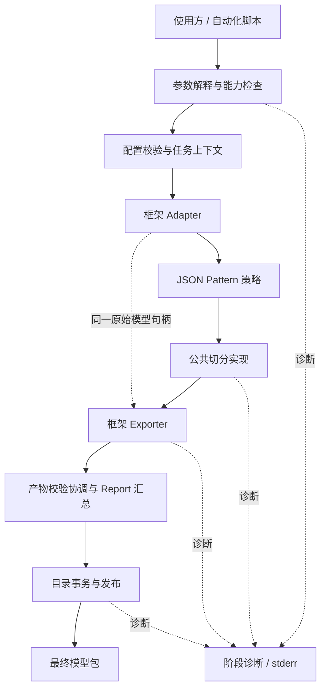
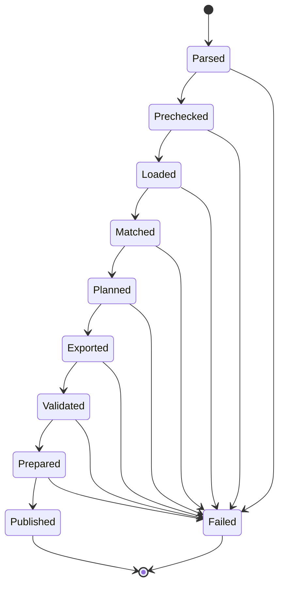
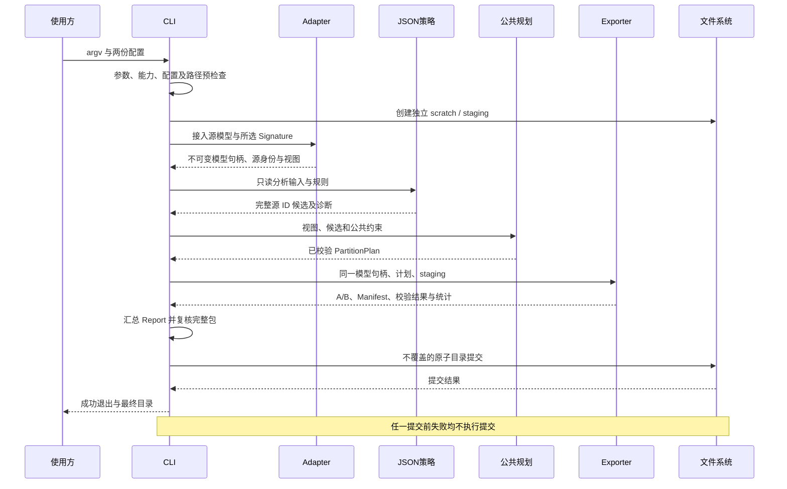

# ANNC 异构图切分优化器 CLI 入口模块详细设计

| 文档控制项 | 内容 |
| --- | --- |
| 文档编号 | ANNC-TFSPLIT-CLI-LLD-001 |
| 版本与日期 | 0.1，2026-11-06 |
| 文档状态 | 初稿，待评审；CLI 入口骨架已落地（薄入口与任务对象 `PartitionTask`，其他模块为任务实现内集中管理的最小类占位），各业务模块尚未建立且未详设，涉及它们的内容仅陈述现状与责任边界 |
| 责任人 | liyancheng |
| 目标读者 | 产品与项目负责人、架构师、模块开发、测试及交付人员 |
| 上位设计 | [异构图切分优化器总体设计](overview.md)，ANNC-TFSPLIT-HLD-001，0.14，待评审 |
| 源码基线 | 本提交（`annc-partition` 骨架：薄入口与 `PartitionTask.h/.cpp`，与本文同批交付，基线核对见 §1.2） |
| 设计范围 | `annc-partition` 的输入解释、能力选择、阶段编排、诊断汇总、产物校验协调与原子发布 |
| 交付边界 | 本文保持设计契约；当前代码交付为 CLI 入口骨架（薄入口 `annc-partition.cpp` 与任务编排 `PartitionTask.h/.cpp`）与集成冒烟测试，不包含真实切分或运行验收结论 |

## 摘要

异构图切分将一个完整推理模型转换为具有明确接口与通信关系的多个子模型。该过程同时涉及模型语义、候选区域、节点归属、通信边界和文件交付，因而其正确性不仅取决于切分算法，还取决于各处理阶段能否在一致的源模型身份下有序执行，以及失败结果能否与有效交付物严格区分。CLI 入口模块承担上述过程的离线协调职责，是使用方与公共规划、框架接入及模型导出能力之间的控制边界。

本文在总体设计规定的模块分工下，将一次命令调用建模为具有单一发布提交点的离线任务，给出参数契约、任务状态转换、错误传播和目录级原子发布方案；模块间数据交接与生命周期待各模块详细设计建立后细化（§6）。在工程组织方面，采用 IPD 中需求分解、方案分析、质量属性设计、验证追踪和阶段退出条件相衔接的文档结构；评审节点名称与签署流程仍以项目管理制度为准，不将本文结构等同于某一企业的强制流程。初版范围限定为冻结 TensorFlow SavedModel、JSON Pattern 策略、A/B 二分区和进程内本地回环通信。文中“应”“必须”均表示待评审的实现要求，不表示源码基线已经具备相应能力；公共规划、TF 接入/导出、通信等模块尚未建立详细设计，涉及它们的内容只陈述现状与责任边界，不拟定其内部实现。

**关键词**：异构图切分；命令行接口；离线编排；契约校验；原子发布；需求追踪

## 1 设计依据与现状分析

### 1.1 问题定义

总体设计已经规定模型接入、切分策略、公共切分实现、模型导出和通信适配的职责，但尚未确定这些能力如何由一条命令形成可重复、可诊断且可安全交付的处理过程。若入口仅依次调用各阶段而缺少显式契约，则可能出现参数解释不一致、同一计划误用于不同模型、导出失败后留下半套模型，以及构建中未包含的能力被错误展示为可用等问题。

因此，本模块的设计对象是一次切分任务的控制过程。算法是否构成合法切分由公共规划层判断，框架模型是否满足导出条件由 Adapter 与 Exporter 判断；CLI 负责保证这些判断均已完成、结果相互一致，并且只有完整结果能够到达最终输出位置。

### 1.2 源码事实与能力差距

| 核对对象 | 源码基线中的事实 | 本设计的处理方式 |
| --- | --- | --- |
| 工具注册 | 已注册 `annc-partition`（`annc/tools/annc-partition/`，薄入口 `annc-partition.cpp` 与任务编排 `PartitionTask.h/.cpp`）；主流程（极简参数解释、静态能力组合、配置读取）由入口与任务对象承载，模型接入起的各阶段为任务实现内集中管理的最小类占位，公共 Planner/通信与 TF Adapter/Exporter 模块尚未建立 | 查询入口与阶段编排已落地；模块实现、严格参数契约、目录事务与能力注册仍待实现 |
| 命令行基础设施 | [metadata 工具](../../../annc/tools/annc-fusion-metadata/annc-fusion-metadata.cpp) 已使用 LLVM `InitLLVM`、`cl::opt` 和诊断输出 | 复用既有 LLVM 支持能力，不引入新的参数解析依赖 |
| 内部日志 | [日志支持](../../../annc/include/Support/Log.h) 以 `ANNC_LOG_LEVEL` 为唯一内部级别控制入口，默认 `error` | 内部开发日志复用该机制；用户诊断和任务进度与内部日志分开，不受其静默设置影响 |
| TF 模型读取 | [TF Loader](../../../frontends/tensorflow/tf2atir/tf_frontend.cpp) 可读取 SavedModel，但只检查 MetaGraph 非空，固定选择第一个 MetaGraph 与 `serving_default` | 严格单 MetaGraph、指定 Signature 和冻结模型检查由拟新增 TF Adapter 承担；Loader 需受控提取或扩展 |
| 前端库化 | [TF 前端 CMake](../../../frontends/tensorflow/tf2atir/CMakeLists.txt) 将 Loader 等源码直接编入 `annc-tf2atir` | 先提取可复用库，CLI 不复制前端实现，也不调用旧 CLI 恢复原始模型 |
| Pattern 匹配 | [配置融合实现](../../../annc/lib/Dialect/Atir/Passes/Fusion/ConfigFusion.cpp) 每轮物化一次匹配并重扫 IR；[内部定义](../../../annc/lib/Dialect/Atir/Passes/Fusion/ConfigFusionSupport.h) 同时包含匹配与融合字段 | match-only 接口及稳定枚举能力仍需解耦，不直接运行融合 Pass 代替候选生成 |
| 现有 pipeline | [TF pipeline](../../../frontends/tensorflow/tf-pipeline/annc-tf-pipeline.cpp) 与 [ONNX pipeline](../../../frontends/onnx/onnx-pipeline/annc-onnx-pipeline.cpp) 面向融合及 kernel 编译 | 借鉴任务选项和诊断组织；分区编译优化按 HLD 0.14 为可选阶段，启用时由 Exporter 按分区复用其能力，调用形式随导出详设确定，CLI 编排主干仍不依赖其业务流水线，也不推定其已提供模型包事务 |
| 目录发布先例 | [ORT 编译缓存](../../../addons/onnxruntime/annc_ep_compile.cc) 已采用工作目录、校验及目录重命名，但含删除旧缓存和完成标记语义 | 仅借鉴先校验后发布的顺序，不链接 EP，也不复制删除目标目录的行为 |
| 测试组织 | [测试说明](../../../tests/README.md) 规定生产目录与测试目录分离；`tests/integration/annc_partition/` 已有 7 个 CLI 集成用例（查询、参数/能力/配置失败、模型接入占位），无 CTest 套件 | CLI 集成冒烟已落地；发布故障注入与宿主测试为拟新增资产 |

### 1.3 范围、约束与非目标

初版只接入总体设计 §1.2 的 TF profile：单 MetaGraph、一个 Signature（默认 `serving_default`）、冻结推理模型、静态主图 A/B 二分区、仅 A→B 跨分区数据依赖。边界 rank 已知而维度可动态；函数闭包、控制依赖、Resource、状态、共享常量及设备注解限制沿用上位设计，由各定义模块校验，CLI 不再次实现其语义。

CLI 不实施匹配、候选冲突裁决、边界推导、GraphDef 改写或通信节点插入，不承担 A/B 在线调度、性能测量与请求级消息路由。初版不提供 ONNX split、启发式、cost-guided、RPC、缓存、计划导入导出、断点续跑或原地覆盖输出。已有 ONNX 导入和 EP 能力不构成 ONNX 切分能力。模块不改变 `NodeInfo`、Fusion Metadata、`sites.json` 或 kernel ABI。

本次文档默认以仓库 Markdown 为维护与评审载体；公共接口名称采用逻辑名称描述，具体 C++ 类型、函数命名及文件拆分可在实现时确定，但不得改变本文规定的所有权、校验顺序和失败行为。

## 2 需求分解与质量目标

### 2.1 功能需求

| 编号 | 需求陈述 | 上位来源 | 优先级 |
| --- | --- | --- | --- |
| CLI-FR-01 | 应解释模型、策略、通信、输出及 TF 入口选项，拒绝缺失、歧义和未知输入 | HLD §3.1、§4.1 | P0 |
| CLI-FR-02 | 应依据实际构建及注册结果选择兼容的 Adapter、策略和 Exporter，拒绝不可用组合 | HLD §2.3、§2.6 | P0 |
| CLI-FR-03 | 应按规定顺序调用库能力，前一阶段失败后不得继续执行依赖其结果的阶段 | HLD §2.2 | P0 |
| CLI-FR-04 | 应保持同一不可变原始模型及其身份贯穿接入、规划、导出与验证 | HLD §2.4、§4.2 | P0 |
| CLI-FR-05 | 应形成 A/B、Manifest 和 Report 的完整交付单元，并校核其身份及引用关系 | HLD §4.2、§5 | P0 |
| CLI-FR-06 | 应在全部必需校验完成后，以单一提交点发布整个模型包 | HLD §5 | P0 |
| CLI-FR-07 | 应提供稳定的退出分类及带阶段、对象和原因的诊断，保留首次根因 | HLD §5 | P0 |
| CLI-FR-08 | 应隔离并发任务与临时目录，拒绝覆盖已有结果，清理仅限本次创建的对象 | HLD §5 的工程细化 | P0 |
| CLI-FR-09 | 应在报告中如实声明验证范围、策略依据、配置身份和产物统计 | HLD §4.2 | P0 |
| CLI-FR-10 | 应支持无任务副作用的帮助与版本查询，以及受控保留调试中间物 | HLD §3.1 的可用性细化 | P1 |

P0 表示初版可交付的必要条件；P1 表示使用与定位问题所需的配套能力，不降低 P0 的门槛。上述需求均为设计分解，不代表项目已完成需求基线签署。

### 2.2 非功能质量目标

| 编号 | 质量属性 | 可判定目标 |
| --- | --- | --- |
| CLI-NFR-01 | 可靠性 | 任一提交前故障均不产生最终模型包；提交点之后包内必需对象完整 |
| CLI-NFR-02 | 确定性 | 相同源内容、选定入口、有效配置及 ID 方案生成相同计划身份、稳定名称与语义 Manifest |
| CLI-NFR-03 | 安全性 | 不执行配置中的命令，不加载任意用户指定动态库，不删除或覆盖任务外对象 |
| CLI-NFR-04 | 可维护性 | 公共入口不包含框架 protobuf 类型、规划算法或 target-specific 代码，不增加通用插件框架 |
| CLI-NFR-05 | 资源可控性 | 不为编排复制整份模型或序列化中间计划；阶段完成后释放不再需要的分析资源 |
| CLI-NFR-06 | 可验证性 | 参数、模块失败与提交故障能够独立注入；关键结果可按完整 JSON 对象或稳定文本快照比较 |

离线切分总时长受图规模、Pattern 数量、载荷及存储环境影响，本文不预设未经测量的固定时延、内存上限或性能收益。发布前应以固定模型集记录耗时、峰值 RSS 与临时磁盘占用，并由项目冻结数值预算；预算未冻结时，不得声明性能验收完成。

## 3 需求场景与处理边界

### 3.1 正常离线切分

使用方提供一个只读 SavedModel、一份分区配置、一份通信配置及一个尚不存在的输出目录。CLI 检查参数和能力后，通过 Adapter 获得源模型与只读视图，调用 JSON 策略形成候选，再调用公共规划形成合法计划。Exporter 基于同一原始模型完成分区子图生成、按启用状态执行分区编译优化与通信物化，写入暂存包并返回校验结果。CLI 汇总 Report，复核交付物后提交整个目录，最终返回成功。

该场景的成功条件是完整模型包已发布且本次规定的静态校验均通过。运行时库的部署、A/B 加载和全部输出数值对照属于交付验收，不作为每次 CLI 调用中隐含执行的步骤。

### 3.2 配置或能力不满足

缺参、未知字段、错误版本或非法分区名属于输入契约错误；请求 ONNX split、未构建的 TF Adapter 或未实现的传输属于能力错误。此类错误应尽量在读取大型模型之前返回，且不创建任务目录。配置文件无法读取与文件内容不合法应分开报告。

### 3.3 模型或计划不合法

模型超过初版 profile、来源映射不完整、跨分区冲突、B→A 边、共享常量缺少显式许可等情况，应由相应模块拒绝。CLI 保留模块诊断，不通过跳过节点、改写配置或降级为其他策略继续生成结果。零匹配不是“零站点成功”：其结果仍必须经过规划，若形成空分区则失败。

### 3.4 发布竞争与中断

多个任务可以同时处理不同输出位置。若两个任务竞争同一最终目录，应由提交原语保证至多一个成功，失败者不得改写成功者的产物。中断前已生成的暂存内容按临时对象处理；使用方仅将明确指定的最终目录作为交付入口，不扫描暂存目录寻找模型。

## 4 总体方案与模块内部分解

### 4.1 方案选择

| 方案 | 分析 | 结论 |
| --- | --- | --- |
| 复用现有 pipeline 串联子进程 | 现有工具面向融合和 kernel 产物，不能传递完整原始模型句柄及切分计划，作为任务主干会扩大文件协议职责；分区编译优化对 pipeline 能力的复用是 Exporter 内部阶段，不属于该方案 | 初版不采用（作为任务主干） |
| CLI 通过进程内库调用编排 | 符合 HLD 薄入口定位，模型所有权明确，可统一传播阶段错误 | 采用 |
| 新建动态插件或独立任务服务 | 需要插件 ABI、发现协议或服务生命周期；初版只有一种框架与策略 | 无初版必要性 |

入口复用 LLVM 参数解析、错误和文件支持，以及仓库已有 JSON 与摘要能力，不引入新的第三方依赖。库调用不意味着加载 TF Runtime：离线工具的 TF 解析与导出应通过框架前端库和 protobuf 完成，通信自定义 Op 与运行时库仍独立交付。

### 4.2 逻辑结构



| CLI 内部职责 | 主要工作 | 明确边界 |
| --- | --- | --- |
| 参数与能力处理 | 解析 argv、选择构建能力、转交框架选项 | 不根据扩展名猜测框架，不动态发现插件 |
| 任务协调 | 维护状态、上下文、调用顺序与取消标志 | 不计算归属与通信边界 |
| 诊断与报告汇总 | 统一错误分类，汇集模块证据 | 不重解释框架语义，不吞掉失败 |
| 目录事务 | 隔离暂存、检查输出引用、提交和清理 | 不重建模型，不覆写用户目录 |

上述职责是模块内部组织方式，不要求创建四个新类或四套公共接口。初版宜以少量局部函数及一个具有清理责任的任务对象实现，避免把单入口扩展为通用工作流引擎。

### 4.3 能力选择

能力表由构建结果显式形成，只记录已链接实现及其支持组合。初版有效组合为 `tensorflow + json + in_process`；框架开关开启只是必要条件，仍需对应 Adapter、Exporter、match-only 策略及通信 profile 的实际实现。`ANNC_ENABLE_ONNX=ON` 不向表中注册 ONNX split。分区编译优化作为可选能力登记：对应库能力未构建或未注册时，能力表不含该选项，任务按未启用处理；已注册时其启用状态由任务配置声明，具体开关形式随详设联合冻结（见 14.3 节）。

框架实现成对提供 Adapter 与 Exporter；入口选择同一实现包中的二者，禁止混配。注册采取固定构建表，不引入运行时目录扫描、动态库路径参数或配置驱动的代码加载。`--help` 与 `--version` 应反映实际构建能力，而非仅展示上游框架开关。

## 5 外部接口详细设计

### 5.1 命令形式与参数

命令已在骨架中落地极简解析：必填检查与未知参数拒绝已实现；重复参数、别名重复与空值拒绝未实现，当前为手工解析循环，严格化时按 §1.2 约定迁移到 LLVM `cl::opt` 或等价设施。完整参数契约如下：

```shell
annc-partition \
  --framework tensorflow \
  --model /models/frozen_model \
  --partition-config /configs/partition.json \
  --comm-config /configs/comm.json \
  --out-dir /outputs/model_v1 \
  --tf-signature serving_default
```

| 参数 | 类型与默认值 | 必填性 | 解释责任及约束 |
| --- | --- | --- | --- |
| `--framework` | 枚举，无默认值 | 必填 | CLI 选择实现；初版仅 `tensorflow` |
| `--model` | 本地目录路径，无默认值 | 必填 | Adapter 解释内容；初版必须为 SavedModel 目录，不接纳裸 GraphDef |
| `--strategy` | 枚举，`json` | 可选 | CLI 选择已注册策略；其他策略明确拒绝 |
| `--partition-config` | 本地 JSON 文件路径 | 必填 | CLI 读取并原文传递；schema 由切分策略与公共切分实现模块定义（见 §5.3） |
| `--comm-config` | 本地 JSON 文件路径 | 必填 | 通信配置经能力检查后交规划、Exporter 和通信适配模块解释 |
| `--out-dir` | 最终目录路径，无默认值 | 必填 | 目录必须不存在，包括不得复用空目录；父目录须已存在且可写 |
| `--tf-signature` | 字符串，`serving_default` | 可选 | 由 TF 选项处理器解释；不存在或不能用于初版工作集时拒绝 |
| `--work-dir` | 已存在的工作根目录，默认输出父目录 | 可选 | 仅作为本次独立 scratch 子目录的父目录；不直接向该根目录写中间文件 |
| `--keep-temps` | 布尔，`false` | 可选 | 成功保留 scratch；失败保留 scratch 与未提交 staging，均以临时位置告知 |
| `--verbose`、`-v` | 布尔，`false` | 可选 | 增加阶段与路径摘要，不输出权重或完整模型 |
| `--help`、`-h` | 查询模式 | 可选 | 展示用法、默认值、支持组合和退出分类，不创建任务对象 |
| `--version` | 查询模式 | 可选 | 展示工具版本、源码版本及实际注册能力，不读取模型和配置 |

不接受位置参数、未知参数、重复的单值参数或重复布尔参数；同一参数的别名也视为重复。除显式别名外不增加下划线、旧工具参数等隐式兼容拼写。正常调用的 stdout 仅输出一行最终目录绝对路径，且发生在提交之后；阶段日志、警告及错误均写 stderr。脚本以退出码和包内 JSON 作为判断依据，不解析日志文案。

查询模式不要求任务参数；常规任务中的路径和配置不得由环境变量暗中覆盖。初版不新增业务环境变量，`ANNC_GEMM`、`ANNC_KERNEL_LIB_PATH` 等融合或后端变量不改变切分语义。工具自身依赖的标准动态库搜索环境仍按安装规范处理。

### 5.2 路径解释

argv 中的相对路径统一相对于启动时工作目录解析，此后不改变进程工作目录。输出使用规范化绝对路径；对已有对象解析真实位置，对尚不存在的输出仅解析已存在父目录并附加合法 basename。空路径、URL、`-` 标准输入输出占位、符号链接输入及链接型输出目标均拒绝。源目录内资产路径还须由 Adapter/Exporter 检查，不得借绝对路径或 `..` 逃逸源模型范围。

源目录、配置文件所在输入范围与输出目录、本次 scratch/staging 之间不得形成可能修改输入的包含关系。具体要求为：输出及本次临时目录不得位于源模型内，输出不得成为源模型或配置文件的祖先，配置文件不得位于预定输出或临时目录中。工作根可以是较大的公共父目录，但本次创建的独立子目录必须满足上述要求。比较按路径分量及解析后的真实位置进行，不以字符串前缀代替目录关系。

当前骨架仅原样记录参数中的路径字符串并读取两份配置文件，本节的规范化与路径关系校验均未实现。

### 5.3 配置输入与责任归属

分区配置与通信配置各为一个本地 JSON 文件。CLI 仅负责存在性与可读性检查及原文传递，不定义其 schema、字段语义或校验规则；两份配置的详细设计由语义拥有模块的模块级设计文档承载，相关文档尚未建立。

| 配置 | 语义拥有模块 |
| --- | --- |
| 分区配置（`--partition-config`） | 切分策略模块（规则与匹配语义）；公共切分实现模块（默认归属、候选裁决与常量许可的规划约束） |
| 通信配置（`--comm-config`） | 通信适配模块（传输方式与边界 dtype 能力）；模型接入模块（共享常量定位）；公共切分实现与模型导出模块（许可、边界与 Op 属性校验） |

## 6 内部接口、数据与生命周期（待细化）

内部接口、逻辑数据对象、源身份规范与生命周期属于各业务模块的联合设计内容，待模块详细设计建立后随 §14.3 联合冻结项一并细化，当前版本不展开。现阶段的模块责任边界以[总体设计](overview.md) §2.3 与 §3 为准；CLI 侧本版仅约束阶段调用顺序（§7）与发布前核心不变量（§7.3）。

## 7 处理流程与状态模型

### 7.1 状态定义



| 状态 | 已成立的事实 | 下一步及主要失败边界 |
| --- | --- | --- |
| `Parsed` | 参数语法与必填项完整 | 读取配置、检查能力与路径 |
| `Prechecked` | 有效配置与能力组合合法，输入输出隔离成立，输出父目录固定 | 创建独立临时目录并调用 Adapter；创建或接入失败即终止 |
| `Loaded` | 不可变模型及工作集视图就绪，初版 profile 已核查 | 构建只读分析输入并恢复候选来源 |
| `Matched` | 候选已完整映射至源节点/值 | 公共归属、合法性与边界分析 |
| `Planned` | 合法非空 A/B 计划、模型及计划身份完整 | Exporter 核对身份并写 staging |
| `Exported` | A/B（启用优化时含 ANNCFused 计算与 kernel 归档）与 Manifest 已写出，导出操作完成 | 执行或汇集框架结构、接口及依赖校验 |
| `Validated` | 必需模型校验通过，尚未发布 | 汇总 Report、复核全部包内引用与文件写入 |
| `Prepared` | 完整包已关闭写句柄，Report 写入成功，允许提交 | 执行不覆盖的单次目录发布 |
| `Published` | 提交成功，最终包对使用方可见 | 输出最终路径，清理 scratch 并成功退出 |
| `Failed` | 已记录首次失败与补充清理诊断 | 按保留策略回收本次对象，不调用后续业务阶段 |

取消是在提交前各阶段出口检查的控制事件，其结果进入失败清理路径。状态不是磁盘上的可恢复任务协议；进程重启后不从中间状态续跑。

骨架现状：参数解释、能力检查与配置读取已实现（对应 `Parsed`/`Prechecked` 的前置检查）并通过集成测试；模型接入起的阶段为占位，任务在进入 `Loaded` 之前以退出码 `5` 终止。完整状态机为各模块就绪后的目标。

### 7.2 主要交互



### 7.3 核心不变量

设源模型身份为 \(I_M\)，计划中记录的源身份为 \(I_P\)，导出结果关联的源身份为 \(I_E\)。进入发布准备阶段必须满足 \(I_M = I_P = I_E\)，且 Manifest 和 Report 引用同一计划身份。身份相等只是必要条件，不能替代各模块对模型及计划合法性的校验。

设必需交付集合为 \(R=\{A,B,Manifest,Report\}\)，必需校验集合为 \(V\)。提交前须满足 \(\forall r\in R, complete(r)\) 以及 \(\forall v\in V, passed(v)\)。未执行、跳过或无法判定的必需校验均不满足该条件。CLI 不通过 `warnings-only`、忽略未知对象或只导出单个分区绕过此约束。

任务的有效输出由是否越过发布提交点决定。`Prepared` 之前的文件即使包含可解析 SavedModel，也仍为未交付中间物；`Published` 之后不得重新修改包内内容以补记日志或计时。

## 8 输出产物与报告契约

### 8.1 模型包布局

```text
<out-dir>/
├── A/                         TF Exporter 生成的 SavedModel 目录（启用优化时含该分区 kernel 归档）
├── B/                         TF Exporter 生成的 SavedModel 目录（启用优化时含该分区 kernel 归档）
├── partition_manifest.json    计划与框架映射的部署契约
└── partition_report.json      本次离线处理依据、统计与验证范围
```

各 SavedModel 内部文件由 Exporter 按 TF profile 组织，必要资产保留在所属模型内。通信运行时库随工具版本独立交付；启用分区编译优化时，ANNC TF 运行时（ANNCFused Op 库）同样随工具版本交付，Manifest 引用其版本化能力要求及各分区 kernel 归档，均不从任意用户路径复制 `.so` 入包。包内引用采用相对包根的路径，不包含 staging/scratch 绝对路径；框架对象名、Signature 和通信边界属性由 Exporter 维护。

### 8.2 Manifest 的汇交与完整性检查

Manifest 的公共字段来自 `PartitionPlan`，框架映射来自 Exporter；CLI 负责协调完整性检查和发布，不拥有第二份 Manifest schema。相应公共/Exporter 详设应定义序列化编码、版本与消费方解析规则，联合冻结后才允许实现对外兼容承诺。

CLI 所需的最小校验投影如下：

| 检查面 | 必需条件 | 定义与主校验方 |
| --- | --- | --- |
| 版本和身份 | Manifest、计划与模型身份相容，无空身份或混用旧计划 | 公共规划、Exporter |
| 分区与路径 | 仅 A/B，模型目录完整且都位于包内，引用不逃逸 | Exporter；CLI 复核路径 |
| 输入输出 | 分区接口、共享输入、未使用原输入及原输出映射完整 | Adapter/Exporter |
| 通信边界 | boundary ID 稳定，Send/Recv 配对，dtype、已知 rank/维和消费者槽位一致 | 公共规划、Exporter |
| A 执行保证 | Manifest 标明 A 内部执行签名及其全部需 fetch 输出，A 无原输出亦可驱动全部 Send | Exporter |
| 字节统计 | 区分激活与常量；静态字节数有依据，动态量不伪装成已知值 | 公共规划、Exporter |
| 运行依赖 | 明示通信 profile 及启用优化时 ANNC TF 运行时与 kernel 归档的版本约束，不将成功导出等同于运行库已经加载 | Exporter/通信适配 |

外部调用方按 Manifest 喂入各分区输入，共享输入使用同值；整体 fetch A 内部执行签名的全部输出后再调用 B，并按原输出映射汇集两侧结果。CLI 记录此契约，但不执行在线推理。请求或会话身份、模型版本与 boundary ID 的联合隔离由通信运行时负责。

### 8.3 Report 的最小内容

| 字段组 | 拟定内容及来源 |
| --- | --- |
| 版本与工具 | Report schema 版本、工具版本、源码基线和实际能力 profile |
| 模型与计划 | 源身份、计划身份、所选入口和相应方案版本；转录模块结果 |
| 配置依据 | 原始与有效配置摘要、策略与传输选择、规则 ID 和默认归属说明 |
| 规划统计 | 工作集节点、各分区节点、候选与匹配/合并统计；不混入不可达节点 |
| 边界统计 | 逐 boundary ID 的激活/常量分类、dtype、shape 和字节数状态 |
| 优化统计 | 优化启用状态及启用时各分区融合区域与 ANNCFused 数量、kernel 归档引用；来自 Exporter 的分区编译优化结果，未启用时记为 `not_applicable` |
| 交付对象 | A/B、Manifest 的包内相对路径及模型接口摘要 |
| 验证范围 | 每项检查的 `passed`、`failed`、`not_run` 或 `not_applicable` 及证据来源 |
| 诊断与运行记录 | 警告、阶段耗时和必要上下文，不包含模型权重或完整 tensor 内容 |

Report 的共同字段应与 HLD §4.2 及公共/Exporter 契约联合评审，不另设“CLI 部署协议”。CLI 汇总静态校验，真实宿主加载、数值差分和并发隔离在普通 CLI 调用中应记为 `not_run`。最终包只允许包含所有必需静态校验为 `passed` 的成功 Report；失败 Report 若保留，应置于 scratch 的 `failure_report.json`，不能放到最终目录或冒充成功报告。

对于形状 \((d_1,\ldots,d_k)\) 的定宽 tensor，仅当全部维度已知且乘积无溢出时，静态字节数才为 \(bytes=width(dtype)\prod_i d_i\)。零维 scalar 的乘积取 1；存在动态维时记录 `static_bytes=null` 及未知原因，不按 0 字节统计，汇总时分列已知总量与未知边界数。此项统计来自规划/导出模块，CLI 不从 TF 对象重新推导。

### 8.4 确定性与版本管理

计划身份、源 ID、边界 ID、导出名称及语义 Manifest 不得依赖临时目录、绝对部署路径、时间或遍历哈希表的偶然顺序。Report 可包含阶段耗时等运行信息，因此不承诺整个包逐字节一致。重复运行测试应比较规范化后的语义对象，对允许变化的字段作显式声明，不通过广泛删除字段掩盖差异。

CLI 选项、分区配置、通信配置、计划、Manifest 与 Report 分别由其定义方管理版本，不能用一个工具版本替代全部契约版本。初版拒绝未知配置版本；下游消费 Manifest 的兼容规则须在对应详设冻结。本文新增的输入与发布约定已登记为 [ADR-019](../../decisions/decisions.md#adr-019)，状态为 proposed，尚未接受或实施。

## 9 目录事务与原子发布设计

### 9.1 目录分工

假设最终路径为 `/outputs/model_v1`，输出父目录已经存在。本次暂存目录在同一父目录中以独占创建方式产生，例如 `/outputs/.model_v1.annc-staging-<unique>`；scratch 在 `--work-dir` 下另建 `annc-partition-work-<unique>`。随机后缀只用于任务隔离，不进入计划身份或包内契约。

staging 承载待发布完整包，scratch 承载分析与失败诊断。即使工作根位于其他文件系统，staging 也始终与最终目录同父目录。所有生成路径必须是受约束的包内路径，禁止 Exporter 返回绝对路径、`..` 逃逸或指向外部的符号链接。

### 9.2 提交协议

发布采用以下有序过程：

1. 参数预检查时确认最终目录不存在，并固定输出父目录的真实位置；在支持的 Linux 实现中持有父目录句柄，以避免后续路径解析指向其他位置。
2. 独占创建本次 staging/scratch，记录所有权和创建结果；目录隔离失败立即终止。
3. Exporter 仅向 staging 写入 A/B 与 Manifest，模型校验也基于该完整暂存内容完成。
4. CLI 写入 Report，检查写入及关闭结果，复核必需对象、包内引用、身份和全部必需校验。Report 完整表示内容已经准备就绪，不依赖提交后再写“发布成功”字段。
5. 进入短提交区间，最后检查取消请求，关闭所有包内写句柄，再用具有“不覆盖目标”保证的原子目录重命名提交 staging。
6. 提交成功后设置内存中的已提交标志，输出最终路径，清理 scratch；此后不删除、不修改最终包。

Linux 目标实现拟采用 `renameat2(..., RENAME_NOREPLACE)` 或经验证具有相同语义的系统封装。仅“先判断目标不存在，再调用可覆盖 rename”存在竞争窗口，不满足本设计。若内核或文件系统不支持所需提交语义，应返回发布失败；不能回退为逐文件复制或删除目标后替换。具体系统调用封装属于实现选择，必须在 openEuler+AArch64 声明支持的文件系统上验证。

此协议承诺同文件系统上的原子可见性与目标不覆盖，不承诺断电后的持久性事务。初版支持范围不延伸到未经验证的 NFS、对象存储或其他远程文件系统；如需掉电持久性，须另行设计文件与目录同步顺序并完成故障验证。

### 9.3 并发与提交后的错误

不同任务拥有不同 staging/scratch，不依赖 PID 单独形成唯一目录。竞争同一最终路径时，提交原语负责排他结果；至多一个任务进入 `Published`，失败任务返回发布冲突且仅处理自身目录。即便目标是空目录，也不得覆盖。

提交是任务成功的线性化点。提交前失败返回非零且没有本任务发布的最终包；提交后 scratch 清理失败、stderr/stdout 写入失败等不撤回模型包，也不把结果改写为“发布失败”，应尽可能给出补充警告。可捕获的 SIGINT/SIGTERM 在提交短区间内延后处理：提交前观察到则取消，提交成功后按已完成任务收尾。进程被强制杀死时可能来不及返回结果，调用方应检查完整最终包，而不能仅凭缺失退出状态推断未发布。

### 9.4 清理与残留策略

默认情况下，成功后回收 scratch；提交前失败后回收本次 staging/scratch。设置 `--keep-temps` 时，成功保留 scratch，失败保留二者并明确打印临时绝对路径。失败信息可写入 scratch，但不得为记录诊断而创建最终输出目录。

递归清理前必须核对对象为本次独占创建的实际目录、真实路径仍在记录的任务范围内且未替换为链接。清理不得直接递归删除用户提供的工作根、输出父目录、源模型或任何最终目录。对象身份无法确认时停止删除并返回清理警告；清理警告不能覆盖首次根因。SIGKILL、机器故障留下的目录不自动续跑或跨任务回收，后续调用只使用新目录，残留由使用方按明确路径处置。

## 10 异常、诊断与退出契约

### 10.1 诊断模型

各库返回诊断，CLI 汇总并输出。诊断应包含稳定错误标识、阶段、严重级别、主要原因，以及可用时的配置路径/JSON Pointer、规则 ID、`SourceNodeId`、`ValueId` 或 boundary ID。框架显示名只作为辅助信息；库内部不能调用 `exit`，也不能以打印一行日志代替失败返回。

人类可读输出采用以下形式，文字允许优化，错误标识和阶段分类保持稳定：

```text
[annc-partition][plan][E_PARTITION_CONFLICT] node ownership conflict; rule=front_relu
[annc-partition][publish][E_OUTPUT_EXISTS] output directory already exists
```

首次失败决定主退出分类。清理失败、诊断文件无法写入等作为后续诊断追加，不覆盖根因。多个静态配置错误可以在预检查中一次汇总，但不能在依赖数据失效后继续执行业务阶段。原始异常消息不得携带权重、凭证或大段模型内容。

### 10.2 退出码

| 退出码 | 类别 | 典型触发 |
| --- | --- | --- |
| `0` | 成功 | 查询完成，或整包已经提交 |
| `2` | 参数或配置契约错误 | 缺参、重复参数、JSON/schema 错误、非法路径关系、已存在输出的预检查失败 |
| `3` | 能力不可用 | 框架/策略/传输未实现、未构建或组合不受支持 |
| `4` | 提交前输入输出错误 | 配置/模型无法读取、临时目录无法创建、暂存写入失败或磁盘满 |
| `5` | 模型接入或分析失败 | 非单 MetaGraph、Signature 无效、非冻结 profile、来源映射不完整或候选分析失败 |
| `6` | 规划失败 | 归属冲突、空分区、逆向/不可跨越依赖、非法边界或常量许可失配 |
| `7` | 模型导出失败 | 身份不一致、分区编译优化失败（启用时）、签名/函数/资产不能闭合、通信物化失败 |
| `8` | 产物校验失败 | 文件已写出但模型结构、接口、依赖、Manifest 或必需验证结果不完整 |
| `9` | 发布失败 | 提交时目标竞争、原子提交不受支持或重命名失败 |
| `70` | 内部错误 | 未分类异常、违反内部不变量 |
| `130` / `143` | 提交前取消 | 分别处理 SIGINT / SIGTERM；强制终止由操作系统决定 |

已知 I/O 根因优先归入 `4`，不因发生在导出阶段就笼统归入 `7`；进入发布提交操作后发生的系统错误归入 `9`。配置中格式错误的常量许可归入 `2`，合法定位表达式在模型内无法唯一解析归入 `5`，已解析许可与规划约束不一致归入 `6`。错误类别由结构化返回信息确定，不从错误文本猜测。

LLVM 参数解析失败须由入口收敛为 `2`，不能照搬其他工具默认的退出码而破坏本契约。具体错误标识目录及本地化措辞可在实现时补充，但验收应覆盖表中全部主分类。

当前骨架已实现并经集成测试覆盖 `0`、`2`、`3`、`4`、`5`；`6`、`7` 的映射已编码但占位阶段不可达；其余退出码保留。

## 11 质量属性与安全设计

### 11.1 可靠性与可观测性

状态单向推进，结果对象只有在成功返回后才向下一阶段开放，任务结束时由统一对象回收持有资源。每个阶段记录起止时刻和结果摘要，普通模式只输出必要警告和最终结果，verbose 模式补充阶段耗时与临时位置。日志不承担状态持久化、重放或恢复职责。

内部开发日志复用 `ANNC_LOG_*`，级别仅由既有 `ANNC_LOG_LEVEL` 控制，不新增 `--log-level`，也不让 `--verbose` 修改已缓存的内部级别。`--verbose` 只控制本次 CLI 面向使用方的阶段进度；错误、必要警告、失败后保留路径等属于强制任务诊断，即使 `ANNC_LOG_LEVEL=off` 仍应输出。相关契约测试应覆盖该环境设置。

模型级语义校验与文件级完整性校验分别保留。模型能够被 protobuf 解析，不等于 Signature、FunctionDef 或配对通信均正确；文件存在也不能代替发布前校验。若某必需校验依赖尚未提供，任务应拒绝发布，而不是在 Report 中记为通过。

### 11.2 安全与信任边界

入口将模型及 JSON 视为数据，初版无网络访问、无 shell 执行、无用户动态库加载选项。模型由受控 Adapter 以 protobuf 读取，不运行源模型中的计算或初始化；输出资产按框架模块规定进行路径和来源核对。对配置大小、protobuf 解析限制和诊断样本数量应采用框架或解析器已有的限制机制；发布前需为目标模型规模确定并记录实际限制值，不承诺无限输入。

目录创建、提交与删除均受本次任务范围约束。输出父目录应由可信调用方管理；本设计通过真实路径、目录句柄与禁止跟随链接减少误操作风险，但不把普通 CLI 进程声明为对恶意同权限用户的完整沙箱。跨节点传输、凭证管理和运行时自定义实现的安全语义属于后续传输设计。

### 11.3 资源与性能

CLI 不重复构造源图、候选索引或计划副本；语义分析成本由对应模块承担。仅考虑入口自身，除配置和报告内容外，其目录对象、状态及调用协调开销应随阶段数保持有界，Report 汇总开销随诊断和统计规模增长。模型载荷固定、摘要与导出 I/O 的成本须单列，不能计为“入口常数开销”。

JSON 策略及来源恢复完成后，可以释放不再被结果引用的分析用 ATIR 和 MLIRContext；原始模型、资产快照及源映射至少保留至导出验证完成。匹配仍需解释的值不能通过裸指针引用已释放的 IR。无必要的全部候选详细日志应采用计数及受限样本，完整诊断保留策略由测试与运维需求共同确定。

### 11.4 兼容性

原有 TF/ONNX 融合和 kernel 编译路径保持自身契约。前端库提取及 matcher 解耦必须通过既有路径回归，不能因切分需求把融合专属检查从原融合流程删除。core-only 与 ONNX-only 构建不得新增 TF protobuf/Runtime 依赖；ONNX 未来接入必须新增自己的 Adapter/Exporter 及验收证据，不能仅扩展 CLI 枚举值。

## 12 代码组织与实现工作分解

### 12.1 拟定落点及构建关系

| 拟新增或调整位置 | 内容 | 边界 |
| --- | --- | --- |
| `annc/tools/annc-partition/` | main、参数及任务协调、诊断映射、局部目录事务 | 不放框架模型处理和规划算法，不强制拆成公共工作流库 |
| `annc/include/Planner/`、`annc/lib/Planner/` | 按 HLD 定义公共视图、策略、计划与规划能力 | 由公共模块详设管理；CLI 仅消费 |
| `frontends/tensorflow/planner/` | TF Adapter/Exporter（含可选的按分区编译优化调用）与框架选项处理器 | 持有 TF 类型，负责严格 profile 和框架映射 |
| `frontends/tensorflow/tf2atir/` | 提取已有 Loader 等为可复用库，并保持旧 CLI 行为 | 共享解析，不复制或隐式扩大支持范围 |
| 既有 Pattern matcher 附近 | 提取只读接口，保留融合端组合能力 | 融合与切分回归同时执行 |
| `tests/unit/annc_partition/` | 任务顺序、错误映射、目录事务及故障注入 | 拟新增，注册集中在 `tests/` |
| `tests/integration/annc_partition/` | CLI 参数、配置及包契约 | 拟新增，驱动实际构建二进制 |
| `tests/e2e/annc_partition/` | 真实宿主与通信联合验收 | 拟新增，依赖受信构建的通信库与 TF 环境 |

现状：仅 `annc/tools/annc-partition/`（薄入口、`PartitionTask` 任务对象与 CMake）与 `tests/integration/annc_partition/` 已建立，其他模块的最小类占位集中于任务实现内；其余落点均未建立，模块落地时按本表迁移。

根构建目前先进入 `annc/`，后进入 `frontends/`。实现时应在 `annc/tools/` 声明通用入口目标，在框架前端目标定义完成后条件链接并注册成对实现，或采用等价的两阶段 CMake 组织；不得为链接顺序问题将 TF 源码复制进 main。公共入口只链接其直接所需的 LLVM/JSON、Planner 与已构建框架库，通信运行时核心保持独立。

建议所有构建组合均提供可查询的通用入口；TF split 组件未构建时，帮助与版本查询仍可运行，请求 TF 返回 `3`。该选择便于一致的脚本诊断，属于本稿工程建议，不是源码基线已有行为。若目标平台无法支持发布原语，查询仍可用，实际任务不能宣称发布能力已具备。

### 12.2 工作包与依赖

| 工作包 | 内容与交付物 | 前置条件 | 牵头角色 |
| --- | --- | --- | --- |
| CLI-WP-01 | 冻结 argv、配置外壳、错误分类及发布语义；形成接口审查记录 | HLD 范围确认 | CLI/架构负责人 |
| CLI-WP-02 | 前端库化、严格 TF profile、不可变模型及源身份接口 | Adapter 详设与 CLI-WP-01 | TF 前端负责人 |
| CLI-WP-03 | match-only、候选与公共计划接口；配置语义校验 | 策略及公共规划详设 | 策略/Planner 负责人 |
| CLI-WP-04 | CLI 状态编排、诊断、目录事务与故障注入测试 | CLI-WP-01；可用模块测试替身 | CLI 负责人 |
| CLI-WP-05 | 接入真实 Exporter/通信 profile，完成包及 Report 校验 | 导出与通信契约冻结 | Exporter/通信负责人 |
| CLI-WP-06 | 完整宿主、构建组合、安装及旧路径回归，归档验收证据 | 前述工作包完成 | 测试/交付负责人 |

CLI-WP-02/03/04 可在接口冻结后并行，CLI-WP-05 依赖真实模块联调。工作包不预设独立 commit 数量；提交按可独立理解与回滚的逻辑单元组织，不把相互依赖的小修补机械拆分。

## 13 验证设计与需求追踪

### 13.1 分层验证矩阵

下列为待实现用例，不是已存在或已执行的测试清单。

| 验收项 | 层级与覆盖 | 通过证据 |
| --- | --- | --- |
| CLI-AT-01 输入契约 | L0/L2：必填、别名、重复/未知参数、空值、JSON 重复键、未知字段/版本、溢出、非法路径及共享常量配置 | help/诊断快照与退出码；预检查失败不创建任务目录 |
| CLI-AT-02 能力隔离 | 构建/L2：TF-only、ONNX-only、core-only、双框架；未注册策略/传输 | 构建和安装记录、实际 help/version、明确拒绝记录；禁止意外 TF 链接 |
| CLI-AT-03 状态与身份 | L0：逐阶段失败注入、取消、ModelHandle 生命周期、旧计划与变化资产 | 不调用后继阶段；原始输入摘要不变；身份失配拒绝 |
| CLI-AT-04 产物契约 | L2：A/B（启用优化时含 kernel 归档）、Manifest、Report、包内引用、动态维、常量字节统计与验证范围 | 规范化完整 JSON 快照及结构校验；不把 `not_run` 记为通过 |
| CLI-AT-05 发布事务 | L0/L2：磁盘满、无权限、关闭失败、提交失败、目标竞争、空目标目录、链接替换与临时保留 | 故障点前后最终路径只见无包或完整包；既有目录内容摘要不变 |
| CLI-AT-06 确定性 | L2：不同绝对路径/临时目录重复运行；改变权重、Signature、规则或通信配置 | 相同有效输入的计划身份及语义 Manifest 相同；语义输入变化不误用旧身份 |
| CLI-AT-07 宿主与通信 | L4：`tf.saved_model.load` 同进程加载 A/B，按 Manifest 执行，分别覆盖启用与未启用分区编译优化两种配置（启用时先注册 ANNC TF 运行时）；动态 batch、共享输入、重复消费、多输出、A 无原输出、多 Send、显式常量传输 | 原模型与 A/B 的全部输出差分、请求/模型隔离记录和运行库来源 |
| CLI-AT-08 兼容与交付 | L1/L2/L4：matcher 解耦、前端库化的 TF/ONNX 回归；移除 build tree 后的安装运行；资源测量 | 既有 FileCheck/pytest/CTest、干净安装包、支持平台与资源预算记录 |

完整宿主测试还应覆盖负例：非冻结模型、多 MetaGraph、无效 Signature、设备/共置注解、跨控制/Resource/Stateful 边界、unknown rank、不支持 dtype、B→A、跨分区函数状态约束、无许可共享常量和空分区。此处校验算法归属对应模块，CLI 验证其失败是否准确传递且不发布。

整数和布尔输出要求逐元素相等；浮点比较采用发布前冻结的 `atol/rtol`，记录最大绝对/相对误差及 NaN/Inf 策略，禁止观察结果后再放宽阈值。宿主门槛仅覆盖 Python TF 加载与本地回环，不推导 TF Serving、C++ SavedModel API、跨节点或真实异构部署已通过。

### 13.2 双向追踪

| 需求 | 设计落点 | 验收项 |
| --- | --- | --- |
| CLI-FR-01 | §5 | CLI-AT-01 |
| CLI-FR-02 | §4.3、§12.1 | CLI-AT-02 |
| CLI-FR-03 | §7 | CLI-AT-03 |
| CLI-FR-04 | §7.3 | CLI-AT-03、06 |
| CLI-FR-05 | §8 | CLI-AT-04、07 |
| CLI-FR-06 | §7.3、§9 | CLI-AT-05 |
| CLI-FR-07 | §10 | CLI-AT-01、03、05 |
| CLI-FR-08 | §5.2、§9 | CLI-AT-05 |
| CLI-FR-09 | §8.2—§8.4 | CLI-AT-04、06、07 |
| CLI-FR-10 | §5.1、§9.4 | CLI-AT-01、02、05 |
| CLI-NFR-01/03 | §9—§11.2 | CLI-AT-03、05、08 |
| CLI-NFR-02 | §8.4 | CLI-AT-06 |
| CLI-NFR-04 | §4、§11.4、§12 | CLI-AT-02、08 |
| CLI-NFR-05 | §11.3 | CLI-AT-08 |
| CLI-NFR-06 | §10、§13.1 | CLI-AT-01、03、04、05 |

### 13.3 实施后的执行入口与报告要求

骨架与后续功能测试均使用仓库既有套件入口；当前已注册查询、阶段占位行为和集成冒烟测试（`pytest`，无 CTest 套件），`tests/e2e/annc_partition/` 及完整功能验收用例尚未实现：

```shell
annc-partition --help
annc-partition --version
python3 -m pytest tests/integration/annc_partition/ -v
```

matcher 解耦、前端库化及公共能力调整还须按实际改动运行 `bash tests/FileCheck/run.sh Dialect/Atir`、`python3 -m pytest tests/`、`ctest --test-dir build --output-on-failure`。FileCheck 与 pytest 互不替代；不以 TF 现有 kernel 数值脚本或 ORT 宿主测试替代新增切分宿主测试。构建组合按 [构建指南](../../guides/build-from-source.md) 使用独立构建目录，TF addon 及 ORT EP 开关与相应前端开关保持合法组合。

验收报告应记录系统/架构、工具与框架版本、构建开关、运行库来源、文件系统、模型与配置身份、实际命令及收集/执行/通过/失败/跳过数量。发布范围关键用例跳过或缺失即不满足验收；静态文档检查、编译成功、宿主数值执行和目标平台执行分别陈述。当前交付仅为可构建骨架及其冒烟验证，不具有真实切分、完整模型包或宿主数值运行通过证据。

## 14 IPD 评审、风险与交付准则

### 14.1 评审阶段与退出条件

| 阶段 | 主要输入 | 退出条件 | 评审参与方 |
| --- | --- | --- | --- |
| 需求与范围确认 | HLD、使用场景、初版支持 profile | 明确用户输入、交付物与非目标；解决上位范围冲突 | 产品/项目、架构、测试 |
| 详细设计评审 | 本文及 Adapter/策略/Planner/Exporter/通信接口草案 | 参数、schema、身份、所有权、静态校验清单与提交协议联合冻结；重大决策登记 proposed/accepted ADR | 各模块负责人、架构、安全及测试 |
| 集成就绪检查 | 模块实现、单元与契约测试、构建矩阵 | 状态失败矩阵、完整包、并发提交和旧路径回归通过 | 开发、测试、构建维护者 |
| 交付验收 | 目标平台、安装包、宿主差分与资源报告 | 关键用例实际通过，支持与限制公布，资源预算冻结，文档与 help 一致 | 测试、交付、技术负责人 |

本次输出处于详细设计初稿阶段，未取得评审结论。本文不虚构评审签名、测试结果或已接受架构决策；关键输入及发布选择已按 [ADR 规则](../../decisions/README.md) 登记为 [ADR-019](../../decisions/decisions.md#adr-019) 提案，后续依据联合评审结论更新。

### 14.2 关键风险与处置

| 编号 | 风险与影响 | 设计处置与关闭证据 |
| --- | --- | --- |
| CLI-R-01 | 现有 Loader 行为较宽且入口固定，误被当成完整 split Adapter | 前端库化及 profile 补齐；多 MetaGraph/指定 Signature/冻结范围负例通过 |
| CLI-R-02 | matcher 解耦改变原有融合行为，或切分候选仍夹带物化检查 | 只读接口单测与 TF/ONNX 融合回归共同关闭 |
| CLI-R-03 | 普通 rename 或复制使并发任务覆盖或暴露半包 | 采用不覆盖原子目录提交，目标平台文件系统竞争与故障注入通过 |
| CLI-R-04 | 资产重读或身份仅基于名称，计划与实际模型不一致 | 不可变模型与载荷快照、内容身份和变化注入用例通过 |
| CLI-R-05 | 静态校验被误表述为可运行与数值正确 | Report 分项声明范围，宿主与请求隔离独立验收 |
| CLI-R-06 | 框架或通信依赖经入口泄漏到公共构建 | 成对条件注册、两阶段链接和四种构建组合证明 |
| CLI-R-07 | 为便利引入覆盖、自动恢复、插件或在线运行功能 | 初版范围显式排除，新增需求重新评估契约与维护成本 |

### 14.3 待联合冻结项与实施自由度

本稿已经提出参数、状态与退出分类，以及默认不覆盖的整包发布方案，可据此组织实现评估。尚需各定义模块联合冻结的内容包括：源/计划身份规范、match-only 接口、分区与通信配置 schema、Manifest/Report 完整 schema、TF 导出与 Send/Recv 具体名称/属性、通信版本匹配、分区编译优化的能力注册与启用开关、必需静态校验清单和目标文件系统支持矩阵。这些是跨模块接口审查项，不应由 CLI 单方面补造实现；未冻结前可以使用测试替身验证入口编排，不能宣称真实链路已就绪。

实现者可自行确定局部 C++ 类型和函数名、文件拆分、RAII 具体形式及测试替身技术；若选择改变用户可见参数、配置含义、退出码、数据生命周期或发布语义，则属于设计变更，需更新需求追踪及评审材料。

### 14.4 文档与交付同步

实现时应在同一交付中同步源码 `--help`/`--version`、[CLI 工作流](../../guides/cli-workflows.md)、[总体架构](../../architecture/overview.md) 的工具及规划路径、构建说明和 [tests/README.md](../../../tests/README.md)。当前已同步骨架状态与查询命令，操作指南明确正常任务在模型接入占位处以退出码 `5` 终止；若引入新环境变量、兼容规则或重大长期决策，应同步环境变量参考及 ADR 正文/索引。

## 15 参考依据与修订记录

本文以所列源码基线及仓库内约定为依据，参考关系如下：

| 编号 | 资料 | 使用范围 |
| --- | --- | --- |
| REF-01 | [异构图切分优化器总体设计](overview.md) | 模块边界、初版范围、身份、产物与失败处理 |
| REF-02 | [总体架构](../../architecture/overview.md) | ANNC 分层、共享能力及 IPD 文档组织 |
| REF-03 | [CLI 工作流](../../guides/cli-workflows.md) | 现有工具输入输出与切分入口的区分 |
| REF-04 | [贡献者指南](../../contributing/README.md) | 工程文档元数据及设计/ADR 类型边界 |
| REF-05 | [测试目录说明](../../../tests/README.md) | 测试分层、资产归属和执行/跳过规则 |
| REF-06 | [ONNX 总体设计](../onnx-support/overall.md) §10.5、§11 | 需求追踪、验收证据与阶段退出条件的结构参考 |
| REF-07 | [TF 前端接口](../../../frontends/tensorflow/tf2atir/tf_frontend.h)及[实现](../../../frontends/tensorflow/tf2atir/tf_frontend.cpp) | Loader 与原始模型生命周期的现状核对 |
| REF-08 | [Pattern 支持定义](../../../annc/lib/Dialect/Atir/Passes/Fusion/ConfigFusionSupport.h)及[配置融合实现](../../../annc/lib/Dialect/Atir/Passes/Fusion/ConfigFusion.cpp) | DSL 复用、物化耦合与只读匹配缺口 |
| REF-09 | [ORT 编译缓存实现](../../../addons/onnxruntime/annc_ep_compile.cc) | 目录发布先例及其不能直接照搬的缓存语义 |

| 版本 | 日期 | 修改人 | 修订说明 |
| --- | --- | --- | --- |
| 0.1 | 2026-11-06 | liyancheng | 初稿：给出源码事实与差距、需求/验收追踪、参数契约、任务状态、诊断与目录原子发布方案，并同步 HLD 0.14 的可选分区编译优化阶段（退出码 7、包布局与运行依赖）；当前交付为入口骨架——薄入口 `annc-partition.cpp` 承担查询模式与参数解释，`PartitionTask.h/.cpp` 以任务对象承载公共关键信息（选项、退出分类、失败信息、配置原文），其他模块为任务实现内集中管理的最小类占位；参数/能力/配置读取已实现，模型接入起为占位（退出码 0/2/3/4/5 已由集成测试覆盖），对未详设模块仅陈述现状与责任边界：分区配置与通信配置的 schema 移交语义拥有模块的详细设计承载（列入 §14.3 联合冻结项），第 6 章内部接口与生命周期标记为待细化 |
