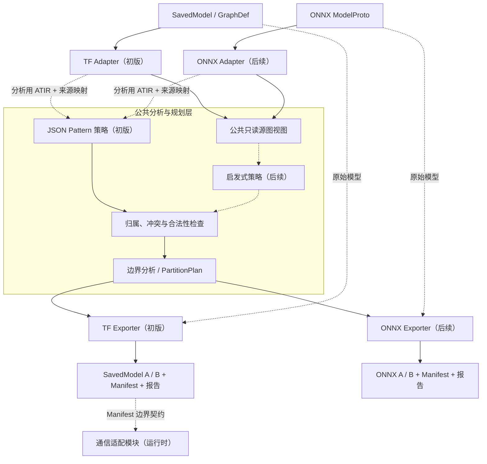

# ANNC 异构图切分优化器设计

| 文档控制项 | 内容                                                                                                                              |
| ----- | ------------------------------------------------------------------------------------------------------------------------------- |
| 文档编号  | ANNC-TFSPLIT-HLD-001                                                                                                            |
| 版本与日期 | 0.13，2026-11-04                                                                                                                  |
| 文档状态  | 待评审                                                                                                                             |
| 责任人   | liyancheng                                                                                                                      |
| 目标读者  | 开发、测试及技术负责人                                                                                                                     |
| 关联文档  | [总体架构](../../architecture/overview.md)、[CLI 工作流](../../guides/cli-workflows.md)、[ONNX 前端设计](../onnx-support/frontend-design.md) |

## 背景

推荐推理同时包含稀疏查表、特征处理和稠密计算，各阶段对 CPU、内存和加速设备的需求差异明显。服务器或容器配置固定后，资源消耗比例容易与硬件配比错位，出现 CPU 或内存先满载、加速设备仍有空闲的情况。模型和负载变化也会改变资源需求。将计算区域拆分到可独立部署、扩缩的运行环境，可以提高资源利用率和部署弹性。

精排推理图通常较为静态，部署环境则覆盖纯 CPU 节点、带加速设备的节点，以及节点内部的主机与设备分工。模型开发以整图为主，部署阶段需要选择切点、导出子图、配置通信并核对两侧输入输出。这些步骤目前依赖经验，模型结构或部署目标变化时需要重复处理。离线工具可以接管这套流程，根据可审查的规则生成子图、通信边和接口映射。

整图切分后，可独立计算的子图能够调度到不同设备或容器，在同一请求内并行执行。评估方案时需要同时考虑算子耗时、参数访问、数据传输、排队和资源占用，重点关注请求关键路径与端到端时延。通信开销可能抵消并行收益，切分结果需要结合目标环境和实际负载验证。

大规模稀疏参数适合交给独立存储服务管理，由服务提供查询、自动分片和负载均衡。计算图保留逻辑表和访问接口，物理分片数量与部署拓扑由存储服务调整。模型或负载变化后，可以通过离线回放和重新评估生成新的切分方案，在线请求继续使用已发布方案。

使用方期望完整模型能适配多种异构部署环境：模型和负载变化时，工具重新生成可执行、可验证的切分与连接方案，通过发布流程替换旧版本。

## 1 目标与范围

### 1.1 目标

当前 ANNC 已具备 TF SavedModel 加载与图解析、`NodeInfo` 适配及 `MLIRBuilder` 构建 ATIR 的模型导入分析能力，基于图 DSL 与条件约束的 JSON Pattern 图匹配能力，以及 GraphDef 融合区域改写、AArch64 kernel 编译与框架回接能力。拟在此基础上新增 ANNC 异构图切分优化器：新增公共 Planner 库（只读源图视图、策略接口、归属与合法性检查、边界分析）、TF Exporter 与通信适配模块，由独立离线 CLI `annc-partition` 作为薄入口编排；同时将 JSON Pattern 匹配从融合改写中解耦，扩展为融合 Pass 与切分策略共用的只读匹配接口；后续在同一公共能力上扩展 ONNX 接入、启发式与 cost-guided 策略及跨节点传输。由此实现把完整模型按可审查规则离线切分为可独立加载、经配对通信连接的分区子模型，并自动生成通信接口与切分报告的目标。初版处理 TensorFlow SavedModel：

```text
输入：
  一个 SavedModel
  一份切分策略配置：
    - JSON Pattern 自动匹配（初版）
    - 内置启发式规则自动分析（后续）
  一份通信配置

输出：
  SavedModel A
  SavedModel B
  partition_manifest.json
  partition_report.json
```

工具复用 ANNC 既有能力承担模型接入与图分析，新增部分集中在规划、导出与通信。

复用已有能力：

- TF SavedModel 加载与图解析：现有 TF 前端已提供 SavedModel 加载、图解析与 `NodeInfo` 适配（`TfModelLoader`、`NodeInfoAdapter`），TF Adapter 在此基础上建立只读源图视图，不重复实现模型读取；
- 分析用 ATIR 构建：复用现有 `MLIRBuilder` 与 `NodeInfo` 契约，JSON Pattern 路线直接产出未经改写的分析用 ATIR；
- JSON Pattern 匹配：复用既有图 DSL、条件约束与匹配语义；匹配逻辑当前与融合改写耦合在 materialization 中，需解耦为只读匹配接口后由融合 Pass 与切分策略共用（见 3.3 节）；
- `NodeInfo`、`FusionInfo` 继续作为导入、匹配与融合的工具契约，不扩为部署协议（见 2.4 节）。

需要新增的部分：

- 公共 Planner 库：只读源图视图、策略接口、归属与合法性检查、边界分析及 `PartitionPlan` 契约，仓库中不存在可替代实现；
- TF Exporter：现有 TF 路径止于模型加载与融合区域改写，分区子模型导出、通信节点物化与签名重建是能力缺口；
- 通信适配模块：Send/Recv 自定义 Op 注册、进程内传输运行时库与消息隔离（见 3.6 节）；
- `annc-partition` CLI 入口与 Manifest、Report 产物契约。

切分策略按可替换接口组织。初版实现 JSON Pattern 模式：复用既有图 DSL 与匹配语义，经来源映射将结果转为源图候选区域；启发式模式通过只读源图视图分析算子、依赖和边界，无需先导入 ATIR，作为后续扩展接入同一接口。所有策略统一产生候选区域，由切分实现模块处理归属与冲突，生成 `PartitionAssignment`，经合法性检查和边界分析形成 `PartitionPlan`，再由 TF Exporter 生成通信节点并导出 SavedModel。

规划算法与框架格式、策略实现分离：ONNX 通过新增 Adapter 和 Exporter 接入，启发式策略经同一策略接口接入，两者均为后续扩展。

### 1.2 初版范围

初版限定为 TensorFlow 路径：

- 单 MetaGraph；
- 一个待处理 Signature，默认 `serving_default`；
- 静态主图上的 A/B 二分区；
- 跨分区数据依赖只允许 A → B；
- 函数调用节点整体归属一个分区，不切分函数体；
- 不允许跨分区控制依赖、Resource 依赖和状态更新；
- 权重已冻结为 `Const`、无需恢复 checkpoint 或初始化变量的推理模型；
- 跨分区边界 tensor 的 dtype 须为受支持的数值类型，具体集合由通信配置声明（初版默认覆盖 float、int、bool 系），resource、variant、string 等类型拒绝；shape 的 rank 须静态已知，允许动态维（如动态 batch），unknown rank 拒绝；
- 主图控制流结构必须整体归属同一分区，边界不得穿越控制流区域，同分区循环不受此限；
- FunctionDef 检查覆盖函数体传递闭包：含 Resource 或状态依赖的函数，其全部调用者必须位于同一分区，纯函数可在两个分区各自导出副本；
- 多分区共享的 `Const` 默认拒绝，仅当通信配置显式指定所有者分区并允许跨分区传输时按常量边界处理（见 3.4 节）；
- 工作集内不得出现显式设备注解（`NodeDef.device`）与共置约束（`loc:@...`），否则拒绝，设备放置与重映射为后续扩展；
- 通信传输所需的 Send/Recv 自定义 Op 与运行时传输实现随初版交付（见 3.6 节）；跨节点传输为后续扩展，不在初版范围。

初版交付以无需恢复 checkpoint 或变量初始化的冻结推理模型为准。不能仅因变量或状态完全落在一个分区就默认支持非冻结模型；其加载、初始化和导出需另行设计验证。

SavedModel 封装 profile 同样收窄：输入的对象图（`object_graph_def`）、collections 与 SaverDef 不参与切分，存在变量恢复或初始化依赖时拒绝（见 3.2 节）；产物 A/B 以 MetaGraphDef 形态导出，不重建对象图，不导出 collections 与 SaverDef（见 3.5 节）。可独立加载的验收宿主指定为 Python `tf.saved_model.load`，TF Serving 与 C++ SavedModel API 加载不在初版验收范围。初版验收在单机本地回环环境完成，不构成跨节点分布式或异构部署的验收；设备放置、跨节点通信与真实部署 profile 的验收随相应扩展另行定义（见第 6 章）。

### 1.3 非目标

初版不做：

- 启发式切分模式；
- 自动代价模型与最优切分；
- 多于两个分区；
- 双向或环形跨分区依赖；
- 在线动态改图；
- ATIR kernel 编译；
- GPU/NPU 代码生成；
- KV 切分与分布式存储；
- RPC、超节点互联等跨节点传输的实现与验收；
- ONNX 模型切分与导出的实现和运行验收。

## 2 整体设计

### 2.1 设计思路

当前 ANNC 已具备 TF/ONNX 模型导入、ATIR 算子融合、JSON Pattern 图匹配、GraphDef 重写，以及 AArch64 kernel 编译与框架回接能力。这些能力主要面向局部计算优化和单图内的融合执行，为整图分析、规则匹配和框架模型处理提供了可复用基础。

面向完整模型的异构部署，还需要把局部融合提升为全局部署规划：识别源图节点及依赖，确定节点归属和跨分区边界，生成可独立加载的子模型及通信接口，并保留从计划、子模型到源图的完整映射。初版以 TensorFlow SavedModel 二分区的 JSON Pattern 切分为目标，后续在同一公共能力上扩展 ONNX、启发式和代价引导策略。

整个工具划分为七个模块。跟框架绑定的是模型接入模块和模型导出模块，新增框架就是新增这一对实现，通信 Op 的注册与加载同样按框架区分；候选生成方式只落在切分策略模块，启发式和 cost-guided 后续作为并列实现接入；策略提出候选，切分实现模块推导出经过校验的最终归属与边界，这一部分与框架无关。CLI 入口模块只做编排。通信适配模块位于运行时侧，承载分区间的实际数据传输；测量评估模块初版不实现。

1. **CLI 入口模块**：`annc-partition` 薄入口。解析参数，选择已构建的 Adapter、策略和 Exporter，编排校验和原子发布，本身不做规划。
2. **模型接入模块**：加载并持有原始模型，建立只读源图视图、稳定源 ID（`SourceNodeId` / `ValueId`）、依赖索引和语义约束，维护 ID 到原始对象的映射；JSON 路线还提供分析用 ATIR 和来源映射。各框架的 Adapter 是该模块的实现，初版只有 TF Adapter，ONNX Adapter 后续补充。
3. **切分策略模块**：消费源图视图或分析用 ATIR，生成候选区域并映射回源 ID。初版只注册 JSON Pattern，复用解耦后的 match-only matcher（见 3.3 节）；启发式和 cost-guided 后续在同一接口下新增实现。
4. **切分实现模块**：把切分策略模块给出的候选确定为最终切分——处理候选优先级、归属与冲突、默认归属和完整性，执行合法性检查和跨分区边界分析，输出框架无关的 `PartitionAssignment` 和 `PartitionPlan`；模型文件的改写属于模型导出模块。不依赖 TF/ONNX protobuf，新增策略或框架时这部分保持不变。
5. **模型导出模块**：按 `PartitionPlan` 处理同一份原始模型，生成 A/B 子图和配对 Send/Recv，重建 Signature，闭合 FunctionDef 与资产依赖，导出 SavedModel 和 Manifest。子图切分和通信节点插入改写的是同一份 GraphDef，节点物化是导出的内部步骤；通信节点在运行时的传输实现由通信适配模块提供（见 3.6 节）。各框架的 Exporter 是该模块的实现，初版只有 TF Exporter。
6. **通信适配模块**：运行时承载分区间数据传输。按 Manifest 边界契约提供 Send/Recv Op 的运行时实现、消息路由与请求级隔离；传输方式经统一接口组织（见 3.6 节）。
7. **测量评估模块**：运行时 Profiler 采集计算与通信数据，校准 Cost Model，供 cost-guided 策略使用（见第 6 章）。初版不实现。

Planner 因此位于 ANNC 工具链前端的公共分析与规划层，处于框架模型读取之后、框架子模型导出之前，与 ATIR 融合优化协作。部署分区决定源节点归属和跨模型接口；已有融合流程决定由哪些 ANNC kernel 接管局部计算，两者的产物契约分别维护。

基于上述目标，整体设计遵循以下原则：

- 导出始终基于原始模型：Adapter 建立规划所需的只读视图，Exporter 处理的是同一份原始模型，不经过其他 IR 往返恢复。
- 公共规划不接触框架格式：候选生成、归属、冲突处理、合法性检查和逻辑边界由切分策略模块和切分实现模块完成，TF/ONNX 的对象、签名、函数和导出语义留在 Adapter 与 Exporter。
- 切分策略可替换：初版只有 JSON Pattern，启发式和 cost-guided 后续接入，共用候选契约、计划和校验链路。
- 计划与执行分开：`PartitionPlan` 只描述逻辑归属和通信需求，具体通信 Op、子模型封装和运行加载由框架和部署环境决定。
- 先校验再发布：源身份、归属完整性、跨分区方向、边界和函数/资源约束任一项不满足就停止导出。

选择公共层可以共享规划算法，同时保留框架语义与导出边界。分别在 TF/ONNX 中实现会重复策略和校验，强制全部规划经过 ATIR 则会将部署分析绑定到导入覆盖及 IR 变换。现有三层架构与 ATIR 计算优化路径保持不变，公共部署规划作为工具链前端的新增分析能力。



ATIR 仅作为可选分析后端，不承担通用反向导出。

### 2.2 端到端交互流程

一次离线切分按以下顺序完成，箭头两侧同时标明模块交接的主要产物：

1. **CLI → Adapter**：CLI 解析模型、策略、通信和输出参数，选择已构建的框架能力；Adapter 加载原始模型并核查初版输入条件。
2. **Adapter → 公共规划层**：Adapter 返回只读源图视图、稳定源 ID、依赖与语义约束，以及 ID 到原始对象的映射。原始模型由 Adapter 持有。
3. **CLI → 切分策略模块**：初版仅注册 JSON Pattern 策略，其请求未经改写的分析用 ATIR，并将匹配结果映射回源 ID；后续接入的启发式策略将直接消费源图视图，无需 ATIR。所有策略都输出带来源说明的候选区域。
4. **切分实现模块**：统一处理候选优先级、重叠与冲突、默认归属和完整性，再执行合法性检查与逻辑边界分析，形成 `PartitionAssignment` 和最终的 `PartitionPlan`。
5. **切分实现模块 → Exporter**：Exporter 接收 `PartitionPlan` 和同一身份的原始模型，先核对源身份及框架专属约束，再生成子图、通信节点、签名、函数和资产依赖，并输出框架子模型及 Manifest 映射。
6. **Exporter/CLI → 发布**：CLI 汇总结构校验、匹配诊断和切分报告；全部验证通过后原子发布模型包、Manifest 和报告。任一阶段失败即停止，不发布不完整产物（见第 5 章）。

公共规划层只传递稳定 ID、逻辑值和计划，不传递 TF/ONNX protobuf 对象；框架对象仅在 Adapter、策略的框架分析后端和 Exporter 之间按需使用。分区模型运行时的边界数据传输由通信适配模块按 Manifest 契约承载（见 3.6 节）。后续运行时 Profiler 通过 Manifest 中的源 ID 与 boundary ID 关联实测数据，再将版本化 Profile 交回离线规划流程。

### 2.3 模块职责与依赖

2.1 节划分的七个模块，职责与依赖边界如下表；其中切分策略模块与切分实现模块落在公共层，模型接入模块与模型导出模块落在框架模块，通信适配模块为公共运行时库，构建隔离要求见 2.6 节。

| 模块       | 初版状态               | 职责                                                                             | 依赖边界                                                           |
| -------- | ------------------ | ------------------------------------------------------------------------------ | -------------------------------------------------------------- |
| CLI 入口模块 | 初版                 | 解析参数，选择已构建的 Adapter、策略和 Exporter，编排校验及原子发布                                     | 无自有产物契约；`annc-partition` 为薄入口，现有 pipeline 后续可调用同一公共能力          |
| 模型接入模块   | 初版（TF）             | 加载源模型，建立身份与依赖索引，解释算子语义并提供分区约束；JSON 路线另提供分析用 ATIR 及来源映射                         | TF/ONNX protobuf、对应前端能力留在框架模块；ONNX Adapter 为后续扩展               |
| 切分策略模块   | 初版（仅 JSON Pattern） | 调用解耦后的 match-only matcher，经 Adapter 来源映射将匹配结果转换为源 ID，输出带来源说明的候选区域              | 策略接口按 `json`、`heuristic`、后续 `cost_guided` 三种模式设计，初版只注册 JSON 实现 |
| 切分实现模块   | 初版                 | 把策略候选确定为最终切分：处理候选优先级、归属与冲突，检查公共约束，提取逻辑 tensor 边界和诊断，产出 `PartitionPlan`，不改写模型文件 | 核心算法不依赖 TF/ONNX protobuf、框架 Runtime 或 AArch64 后端；新增策略或框架时保持不变  |
| 模型导出模块   | 初版（TF）             | 校验框架专属条件，按计划完成子图生成、通信节点物化、签名重建、函数与资产依赖处理，导出并验证产物                               | 通信 Op 注册、模型封装和运行库加载按框架实现，传输核心由通信适配模块提供                                       |
| 通信适配模块   | 初版                 | 运行时按 Manifest 边界契约承载分区间数据传输：Send/Recv Op 实现、消息路由与请求级隔离                                  | 传输核心为公共运行时库，不依赖 MLIR/ATIR 与框架 protobuf；Op 注册按框架落在框架模块 |
| 测量评估模块   | 预留，初版不实现           | 运行时 Profiler 采集计算与通信数据，校准 Cost Model，为代价引导切分提供输入                               | 供后续 `cost_guided` 策略使用（见第 6 章）；接口随其设计另行确定                |

只读 matcher 应从当前融合 materialization 中提取为可复用的分析组件，由融合 Pass 和 JSON Pattern 策略共同调用。其 MLIR/ATIR 依赖留在分析路径；后续的启发式路径不要求构建 ATIR，也不链接 kernel 编译流程。初版不改变 Grappler、ORT EP、现有 pipeline 默认参数、Fusion Metadata 或执行 ABI。

### 2.4 公共契约与关键不变量

以下名称为逻辑契约草案，并非现有 API。具体容器与序列化格式在实现评审中确定。

| 契约                    | 必需内容                                                                                                               | 生产者 → 消费者                           |
| --------------------- | ------------------------------------------------------------------------------------------------------------------ | ----------------------------------- |
| 只读源图视图                | 源模型身份、稳定声明顺序、`SourceNodeId` 与独立的 `ValueId`；数据依赖、消费者原始输入位置、控制/不可传输依赖及同组约束；图输入/输出、常量等值角色；dtype、shape 与未知状态；策略需要的算子分类 | Adapter → 切分策略模块、切分实现模块             |
| `PartitionAssignment` | `SourceNodeId → PartitionId`、规则或启发式原因；计划中的节点归属部分，完整计划为 `PartitionPlan`                                                        | 公共归属阶段 → 合法性检查、边界分析                 |
| `PartitionPlan`       | 计划版本、源模型身份、归属、跨分区 `ValueId`、生产者与消费者、边界分类（激活/常量）、dtype 与 shape（含动态维标记）、原模型 I/O 映射、诊断及稳定 boundary ID                                           | 切分实现模块 → Exporter、CLI               |
| Manifest / Report     | 源模型与计划身份、框架对象映射、分区接口、通信边界（含激活/常量分类与字节数）、策略依据、诊断及验证范围                                                                             | Exporter / CLI → 部署运行时、通信适配模块、Profiler、使用方 |

视图仅包含规划所需的事实，完整属性与模型载荷留在源模型中，不引入新的完整计算 IR。Adapter 保留源模型及 ID 到原始对象的映射，生命周期覆盖分析、校验与导出；Exporter 在同一源模型身份下消费计划，模型变化后不得套用旧计划。

身份与名称分离：

- `SourceNodeId` 标识一个源模型图作用域中的原始计算节点，可按固定源声明顺序建立；`ValueId` 独立标识 tensor，不能直接等同于节点名。
- 原始名称与 TF `node:port` 仅用于框架映射和诊断。ONNX tensor 名称、缺失或重复的节点显示名，由 ONNX Adapter 分别处理；不将 `tf.name` 规定为公共主键。
- 图输入、initializer 等保留其源值角色，不为满足公共算法而强制合成为计算节点。图输入不属于需要唯一归属的计算节点；TF `Placeholder` 是图输入的框架载体，可按需在各分区生成副本；TF `Const` 仍按其真实源计算节点处理。
- 消费者引用保留 `SourceNodeId` 与原始输入位置，不能因省略可选输入、重复消费同一值或按名称去重而改变槽位。
- 分析用 ATIR 的合成节点不获得源计算节点归属；匹配结果必须完整映射到源节点及源值。无法证明映射完整时拒绝该结果，不在一个源节点的内部做隐式切分。

复用现有 [NodeInfo](../../../annc/include/Builder/MLIROpBuilder.h)、[FusionInfo](../../../annc/include/FusionMetadata/FusionMetadata.h) 所服务的导入、匹配和端点工具，但不将二者扩为部署协议。`NodeInfo` 是 ATIR 构建契约，`FusionInfo` 还包含 kernel、ABI 与执行模式；公共计划保持独立。现有 `tf.*` metadata 可以作为兼容来源，不要求先重命名全仓元数据。

### 2.5 框架约束与导出边界

切分实现模块检查归属完整性、跨分区方向、候选冲突及边界一致性；Adapter 提供不能跨越的依赖、必须共同归属的节点组等语义约束，Exporter 再校验模型封装与实际通信接口。共同算法不按框架 Op 名猜测状态或资源语义，不能确认合法性的边界必须失败。

| TF 初版                                                            | ONNX 后续接入                                 |
| ---------------------------------------------------------------- | ----------------------------------------- |
| GraphDef 数据/控制边、Resource、状态和函数调用边界                               | NodeProto 的 domain/opset、子图/本地函数及框架语义约束   |
| Const/Placeholder、SignatureDef、FunctionDef、assets/checkpoint 所有权 | initializer、图 I/O、模型级信息、函数依赖和外置数据策略       |
| TF 通信 Op 的属性、注册、加载和执行签名 fetch 契约                                | ONNX 通信自定义 Op 或显式 I/O 的表示、版本与运行时支持，另行设计验证 |

这些是 Adapter/Exporter 的职责，不代表相应框架功能已经支持。现有 [ONNX 前端](../../../frontends/onnx/onnx2atir/onnx_frontend.h) 有自己的导入限制，后续 split 必须另行声明支持范围；ORT EP 在单个会话内申报融合区域，也不等于独立 ONNX 子模型导出。

### 2.6 代码落点与构建

建议目录如下，均为拟新增落点：

```text
annc/include/Planner/          公共只读图视图、策略接口、PartitionPlan 与规划接口
annc/lib/Planner/              策略实现（初版 JSON Pattern，启发式为后续）与公共归属、合法性、边界算法
annc/include/Comm/             通信传输接口与消息标识、隔离契约
annc/lib/Comm/                 消息路由与隔离核心、参考传输实现（跨节点传输为后续）
frontends/tensorflow/planner/  TF Adapter / Exporter / TF Send/Recv 自定义 Op 注册与加载
frontends/onnx/planner/        ONNX Adapter / Exporter（后续）
annc/tools/annc-partition/     薄 CLI
```

现有 Loader、ATIR 构建和匹配能力先提取为可复用组件，避免复制到 CLI。通信库独立构建为运行时库，不依赖 MLIR/ATIR 与框架 protobuf，随分区模型部署；TF Send/Recv Op 注册链接该通信库。框架模块按 `ANNC_ENABLE_TENSORFLOW`、`ANNC_ENABLE_ONNX` 构建，CLI 只接入已构建的框架能力；切分策略模块与切分实现模块不给 core-only 或 ONNX-only 构建引入 TensorFlow protobuf/Runtime。初版仍只注册 TF split，ONNX 构建开关不会自动获得 ONNX split 支持。

### 2.7 TF 初版路径

TF Adapter 读取 SavedModel 并保留原始 MetaGraph/GraphDef，构建只读视图。初版仅接入 JSON 策略，其额外构建未经改写的 ATIR；后续的启发式策略将直接消费视图。切分实现模块根据策略候选生成统一计划后，由 TF Exporter 按原 GraphDef 生成 A/B、配对 Send/Recv，再重建 Signature、函数与资产依赖。该 TF 初版处理流程不作为 ONNX 的默认导出规则。

本次规划工作集为所选 Signature 输出反向可达的数据及控制依赖闭包，函数调用节点整体处理；源 ID 仍以原始模型的位置建立。其他 Signature 和不可达计算节点不参与归属、分区非空或方向判定。图输入按各分区的实际依赖建立接口，未使用的原签名输入在接口映射中记录；导出必需的函数和资产另由 TF Exporter 闭合。若模型仍需要不在初版冻结范围内的初始化或状态恢复，必须失败，不能作为不可达内容静默丢弃。

**设计导航**：第 3 章按七个模块展开职责、输入输出、主要流程和协作约束；第 4 章说明接口与产物；第 5 章说明失败处理与原子发布；第 6 章说明后续演进。

## 3 模块设计

本章承接第 2 章的模块划分，说明各模块如何处理输入、交接产物及承担校验职责。公共契约沿用 2.4 节，外部接口与交付产物见第 4 章。初版实现 CLI、TF 模型接入、JSON Pattern 策略、公共切分实现、TF 模型导出与通信适配，测量评估、其余策略与跨节点传输为后续扩展。

### 3.1 CLI 入口模块

CLI 接收源模型位置、切分配置、输出位置及框架专属选项，负责调用各模块完成一次离线切分，输出模型包、Manifest 和报告。`annc-partition` 保持薄入口，规划和导出能力由库提供，供现有 pipeline 后续复用。

主要流程为：

1. 解析配置，选择已构建的 Adapter、策略和 Exporter，核查请求的框架与策略是否可用；
2. 调用模型接入、候选生成和切分实现，将计划与同一份原始模型交给 Exporter；
3. 汇总各阶段诊断与验证结果，全部通过后原子发布产物。

框架选项交由对应框架模块解释，CLI 不承载匹配、归属或 GraphDef 改写逻辑。工具接口与失败边界分别见第 4～5 章。

### 3.2 模型接入模块

模型接入模块以 Adapter 隔离框架格式，输入原始模型及待处理入口，输出只读源图视图、稳定源身份、依赖与语义约束，并持有源 ID 到原始对象的映射。初版由 TF Adapter 加载 SavedModel，确定 2.7 节规定的工作集，核查 1.2 节限定的输入条件：模型为冻结推理模型，工作集内无显式设备注解与共置约束；Adapter 直接解析 MetaGraphDef，仅消费 graph_def、signature_def、asset_file_def 与函数库，object_graph_def、collections_def 与 SaverDef 不参与切分，存在变量恢复或初始化依赖时拒绝。

Adapter 从框架模型提取规划所需的节点、值和依赖，解释算子语义并标记不可跨越的依赖与必须共同归属的节点组；主图控制流结构整体标记为共同归属组，函数库检查延伸到 FunctionDef 传递闭包内的 Resource 与状态依赖（语义边界见 1.2 节）。源节点与源值分别标识，消费者原始输入位置及图输入、常量等角色均须保留，公共层据此分析。TF 节点名称与 tensor 端口必须无歧义，函数调用在主图中按整体处理。

JSON Pattern 路线还需复用现有前端构建未经改写的分析用 ATIR，并提供完整来源映射；合成节点归属与映射完整性要求见 2.4 节。

后续 ONNX Adapter 按自身的节点、tensor、initializer 和算子语义建立相同公共视图，不套用 TF 名称或端口规则。视图契约与框架边界见 2.4～2.5 节。

### 3.3 切分策略模块

切分策略模块根据配置和分析输入生成候选区域，交给切分实现模块。候选以源 ID 描述成员、建议分区及规则或分析依据；策略不决定最终归属。

| 策略           | 状态 | 分析输入与候选依据                                          |
| ------------ | -- | -------------------------------------------------- |
| JSON Pattern | 初版 | 消费分析用 ATIR，复用图 DSL 与 matcher，经 Adapter 来源映射转换为源图候选 |
| 启发式          | 后续 | 消费只读源图视图，根据框架解释的算子分类、依赖和边界约束生成候选，无需构建 ATIR         |
| cost-guided  | 后续 | 消费源图视图及版本匹配的测量与代价信息，比较候选方案，见第 6 章                  |

JSON Pattern 路线需将现有 matcher 的只读匹配能力从融合改写中提取出来，由融合 Pass 和切分策略共同复用。原融合流程继续组合匹配与改写，切分策略仅收集匹配并恢复来源；不得修改分析用 ATIR，也不运行可能删除、合并或替换源节点的改写流程。该解耦需保持 TF/ONNX 既有融合行为。

只读接口与融合改写的语义差异须显式定义：融合流程每轮只做一次匹配并随物化重扫，重叠与顺序由该循环隐式处理；只读接口须在不修改 IR 的前提下一次枚举全部稳定匹配且不去重，重叠交由切分实现模块按归属规则裁决（同分区合并、跨分区失败），同一锚点不得因扫描轮次不同产生不同结果。融合专属的逃逸输出拒绝、属性捕获、kernel/ABI 约束与物化不进入只读接口：切分场景中的逃逸值即合法通信边界（边界规则见 3.4 节）。

JSON Pattern 复用既有图 DSL、条件约束和优先级语义，分区配置独立于 fusion 配置，不继承 kernel/ABI 契约。初版可先复用已知 ATIR Pattern，涉及未知源 Op 时再扩展匹配能力，由对应框架解释原始算子语义。配置职责见 4.1 节；后续策略沿用相同候选契约及公共校验链路。

### 3.4 切分实现模块

切分实现模块接收只读源图视图、策略候选和公共分区配置，将候选确定为经过校验的 `PartitionAssignment` 和 `PartitionPlan`，供 Exporter 与 CLI 消费。该模块承担所有策略共享的归属、合法性与逻辑边界分析。

主要流程分为三个阶段：

1. **归属处理**：按配置优先级和稳定顺序处理候选。同分区重叠允许合并并记录，不同分区争抢同一节点则失败；未覆盖的工作集计算节点进入默认分区，形成唯一归属及其依据，图输入及其框架载体除外；
2. **合法性检查**：核对源身份、候选映射与归属完整性，检查 Adapter 提供的语义约束、分区非空和初版 A → B 单向依赖要求，拒绝跨分区控制及 Resource/Stateful 依赖；
3. **边界分析**：从真实源依赖提取跨分区值，按 `ValueId` 去重并保留全部消费者及重复输入位置，关联原模型输入输出，形成具有稳定边界身份的计划。图输入只产生外部输入需求，不生成跨分区通信边界。

常量归属是归属处理的组成部分。JSON Pattern 的匹配结果通常不含常量（matcher 将常量与 buffer 视为隐式操作数），`Const` 因而不进入默认归属路径：计算节点归属确定后，全部消费者位于同一分区的 `Const` 随消费者归属；被多个分区消费的 `Const` 默认拒绝，诊断给出常量身份、字节规模与两侧消费者，仅当通信配置为该常量显式指定所有者分区并允许跨分区传输时，才按常量边界物化。初版通信均为请求级执行，跨分区常量等价于每请求重传，默认拒绝据此成立；初版不做常量自动复制。

完整边界由源图依赖决定，不能以 Pattern 声明的输出列表替代。公共计划只描述逻辑归属、值和通信需求（契约见 2.4 节）；框架语义由 Adapter 提供，导出侧的封装与通信接口检查由 Exporter 负责（职责划分见 2.5 节），失败处理见第 5 章。

### 3.5 模型导出模块

模型导出模块接收 `PartitionPlan`、Adapter 持有的原始模型及通信配置，输出框架子模型和 Manifest 所需的框架映射。Exporter 先核对计划与源模型身份及框架专属条件，再按计划处理原始模型。

TF Exporter 按归属生成 A/B 子图，将逻辑边界物化为配对 Send/Recv，重建 Signature，保留所需 FunctionDef 的传递闭包及仍被引用的 assets。导出的 A/B 以 MetaGraphDef 形态封装（graph_def、signature_def、FunctionDef 与 assets 闭包），不重建 object_graph_def，不导出 collections 与 SaverDef；通信传输与运行库加载由通信适配模块承担（见 3.6 节）。

原模型输入按各分区实际依赖保留，共享输入及原输出映射写入 Manifest；`Const` 按 3.4 节归属结果保留在被归属分区，被显式允许跨分区使用的常量物化为常量边界。原输出同时被另一分区消费时，须同时保留本地输出和通信。边界分为激活与常量两类，Manifest 逐边界记录分类、dtype、shape 及字节数，供使用方评估每请求通信量。

通信物化需保证 Send/Recv 配对完整、dtype 一致，shape 的静态已知维一致，动态维一致性由运行时与数值验证覆盖；Recv 按计划中的边界 dtype 与 shape（含动态维）声明输出类型。为保证 A 在调用方选择性 fetch 下仍然执行，A 除保留原输出映射的签名外，另建覆盖全部 Send 输出的内部执行签名，调用方须整体 fetch 该签名的全部输出，不得跳过任何 Send；A 无原模型输出时同样由该签名驱动执行。B 的跨分区输入由 Recv 提供，不再暴露为普通 Placeholder。调用方最小契约：按 Manifest 分区接口分发输入（共享输入同值喂给两侧），整体 fetch A 的执行签名后再调用 B，最终输出按 Manifest 的原输出映射从两侧读取。

初版随工具交付的运行时通信能力由通信适配模块提供（见 3.6 节）。跨节点场景的传输协议、超时、取消与错误传播语义属传输实现详细设计，不在本设计规定。

导出模块在发布前验证子模型结构、接口与依赖完整性，向 CLI 返回产物、框架映射和诊断。CLI 汇总结果后负责发布，产物职责见第 4 章。

### 3.6 通信适配模块

模型导出模块在子图中物化的 Send/Recv 只是通信节点，实际数据传输由通信适配模块在运行时承载。模块按 Manifest 边界契约工作：消费边界身份、dtype 与 shape 声明，提供 Send/Recv Op 的运行时实现、消息路由和请求级隔离。该模块位于运行时侧，不属于离线规划链路：规划与导出只产出边界契约，传输实现独立演进、随分区模型单独部署。

传输方式经统一传输接口组织，可按部署形态选择或组合：

| 传输方式 | 状态 | 适用形态 |
| ---- | ---- | ---- |
| 进程内本地回环 | 初版 | 单机验证与同进程部署，A/B 加载于同一进程 |
| RPC | 后续 | 跨进程、跨节点通用部署 |
| 超节点互联 | 后续 | 超节点内高速互联，面向大张量、低时延场景 |

初版交付本地回环参考实现：提供 TF Send/Recv 自定义 Op 注册与按请求隔离的进程内消息传递，作为数值与运行验证的依赖项。RPC 与超节点互联为后续传输实现，经同一传输接口接入；接口向使用方开放，支持自定义传输。传输选择与组合策略随传输实现详细设计确定。

运行时约束：

- 消息以（请求或会话身份，模型版本，boundary ID）共同定位，静态 boundary ID 不能单独充当全局消息标识；
- 并发请求按请求或会话身份隔离，不得串扰；
- 外部运行环境负责 A/B 的启动与并发调度，本模块不接管进程编排；
- 传输接口预留按边界采集通信度量（时延、字节数）的扩展点，供测量评估模块使用（见第 6 章）。

传输失败、超时、取消与错误传播语义属于传输实现详细设计，本设计仅约束接口与隔离要求。

### 3.7 测量评估模块（后续扩展）

测量评估模块初版不实现。后续以已发布模型的运行时测量、Manifest 映射及目标环境信息为输入，产出版本化 Profile 和经校准的代价信息，供离线 cost-guided 策略使用。

运行时 Profiler 采集计算、通信与请求关键路径数据，通过源模型身份、源 ID、boundary ID 和 plan ID 关联回规划对象；离线评估负责数据核对与 Cost Model 校准。测量与评估不改变当前在线请求使用的模型。

该模块不作为初版 JSON Pattern 规划的依赖。测量闭环及版本约束见第 6 章，具体接口随后续设计确定。

## 4 接口与产物

### 4.1 输入与配置

CLI 接收原始模型、切分策略配置、通信配置和输出位置。模型格式与待处理入口由 Adapter 解释；策略配置描述候选生成方式、目标分区和默认归属；通信配置由 Exporter 映射到目标环境的通信 Op 并声明传输方式，初版对应通信适配模块的参考实现（见 3.6 节）；跨节点传输配置随相应传输实现扩展。初版只接入 TF SavedModel 与 JSON Pattern，其他框架和策略随其实现扩展。

JSON Pattern 复用现有图 DSL 的解析能力，分区配置与融合配置分别维护，通信配置也不要求各框架使用同名 Op。具体配置 schema、CLI 参数及序列化字段在详细设计中确定，落地时同步工具帮助与 CLI 参考文档。

### 4.2 计划与交付产物

模块间公共契约沿用 2.4 节，内部计划与外部交付产物的职责如下：

| 接口或产物                     | 生产者 → 消费者                            | 用途                                     |
| ------------------------- | ------------------------------------ | -------------------------------------- |
| `PartitionPlan`           | 切分实现模块 → Exporter、CLI                | 传递已校验的逻辑归属、边界与原模型 I/O 关系；初版可仅在进程内传递    |
| SavedModel A/B            | TF Exporter → 外部运行环境                 | 提供可独立加载的分区模型，保留原模型计算语义并通过配对通信连接        |
| 通信运行时库               | 通信适配模块 → 部署运行环境                 | 提供 Send/Recv Op 的运行时实现与分区间数据传输，随工具版本交付 |
| `partition_manifest.json` | Exporter / CLI → 部署运行时、Profiler、调试工具 | 关联源模型与计划身份、分区接口、共享输入、静态通信边界和原模型 I/O 映射 |
| `partition_report.json`   | CLI 汇总各模块 → 使用方、验证流程                 | 说明策略与配置摘要、归属依据、匹配和冲突诊断、产物统计（含逐边界激活/常量分类与字节数）及验证范围       |

Manifest 由公共计划与 Exporter 的框架映射共同生成，通过源节点、源值及 boundary ID 关联原始对象和导出对象。源模型身份覆盖图结构、权重及相关载荷版本；相同源模型、配置和 ID 方案应生成稳定的源 ID、边界身份、导出名称和 Manifest。名称仅用于展示与框架映射，不能替代模型身份校验。

初版不强制新增独立计划文件或进程间协议。后续如需独立传递、缓存或重放计划，需明确版本、源模型身份和约束校验。

## 5 失败处理与原子发布

各阶段须在职责范围内拒绝不能证明合法的输入或结果，并返回可关联配置、源对象和失败原因的诊断：

| 阶段        | 主要失败边界                                          |
| --------- | ----------------------------------------------- |
| 模型接入与候选生成 | 模型超出初版范围，框架语义无法确认，候选不能完整、唯一地映射到源节点与源值           |
| 公共切分实现    | 源身份或输入槽位不一致，节点归属冲突或不完整，任一分区为空，存在逆向、环形或不可跨越的依赖   |
| 模型导出与产物校验 | 计划与模型身份不符，签名、函数或资产依赖无法闭合，通信边界无法正确物化，产物缺少必需对象或接口 |

任一阶段失败即停止后续处理，不以跳过冲突或忽略未知语义的方式生成部分计划。公共检查与框架专属检查共同构成发布前提，初版 TF 的输入和依赖限制见 1.2 节及第 3 章。

产物先写入临时位置，完成结构、接口与依赖校验后，再将 A/B 模型、Manifest 和报告作为同一交付单元原子发布。失败时不得留下可被使用方当作完整结果加载的半套产物。

## 6 后续演进

### 6.1 框架与策略扩展

框架扩展通过新增 Adapter/Exporter 接入相同公共规划能力。ONNX 路径需独立处理其算子、图 I/O、函数及模型载荷语义，明确通信表示和运行时支持，并完成真实宿主验收。

策略扩展通过同一候选接口接入。启发式直接分析只读源图视图，不依赖 ATIR 或运行时测量；cost-guided 利用静态图特征与版本匹配的测量信息比较候选方案。两者共用归属、合法性和边界分析，不修改模型导出职责。初版 JSON Pattern 规划可独立于测量评估运行。

传输扩展通过通信适配模块的传输接口接入：RPC 与超节点互联作为后续传输实现，按部署形态选择或组合；接口同时向使用方开放自定义传输。跨节点传输的协议、超时、取消与错误传播语义随传输实现详细设计确定，并单独验收。

### 6.2 测量与离线规划闭环

后续测量闭环为：已发布方案的运行时测量 → 版本化 Profile 与离线 Cost Model 校准 → cost-guided 候选生成 → 公共校验与导出 → 结构、数值及目标环境验证 → 发布新方案。在线请求只采集数据并执行已发布计划，校准、规划和发布均在离线进行。

测量数据通过模型与计划身份、源节点/值及边界身份关联到规划对象，同时保留目标环境与采样范围，避免混用不同模型、权重或部署版本的数据。测量不足时回退到显式规则或启发式结果，并在报告中说明缺失信息和适用范围。

新方案连同模型、规则、测量、Cost Model、目标环境及验证依据共同版本化。版本不匹配时继续执行已加载的兼容计划并返回诊断；新方案通过验证后再替换已发布计划，保持当前请求的图一致并支持回滚。具体测量指标、采集机制与校准方法在后续详细设计中确定。

## 修订记录

| 版本  | 日期         | 修订人        | 修订说明                                                                            |
| --- | ---------- | ---------- | ------------------------------------------------------------------------------- |
| 0.13 | 2026-11-04 | liyancheng | 初版成稿：确定含通信适配模块在内的六模块划分与 TF SavedModel A/B 二分区初版范围、验收边界（含加载宿主与本地回环验收范围）；明确常量归属与激活/常量边界分类、边界 dtype/shape 与控制流及函数闭包语义边界、A 执行保证（内部执行签名与调用方最小契约）、只读匹配枚举语义与融合专属检查排除及设备注解拒绝规则，以及统一传输接口（初版进程内本地回环，RPC 与超节点互联为后续传输实现）与消息标识、请求级隔离要求；梳理复用已有能力与新增模块的划分；明确启发式、cost-guided、ONNX 及测量评估为后续扩展。 |

