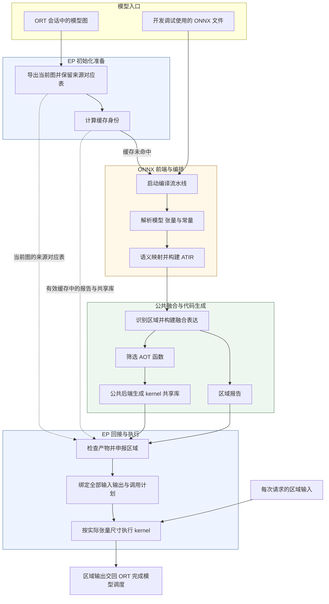
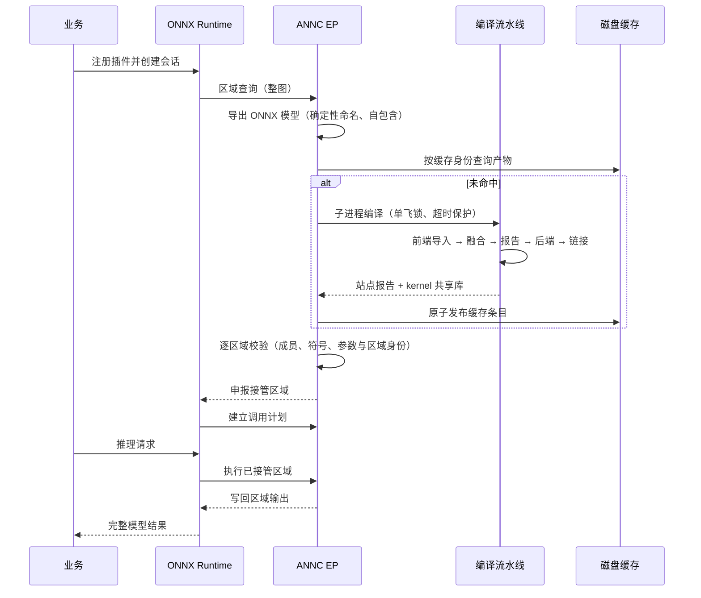

# ANNC ONNX 支持详细设计（模块文档集）

| 文档控制项 | 内容 |
| --- | --- |
| 文档编号 | ANNC-ONNX-LLD-000 |
| 版本与日期 | 1.10，2026-10-20；迁移至新基线 `11bef0d0`（原基线 `c1622b87`）；同步 KDNN adaptor 构建下的 AOT `matmul` 分支、条件注册的模式类与构建门控 |
| 文档状态 | 模块设计。与源码基线同步，待评审 |
| 文档层级 | 详细设计索引与整体数据流；各模块设计见同目录子文档 |
| 源码基线 | Git 提交 `11bef0d0`（分支 `upstream/dev`） |
| 上级文档 | [ANNC ONNX 支持整体方案设计](overall.md)（ANNC-ONNX-HLD-001） |
| 关联文档 | [ANNC 总体架构](../../architecture/overview.md)、[架构决策索引](../../decisions/README.md)（ADR-011～ADR-015） |

## 1 本文档集的定位

整体方案设计（[onnx-support-overall-design.md](overall.md)）规定 ONNX 支持的目标、范围与风险边界；本目录则论述各子模块的设计，包括抽象与职责划分、接口与契约、关键决策与权衡、失败模型、质量属性、扩展点，以及实现相对设计的遵循程度。

三份文档按核心职责划分，以数据契约交接，并通过源码索引定位对应实现。ONNX 前端拥有导入与编排接口，公共融合模块定义融合表达和元数据，EP 消费产物并管理会话执行。跨模块协议由定义方说明语义，由消费方说明支持范围和验证规则。

| 文档 | 覆盖范围 | 主要源码落点 |
| --- | --- | --- |
| [ep-design.md](ep-design.md) | ORT EP 接入与执行：插件注册、区域申报、调用计划、执行、缓存、编译子进程与图导出 | `addons/onnxruntime/` |
| [onnx-frontend-design.md](frontend-design.md) | ONNX 前端：解析、类型与形状推导、常量解码、语义适配、算子映射面、ATIR 产出与端到端编排 | `frontends/onnx/` |
| [fusion-design.md](fusion-design.md) | 融合优化与算子实现：区域模型、模式目录、元数据契约、实现链路、调用约定、目标后端与编译驱动 | `annc/lib/Dialect/Atir/`、`annc/lib/FusionMetadata/`、`annc/lib/Conversion/`、`annc/lib/Target/aarch64/`、`annc/lib/Kernel/`、`annc/tools/` |

## 2 基线、当前能力与阅读入口

### 2.1 基线

- 源码基线：Git 提交 `11bef0d0`（分支 `upstream/dev`）。正文描述该基线的实现事实；尚未落地的能力显式标注为设计目标或待补项，不写成既有保障。
- 首期验收基线：ONNX 默认域 opset 13；ORT SDK 与宿主 1.26.0；openEuler + AArch64 CPU。
- 能力口径：全文统一使用“能导入／能生成／能交付”三层（定义见[整体方案](overall.md) §4.3）。“可交付”只用于通过指定平台验收的组合；源码事实、测试复现与生产观察三类证据在正文中分别标注。

### 2.2 命名与版本标识

同一子系统并存多个版本标识。正文不使用“v2 ABI／v3 ABI”这类简称交替指代，统一按下表区分。

| 标识 | 当前取值 | 含义与位置 |
| --- | --- | --- |
| 站点 ABI 标签 | `annc_execution_v2`（主路径）、`mlir_ciface`（兼容路径） | 站点报告 `abi` 字段，决定消费者走哪条调用路径；标签名沿用自 v2 原型，其对应的执行上下文结构当前为版本 3（[fusion-design.md](fusion-design.md) §7.3） |
| 执行上下文结构版本 | 3；校验同时接受 v3（按结构尺寸＋版本 3）与 v2（按 `ANNC_EXECUTION_V2_CONTEXT_SIZE`＋版本 2） | `AnncExecutionContext` 的结构字段；v3 在尾部增加不透明 `thread_pool`（[ep-design.md](ep-design.md) §6.7、[ADR-013](../../decisions/decisions.md#adr-013)） |
| 站点报告 schema | `annc-ep-site-report/1` | 报告顶层字段，EP 读取并校验，不符即按未命中处理（[fusion-design.md](fusion-design.md) §6.4） |
| 报告契约版本 | `contract_version = 1.0.0` | 由 pipeline 写出；EP 当前**不读取**该字段（GAP-04） |
| 缓存命名空间 | `v1`（`<cache>/v1/<签名前两位>/<签名>/`） | 磁盘缓存目录；签名另有三个前缀：`annc-ep-cache-key-v1`（模型结构）、`annc-ep-config-v2`（工具链与配置，含四个 `ANNC_EP_FUSION_*` 与 `ANNC_MLAS_LIB_DIR`）与 `annc-ep-kernel-libs-v1`（kernel 归档大小＋修改时间）（[ep-design.md](ep-design.md) §6.2） |

### 2.3 当前能力摘要

| 层次 | 当前基线结论（详见各文档与 §7） |
| --- | --- |
| 能导入 | 前端映射表列出 39 个 ONNX 算子名称；未支持的节点按 opaque 降级并记录原因（[onnx-frontend-design.md](frontend-design.md) 附录 A） |
| 能生成 | 融合 Pass 在默认构建注册 14 个模式类；`ANNC_ENABLE_KDNN_ADAPTOR=ON` 时另注册 KDNN MatMul 模式（#15），合计 15 个（patterns 见 `annc/lib/Dialect/Atir/Passes/OpFusion.cpp`）。AOT 裁剪只保留 `execution_mode=aot` 且带 `fusion.pattern` 的函数。`masked_mul`、`batched_matmul_add`、`layer_norm` 三个模式的融合实现与 kernel 已合入当前基线（[fusion-design.md](fusion-design.md) §5） |
| 能交付 | ONNX AOT 链路的四个默认载体为上下文 ABI（`annc_execution_v2`）站点：#11 `tensordot_matmul`（FTDMM）与 #12–#14 `masked_mul`/`layer_norm`/`batched_matmul_add`。默认构建的 `matmul` 家族为 JIT，prune 阶段即被裁剪；KDNN adaptor 构建且 `ANNC_GEMM=1` 时，plain `matmul` 走 #15 生成 AOT 站点（`matmul_add`/`matmul_add_relu` 不在 EP 白名单内，仍被丢弃）。当前尚未有组合完成指定平台验收，发布清单以验收报告为准 |

### 2.4 阅读入口

按角色：

- 评审与架构人员：先读整体方案，再看三份详设的“设计目标与优先级”“接口与契约”“关键设计决策”“现状与目标差距”章节。
- EP 开发：[ep-design.md](ep-design.md)（§3 总体设计、§4 契约、§6 核心机制、§10 差距）。
- 前端算子支持开发：[onnx-frontend-design.md](frontend-design.md) 第 6 节与附录 A。
- 融合模式或 kernel 开发：[fusion-design.md](fusion-design.md) 第 4、5、7、10 节。

按问题：

- ONNX Runtime 的 EP 机制与插件接入方式：ep-design §1.2。
- 某个模型未被加速的原因：ep-design §7（失败分级）与 §10（校验缺口）。
- 某个 ONNX 算子是否受支持：onnx-frontend-design §6.4（降级决策）与附录 A（映射面）。
- 某个融合模式的识别条件与边界：fusion-design §4（区域模型）与 §5（模式目录）。
- kernel 的生成方式与 ABI：fusion-design §7。
- 缓存身份的组成：ep-design §6.2。
- 某个标识（ABI 标签、结构版本、schema、缓存命名空间）的含义：本文 §2.2。
- 某条差距的状态、关联风险与关闭条件：本文 §7。
- 旧 MR 文档某节内容的落点：本文 §8。

## 3 整体数据流

ONNX 模型进入 ANNC 有两条入口，二者共用同一条编译主干。

- 运行时入口（主路径）：ONNX Runtime 会话加载模型，ANNC EP 在会话初始化阶段导出整图并调用 `annc-onnx-pipeline`。
- 开发与调试入口：直接运行前端与编排工具处理 `.onnx` 文件。

两条入口在生成 ATIR 之后共用编译主干：公共融合决定候选区域，公共 lowering 与 AArch64 后端生成 kernel，编译驱动链接共享库。EP 导出的当前主图整体进入分析，未融合节点仅提供依赖与边界上下文，最终生成代码的是选中的融合函数。

公共 Pass 产生候选区域，EP 检查后向 ORT 提交成员集合，由 ORT 建立接管分组；未接管部分按原提供者配置执行。代码在会话初始化时生成，推理时使用实际张量尺寸调用已准备函数。AOT 代码通过张量描述符处理经过验证的动态维度；逐请求任意形状 JIT 列为后续扩展。零区域是正常结果，在首期 CPU 会话中整个模型继续由 CPU EP 执行。

ANNC EP 是 ORT 的 CPU 执行提供者插件，设备选择在注册枚举与会话配置时完成。CPU 或 GPU 的分配由 ORT 会话中的执行提供者配置决定。GPU 区域及其设备数据由相应 GPU EP 与 ORT 管理，GPU 混合配置需单独验收。区域被接受后，绑定失败使会话初始化失败，执行失败使当前请求失败；自动重放原 CPU 子图的机制尚未实现。

### 3.1 端到端时序（运行时路径）

契约细节的查阅位置为：报告字段语义见 [fusion-design.md](fusion-design.md) 第 6 节；EP 侧消费规则见 [ep-design.md](ep-design.md) 第 4 节；流水线阶段见 [onnx-frontend-design.md](frontend-design.md) §3.5。

## 4 模块与文档对照

| 源码位置 | 模块职责 | 文档与章节 |
| --- | --- | --- |
| `addons/onnxruntime/annc_ep.cpp` | 符号表、参数绑定与执行器、ORT 回调 | ep-design §3.2、§4、§6.3、§6.5 |
| `addons/onnxruntime/annc_ep_site.cc` | 站点校验（上下文与兼容两套规则） | ep-design §4.3 |
| `addons/onnxruntime/annc_ep_execution.*` | 执行上下文、三回调与线程池适配器 | ep-design §6.6、§6.7 |
| `addons/onnxruntime/annc_ep_native_pool.h` | 原生 operator pool 私有布局读取与宿主版本校验 | ep-design §6.6 |
| `addons/onnxruntime/annc_ep_compile.*` | 编译驱动：工具定位、缓存身份与发布、子进程与超时 | ep-design §4.2、§6.2、§6.4 |
| `addons/onnxruntime/annc_ep_graph_export.cc`、`ort_graph_to_proto.h` | 图导出、确定性命名与缓存身份计算 | ep-design §6.1、§6.2 |
| `frontends/onnx/onnx2atir/`（前端各件） | 加载解析、类型与形状推导、常量解码、语义适配、映射表与构建扩展接口 | onnx-frontend-design §3.2、§4.4、§6 |
| `frontends/onnx/onnx2atir/annc-onnx2atir.cpp` | CLI 契约与诊断报告 | onnx-frontend-design §4.1、§4.2 |
| `frontends/onnx/onnx-pipeline/` | 端到端编排、站点报告生成与工具链指纹 | onnx-frontend-design §3.5；fusion-design §6.4 |
| `annc/lib/Dialect/Atir/Passes/`（融合相关） | 融合 Pass 体系、区域模型、模式目录与产物形态 | fusion-design §3、§4、§5 |
| `annc/lib/FusionMetadata/`、`annc/include/FusionMetadata/` | 元数据契约与序列化 | fusion-design §6 |
| `annc/lib/Conversion/`、`annc/lib/Target/aarch64/` | 实现落点、调用约定与目标后端 | fusion-design §7.1、§7.3、§7.4 |
| `annc/lib/Kernel/`、`annc/lib/Support/ThreadPool/` | kernel 注册与选择、并行运行时 | fusion-design §7.2、附录 A；ep-design §6.6 |
| `annc/tools/annc*` | 编译驱动、汇编与验证工具 | fusion-design §7.5、§9 |

## 5 交付物与关键契约

| 产物或契约 | 生产者 | 消费者 | 契约定义 |
| --- | --- | --- | --- |
| ATIR（文本或字节码） | ONNX 前端 | 融合与后端 | [onnx-frontend-design.md](frontend-design.md) §4.3 |
| ONNX 站点报告（schema、契约版本与站点数组） | ONNX 编排工具 | ANNC EP | [fusion-design.md](fusion-design.md) §6；字段复用公共 FusionMetadata，TF converter 使用其对应公共元数据接口 |
| Kernel 共享库（统一 C 符号） | 编译驱动 | EP 执行器（动态加载） | [fusion-design.md](fusion-design.md) §7.3、§7.5 |
| 缓存条目（报告、共享库与完成标记） | ANNC EP 编译驱动 | ANNC EP（跨进程复用） | [ep-design.md](ep-design.md) §6.2 |
| 导入诊断报告（统计与推理快照） | ONNX 前端 | 人工与 CI | [onnx-frontend-design.md](frontend-design.md) §4.2 |

## 6 需求追踪（摘要）

本节将上级文档的功能需求（FR，定义见整体方案设计 §2.4）映射到本设计集的承载章节，供评审核对需求、设计与实现之间的覆盖关系。

| 需求 | 设计承载 |
| --- | --- |
| FR-01 准确读取模型结构与常量 | onnx-frontend-design §3.4（流水线）、§6.5（常量策略） |
| FR-02 管理 domain 与 opset 边界 | onnx-frontend-design §6.6（版本模型） |
| FR-03 类型、形状、轴、广播与可选输入保真 | onnx-frontend-design §6.3、§6.4、§6.2 |
| FR-04 保留不支持节点及其原因 | onnx-frontend-design §4.2（诊断报告与守恒）、§7.1（分级） |
| FR-05 复用公共融合与后端 | fusion-design §1.2（G1/G4）、§3（分层）、§7（实现落点） |
| FR-06 精确申报区域与建立调用计划 | fusion-design §6.2（参数排列）；ep-design §4.3、§6.3 |
| FR-07 会话初始化编译与缓存复用 | ep-design §5（D1/D4）、§6.2（缓存身份与发布） |
| FR-08 失败处理与关闭加速 | ep-design §7；各文档“失败模型” |
| FR-09 构建、运行与诊断 | ep-design §4.5、§7.3；onnx-frontend-design §4.1、§4.2 |
| FR-10 保持 TF 路径与公共接口兼容 | fusion-design §2.2（交付约束）；onnx-frontend-design §4.4、§8.3 |
| FR-11 后续能力（JIT、量化与 opset 扩展） | 各文档“扩展点与演进” |

## 7 现状与差距摘要

本节统一登记跨模块差距，并为每项分配唯一编号（GAP-xx），供本目录各文档交叉引用。模块局部差距收录在各文档的“现状与目标差距”章节，使用稳定编号（不复用）：`FE-Lxx`（前端）、`FD-Lxx`（融合与算子实现）、`EP-Lxx`（EP）。P0 指影响正确性或阻断首期发布的差距；P1 指可在明确范围内管理的覆盖率、健壮性、可诊断性与工程效率差距。

登记项同时给出状态、关联关系与关闭条件：状态为“开放／收敛中／已闭合”；“关联”按“风险 · 工作包 · 验收项”列出对应编号（定义见整体方案 §11、§12 与 §10.5）；关闭条件中的证据须可复现（命令、平台、模型摘要与执行结果），仅访问日期或测试数量不构成证据。

| 编号 | 主题 | 级别 | 状态 | 差距概述 | 关联 | 关闭条件与证据 | 详见 |
| --- | --- | --- | --- | --- | --- | --- | --- |
| GAP-01 | 缓存身份 | P0 | 开放 | 签名未覆盖全部编译期常量与部分环境身份，存在同结构不同语义模型误复用代码的风险 | R-01/R-06 · WP-04 · AT-04 | 常量内容与版本身份进入签名；“同结构不同 padding”反例、升级与旧缓存隔离用例通过并归档报告 | ep-design §6.2、§10；fusion-design §4.4、§11 |
| GAP-02 | 调用约定一致性 | P0 | 收敛中 | 上下文 ABI 为唯一实际执行路径，默认构建已覆盖 AOT 四个上下文站点（#11–#14），KDNN adaptor 构建另含 plain `matmul` 的 AOT 站点；其余 pattern、动态形状与完整端到端验证待补 | R-02 · WP-03 · AT-02 | 发布清单内各 pattern 完成真实宿主端到端差分；报告、符号、排列与产物逐一核对 | fusion-design §5、§11；ep-design §9.2、§10 |
| GAP-03 | 并发隔离 | P0 | 开放（证据缺口） | 任务级导出目录、查询局部驱动与实例级状态锁已实现，旧的“固定路径、无互斥”依据已过时；并发压力与竞态证据缺失，临时导出目录不回收 | R-05 · WP-04 · AT-05 | 多会话、多实例、多进程压力与竞态用例通过；临时导出目录按任务状态回收 | ep-design §3.5、§8.2、§10 |
| GAP-04 | 契约校验与报告消费 | P0 | 开放 | 逐字段校验已落地（ep-design §4.3 矩阵）；剩余为 `contract_version` 未读取、固定维数值未校验、输出端点身份未核对、显式形状关系未求值 | R-02/R-04 · WP-03 · AT-02/AT-03 | 校验矩阵“剩余缺口”列清零；契约不符与二义输入按等级注入并通过断言 | ep-design §4.3、§8.1、§10；fusion-design §3.3、§11 |
| GAP-05 | 前端语义保真 | P0 | 开放 | 必填属性缺前置拒绝、未定义属性未拒绝、可选输入 slot 保真与动态 axes 语义待补、声明与推导冲突缺诊断；部分守卫已实现（如 GlobalAveragePool 秩守卫） | R-03 · WP-02 · AT-01 | 前端负例与逐算子差分通过；onnx-frontend-design §10 各局部项逐条关闭 | onnx-frontend-design §4.5、§10 |
| GAP-06 | 算子覆盖 | P1 | 开放 | 通用 kernel 覆盖矩阵家族与四个上下文站点（#11–#14），KDNN adaptor 构建另有 KDNN `matmul` 家族；通用逐元素融合仍未实现，未融合算子在 AOT 路径没有落点 | — · WP-01/WP-02 · AT-01/AT-06 | 发布清单内模式具备 AOT 落点并通过端到端验收；无 AOT 落点的算子按收益扩展 | fusion-design §7.1、§11、附录 A |
| GAP-07 | 测试门禁 | P0 | 开放 | 前端 52 个 GTest 与 6 个 CLI 用例、EP 侧两个 GTest 与两组宿主夹具、四个上下文端到端用例（FTDMM / masked_mul / layer_norm / BMM）及 `masked_mul_context_test` 已就位；前端语义差分、kernel 全模式数值、真实 ORT 全模型差分、L1–L4 完整失败矩阵，以及 CI 实际执行与跳过统计仍缺 | R-09 · WP-06 · AT-01–AT-05 | 规定套件进 CI 并阻断发布；全程报告收集/执行/跳过/通过数；精度与失败矩阵证据归档 | ep-design §8.6、§10；fusion-design §9、§11；onnx-frontend-design §8.1 |
| GAP-08 | 并行执行 | 已闭合 | 已闭合 | 已实现：EP 经执行上下文 ABI v3 的 `thread_pool` 注入适配器，kernel 经 `resolveThreadPool` 取池并复用 ORT intra-op 池；原生池路径始终编入 EP（受宿主版本校验）与默认关闭的 MLAS 路径。剩余风险为 EP 与 kernel 必须同源构建、原生池私有布局随宿主版本变化、嵌套判定依赖 `thread_local`、池不可用时静默回退本线程 | R-10 · WP-03 · AT-06 | 已闭合；剩余风险在 §6.6 与 ep-design §10 跟踪，线程数声明与并行收益随性能验收固定 | ep-design §6.6、§8.4、§10；fusion-design §7.2、§11 |

本节依据源码机制分析差距及其风险，具体后果需在相应测试中验证。完整支持按“ONNX 可表达 → 公共模式可形成 → pipeline 可生成 → EP 可执行 → 目标平台已验收”逐层确认。各项差距在实现补齐并通过验证后关闭，发布能力以整体方案的验收矩阵为准。

## 8 旧文档迁移对照

原按 MR 编号编排的三篇文档（ONNX 前端架构设计、EP 执行上下文设计、ORT EP/pipeline 运行时编译适配设计）已删除，内容由本设计集承接。下表登记关键契约的落点，迁移完整性以本表逐项核对；未完整承接的内容已按事实重新落笔，不再保留旧文档口径。

| 原文档关键内容 | 现落点 |
| --- | --- |
| ABI 标签与结构版本的命名区分 | 本文 §2.2（命名与版本标识） |
| v2/v3 上下文尺寸与版本组合 | [ep-design.md](ep-design.md) §6.7；[ADR-013](../../decisions/decisions.md#adr-013) |
| 上下文回调首错规则与状态释放 | [ep-design.md](ep-design.md) §6.7（错误语义行） |
| 临时内存分配与释放 | [ep-design.md](ep-design.md) §6.7（内存与生命周期行） |
| 参数绑定（名称置换与 rank＋元素类型回退）与二义拒绝 | [ep-design.md](ep-design.md) §4.3、§6.3、§6.7 |
| 线程池入上下文（GAP-08） | [ep-design.md](ep-design.md) §6.6；[fusion-design.md](fusion-design.md) §7.2 |
| 图导出与确定性命名 | [ep-design.md](ep-design.md) §6.1 |
| 缓存身份与发布协议 | [ep-design.md](ep-design.md) §6.2 |
| 运行时编译驱动、超时与工具链指纹 | [ep-design.md](ep-design.md) §4.2、§6.4 |
| pipeline 阶段与站点报告 | [onnx-frontend-design.md](frontend-design.md) §3.5；[fusion-design.md](fusion-design.md) §6 |
| 前端语义适配与“不可表达即降级”契约 | [onnx-frontend-design.md](frontend-design.md) §6；[ADR-011](../../decisions/decisions.md#adr-011) |
| 原生池私有布局与 MLAS 路径 | [ep-design.md](ep-design.md) §6.6；使用与回落条件见 [addons/onnxruntime/README.md](../../../addons/onnxruntime/README.md) |
| 实参名称回映射与参数/输出槽置换 | [ep-design.md](ep-design.md) §4.3、§6.3 |
| masked_mul / layer_norm / batched_matmul_add 站点 | [fusion-design.md](fusion-design.md) §5、§5.1 |

## 9 关联文档

- [ANNC ONNX 支持整体方案设计](overall.md)：需求、范围、风险与验收门槛。
- [ANNC 总体架构设计](../../architecture/overview.md)：三层架构、工具矩阵与非功能质量属性。
- [架构决策记录](../../decisions/decisions.md)：ADR-011（ONNX 前端接入与降级契约）、ADR-012（EP 由报告驱动申报与缓存）、ADR-013（执行上下文 ABI v3）、ADR-014（目录与构建开关）、ADR-015（ONNX 整体方案，proposed）。
- [JIT 常量折叠设计](../jit-constant-folding/overview.md)：TF 侧常量折叠，与调用约定及缓存身份相关。

## 10 文档集编写约定

三份详设采用同一套设计要素模板，以便横向评审。

| 设计要素 | 含义 |
| --- | --- |
| 设计目标与优先级 | 模块所服务的目标，以及目标冲突时的取舍准则 |
| 设计约束、假设与原则 | 外部约束、成立的前提条件与贯穿全文的设计原则 |
| 总体设计 | 分层与上下文、组件分解与职责、依赖方向、关键流程、状态与生命周期 |
| 接口与契约 | 对外与对内接口、数据契约及其不变量 |
| 关键设计决策 | 决策内容、理由、备选方案与相应代价 |
| 核心机制设计 | 支撑目标的机制、算法与关键约束 |
| 失败模型 | 失败分级、降级策略与可诊断性 |
| 质量属性设计 | 正确性、可靠性、安全性、性能、可维护性与可移植性 |
| 扩展点与演进 | 以最小改动新增能力的路径 |
| 现状与目标差距 | 当前实现与设计目标的差距及收敛条件 |

文档集遵循以下编写约定。

- 三份文档均以源码事实为基础描述现状，与标记为待补齐的目标项明确区分；主语与时间范围写明（“基线 `11bef0d0` 的上下文路径已……；兼容路径……；尚缺……”）。
- 术语沿用整体方案设计（EP、site/融合区域、kernel、AOT、ABI、opaque 等），详见其附录 B；版本标识按本文 §2.2 区分。
- 跨模块契约（如站点报告）由定义方文档给出字段语义，消费方文档说明校验与使用规则，并作交叉引用；同一事实只在唯一位置维护，其他位置保留摘要与链接。
- 四种“降级”分属不同机制，首次出现时使用完整称呼：前端保留 opaque（导入降级）、EP 不申报区域（放弃接管）、服务切换 CPU 会话（运维切换）、执行失败后重放 CPU 子图（尚未实现）。
- 正文围绕职责、接口和机制展开；附录“源码位置索引”提供文件级定位。
