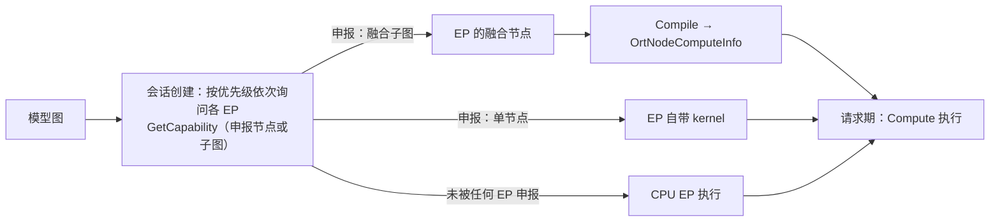
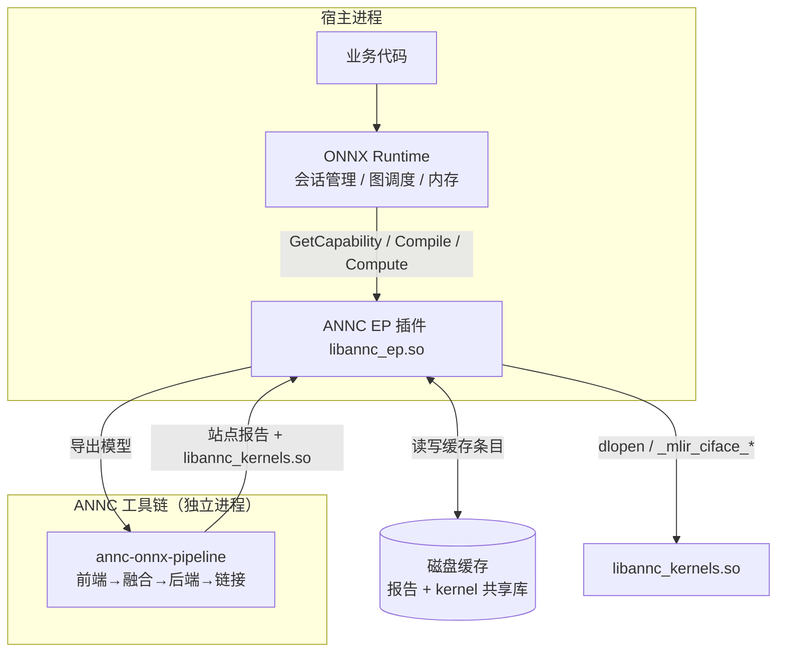
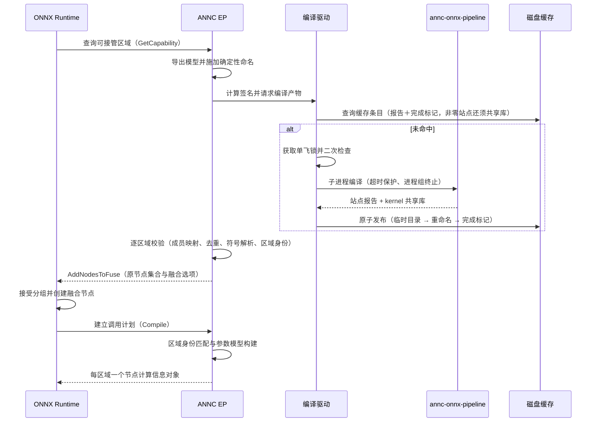
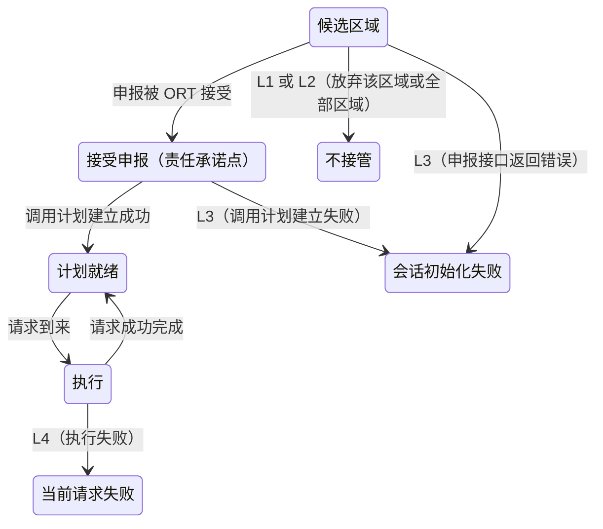

# ANNC ONNX Runtime EP 接入与执行设计

| 文档控制项 | 内容                                                                                                          |
| ----- | ----------------------------------------------------------------------------------------------------------- |
| 文档编号  | ANNC-ONNX-LLD-001                                                                                           |
| 版本与日期 | 1.9，2026-10-16；迁移至新基线 `4c5435fd`：白名单扩至五个 pattern、上下文参数上限与 dtype 调整、参数按名称置换、缓存纳入 kernel 归档身份；线程池新增原生池路径 |
| 文档状态  | 模块设计。描述当前设计意图与实现遵循度，差距见第 10 节                                                                               |
| 评审对象  | ANNC 架构师、框架接入开发、Runtime 开发、测试负责人                                                                            |
| 设计基线  | `addons/onnxruntime/`（源码基线 `4c5435fd`，分支 `upstream/dev`）                                                                      |
| 上级文档  | [ANNC ONNX 支持整体方案设计](overall.md)（重点第 6、7.3–7.7、8 节）                                  |
| 关联文档  | [README](README.md)、[onnx-frontend-design.md](frontend-design.md)、[fusion-design.md](fusion-design.md)、[ADR-012](../../decisions/decisions.md#adr-012)、[ADR-013](../../decisions/decisions.md#adr-013) |

## 1 概述

### 1.1 定位与作用

ANNC EP 是 ANNC 框架对接层中面向 ONNX Runtime 的接入部件。EP 是 Execution Provider（执行提供者）的缩写，表示 ORT 中负责一部分图计算的软件组件。ANNC 的 `AnncExecutionProvider` 使用宿主 AArch64 CPU 执行 kernel，设备枚举呈现该 CPU 上的逻辑执行入口。业务继续使用原模型文件和推理接口，通过插件将已加载的 ONNX 模型接入 ANNC 的编译与执行能力。首期以 CPU 推理会话为验收范围。ANNC 接管符合条件的区域，其余区域按 ORT 的 provider 分配规则交给其他已配置 EP，在首期范围内由 CPU EP 承接。

该部件为既有 ORT 推理服务提供 ANNC 的 CPU 优化能力，业务通过插件注册和设备选择完成接入。其工作方式与 TensorFlow 侧一致：公共编译器划分优化区域，接入层承担模型读取、工具链驱动与执行回接三项职责。

### 1.2 背景：ONNX Runtime 的执行提供者（EP）机制

ONNX Runtime 的执行提供者机制规定了区域分配、编译和执行的接口。以下说明与本设计直接相关的机制。

#### 1.2.1 EP 的定义与作用

ONNX Runtime 通过执行提供者框架对接 CPU、GPU、NPU 等平台的执行库。ORT 自身提供 CPU EP 等内建 EP，同时允许第三方以 EP 形式扩展执行能力。EP 定义软件执行接口，具体实现选择执行硬件。多个 EP 可以共用同一类 CPU，也可以分别使用不同硬件。同一模型可以在会话创建时划分给多个 EP，各段使用各自的实现，业务侧仍通过 ORT 推理接口调用。[Execution Providers 概述](https://onnxruntime.ai/docs/execution-providers/)

#### 1.2.2 运行时的分区与执行模型



该模型包含三个要点。

第一，分区（partitioning）。会话创建时，ORT 按配置的 EP 优先级查询 `GetCapability()`，据此分配节点或子图。本文的“申报”指 ANNC 在该回调中调用 `EpGraphSupportInfo_AddNodesToFuse`，向 ORT 提供拟由替代函数执行的原节点集合及融合选项。站点报告为 EP 提供成员和函数信息，ORT 接受分组后再经 `Compile` 绑定替代函数的计算回调，整个申报过程通过 ORT 进程内接口完成。ANNC 可以在调用申报接口前放弃候选区域，相应节点继续参与 ORT 的正常 provider 分配，在首期 CPU 会话中由 CPU EP 执行。

第二，申报粒度可以是子图。EP 既可以申报单个节点（由自带算子 kernel 执行），也可以将若干节点整体申报为一个融合节点（fused subgraph），由该 EP 负责整个子图的计算。编译器型接入（如 ANNC）采用后一种方式。

第三，编译与执行分离。EP 在会话建立阶段通过编译回调将融合子图转换为计算函数。编译在请求到来前完成，请求执行阶段调用已准备好的计算函数。

#### 1.2.3 插件式 EP 接口

早期 EP 是编译进 ONNX Runtime 的内建组件；ORT 1.22/1.23 起引入插件式 EP 库（plugin EP library），EP 以独立共享库发布，由应用在运行时注册并按会话启用。本设计采用该接口。

| 环节  | 接口                                                              | 语义                                                                                    |
| --- | --------------------------------------------------------------- | ------------------------------------------------------------------------------------- |
| 注册库 | `RegisterExecutionProviderLibrary(名称, 路径)`                      | ORT 加载共享库并调用其导出的 `CreateEpFactories()`；库必须导出 `CreateEpFactories` 与 `ReleaseEpFactory` |
| 工厂  | `OrtEpFactory`                                                  | 声明 EP 名称、厂商、版本与支持的设备；`GetName` 必须与 Ep 实例一致                                            |
| 设备  | `GetSupportedDevices()` → `OrtEpDevice`                         | 工厂针对 ORT 探测到的硬件设备返回“工厂与设备”的配对；一个工厂覆盖多台设备时由 EP 在内部再分区                                  |
| 启用  | `GetEpDevices()` + `SessionOptionsAppendExecutionProvider_V2()` | 会话创建时 ORT 调用 `OrtEpFactory::CreateEp()` 实例化 EP；也可由选择策略自动启用                            |
| 能力  | `OrtEp::GetCapability()`                                        | 经 `OrtEpGraphSupportInfo` 与 `AddNodesToFuse` 提供原节点集合及融合选项；替代函数由后续 `Compile` 的计算信息绑定   |
| 编译  | `OrtEp::Compile()` → `OrtNodeComputeInfo`                       | 为每个被分配的融合子图设置计算函数；`OrtNodeComputeContext` 提供融合节点名与宿主内存分配函数                            |
| 执行  | `OrtNodeComputeInfo::{CreateState, Compute, ReleaseState}`      | 计算状态随会话建立、随请求执行、随会话释放                                                                 |
| 注销  | `UnregisterExecutionProviderLibrary` 等                          | 必须在所有使用该库的会话释放之后执行；`ReleaseNodeComputeInfos` 批量释放计算信息                                 |

版本要点如下：`OrtEpFactory` 自 ORT 1.22 引入；编译式 EP 的完整接口（`GetCapability` 稳定化、`Compile`、`ReleaseNodeComputeInfos` 与 `OrtNodeComputeInfo`）自 1.23 提供；自 1.24 起，EP 亦可选择直接注册算子内核的 kernel registry 形态。本项目以 ORT 1.26.0 为验收基线，采用该版本的编译式 EP 接口。

#### 1.2.4 机制对本设计的约束

| 机制事实              | 对本设计的约束或影响                              |
| ----------------- | --------------------------------------- |
| 申报粒度可以是融合子图       | ANNC 按融合区域整体接管，区域的成员、边界与参数均由编译器决定（§6.3） |
| 分区在会话创建时完成，执行在请求期 | 会话初始化阶段完成编译（§5 D1），请求处理阶段执行已生成的 kernel  |
| ORT 负责调度与张量内存     | 输出由 ORT 分配，EP 提供求得的形状并填写描述符；            |
| intra-op 线程池可经 `KernelContext_ParallelFor` 借用，池对象本身不公开 | kernel 并行复用 ORT 线程池，EP 与 kernel 不自建线程（§6.6） |
| 插件式 EP 是独立发布单元    | 以共享库和注册调用接入现有 ORT 安装（§1.3）              |
| 接口兼容性随版本演进        | SDK 与运行时按同一 ORT 基线版本验收（§2.1），注册使用绝对路径   |

外部资料：[Execution Providers 概述](https://onnxruntime.ai/docs/execution-providers/)、[插件 EP 库总览](https://onnxruntime.ai/docs/execution-providers/plugin-ep-libraries/)、[插件 EP 使用](https://onnxruntime.ai/docs/execution-providers/plugin-ep-libraries/usage.html)、[插件 EP 开发](https://onnxruntime.ai/docs/execution-providers/plugin-ep-libraries/development.html)，机制资料于 2026-10-15 复核，接口行为同时对照本项目源码基线。

### 1.3 设计目标与优先级

| 编号 | 目标                        | 优先级 | 判据                                                                             |
| -- | ------------------------- | --- | ------------------------------------------------------------------------------ |
| G1 | 模型与业务代码零改动接入，仅增加插件注册与设备选择 | 高   | 同一 `model.onnx` 在接入前后语义一致，业务接口不变                                               |
| G2 | 正确性优先于覆盖率：区域通过正确性校验后才可接管  | 最高  | 候选校验失败则交回 ORT 继续正常分配；已接管区域不产生静默错误结果                                            |
| G3 | 故障隔离：候选准备失败放弃接管           | 最高  | 导出、工具链编译或候选检查失败时可放弃该区域或全部区域；申报接口错误使会话初始化失败，ORT 接受后的计划建立与执行失败分别为会话级、请求级错误（§7.1） |
| G4 | 公共编译器负责优化，接入层消费优化结果       | 高   | 公共 Pass 统一完成模式匹配和融合决策，EP 按报告接管区域                                               |
| G5 | 可诊断、可关闭、可由服务切换会话          | 中   | 每类失败有明确的归属阶段；可在创建会话前关闭加速，服务可切换到已验证的 CPU 会话                                     |
| G6 | 会话初始化开销可控且可复用             | 中   | 编译结果按模型语义落盘缓存，后续会话直接复用                                                         |

### 1.4 范围

本模块负责 ORT 侧插件注册、图导出、区域申报、调用计划、执行、缓存复用、编译子进程管理与失败处理。

ONNX 语义转换由前端负责（见 [onnx-frontend-design.md](frontend-design.md)），融合决策与 kernel 实现由公共编译器负责（见 [fusion-design.md](fusion-design.md)），调度与内存管理由 ORT 负责。多机编译分发留待后续设计。首期未实现执行失败后用同一请求重放原 CPU 子图的自动重试（见 §5 D7）。GPU 与 ANNC 的混合分区、设备间数据搬运及 GPU 服务迁移须另行设计与验收。

### 1.5 术语

本文沿用整体方案设计附录 B 的术语（EP、site/融合区域、kernel、AOT、ABI、`mlir_ciface`），并补充如下定义。

| 术语     | 含义                                                                |
| ------ | ----------------------------------------------------------------- |
| 导出命名空间 | EP 导出 ORT 图时施加的确定性重命名体系；报告中的名字均属于该命名空间                            |
| 区域身份   | 融合区域在 ORT 侧的稳定标识，即其成员 ORT 节点 id 的集合                               |
| 调用计划   | 设计概念：由站点报告翻译得到、供执行期使用的参数模型，包括参数到输入或输出槽位的映射、各参数的秩以及输出形状的来源。当前实现对应两套具体机制——上下文路径的参数绑定（`Compile` 优先按名称置换，无名称时按 rank＋元素类型）与兼容路径的用例专用装配，见 §6.3 |
| 主输入    | 设计概念：输出动态维的补全来源。当前实现尚未落地通用规则：上下文路径的输出维度由 kernel 经上下文回调给出，兼容路径按 `{d0,d1,n}` 直接求值，见 §6.3 |
| 责任承诺点  | ORT 接受区域申报、区域进入 ANNC 执行责任的时刻；候选准备失败可放弃接管，申报接口本身及后续阶段的错误按 §7.1 处理  |
| 动态维    | 报告 shape 中以 `-1` 表示的运行期维度；仅允许在该模式、kernel 和形状关系已验证的范围内变化           |
| CPU 重试 | 已接管区域执行失败后，用同一请求重放原 CPU 子图；首期未实现，分区时放弃接管与服务切换 CPU 会话分别见 §7.1、§7.2 |
| 线程池适配器 | 将 ORT 的 `KernelContext_ParallelFor` 适配为 ANNC 线程池抽象的对象；绑定单次 Compute 调用，随调用结束失效（§6.6） |

## 2 设计约束、假设与原则

### 2.1 外部约束

- ORT 插件接口。EP 以独立共享库形式经 ORT 的插件式 EP 接口（工厂、Ep 与节点计算信息三级对象）注册。ORT 定义能力上报、区域分组与执行回调的语义，ANNC 按接口协议提供实现。
- 版本基线。以 ORT 1.26.0 SDK/运行时为验收基线。编译期绑定 ORT API 版本，运行时不做版本检测。
- 运行平台。实现依赖 POSIX 的进程、文件锁与动态库机制，仅支持 Linux 类宿主。
- 配套部署。工具链（pipeline 及其配套工具、kernel 归档）作为独立程序与本插件成套安装。
- 同机前提。编译所在的机器即执行所在的机器，这是运行时编译形态成立的前提。
- 设备与内存。工厂只枚举 CPU 设备，ANNC kernel 要求输入位于宿主可访问的 host 内存。CPU/GPU provider 的启用与优先级在会话创建时确定，整个会话沿用该配置。ANNC 尚无设备 allocator、data-transfer 或 stream 实现，GPU device pointer 不可直接传入 ANNC kernel。

### 2.2 关键假设

| 编号 | 假设                                | 若不成立的影响          | 现状                                                              |
| -- | --------------------------------- | ---------------- | --------------------------------------------------------------- |
| A1 | 被接管的计算可表示为无状态函数，全部依赖和结果均由显式输入输出表达 | 区域无法安全接管         | 由公共融合 Pass 的闭包规则保证                                              |
| A2 | 缓存身份能够区分所有影响生成代码的模型语义，包括常量        | 错误复用其他语义的 kernel | 尚不完整，当前常量摘要缺口见 §6.2 与 GAP-01                                    |
| A3 | ORT 负责输入张量视图与输出缓冲区分配              | EP 需自行管理内存       | 成立。内存归 ORT 所有，EP 填写 memref 描述符                                  |
| A4 | 报告边界端点可与 ORT 融合节点输入输出建立唯一对应       | 参数或输出槽位错位        | 输入优先按名称置换绑定、无名称时按 rank＋元素类型绑定（上下文路径），或按秩与类型扫描操作数（兼容路径）；名称不可解析的重复 rank／多输出站点在申报前丢弃，上下文路径在同一参数命中两个输入时拒绝，兼容路径取首个匹配且无此拒绝；输出沿用报告索引与 ORT 槽位相同的隐式顺序，显式端点核对待补，见 §6.3 与 GAP-04 |

### 2.3 设计原则

1. 融合决策统一。公共 Pass 完成模式匹配并产出站点报告，EP 按报告申报融合区域。
2. 契约检查前置。符号解析、成员映射、实参名称回译与参数/输出槽置换等可前置检查均在申报与 `Compile` 阶段执行（见 §6.3）。候选校验失败时即放弃接管，将问题限制在责任承诺点之前。
3. 失败按阶段处理。候选准备中的导出、工具链编译或区域检查失败时，放弃该区域或全部区域；申报接口返回错误时，按 ORT 错误语义结束会话初始化。ORT 接受申报后，调用计划建立失败导致会话初始化失败，执行失败导致当前请求失败。CPU 重试边界与状态模型见 §7.1。
4. 职责按层划分。lowering、目标后端与 kernel 实现归工具链负责；EP 通过导出的模型文件、子进程调用与产物目录交换数据。
5. 保守优先。收益与正确性冲突时，优先保证正确性：可以减少接管范围，但不得产生错误结果。

## 3 总体设计

### 3.1 上下文与分层



EP 位于框架对接层，向上适配 ORT 的 EP 接口，向下通过 ONNX 模型、站点报告与共享库对接工具链。EP 独立构建，编译和链接均与 ANNC 编译期类型及目标解耦。

### 3.2 组件分解与职责

| 组件       | 职责                                                                         | 依赖                |
| -------- | -------------------------------------------------------------------------- | ----------------- |
| 图导出器     | 将 ORT 图视图序列化为自包含的 ONNX 模型，并施加确定性重命名                                        | ORT 图视图、ONNX 序列化器 |
| 模型签名器    | 将导出模型的编译语义与部署身份形成稳定摘要，供编译驱动判定产物是否可复用；摘要应覆盖常量、工具链及 EP 版本、目标 ISA、ABI、配置和缓存格式 | 图导出器产物、部署身份与编译配置  |
| 编译驱动     | 定位并调用 pipeline 子进程；管理缓存条目、单飞锁、超时与工作目录                                      | 工具链、文件系统          |
| 站点消费与申报器 | 读取站点报告，将报告成员映射回 ORT 节点，逐区域校验后申报                                            | 报告契约、ORT 图        |
| 调用计划器    | 将报告的参数与输出契约绑定到 ORT 融合节点：上下文路径优先按名称置换绑定输入（无名称时按 rank＋元素类型），兼容路径按秩与类型扫描操作数                                  | 站点报告、融合节点输入       |
| 执行器      | 每次请求构造携带线程池适配器的执行上下文（上下文路径）或申请输出缓冲区（兼容路径）、组装 memref 描述符、调用 kernel（上下文路径检查返回码，兼容路径为 void 调用、不读取状态）                        | 调用计划、符号表、线程池适配器（§6.6） |
| 符号表      | 进程级的共享库与符号解析缓存，含失败负缓存                                                      | 动态库加载器            |

上述组件构成单向依赖链：导出、签名、编译、申报、计划、执行；反向仅存在诊断数据流（调试与计时输出）。

### 3.3 依赖关系与边界

- EP 独立于 ANNC 编译期目标构建；ORT 符号由宿主提供，链接方式与 TF addon 相同。
- EP 与工具链之间的媒介有三种：导出的 ONNX 文件、子进程调用及其退出码、产物目录（报告与共享库）。
- EP 按公共元数据契约（FusionMetadata）读取报告：字段语义由 [fusion-design.md](fusion-design.md) 定义，EP 负责校验与翻译。

### 3.4 关键流程

会话初始化阶段的主要交互过程如下。



请求执行阶段的处理顺序为：读取输入地址与形状，组装 memref 描述符，调用 kernel。主路径（上下文 ABI）由 kernel 经上下文回调申请输出缓冲区，并读取 kernel 返回的 int32 状态；兼容的 `mlir_ciface` 路径由 EP 按 `{d0,d1,n}` 求得输出形状并申请缓冲区，按秩与元素类型绑定输入，调用后不读取 kernel 状态。

### 3.5 状态与生命周期

生命周期设计遵循进程级共享、会话级隔离的分层原则。其中会话级隔离在当前实现中尚不完整（见 §10）。

| 状态           | 归属           | 生命周期语义                                                             |
| ------------ | ------------ | ------------------------------------------------------------------ |
| 已加载的共享库与符号   | 进程级          | 持续保留至进程结束；解析失败形成负缓存                                                |
| 编译驱动的定位与工具链指纹 | 能力查询级（当前实现） | 驱动为每次能力查询的局部对象：定位、启用状态与工具链指纹按次探测、不跨查询复用（每次查询都重新执行 `--toolchain-info`）。进程级长生命周期状态只有已加载的共享库与符号负缓存（§6.5）                    |
| 已发布缓存条目      | 磁盘级          | EP 创建并复用；配额、保留期限与清理由发布及运维配置管理，当前没有自动 LRU 淘汰                        |
| 导出模型与编译工作目录  | 任务级（当前实现） | 每次能力查询在缓存根下新建 `tmp-<pid>-<序号>` 导出目录；编译驱动为本次查询局部对象；能力查询全程持有实例级状态锁；工作目录按缓存签名复用。剩余缺口：临时导出目录不回收、多实例与多进程并发的压力验证缺失（GAP-03，见 §10） |
| 已申报区域与区域身份   | 会话级          | 随会话存在，用于 Compile 阶段的匹配                                             |
| 调用计划与节点计算信息  | 会话级          | 随融合节点存在，持有已解析的函数指针                                                 |
| 线程池适配器        | 调用级          | 每次执行构造并写入本次调用的执行上下文（ABI v3 `thread_pool`），随 Compute 调用结束回收（§6.6）；已实现，GAP-08 已闭合      |

## 4 接口与契约

### 4.1 对 ORT 的接口

| 接口面  | 设计要点                                                                                                                                                           |
| ---- | -------------------------------------------------------------------------------------------------------------------------------------------------------------- |
| 工厂级  | 提供设备枚举（仅接受 CPU 设备）、Ep 的创建与释放、能力与身份上报。插件式 EP 接口要求一组“头文件标注为可选、实现方必须提供”的回调（allocator、data-transfer、stream 与 vendor 信息），缺失将导致宿主加载失败                                |
| 会话级  | 实现能力查询、编译（建立调用计划）、释放计算信息与名称四个回调，完成 CPU 区域的接入                                                                                                                   |
| 区域申报 | `GetCapability` 通过 `AddNodesToFuse` 向 ORT 提供完整的原成员节点集合与融合选项，`Compile` 再绑定替代函数；`drop_constant_initializers=false` 保留融合节点边界上的 initializer 输入，区域内部常量按工具链的常量处理规则传递 |
| 错误语义 | 候选准备失败时放弃该区域或全部区域接管；申报接口返回错误时透传 ORT status 并使会话初始化失败；接受申报后的调用计划建立失败与执行失败分别为会话级、请求级错误（§7.1）                                                                     |

工厂只把 ORT 探测到的 CPU 设备与 ANNC EP 配对。业务在创建会话时选择 ANNC、CPU 或其他 provider，执行期沿用已建立的分区。若另行配置 GPU EP，区域执行与跨设备 copy 由 ORT 和相应 GPU provider 管理，这种混合配置须另行验收。原有 GPU 服务接入 ANNC 时，应先建立 CPU 路径的正确性基准，验证模型、算子语义、精度和输入输出搬运。请求使用的 provider 和设备路径按会话配置确定。

### 4.2 对工具链的接口

| 项     | 设计约定                                                             |
| ----- | ---------------------------------------------------------------- |
| 调用方式  | 以子进程方式调用 pipeline 工具，并继承宿主环境，使 ANNC 侧开关对编译生效                     |
| 定位顺序  | 环境变量指定（绝对路径）→ 插件同目录 → 上级 bin 目录 → PATH。指定的环境变量路径无效时直接判定为不可用，结束定位 |
| 参数    | 模型路径与输出目录；工作目录即输出目录                                              |
| 退出码语义 | 0 表示完成（含零区域情形）；非 0 表示失败。调用方据此决定是否接管                              |
| 超时    | 子进程超时默认 600 秒；超时后以进程组为单位终止                                       |
| 工具链指纹 | 由 pipeline 的 `--toolchain-info` 提供（十个配套工具的路径、大小与时间戳），并计入缓存键      |

### 4.3 站点报告契约（消费方视角）

报告的公共定义见 [fusion-design.md](fusion-design.md) 第 6 节。消费契约包含两层判断：报告是否符合公共契约，以及其中站点是否属于 EP 的执行集合。公共契约允许表示 `aot`、`jit` 及不同 ABI，`annc_execution_v2` 也是合法站点类型。EP 的消费流程是：检查公共 schema，按 execution_mode、abi 与 pattern 过滤出当前执行集合内的站点，再校验区域与运行数据契约。工具链用 `--atir-prune-func=execution-mode=aot` 只把 execution_mode=aot 且带 fusion.pattern 的 func 送入后端与共享库，JIT 站点因此没有产物；站点报告由 prune 之前的融合模块生成，可能包含这些无产物站点，EP 在申报前将其过滤或按缺符号丢弃。当前主路径为 `abi=annc_execution_v2` 的上下文站点，`abi=mlir_ciface` 为兼容路径，其他模式或 ABI 的站点按超出执行范围处理，报告合法性仍按公共契约判定。

对主路径 `aot + annc_execution_v2` 站点，EP 消费成员节点名单、kernel 符号名、实参和输出契约；该 ABI 使用上下文调用协议，`kernel_arg_order` 必须为空。兼容的 `aot + mlir_ciface` 子集要求三项参数排列显式给出并与预期排列一致（见下表）。报告名字属于导出命名空间：成员名经导出映射解析为原图节点（节点名映射）；实参张量名在申报期回映射到原图后，`Compile` 按名称建立参数与输出槽置换；仅当站点不带名称时才回退到按秩与元素类型绑定，两条路径都不读取 `kernel_arg_order` 来装配输入。重复 rank 或多输出站点要求名称全部可解析，否则在申报前丢弃。输出端点与融合节点实际输出的核对仍待实现（GAP-04）。

当前实现要求顶层 schema 为 `annc-ep-site-report/1`，读取 rank/shape、成员和符号等字段，**不读取 `contract_version`**。参数排列不会在缺省时自动补 identity：兼容站点要求显式三项排列并校验取值，缺失或取值不符即按无效站点丢弃。申报前已按 execution_mode 与 abi 过滤，要求 `execution_mode=aot`，模式白名单为 `matmul`、`tensordot_matmul`、`masked_mul`、`layer_norm`、`batched_matmul_add`（`annc_ep_site.cc`），被丢弃的站点保留原因日志。各项检查的实际覆盖如下表；“剩余缺口”列即 GAP-04 的收敛范围。

| 契约字段 | 申报前检查 | 计划建立与执行时检查 | 剩余缺口 |
| --- | --- | --- | --- |
| 顶层 schema | 必须等于 `annc-ep-site-report/1`，否则整份报告按未命中处理并触发重建 | — | `contract_version` 未读取 |
| pattern、execution_mode、abi | 白名单（`matmul`、`tensordot_matmul`、`masked_mul`、`layer_norm`、`batched_matmul_add`）、`aot`、`annc_execution_v2` 或 `mlir_ciface` | 按 abi 分发调用路径 | 其他 pattern 与 ABI 的覆盖 |
| 成员节点名单 | 非空、去重 | 与融合子图的节点 id 集合匹配（区域身份，D5） | — |
| kernel 符号 | 申报前预解析（`dlopen`/`dlsym`），失败即丢弃该区域 | 执行时按符号取函数指针 | 失败解析写入进程级负缓存，更新需重启进程 |
| 参数 name/role/rank/shape/dtype | 上下文站点：参数 1–14 个，名称与 role 非空、rank 0–4、shape 长度等于 rank、输入 dtype 为 f32 或 i64；重复 rank 或多输出时要求名称全部可解析，否则丢弃该区域；兼容站点：恰 2 个参数（秩 3 dynamic、秩 2 fixed），**不校验 dtype** | 上下文路径优先按名称置换绑定（`Compile` 建立参数与输出槽置换），无名称时按 rank＋元素类型绑定，未命中或**二义时拒绝**；兼容路径按首个匹配的秩 3／秩 2 浮点输入装配，**无二义拒绝**（额外输入被忽略） | 兼容站点无 dtype 校验；两条路径的固定维数值均未校验 |
| kernel_arg_order | 上下文站点必须为空数组；兼容站点必须为三项排列且等于预期值（`matmul` 为 `{0,1,2}`、`tensordot_matmul` 为 `{1,0,2}`） | 执行期绑定不读取该字段（按秩与类型绑定） | M6 要求的通用排列装配未实现 |
| outputs | 上下文站点：非空、role 为 `output`、rank 0–4、shape 长度等于 rank、dtype 为 f32；兼容站点：恰 1 个输出（rank 3），**不校验 dtype** | 上下文站点在计划建立时校验输出数量与融合子图一致，每次执行校验全部输出槽位已写入且秩/元素类型与契约相符（含维度存在且非负）；兼容路径固定只分配槽位 0 | 输出端点身份与报告索引、ORT 槽位的显式对应 |
| 动态维（shape 中的 `-1`） | — | 上下文路径直接使用 kernel 给出的维度，EP 校验维度存在且非负 | 工具链声明并经校验的维度关系求值 |

表中未标注路径的行对两条路径同样成立；“上下文站点／兼容站点”的限定只适用于对应路径——二义输入拒绝、dtype 校验与通用多输出分配均为上下文路径的能力，兼容路径是固定签名的单输出路径。

### 4.4 运行数据契约

| 契约         | 设计要点                                                                                                     |
| ---------- | -------------------------------------------------------------------------------------------------------- |
| memref 描述符 | 当前主路径（`annc_execution_v2` 上下文）与兼容的 `mlir_ciface` 均使用固定秩 memref 布局（两个指针、偏移量、各维大小与步长）；执行器以请求实际维度填充描述符，数据地址必须是 host 内存                       |
| 参数排列       | 主路径（`annc_execution_v2`）的 `kernel_arg_order` 为空；`Compile` 按站点名称建立参数与输出槽置换，无名称时回退按秩与元素类型绑定。兼容的 `mlir_ciface` 中，报告须给出完整三项排列并与预期值一致，但执行期绑定同样按秩与类型扫描操作数，未读取该排列。导出形参与函数内部算子 schema 各按自身契约排列（三层区分见 §6.3） |
| 输出内存       | 输出缓冲由 ORT 分配：上下文路径由 kernel 经 `allocate_output` 回调给出槽位与维度，兼容路径由 EP 计算维度后申请。输出端点→报告索引→ORT 槽位须有唯一对应，当前仅隐式采用 `outputs[k]` 对应槽位 k，显式核对待补                |
| 形状契约       | 设计目标是由 EP 按固定声明或已验证的输入关系求得每个输出维；当前实现中上下文路径的维度由 kernel 提供、EP 仅校验秩与元素类型及维度非负，兼容路径按 `{d0,d1,n}`（输入前两维与权重末维）直接求值。动态维的变化须满足 kernel 支持范围                                              |
| 返回值        | 上下文路径读取 kernel 返回的 int32 状态（非 0 视为执行失败）并检查输出槽位是否全部写入；兼容的 `mlir_ciface` 函数指针类型为 `void (*)(void*,void*,void*)`，调用后不读取 kernel 状态。契约期望接口能报告错误，该保障当前仅在上下文路径成立（§6.3）                                                          |
| 容量约束       | 上下文路径接受 1 至 14 个 kernel 实参（外加执行上下文，逐参组装 memref 描述符），输入 dtype 为 f32／i64、输出为 f32，实参与输出秩均不超过 4；兼容的 `mlir_ciface` 路径按 legacy 校验分支的秩与参数容量约束；容量与声明秩在申报前拒绝，固定维数值等其余前置检查待补              |

### 4.5 配置接口

| 变量                                       | 作用                          | 默认值            |
| ---------------------------------------- | --------------------------- | -------------- |
| `ANNC_EP_PIPELINE` / `ANNC_EP_CACHE_DIR` | 工具链路径 / 缓存根目录               | 自动查找 / 用户缓存目录链 |
| `ANNC_EP_COMPILE`                        | 取值为 0 时完全禁用运行时编译，是关闭加速的配置入口 | 启用             |
| `ANNC_EP_COMPILE_TIMEOUT_S`              | 子进程超时                       | 600            |
| `ANNC_EP_DEBUG` / `ANNC_EP_TIMING`       | 诊断输出 / 执行计时                 | 关闭             |
| `ANNC_EP_NOOP` / `ANNC_EP_KEEP_TEMPS`    | 测量辅助（分配输出但不计算）/ 保留失败编译的工作目录（§6.2.3）   | 关闭             |
| `ANNC_EP_NUM_THREADS`                    | 声明 intra-op 并行度，供 kernel 并行判定与规模选择，不参与正确性（§6.6） | 未接线：当前实现不读取该变量，适配器按硬件并发度取值 |
| `ANNC_EP_NATIVE_POOL`                    | 取值为 0 时禁用按 ORT 私有布局读取 operator pool 的原生池路径，回落到公开 `KernelContext_ParallelFor`（§6.6）；原生路径还要求宿主版本匹配编译期常量 `ANNC_EP_NATIVE_POOL_ORT_VERSION`（默认 `1.26.0`，非环境变量） | 启用 |
| `ANNC_EP_SHARDS`                         | 限制公开 API 路径的分片数；不影响原生 cost/grain 调度或 MLAS | 按内部估计 |

这些配置的读取时机不同。编译驱动为每次能力查询局部创建：定位、启用状态与工具链指纹都按次探测、不跨查询复用，因此替换工具链或修改 `ANNC_EP_PIPELINE`、`ANNC_EP_CACHE_DIR`、`ANNC_EP_COMPILE`、`ANNC_EP_COMPILE_TIMEOUT_S`、`ANNC_EP_KEEP_TEMPS` 在下次能力查询即生效，无需重启进程。`ANNC_EP_DEBUG` 在工厂创建时读取并存入进程全局；`ANNC_EP_TIMING`、`ANNC_EP_NOOP` 在首次访问时静态记忆，此后不再读取环境——尤其 `ANNC_EP_NOOP` 一旦首次启用，删除变量或新建会话都不会刷新该记忆值。原生池可用性（`ANNC_EP_NATIVE_POOL` 与宿主版本校验）在进程内首次求值时记忆一次。需要新进程才能刷新的是进程级的长生命周期状态——已加载的共享库句柄与符号负缓存（§6.5）。`ANNC_EP_NUM_THREADS` 当前实现未读取（见 §6.6 与 §10），接入后按进程级配置处理、变更须重启进程生效。

### 4.6 契约不变量

| 编号 | 不变量                                                                     |
| -- | ----------------------------------------------------------------------- |
| I1 | 每个已申报成员归属唯一的区域                                                          |
| I2 | 报告引用的 kernel 符号在申报前必须可解析（`dlopen`/`dlsym` 成功）                           |
| I3 | 主路径（`annc_execution_v2`）的 `kernel_arg_order` 为空，参数优先按名称置换绑定（无名称时按秩与元素类型）融合节点输入；兼容的 `mlir_ciface` 中调用计划是“\[实参…输出…]”索引空间上的完整排列，当前执行期绑定同样按秩与类型扫描操作数。输出端点、报告索引与 ORT 槽位唯一对应 |
| I4 | 每个输出槽位在每次执行中分配一次；上下文路径的输出形状由 kernel 给出、EP 校验其秩与元素类型符合契约，兼容路径按 `{d0,d1,n}` 求值；显式维度关系的校验通过后才可接管                      |
| I5 | 非零站点缓存条目在报告、共享库与完成标记齐备后，零站点条目在报告与完成标记齐备后，才对读者可见                                            |
| I6 | kernel 执行期间可用的并行运行时由执行器写入本次 Compute 的执行上下文并随调用结束回收，适配器不跨请求、不跨线程保留          |

I1、I2 与 I3 的参数装配检查已实现（上下文站点另校验参数秩互异与 dtype 为 f32）；I3 的输出端点核对、I4 的显式形状关系与固定维校验仍是目标契约；I6 已随并行执行接入（GAP-08 已闭合）落地。差距见 §10。

## 5 关键设计决策

| 编号 | 决策                             | 理由                                                        | 备选与代价                                                                     |
| -- | ------------------------------ | --------------------------------------------------------- | ------------------------------------------------------------------------- |
| D1 | 运行时编译（会话初始化时编译并配合磁盘缓存）作为唯一形态   | 客户端与服务端同机，可免除产物分发协议与版本匹配；缓存未命中的会话承担编译开销，后续会话可复用有效缓存       | 备选为离线 AOT 加 manifest 或模型改写，但需维护产物与模型的绑定、分发与匹配协议，该路径已从仓库删除。代价是冷缓存初始化包含编译开销 |
| D2 | 公共 Pass 统一划分融合区域，EP 按报告的成员名单申报 | 优化规则集中在公共编译器，边界来源唯一，便于验证                                  | 备选为 EP 内建匹配器，但会造成逻辑重复并易与编译器产生偏差；不完整分组可能留下重复计算或额外边界开销，收益需实测                |
| D3 | 申报前完成符号解析与成员校验                 | ORT 接受申报即为责任承诺点，此后的区域失败分别按会话级或请求级处理（§7.1）；预校验失败时可直接放弃候选区域 | 代价是每个区域需要一次符号解析，由进程内缓存摊销                                                  |
| D4 | 磁盘缓存配合跨进程单飞锁与原子发布              | 多会话或多进程并发初始化时避免重复编译；读者在产物完成发布后才可访问                        | 代价是缓存目录成为信任边界（§8.3）；锁等待当前无期限，属待收敛项                                        |
| D5 | 区域身份采用成员 ORT 节点 id 的集合         | 成员 id 可关联报告中的导出名字与 Compile 阶段的原图，跨命名空间保持区域身份一致            | 代价是集合比较的复杂度为 O(n²)；区域规模较小，可以接受                                            |
| D6 | 内存所有权归 ORT，形状求值由 EP 消费工具链契约后完成 | 复用 ORT 分配器及其生命周期管理，形状关系由工具链契约独立表达                         | EP 必须保证输出形状正确；当前上下文路径由 kernel 提供维度、兼容路径按 `{d0,d1,n}` 求值，显式关系与校验待补                                 |
| D7 | 首期不实现执行失败后的原 CPU 子图重试          | 同一请求重放原区域需要保留 CPU 执行计划，并处理中间缓冲、输出写回与调度语义；ADR-005 已确立该边界   | 执行失败导致当前请求返回错误（§7.1 L4）；服务可切换已预热且验证的 CPU 会话，是否重放整次请求由服务决定                 |
| D8 | 共享库句柄与失败负缓存保留至进程结束             | 简化生命周期管理，避免在活动调用期间卸载                                      | 代价是长进程多模型场景下的资源占用，以及缓存失效后的隔离问题（§10）                                       |
| D9 | 并行执行复用 ORT intra-op 线程池，经 `KernelContext_ParallelFor` 适配接入 | 线程总量与调度由 ORT 统一管理，无两套线程池叠加，与 ORT 自身 CPU kernel 的并行行为一致 | 备选为 EP 自建线程池：需独立的线程生命周期与资源管理，并与 ORT 线程池形成线程数叠加和调度竞争。代价是 EP 接口无法查询会话线程数，须由配置声明（§6.6） |

## 6 核心机制设计

### 6.1 图导出与确定性命名

#### 6.1.1 导出对象与序列化

导出发生在 `GetCapability` 内，对象是 ORT 交给 EP 的当前主图。控制流子图带有父节点标记，无法作为自包含模型序列化（引用外层作用域值、initializer 不在子图内），检测到父节点时本次查询不申报（L1）。序列化复用 ORT 提供的图转 ONNX 辅助器（随 ORT 版本 vendored，仅重定向包含路径）：辅助器按拓扑序遍历图并填充 ModelProto，EP 不自行遍历 ORT 图结构。

#### 6.1.2 确定性命名

ORT 图中的张量名可能为空、重复，或由上游组件自由生成，不能作为两侧的精确引用基础。导出侧按下表统一重命名：

| 对象 | 命名规则 |
| --- | --- |
| 节点 i（拓扑序） | `n<i>` |
| 节点 i 的第 p 个结果 | `t<i>_<p>` |
| 图输入 k | `in_<k>` |
| initializer k | `w_<k>` |
| value_info k | `v_<k>` |

重命名分两遍完成：先按上表建立"原名 → 导出名"的一张映射，再用该映射统一重写节点名、节点输入输出、图输入输出、value_info 与 initializer 名；单一映射服务于全部引用位置，图内引用一致性由构造保证，未命中映射的名字原样保留。

命名与 ORT 图节点下标保持对应：序列化遍历顺序与 `Graph_GetNodes` 返回的拓扑序一致，导出节点 `n<i>` 即该序列的第 i 个 `OrtNode`。这一对应关系是 §6.3 成员回映射的基础，属于导出契约的一部分。

#### 6.1.3 保留映射与导出产物

导出完成后，EP 保留供回接使用的映射：导出节点名到节点下标、张量原名与导出名的双向映射。映射的生命周期为单次 `GetCapability` 调用，随申报完成释放。

导出模型写入缓存根下按 PID 与递增序号生成的独立目录（`<缓存根>/tmp-<pid>-<n>/model.onnx`），每次能力查询新建一个，目录当前不回收（GAP-03）。initializer 为 ORT 已加载并内联的值，随图一并写入；编译子进程从该自包含文件读取全部数据。工具链使用导出命名空间处理模型并生成报告；EP 以导出映射把报告成员名还原为原图节点（§6.3）；实参张量名的双向映射当前只生成、不消费。确定性命名使同一模型多次导出的字节差异限于易变字段，有利于保持缓存身份稳定（§6.2）。

### 6.2 缓存身份与发布协议

#### 6.2.1 语义摘要与升级隔离

缓存身份应覆盖所有决定编译结果或执行兼容性的因素。目标键包含模型结构与常量、工具链及 EP 构建版本、目标架构与 ISA 特性、ABI、报告和缓存格式版本，以及影响代码生成的配置。模型权重、插件、工具链、目标 ISA/ABI 或编译配置发生变化时，新部署应使用新的缓存命名空间。存活进程继续使用原库，服务完成切换后再清理旧命名空间。

当前实现的签名由三段构成：模型结构签名前缀 `annc-ep-cache-key-v1`（`annc_ep_graph_export.cc`）、工具链+配置指纹（`annc_ep.cpp` 的 `CacheToolchainFingerprint`，前缀 `annc-ep-config-v1`，把 `ANNC_EP_PIPELINE`、`ANNC_GEMM_CONFIG`、`ANNC_GEMM`、`ANNC_KERNEL_LIB_PATH`、`ANNC_CLANG`、`LIBRARY_PATH`、`CPATH`、`C_INCLUDE_PATH`、`CPLUS_INCLUDE_PATH` 以长度前缀编码），以及 kernel 归档身份（同函数追加 `annc-ep-kernel-libs-v1`，逐一记录 `ANNC_KERNEL_LIB_PATH` 下每个 `.a` 的大小与修改时间）。签名对前缀、工具链指纹与规范化模型字节求 SHA-256，缓存目录使用固定 `v1` 命名空间。规范化剔除 producer 元数据与图名；initializer 载荷**仅在图中同时含 `Mul` 与 `MatMul` 时保留数值**（其余情况清空数值字段），以覆盖可被折叠进 BMM kernel 的常量。EP 身份、目标 ISA、ABI 与完整编译配置尚未全部纳入，升级失效规则也待补齐（GAP-01）。

该缺口在以下条件下可能触发：两个模型结构、同名 initializer 的形状与类型相同，数值不同，且常量进入生成代码（属性化或随体保留通道，见 [fusion-design.md](fusion-design.md) §4.4），而该图又不在“同时含 `Mul` 与 `MatMul`”的保留集合内。它们可能共用缓存键，后创建的会话因而加载与自身常量语义不符的 kernel，调用仍可能返回成功。模型仅更新权重是必须覆盖的验证场景。上述静默错误风险由源码推导，尚待端到端实测。GAP-01 与执行路径覆盖/验证缺口（GAP-02）、并发导出覆盖（GAP-03）同属 P0 收敛项，见 [README](README.md) §7。

#### 6.2.2 发布与复用

EP 的编译驱动负责创建缓存条目并复用已发布产物。发布协议要求先在独立工作目录完成编译，再整体重命名进缓存条目并写入完成标记。读取侧的命中条件为：完成标记与报告齐备、报告可解析，且非空报告还须有共享库；零站点报告不带共享库即可命中。报告解析失败或缺库按未命中处理，获锁后再次检查缓存并重建，避免重复编译。锁仅由驱动持有，生命周期止于驱动释放。共享库加载失败与符号缺失不在命中检查范围内：缓存条目按命中接受，对应站点在申报阶段被丢弃并写入进程级负缓存，不触发重建（§6.5）。

#### 6.2.3 保留与清理责任

发布及运维根据模型数量、磁盘预算与服务周期配置 quota、retention 和清理任务。当前 EP 尚无 LRU 或基于容量的自动淘汰，清理须分别管理三类资源：已发布条目按部署命名空间及保留策略清理；导出模型、`.work` 和锁文件按任务状态清理，避开活动编译；进程内 `dlopen` 句柄与符号负缓存依 §6.5 管理，保留至进程结束。`ANNC_EP_KEEP_TEMPS` 只控制失败工作目录（`<条目>.work`）的保留，成功条目的中间文件与 `tmp-<pid>-<n>` 导出目录不受其控制，且导出目录当前不回收（§10）。

编译驱动不保留跨查询状态（§4.5）。部署升级或同路径缓存修复时，应创建新命名空间，并重启服务进程或切换新进程，以刷新库映射与符号负缓存；磁盘条目按各自保留策略清理。

### 6.3 区域申报与调用计划

区域申报将报告中的候选成员名单转换为 ORT 融合分组。目标流程逐区域执行以下检查和操作：

```
公共契约可消费 → 执行模式与 ABI 可执行 → 成员与边界可映射且不重叠
→ 符号可解析 → dtype/秩/固定维/参数排列/形状关系可验证 → 区域身份可记录
→ AddNodesToFuse → ORT 接受 → Compile 建立调用计划
（申报接口之前的候选校验失败：丢弃该区域；申报接口及后续失败：按 §7.1 处理）
```

当前已实现成员映射（节点名）、去重、符号解析、区域身份记录，以及按 execution_mode、abi 与 pattern 白名单的执行子集过滤；实参张量名在申报期回译到原图，`Compile` 按名称建立参数与输出槽置换，无名称时回退按秩与元素类型绑定（§4.3）。完整运行契约检查（固定维、输出端点与槽位）与结构化的丢弃原因诊断仍待补齐（见 §10）。

回接机制按三个阶段落地，均以导出契约（§6.1）为基础：

| 阶段 | 机制 |
| --- | --- |
| 申报（GetCapability） | 报告成员名 `n<i>` 经导出映射解析为原图节点指针（依赖 `n<i>` ↔ 拓扑序第 i 个节点的对应）；以本次调用内已申报成员集合拒绝区域重叠；申报前预解析 kernel 符号（D3）；成员 ORT 节点 id 集合记录为区域身份（D5）；同时把实参张量名回译到原图；`AddNodesToFuse` 提交完整成员集合，`drop_constant_initializers=false` 保留边界 initializer 输入 |
| 计划（Compile） | ORT 将被接受的分组实例化为融合节点并回调 `Compile`，交付的子图即被申报的成员块。EP 提取子图成员的节点 id 集合，与申报记录的区域身份匹配；融合节点名由 ORT 生成（形如 `<provider>_sub_graph_<n>`），不承载区域信息，因此区域身份以 id 集合表达。随后登记调用契约：上下文站点校验输出数量与融合子图一致并记录各参数与输出的秩、元素类型，并**按名称建立参数与输出槽置换**（名称缺失或不可解析、且站点重复 rank 或多输出时拒绝申报）；无名称的站点推迟到首次执行按 rank＋元素类型绑定（二义或未命中即拒绝）。任一环节失败使会话初始化失败（L3） |
| 执行（Compute） | 构造携带线程池适配器的执行上下文（上下文路径）或按 `{d0,d1,n}` 求输出形状并申请缓冲区（兼容路径）、读取输入并绑定参数、组装 memref 描述符、调用 kernel（上下文路径检查返回码，兼容路径为 void 调用、不读取状态）（§3.4、§6.6） |

调用计划把报告语义与运行数据解耦，包含参数装配、边界槽位映射及形状求值规则。参数顺序区分三层，与 [fusion-design.md](fusion-design.md) 对齐。

| 层次            | 契约与责任                                                                                                                                       |
| ------------- | ------------------------------------------------------------------------------------------------------------------------------------------- |
| 区域逻辑输入输出      | 报告 `args[]` 与 `outputs[]` 表示有序边界，形成“\[实参…输出…]”索引空间；每项仍有独立端点身份                                                                               |
| 导出函数形参        | 主路径（`annc_execution_v2`）无 `kernel_arg_order`，`Compile` 按站点名称建立参数与输出槽置换（无名称时按秩与元素类型）；兼容的 `mlir_ciface` 中，`kernel_arg_order[p]` 指明形参 p 使用哪个逻辑条目，仅用于申报前的排列校验；执行器按秩与类型扫描操作数装配，不读取该排列来构建通用装配                                                                          |
| 函数内部算子 schema | 工具链按内部 schema 完成调用 lowering。上下文站点的 schema 以 `Result` 描述输出（FTDMM 为 `(input, weight) -> output`）；兼容站点（如 matmul 家族）的内部 schema 以 output 为首项，导出形参与逻辑槽位的对应由 `kernel_arg_order` 记录 |

输入侧的绑定规则按路径分叉（§4.3 校验矩阵）：上下文路径优先按名称置换绑定（名称缺失或不可解析时按 rank＋元素类型），兼容路径按秩与类型扫描操作数；两条路径都可能在出现同排名同类型的额外界外输入时需要拒绝。输出侧的目标是建立“原图输出端点 → 报告 `outputs[]` 索引 → ORT 融合节点输出槽位”的唯一映射，并逐项核对输出数量、名称或端点身份、dtype 与形状。

兼容路径只有单输出：按 `{d0,d1,n}` 求值并分配槽位 0。主路径（上下文 ABI）的多输出由 kernel 侧经上下文回调按声明槽位分配，“槽位 k 对应报告 `outputs[k]`”是目标约定。输出端点与融合节点实际输出的核对仍待实现；多输出区域尤其需要验证上述映射（GAP-04）。

动态形状在 shape 中以 `-1` 标明运行期维度，执行器将本次输入的实际维度写入 memref 描述符。AOT kernel 在请求前生成，同一 kernel 可支持已验证模式允许的动态维度，例如 batch 变化。请求期复用已生成的 kernel，输入须满足该模式的 dtype、声明秩、固定维和动态维约束。执行时的 dtype 与秩复核已在输出分配侧落地（元素类型、秩、维度存在且非负）；固定维的数值复核仍待实现（GAP-04）。

输出形状的当前实现按路径分叉：上下文路径由 kernel 经 `allocate_output` 提供维度，EP 只校验维度数量与契约秩一致、取值非负并核对元素类型；兼容路径由 EP 按 `{d0,d1,n}`（秩 3 输入的前两维与秩 2 权重的末维）直接求值。两条路径都不消费工具链声明的维度关系。涉及 reshape、拼接或跨输入取维的其他输出关系，须由工具链显式声明，并由 EP 扩展求值与校验后接入。融合侧与消费侧的完整走查见 [fusion-design.md](fusion-design.md) §5.2 的贯穿示例。

目标契约要求 EP 消费工具链声明且经验证的输出维度关系，在候选阶段拒绝关系不明或超出求值能力的区域，并在执行时复核请求。EP 先求得输出形状，ORT 再按该形状分配缓冲区；后续扩展形状关系仍沿用这一分工。

### 6.4 编译隔离与资源控制

编译由独立子进程承担，宿主根据退出状态和超时结果处理编译器崩溃、无响应等故障。超时后按进程组终止，覆盖 clang 等派生进程。驱动捕获标准输出用于诊断，标准错误直接输出至宿主；产物在独立目录生成后再发布。

资源控制的目标是覆盖工具定位、指纹计算、签名、锁等待与编译的全过程，并限制编译异常对宿主的影响。当前已实现子进程超时，完整初始化预算仍待补齐（见 §10）。

### 6.5 符号解析与生命周期

符号表以库路径与符号名为键，供进程内各会话共享，用于申报前预校验（D3）和执行期获取函数指针。解析失败后，同路径同符号直接命中负缓存。解析成功的句柄保留至进程结束，以避免活动调用期间的卸载竞态，资源占用随加载库数量累积。

不同库路径可承载多个模型。已有映射与负缓存持续引用原路径，磁盘删除、同路径替换或会话释放后仍然保留。发布升级须用新库路径隔离；刷新库映射和负缓存须重启服务进程或切换新进程。

### 6.6 并行执行接入

生成 kernel 的并行能力来自统一的线程池抽象：kernel 经 `resolveThreadPool` 取池——优先取上下文携带的池，未提供时回退线程局部的当前线程池，两处都没有时退化为串行执行。TF 侧由 ANNCFusedOp 在每次调用前将 TF 线程池注入 kernel 库的 TLS；ONNX EP 已实现线程池注入：`OnnxExecutionContext` 填充上下文 ABI v3 的 `thread_pool` 字段，`OrtThreadPool` 把 ANNC 区间任务适配为 `KernelContext_ParallelFor` 逐索引回调（GAP-08 已在新基线上闭合）。

实现方式复用 ORT 的 intra-op 线程池。ORT 不通过公开接口暴露线程池对象，但提供借用入口 `KernelContext_ParallelFor`（自 ORT 1.17 提供，位于 1.26.0 验收基线内）：该接口把 total 个迭代调度到当前会话的 intra-op 池上动态负载均衡执行，调用返回即全部迭代完成；会话未启用 intra-op 池（如单线程会话）时在调用线程上串行完成，不构成失败。

除公开入口外，实现另有**原生池路径**（`annc_ep_native_pool.h`）：按与宿主版本绑定的 ORT 私有布局直接取出 operator pool（`kThreadPoolSlot`），经版本校验（`ANNC_EP_NATIVE_POOL_ORT_VERSION`）后调用其 `TryParallelFor`／固定块调度。该路径默认启用，`ANNC_EP_NATIVE_POOL=0` 或版本不匹配时回落公开 `KernelContext_ParallelFor`。原生池使用私有 ABI，须链接宿主同源构建的归档；FTDMM/BMM 的 MLAS 路径仅在 `native_pool()` 非空时启用，其余情况走标量行路径（完整开关与回落条件见 [addons/onnxruntime/README.md](../../../addons/onnxruntime/README.md)）。

执行器的接入流程在两条宿主路径上分别实现，取池语义相同（kernel 均经 `resolveThreadPool` 取池，上下文优先）：

```
ONNX 路径（当前实现）
ComputeWithContext
  → 构造绑定本次 OrtKernelContext 的线程池适配器
  → 与三个回调一并写入本次执行的上下文（ABI v3 的 thread_pool 字段）
  → 组装 memref 描述符并调用 kernel（kernel 内部经适配器提交并行循环）
  → 调用返回后随上下文一并回收

TF 路径（对照，见 ADR-013）
ANNCFusedOp
  → 以 RAII 把 TF 线程池安装为当前线程的线程池（TLS）
  → 调用 kernel；上下文未携带池，kernel 回退取 TLS 池
  → 调用返回后恢复原线程池状态
```

| 设计要素 | 约定 |
| --- | --- |
| 适配器职责 | 实现 ANNC 线程池抽象；派发顺序：原生池可用且报出 `cost_per_unit` 时走 `TryParallelFor`，仅报 `grain_size` 时用固定块调度，均不可用时回落到公开 `KernelContext_ParallelFor(kernel_context, trampoline, total, num_batch, &fn)`（逐索引提交、每个任务调用一次区间回调 `[i, i+1)`，`num_batch` 由 `grain_size` 折算，上限为 `num_threads()`） |
| 线程池归属 | 复用 ORT intra-op 池，EP 与 kernel 均不自建线程，不存在两套线程池的线程数叠加 |
| 线程数感知 | 原生池路径读取 ORT operator pool 的真实并行度；公开路径因 EP 接口无法查询会话 intra-op 线程数，`num_threads()` 仅供 kernel 的并行判定与规模选择、不参与正确性，返回硬件并发度（下限 2、上限 256）作为建议上界，**无法单独配置**（`ANNC_EP_NUM_THREADS` 未接线，见 §4.5）。“与会话 intra_op_num_threads 一致设置”列为该变量接入后的验收项 |
| 嵌套防护 | `in_parallel_region()` 以线程局部标记实现，kernel 内的嵌套并行按串行执行 |
| 生命周期 | 适配器仅在本次 Compute 调用栈内有效（I6），不跨请求、不跨线程保留；并发请求在各自调用线程上独立安装与回收 |
| 失败语义 | `KernelContext_ParallelFor` 返回错误（池不可用）时释放 ORT status 并在本线程内联执行整段，不视为失败；`ANNC_EP_DEBUG` 下打印回退原因 |

正确性约定：首期模式的 kernel 均按行或元素划分并行，行内累加顺序不变，多线程与单线程会话的全部输出应逐位一致；该一致性连同并行收益（动态 batch、大形状）、线程数声明与会话配置的一致性、小形状站点的任务提交开销，列入性能与端到端验收（§8.4、§8.6）。实现现状的剩余风险：EP 与 kernel 必须同源构建——`thread_pool` 句柄背后的 C++ 虚表不在上下文尺寸/版本校验覆盖内；原生池依赖 ORT 私有布局，须随宿主版本重新验证；嵌套并行判定依赖 `thread_local`；池不可用时会静默回退到本线程执行整段。MLAS 路径默认关闭，其性能结论不适用于默认标量路径。

### 6.7 执行上下文协议（ABI v3）

`annc_execution_v2` 站点的上下文路径由执行上下文承载宿主状态，协议要点如下。

| 项 | 约定与当前实现 |
| --- | --- |
| 结构版本与尺寸 | 上下文尾部的不透明 `thread_pool` 句柄在 v3 引入；校验同时接受 v3（按结构尺寸与版本号 3 匹配）与 v2（按 `ANNC_EXECUTION_V2_CONTEXT_SIZE` 与版本号 2 匹配）并拒绝其余错配，保证旧宿主的小结构不会被越界读取 |
| 回调 | `allocate_output`：先做不触碰 ORT 的检查（槽位范围、是否重复分配、秩与元素类型对契约、维度存在且非负），再经 `KernelContext_GetOutput` 由 ORT 创建并分配，随后复核取回的类型与数据指针。`allocate_temp`：零字节请求不分配、返回空指针；支持置零标志（分配后清零）；分配记录在上下文内。`report_error`：上报执行错误，保留首个 |
| 错误语义 | 保留首个上报的错误，其后上报的状态一律释放且不覆盖首个。`GetOutput` 之前的检查失败不触碰 ORT 状态；但 ORT 在类型与数据指针复核之前已创建输出槽位，其后失败会留下已分配的输出缓冲——失败不会回滚已申请的 ORT 输出，其生命周期仍由 ORT 管理；“不触碰 ORT 侧状态”只对 `GetOutput` 之前的失败成立，失败本身仍按 fail-closed 传给 ORT |
| 内存与生命周期 | 输出由 ORT 分配与持有；临时内存经 ORT 分配器取得，但由 EP 的执行上下文析构释放（连同分配器句柄）。上下文绑定单次 Compute 调用，不跨请求、不跨线程保留 |
| 线程池 | kernel 经 `resolveThreadPool` 取池：先取上下文携带的池；上下文未提供时回退本库 TLS 注入的池；两处都为空时 `parallel_for` 按串行执行（空池视同 `num_threads == 1`） |
| 参数绑定 | 上下文路径在 `Compile` 期按站点名称建立参数与输出槽置换；无名称或名称不可解析时按 rank＋元素类型解析；同一参数被两个输入命中时 fail-closed，拒绝该次执行（§6.3）。兼容路径按首个匹配项装配，无此拒绝 |

## 7 失败模型与降级策略

### 7.1 失败分类

失败按发生阶段处理。区域依次经历候选、ORT 接受申报、计划就绪和执行四个状态。会话初始化时，EP 先校验候选站点，再在 `GetCapability` 中通过 `AddNodesToFuse` 提供完整原节点集合。ORT 接受分组后，ANNC 承担该区域的执行责任；`Compile` 建立调用计划与计算回调，成功后进入计划就绪状态。请求期由 `Compute` 执行。

导出、工具链编译或区域校验失败时，EP 可以放弃该区域或全部候选区域，相关节点继续按 ORT 的正常规则分配。申报接口返回错误（含非法融合分组）时，当前 EP 透传 status，会话初始化失败。ORT 接受申报后，调用计划建立失败按会话级错误处理，执行失败按当前请求错误处理。自动 CPU 重试尚未实现。



在状态模型基础上，本设计按影响范围将失败分为四级，语义逐级上升。

| 级别      | 发生阶段            | 触发条件                                        | 语义                                         | 设计理由                                          |
| ------- | --------------- | ------------------------------------------- | ------------------------------------------ | --------------------------------------------- |
| L1 不接管  | 候选准备阶段          | 当前图为控制流子图、驱动不可用、图导出或指纹或签名失败、工具链编译失败         | 本次图能力查询不申报区域，节点继续正常分配；首期 CPU 会话由 CPU EP 执行 | 故障尚未改变区域执行责任，可放弃接管                            |
| L2 丢弃区域 | 候选区域校验阶段        | 模式或 ABI 不属于支持集合、成员不可映射或重复、符号不可解析、参数或边界契约不满足 | 放弃该区域，其他合格候选仍可申报                           | 区域级问题在区域范围内处理；其中完整执行子集与运行契约过滤待补               |
| L3 会话失败 | 申报接口调用或接受后的计划建立 | `AddNodesToFuse` 返回错误；调用计划无法为已接受区域建立        | 会话初始化失败                                    | 当前申报错误直接返回 ORT；已接受区域在 `Compile` 中建立计划失败时须显式报错 |
| L4 执行失败 | 责任承诺点之后（执行）     | 内核未解析、计划不完整、输入秩超限、输出形状不可确定、kernel 返回非 0     | 该次请求返回错误                                   | 依 D7 将错误返回调用方，供诊断与服务侧处理                       |

### 7.2 降级与关闭加速

降级按 §7.1 的阶段边界实施：候选准备失败时放弃接管，相关节点继续参与 provider 分配；已接受区域发生错误时，会话初始化或当前请求失败。

自动重试需要保存失败请求的输入并重放原 CPU 子图，还需保留 CPU 执行计划、安排调度并处理已写出的中间结果。这些机制首期尚未实现。当前可用的服务侧措施是切换到另一个已预热并验证的 CPU 会话，由服务决定后续请求的路由以及失败请求是否重新提交。具体手段如下。

| 手段      | 路径                                              | 语义                                                    |
| ------- | ----------------------------------------------- | ----------------------------------------------------- |
| 配置关闭    | 设 `ANNC_EP_COMPILE=0`，或创建会话时不启用 ANNC EP | 不产生 ANNC 接管；该开关在下次能力查询即生效（驱动按次探测，§4.5）                            |
| 缓存修复    | 隔离损坏条目，在新命名空间受控重建并切换或重启进程                       | 报告解析失败或缺库已按未命中处理并在锁内重建（§6.2）；共享库加载失败与符号缺失被负缓存至进程结束，修复须换路径或新命名空间并重启进程（§6.5） |
| 服务侧会话切换 | 预热并验证 CPU 会话，加速异常时切换后续请求                        | 属服务流程；失败请求的再次执行须由服务显式决定                               |

### 7.3 可诊断性设计

诊断按三层设计：会话级汇总（接管与丢弃计数、签名与缓存状态）、区域级明细（各区域的锚点、kernel 名与丢弃原因）、执行级计量（输入、输出与 kernel 三段耗时）。实现约定为：诊断信息输出至标准错误，由 `ANNC_EP_DEBUG` 与 `ANNC_EP_TIMING` 分级开启；当前未接入 ORT Logger（见 §10）。

## 8 质量属性设计

### 8.1 正确性与可靠性

正确性目标是通过契约检查和保守接管保障结果：校验通过后接管，执行失败时按请求错误处理（§4.6、§7.1）。申报前已按 execution_mode、abi 与 pattern 白名单（`matmul`、`tensordot_matmul`、`masked_mul`、`layer_norm`、`batched_matmul_add`）过滤，并对上下文站点校验参数 1–14、rank 0–4、输入 dtype 为 f32／i64、输出 f32、重复 rank／多输出的名称可解析与输出契约；执行时校验输出槽位的秩、元素类型以及维度存在且非负。当前待补的检查包括契约版本过滤、固定维校验、输出端点与槽位核对，以及显式形状关系求值（GAP-04）。上下文站点（`annc_execution_v2`）为主路径，`mlir_ciface` 为兼容路径。上述风险来自源码分析，仍需 ORT 端到端用例验证。

### 8.2 并发与隔离

目标是支持多会话并存，并使同一签名的编译单飞。当前每次能力查询使用独立的 `tmp-<pid>-<序号>` 导出目录，编译驱动为查询局部对象，同一 EP 实例上的能力查询由实例级状态锁串行化，同签名编译由跨进程 flock 协调。已不再存在“固定导出路径被并发覆盖”的机制依据；剩余待验证项为多实例与多进程并发下的行为（实例锁不跨实例）、临时导出目录不回收，以及缺少并发压力与竞态测试证据（GAP-03，属证据缺口）。

### 8.3 安全

| 信任边界  | 设计规则                                                      |
| ----- | --------------------------------------------------------- |
| 磁盘缓存  | 缓存中存有将被执行的共享库，只允许受信身份写入，读取前应校验完整性                         |
| 模型输入  | 导出 ORT 已加载的图并内联 initializer，编译所需数据由导出文件提供                 |
| 编译子进程 | `fork`/`exec` 提供进程级故障隔离，子进程的访问权限仍由宿主授权决定；交付时需限制工具路径与可访问目录 |
| 生成代码  | kernel 在宿主进程内执行，越界或不兼容指令会直接影响宿主；通过运行接口检查与目标兼容测试降低风险       |

### 8.4 性能与资源

稳态请求路径依次执行张量访问、输出形状求值与分配、描述符组装和 kernel 调用。编译发生在会话冷启动阶段，包含模型导入、融合与链接；完整缓存命中可避免重复编译。EP 负责缓存生成与复用，发布及运维负责磁盘配额、保留期与清理。当前磁盘淘汰依靠运维任务，进程内库句柄和符号缓存持续累积。并行执行复用 ORT intra-op 线程池（§6.6），无独立线程池的线程数叠加；性能验收须覆盖动态 batch 与大形状下的并行收益、线程数声明与会话配置的一致性，以及小形状站点的任务提交开销。CPU/GPU 混合配置的 copy 和调度开销须单独测量，形成该配置自身的基准。

### 8.5 可维护性与可移植性

报告复用公共 FusionMetadata 契约，EP 按同一格式校验和消费。组件保持单向依赖（见 §3.2），新增能力优先由工具链实现，EP 专注接入职责。平台移植须适配 §2.1 所列的 POSIX 进程、文件锁与动态库语义。

### 8.6 可测试性与失败注入设计

失败模型（§7.1）需要通过外部配置触发各级失败，并断言相应的外显行为。注入使用三个接口：`ANNC_EP_PIPELINE` 将编译子进程替换为测试桩，返回构造的报告或产物；`ANNC_EP_CACHE_DIR` 指向预置缓存；测试条目中的 `libannc_kernels.so` 提供受控桩共享库。不同场景须使用独立进程或独立缓存路径，以隔离进程级共享库句柄与符号负缓存。各级失败的注入方式与断言目标如下。

| 级别 | 注入方式                                                                             | 预期外显行为（断言目标）                          |
| -- | -------------------------------------------------------------------------------- | ------------------------------------- |
| L1 | 将 `ANNC_EP_PIPELINE` 指向不存在的路径，或指向必然以非 0 退出的桩                                     | 会话正常创建；申报数为 0；模型由 CPU EP 执行；调试输出含失败原因 |
| L2 | 以桩 pipeline 返回构造的报告，逐项注入申报前会被拒绝的缺陷：ABI 不在支持集合、成员名不属于导出命名空间、kernel 符号不存在（均要求在申报前丢弃该区域）                     | 被注入的区域不计入申报数，其余区域照常申报；调试输出给出对应的丢弃原因   |
| L3 | 以桩 pipeline 返回成员与 ABI 合法、但输出数量与融合子图不一致的上下文站点报告（在 `Compile` 建立计划时失败） | 会话初始化失败；失败信息可定位到区域或站点                 |
| L4 | 使用合法的上下文站点报告，注入执行期故障：以桩共享库令目标符号返回非 0（仅上下文路径读取该状态）；或构造参数二义（两个输入命中同一参数）、kernel 分配契约外槽位等首次 Compute 即可复现的场景                              | 该次请求返回错误；执行级诊断可定位到失败区域                |

断言按 §7.3 分为会话级、区域级和执行级。工具定位、编译失败与报告解析可在驱动层独立验证；成员映射、申报结果、计划建立及执行错误须由 ORT 宿主端到端用例验证。还应覆盖同一会话中已验证动态 batch 的多次请求、固定维或 dtype 不匹配拒绝、多输出端点与槽位一致性，以及 CPU 正确性基准；并行接入后，同一站点在多线程与单线程会话下的全部输出须逐位一致，并覆盖线程数声明与会话配置不一致时的行为（§6.6）。当前夹具已覆盖驱动缺失、编译失败、报告损坏、符号缺失、库缺失、零站点、并发与执行错误等场景（清单见 §10 GAP-07），L1–L4 的完整等级矩阵、动态形状与边界映射用例仍待补齐，属 GAP-07。失败隔离与 GPU 服务迁移须分别通过相应用例后验收。

## 9 扩展点与演进

### 9.1 新增融合模式

公共 Pass 新增模式后，EP 按报告接入。接入条件是模式属于 EP 支持的 ABI 与执行集合、参数容量和输出形状关系可验证、边界端点可唯一映射。当前执行集合为 `aot + annc_execution_v2`（主路径）与兼容的 `aot + mlir_ciface`，模式白名单为 `matmul`、`tensordot_matmul`、`masked_mul`、`layer_norm`、`batched_matmul_add`。新模式采用其他动态形状关系或 ABI 时，须先扩展相应契约与执行路径，经验证后再申报。

### 9.2 新增调用约定

站点标签 `annc_execution_v2` 对应执行上下文调用协议（结构版本 v3，见 §6.7 与 ADR-013；各标识的命名区分见 [README](README.md) §2）；它符合公共契约且已是当前主路径：EP 按该协议构造执行上下文与张量描述符，输出由 kernel 经上下文回调分配，上下文路径返回整型状态。`mlir_ciface` 为兼容路径，其完整参数排列条件归属该 ABI（当前执行期绑定未读取排列，见 §4.3）。上下文执行路径与申报前的 ABI/执行模式过滤均已接入（详见 ADR-013）；后续演进为扩展其他 pattern 与 ABI 的覆盖（见 [fusion-design.md](fusion-design.md) §11）。

### 9.3 多会话与多模型演进

多会话演进需明确两类状态：符号表、部署期间固定的工具链指纹等可同步的进程共享状态，以及导出目录、编译工作目录等每任务私有状态。同时补齐初始化和加载预算，并对接运维的配额、保留及清理流程。版本和配置更新通过新命名空间及进程切换刷新共享状态。后续若引入句柄回收，须确认活动调用全部结束、存活计划引用归零后，再决定卸载时机。

## 10 现状与目标差距

| 编号     | 主题          | 设计目标                                                              | 当前实现                                                                            | 影响                                                |
| ------ | ----------- | ----------------------------------------------------------------- | ------------------------------------------------------------------------------- | ------------------------------------------------- |
| GAP-01 | 缓存身份        | 常量、EP 与工具链版本、目标 ISA、ABI、代码生成配置及格式版本参与摘要，升级进入新命名空间                 | 固定版本串、工具链+配置指纹、kernel 归档 size+mtime 身份与规范化模型结构；initializer 载荷仅在“同时含 Mul 与 MatMul”的图中保留；字段覆盖不足；签名按次重算，进程级复用仅限共享库句柄与符号负缓存                                       | 满足 §6.2 条件时可能复用错误 kernel，产生静默错误结果（P0，源码推导风险）      |
| GAP-02 | v2 调用约定执行路径 | v2 上下文站点为主路径；申报前按 execution_mode 与 abi 过滤，`mlir_ciface` 作为兼容路径保留         | 上下文执行路径（ABI v3）与申报前 ABI/执行模式过滤已接入；覆盖为 AOT 四个上下文站点（#11–#14），其余 pattern 与端到端验证待补                                                          | 原「v2 站点被错误装配」的风险已收敛；剩余为 pattern 覆盖与端到端验证（P0 收敛中） |
| GAP-03 | 并发隔离        | 每任务独立工作目录；驱动状态线程安全                                                | 每次能力查询在缓存根下新建 `tmp-<pid>-<序号>` 导出目录；编译驱动为本次查询局部对象；能力查询全程持有实例级状态锁；同签名编译由跨进程 flock 串行 | 旧的“进程级固定导出路径、驱动无互斥”依据已过时；尚未验证的剩余项为临时导出目录不回收、多实例与多进程并发下的行为，以及缺少并发压力与竞态测试证据（P0，证据缺口）     |
| GAP-04 | 契约校验        | 申报前验证 dtype、秩、固定维、参数排列、输出端点与槽位及显式形状关系；执行前复核实际数据契约                 | 逐字段覆盖见 §4.3 校验矩阵：schema、白名单、成员、符号、上下文站点的参数数/rank/输入 dtype/名称可解析与输出契约、兼容站点的排列取值，以及执行时的输出秩、元素类型与维度检查均已落地 | 剩余缺口集中在契约版本未读取、固定维数值未校验、输出端点身份未核对、显式形状关系未求值；不匹配时可能返回错误或写错槽位                         |
| GAP-04 | 报告的消费过滤     | 公共报告合法性与 EP 可执行子集分开判断；申报前按契约版本、执行模式、ABI 和产物过滤，并记录丢弃原因             | 申报前已按 pattern 白名单（`matmul`、`tensordot_matmul`、`masked_mul`、`layer_norm`、`batched_matmul_add`）、执行模式（`aot`）与 ABI 过滤，被丢弃站点带原因输出到标准错误；产物符号缺失仍按丢弃处理，丢弃原因未接入 ORT Logger                              | 合法报告中的不可执行站点已不会被接管；剩余为诊断通道与丢弃原因的可观测性                    |
| EP-L01 | 缓存健壮性       | 损坏产物视为未命中并受控重建；零区域结果可复用                                           | 报告解析失败或缺库按未命中处理，获锁后二次检查并重建；零站点报告可无共享库热命中；`KEEP_TEMPS` 控制失败工作目录的保留。共享库加载失败与符号缺失不触发重建，只丢弃站点并负缓存                                                              | 报告损坏与缺库已可重建；“零区域无法热命中”的旧结论已不适用；剩余影响集中在库加载失败与符号缺失的恢复路径须换路径或重启进程                                              |
| EP-L02 | 资源与生命周期     | 总初始化与加载预算；条目、工作文件和句柄分开管理；发布运维配置 quota/retention/清理；升级使用新命名空间与进程切换 | 仅子进程超时；锁无期限；无自动淘汰；句柄及负缓存不释放；临时导出目录不回收，`KEEP_TEMPS` 仅覆盖失败工作目录                                     | 初始化等待与长期资源增长缺乏上限，新会话无法刷新全部升级状态                    |
| EP-L03 | 可诊断性        | 结构化的失败记录；接入 ORT Logger                                            | 标准错误上的调试输出，部分丢弃路径无输出                                                            | 故障定位依赖人工排查                                        |
| GAP-07 | 失败注入测试      | L1–L4 各级失败具备可注入触发与外显断言，覆盖动态形状及边界映射等正确性基准（§8.6）                    | 已注册并随 ctest 运行：`annc-ep-compile-test`（站点校验 18 例）、`annc-ep-execution-test`（执行上下文与参数绑定 16 例）、`AnncEpAotFixture`（正常、缺符号、缺库、报告损坏、并发、缓存配置、缺驱动、编译失败、零站点）、`AnncEpContextFixture`（正常、多线程、嵌套、并发、同会话、执行错误、坏槽位），以及 `AnncEpFtdmmAotE2e` 与四个上下文端到端用例（`AnncEpFtdmmContextE2e`、`AnncEpMaskedMulContextE2e`、`AnncEpLayerNormContextE2e`、`AnncEpBatchedMatMulAddContextE2e`，按 pipeline 目标条件注册）；L1–L4 的完整等级矩阵、动态形状与边界映射用例尚未落地                                                           | 现有用例覆盖站点校验、执行上下文与有限端到端链路，尚不足以证明完整失败隔离与发布门禁（P0，发布阻断）                         |
| GAP-08 | 并行执行接入       | Compute 调用前把绑定 OrtKernelContext 的线程池放入执行上下文，复用 ORT intra-op 池（§6.6）          | 已实现：EP 经 ABI v3 的 `thread_pool` 字段注入适配器，kernel 经 `resolveThreadPool` 取池（§6.6），已在新基线上闭合；另有受版本校验的原生池路径与默认关闭的 MLAS 路径                               | 剩余风险：EP 与 kernel 必须同源构建（`thread_pool` 句柄背后的 C++ 虚表不在上下文尺寸/版本校验覆盖内）；原生池私有布局须随宿主版本重新验证；嵌套并行判定依赖 `thread_local`；池不可用时静默回退本线程执行 |

编号沿用 [README](README.md) 第 7 节的全局差距登记；`EP-Lxx` 为仅在本模块记录的局部差距，编号稳定、不复用。登记项多数对应整体方案设计中的风险（R-01 至 R-13）与工作包（WP-03/04），治理与实施沿用这些登记。

## 附录 A 源码位置索引（文件级）

| 源码                                           | 内容                                                           |
| -------------------------------------------- | ------------------------------------------------------------ |
| `addons/onnxruntime/annc_ep.cpp`             | EP 主体：符号表、参数绑定与执行、工厂与 Ep 及节点计算信息回调、C 入口                     |
| `addons/onnxruntime/annc_ep_site.cc`         | 站点校验：上下文站点与兼容站点两套规则、模式白名单（§4.3）                       |
| `addons/onnxruntime/annc_ep_execution.{h,cc}` | 执行上下文构造与三回调、线程池适配器、输出槽位分配与校验（§6.7）                     |
| `addons/onnxruntime/annc_ep_native_pool.h`   | 原生 operator pool 私有布局镜像、宿主版本校验与可用性判定（§6.6）                    |
| `addons/onnxruntime/annc_ep_compile.{h,cc}`  | 编译驱动：工具定位、子进程执行与超时、缓存条目与锁、报告解析                               |
| `addons/onnxruntime/annc_ep_graph_export.cc` | 图导出后的确定性重命名、哈希与模型签名                                          |
| `addons/onnxruntime/ort_graph_to_proto.h`    | 随 ORT 版本 vendored 的图到 ONNX 序列化器（含一处 ANNC 修改：字符串 initializer） |
| `addons/onnxruntime/annc_ep_compile_test.cpp`、`annc_ep_execution_test.cpp` | 站点校验与执行上下文的 GTest 单测（清单见 §10 GAP-07） |
| `addons/onnxruntime/tests/`                  | ctest 宿主夹具与端到端用例（AOT、上下文、FTDMM）                                     |
| `addons/onnxruntime/CMakeLists.txt`          | 可选插件构建（默认关闭，要求外部 ORT SDK 头文件目录）                              |
| `addons/onnxruntime/README.md`               | 使用说明与接入示例。其中少量表述与代码不符，见 §10 与各节注记                            |
| `annc/lib/Support/ThreadPool/`               | ANNC 线程池抽象：线程局部安装接口与并行入口；EP 侧适配器按 §6.6 接入，TF 侧适配见 `tensorflow_addons/annc_fused_op.cc` |

