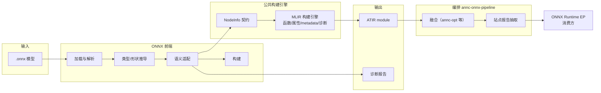
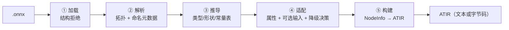
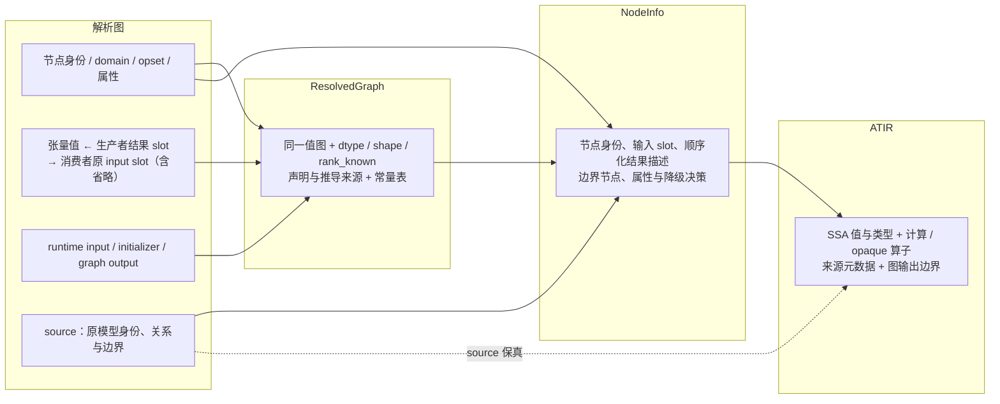

# ANNC ONNX 前端设计

| 文档控制项 | 内容                                                                                    |
| ----- | ------------------------------------------------------------------------------------- |
| 文档编号  | ANNC-ONNX-LLD-002                                                                     |
| 版本与日期 | 1.9，2026-10-20；复核并迁移至新基线 `c1622b87`（原基线 `4c5435fd`）；补充 Gemm 形状推导事实，GTest 计数更新为 52 |
| 文档状态  | 模块设计。描述当前设计意图与实现遵循度，差距见第 10 节                                                         |
| 评审对象  | ANNC 架构师、前端开发、融合与后端开发、测试负责人                                                           |
| 设计基线  | `frontends/onnx/`（源码基线 `c1622b87`，分支 `upstream/dev`）                                                    |
| 上级文档  | [ANNC ONNX 支持整体方案设计](overall.md)（重点第 7.1、8.1 节与附录 A）           |
| 关联文档  | [README](README.md)、[ep-design.md](ep-design.md)、[fusion-design.md](fusion-design.md)、[ADR-011](../../decisions/decisions.md#adr-011)、[ADR-013](../../decisions/decisions.md#adr-013) |

## 1 概述

### 1.1 定位与作用

ONNX 前端是 ANNC 框架对接层中的语义翻译部件，负责将 ONNX 模型的图结构、张量、属性与算子语义转换为框架无关的 ATIR。优化决策与代码生成由后续公共模块完成。

ONNX 与 TensorFlow 在算子含义（例如同名的 Sum）、属性位置（轴作为属性或操作数）、默认值与广播规则上存在差异。前端依据各框架规范完成语义适配，使公共 Pass、lowering 与 kernel 可以统一处理 ATIR。

转换以整张模型图为对象。前端读取图结构与算子版本，按 ONNX 规则解释输入、属性、广播与轴语义，再通过共享构建引擎组织成已有 ATIR 算子图。每个新增 ONNX 算子都需要对应版本的转换规则和等价性验证。生成的 ATIR 随后进入公共优化、lowering 与目标后端，复用已有 Pass 和 kernel 实现。

### 1.2 设计目标与优先级

| 编号 | 目标                             | 优先级 | 判据                            |
| -- | ------------------------------ | --- | ----------------------------- |
| G1 | 忠实性优先：转换结果必须与 ONNX 语义一致        | 最高  | 以已确认的语义为依据，无法等价表达时显式降级并记录原因   |
| G2 | 无静默丢弃：每个模型节点均有明确去向             | 最高  | 映射、降级为 opaque 与硬错误三者必居其一，且可对账 |
| G3 | 复用公共构建引擎，前端只提供框架专属语义           | 高   | 函数构造、属性应用与诊断与 TF 前端同源         |
| G4 | 局部降级：其余区域照常融合与编译               | 高   | 不支持的节点以 opaque 占位，其余图照常进入融合   |
| G5 | 可诊断、可对账：导入结果可由程序与人工核对          | 中   | 诊断报告包含逐节点审计行与守恒自检             |
| G6 | 可演进：新增算子、opset 与 dtype 以数据扩展为主 | 中   | 通过映射表与规则扩展支持面，保持处理流程稳定        |

### 1.3 范围

在范围内：模型加载、图解析、类型与形状推导、常量解码、语义适配、算子映射表、ATIR 构建、导入诊断，以及端到端编排工具 `annc-onnx-pipeline`。

职责交接：融合与优化见 [fusion-design.md](fusion-design.md)，EP 接入见 [ep-design.md](ep-design.md)，算子实现与后端由相应公共模块负责。公共构建引擎由共享模块维护，本文定义前端与它的接口。

### 1.4 术语

本文沿用整体方案设计附录 B 的术语，并补充如下定义。

| 术语           | 含义                                                           |
| ------------ | ------------------------------------------------------------ |
| NodeInfo     | 前端与公共构建引擎之间的节点描述契约，由各框架前端共用                                  |
| 类型与形状信息模型    | 推导结果由类型、形状、秩是否已知与来源标记四个维度共同刻画，允许部分维度未知                       |
| 降级（fallback） | 将无法等价映射的节点保留为 `atir.opaque` 占位，并记录原因                         |
| 边界节点         | 前端为图输入、initializer 与图输出合成的节点，分别为 Input、Constant 与输出 Identity |
| 守恒自检         | 诊断报告中用于核对模型侧节点数与模块侧内容是否一致的字段                                 |

## 2 设计约束、假设与原则

### 2.1 外部约束

- ONNX 规范。兼容性须结合 IR、opset 与 domain 判断，这三者共同决定算子语义。默认导入要求默认域（空 domain 或 `ai.onnx`）的 opset 为 13。非默认 domain 节点可保留为 opaque；其他 opset 的分析导入与 EP 运行认证条件见 §6.6。
- 下游契约。产出的分析图符合公共 ATIR 契约，供公共融合处理；选中的可执行区域再满足 AArch64 后端条件。前端不得引入公共模块无法承载的表达。
- 进程边界。前端为独立工具（可由 pipeline 以子进程方式调用），不依赖 TensorFlow 运行时；仅启用 ONNX 的构建可以关闭 TF 前端。

### 2.2 关键假设

| 编号 | 假设                                         | 若不成立的影响                                   |
| -- | ------------------------------------------ | ----------------------------------------- |
| A1 | 模型为推理图且结构静态，控制流与本地函数不在导入范围内                | 整模型拒绝导入，并报告相关结构                           |
| A2 | 信息模型能区分已知秩的动态维、未知秩与未知 dtype                | 缺失信息只在候选转换依赖它且无法证明等价时导致降级；运行能力仍须由模式契约判断   |
| A3 | 图输出边界可用 Identity 边界节点显式表示，并与 TF 前端保持同一约定   | 公共构建引擎的输出收集契约需要修改                         |
| A4 | 需要物化或用于静态转换的 initializer、Constant 载荷在编译期可读 | 运行期计算的轴或 shape 值保留为动态信息；转换若必须读取这些值则无法建立映射 |
| A5 | 下游（EP）按节点名回映射原图；实参张量名回译用于重复 rank 或多输出站点的参数绑定 | `tf.*` 兼容元数据必须完整保真——节点名与实参张量名均为当前消费路径；重复 rank 或多输出站点依赖名称解析，其余站点按 rank＋元素类型绑定（详见 [ep-design.md](ep-design.md) §6.3） |

### 2.3 设计原则

1. 忠实翻译。前端保持计算语义；合并、消除与重排由公共 Pass 完成。
2. 按等价性决定降级。信息模型显式承载未知 dtype、维度或秩，保持未知项，避免猜值或以默认值顶替。已知秩且部分维未知的张量继续以动态维表达。候选转换依赖缺失信息且无法证明等价时才降级，例如无法归一化显式轴、无法生成缺省 perm，或无法静态构造 Squeeze 输出。运行期 axes 已提供但值未知时须保留这一状态；axes 未提供时才适用缺省轴规则。常量物化的 dtype 约束见 §6.3。
3. 结构性、非法输入与能力不足分级处理。结构上无法表达（控制流、外置数据、依赖环）或已确认违反 schema 的模型按硬错误处理；合法但暂不支持的算子、属性组合或无法证明等价的转换按逐节点降级处理。当前实现未完整校验 schema，其缺口见 §10。
4. 表驱动。算子支持面由声明式表格描述，处理流程按表执行。
5. 引擎共享、语义隔离。与 TF 前端共用构建引擎，映射表与转换器分别维护。

## 3 总体设计

### 3.1 上下文与分层



前端位于 ONNX 接入链路的语义转换层：其输入为 EP 导出的或用户直接提供的 `.onnx` 模型，输出为统一的 ATIR。前端与公共构建引擎的分工是本设计的核心抽象，见 §4.4。图中同时标出站点报告的数据流：ATIR 经编排工具融合后，站点报告从融合后模块中抽取，由 EP 作为消费方用于运行期回映射（§3.3、§3.5 的报告阶段）。

当前 `GetCapability` 导出 ORT 交给它的图，接入层尚无预先识别模式、切出小子图的 matcher。前端先将整张导出图导入 ATIR，公共融合据此查看候选节点、生产者与消费者、initializer、形状链及图输出边界，判断区域完整性和跨边界的值。最终接管范围在融合后确定；例如仅融合约 1% 的节点时，前端仍完成整张导出图的导入。

整图 ATIR 为分析与融合保留上下文。opaque 用于占位和保留关系，本身没有计算实现。融合后，当前 AOT 筛选按执行模式保留标记为 AOT 的融合函数，并裁掉原图入口及其他执行模式的函数，再将保留的函数送入后端。完整运行契约由模式与消费端检查，现有缺口见 GAP-04。未融合区域（包括 opaque 对应的节点）在 ORT 原图中继续由 CPU EP 或其他已注册 provider 执行。后续若为性能缩小前端输入范围，需要证明边界与语义信息完整。

### 3.2 组件分解与职责

| 组件       | 职责                                 | 关键抽象                         |
| -------- | ---------------------------------- | ---------------------------- |
| 模型加载与图解析 | 读取 protobuf，拒绝结构上无法表达的模型，确定拓扑序与节点名 | 已解析图（张量、initializer、节点与声明类型） |
| 类型与形状推导  | 逐算子推导类型与形状，允许部分未知                  | 类型与形状信息模型结果（§6.3）            |
| 常量解码     | 将 ONNX 张量载荷解码为宿主字节布局               | 解码策略（raw、typed、string 与拒绝外置） |
| 语义适配     | 属性转换、可选输入处理、降级决策与来源信息填充            | NodeInfo 与降级原因               |
| 算子映射表    | 声明 ONNX 算子与 ATIR 表达及属性规则的对应关系      | 声明式表行（§6.1）                  |
| 专用转换器    | 语义无法由声明表达时的命令式补充                   | 转换器集合                        |
| ONNX 构建器 | 实现前端与公共引擎之间的构建引擎扩展接口               | 构建引擎扩展接口两处：表查找与降级判定（§4.4）    |
| 端到端编排    | 串联导入、融合、报告、后端与链接，产出 EP 所需的产物       | 流水线阶段与产物契约                   |
| 诊断报告     | 导入覆盖统计、逐节点审计与类型与形状推导报告             | 报告契约（§4.2）                   |

### 3.3 依赖关系

- 前端与公共构建引擎之间为单向依赖，且只通过 NodeInfo 契约与构建引擎扩展接口（表查找与降级判定，§4.4）交互。
- 前端通过 ATIR 文本或字节码向融合及后端交接，两侧保持模块独立。
- 前端对公共融合元数据的使用是生产者角色：编排工具将融合产物转换为站点报告。
- 编排工具以子进程方式串联 `annc-opt`、`annc-asm` 与 `annc`，并为其构建受控环境。

### 3.4 处理流水线



各阶段的输入输出与失败语义如下表所示，失败语义属于设计契约。

| 阶段   | 输入与输出              | 失败语义                                                                                                       |
| ---- | ------------------ | ---------------------------------------------------------------------------------------------------------- |
| ① 加载 | 文件 → 模型            | 硬错误：解析失败、无图、含本地函数（函数体在导入图边界之外，展开超出前端职责）                                                                    |
| ② 解析 | 模型 → 已解析图          | 硬错误：控制流子图、依赖环、无输出节点、initializer 无名                                                                         |
| ③ 推导 | 已解析图 → 推导结果与常量表    | 缺失信息保留为未知并继续处理。目标要求检查已知声明与推导的一致性；当前 resolver 返回成功且缺少冲突诊断，见 I5 与 §10                                        |
| ④ 适配 | 推导结果 → NodeInfo 列表 | 混合：合法但无法等价映射的节点逐节点降级；缺失张量描述、initializer 外置或 dense initializer dtype 不可解码按硬错误处理。普通张量及图输出 dtype 未知可保留，见 §6.3 |
| ⑤ 构建 | NodeInfo → ATIR    | 硬错误：构建失败即导入失败                                                                                              |

模型声明可以含有动态维或未知秩，阶段 ③ 将这些声明与推导结果统一到信息模型。阶段 ④ 检查每个候选转换需要的信息，仅在信息缺失妨碍等价表达时降级。阶段 ⑤ 忠实构建已确定的表达。前端导入能力与模式运行能力分别验收。

### 3.5 编排工具的设计（annc-onnx-pipeline）

编排工具是 EP 与编译工具链之间的唯一编排者，其设计目标是将若干独立工具串联为可重复执行的编译流水线。

| 阶段 | 设计要点                                                                        |
| -- | --------------------------------------------------------------------------- |
| 导入 | 接受含降级节点的成功导入结果，并继续后续阶段                                                      |
| 融合 | 运行公共 Identity canonicalize 与算子融合 Pass 的已登记模式（含 EP 暂不支持的模式），申报范围由报告及 EP 校验决定 |
| 报告 | 在进程内从融合后模块抽取站点元数据，产出报告契约（见 [fusion-design.md](fusion-design.md) 第 6 节）      |
| 筛选 | 按执行模式筛选进入 AOT 产物的函数；AOT 表示编译时机，静态维与动态维的执行条件由模式、ABI 与后端契约判断                  |
| 后端 | 调用后端流水线生成目标代码并链接为共享库                                                        |
| 产物 | 存在站点时产出报告与共享库；零站点时仅产出报告，属正常结局                                               |

工具链身份方面，编排工具提供配套工具指纹查询（工具路径、大小与时间戳），供 EP 的缓存身份使用。

## 4 接口与契约

### 4.1 CLI 契约

| 接口面  | 设计约定                                                                                                |
| ---- | --------------------------------------------------------------------------------------------------- |
| 主用法  | `annc-onnx2atir <model.onnx> [输出与驱动参数…]`。除自有选项外的参数透传给 MLIR 驱动，输出格式与 pass 参数由此控制                     |
| 自有选项 | `--dump-stats` 与 `--dump-inference`（诊断报告）、`--strict`（降级即失败）、`--relaxed-opset`（宽松导入）、`--quiet`       |
| 退出码  | 三值语义：0 表示全部映射；2 表示导入完成但存在降级节点，属正常业务结果，产物照常输出；1 表示硬错误。下游（pipeline 与 EP）据此区分可继续与失败                    |
| 编排工具 | `--model`、`--out-dir`、`--work-dir`、`--execution-modes`（当前仅支持 aot）、`--toolchain-info`、`--keep-temps` |

### 4.2 诊断报告契约

两份报告面向不同读者，共用契约版本号。

| 报告                                      | 读者      | 设计要点                                                                                  |
| --------------------------------------- | ------- | ------------------------------------------------------------------------------------- |
| 导入统计（stats，`--dump-stats`）              | 人工与 CI  | 逐节点审计行（决策与原因）、按算子的覆盖统计、类型与形状统计，以及守恒自检：当前为两个布尔核对——`nodes_accounted`（除 sparse initializer 外的审计行数＝模型节点数）与 `opaque_nodes_match`（模块内 `atir.opaque` 数＝未映射审计行数，含未映射的 sparse initializer 行）；其余字段（initializer、输出边界、基础常量等）目前只作计数记录，未参与自动对账 |
| 类型与形状推导报告（inference，`--dump-inference`） | 人工与调试工具 | 逐张量的 dtype、形状、秩是否已知、符号维与未知维计数、来源（模型声明或推导）                                             |

守恒设计是目标 G2 的实现手段：报告提供统计及可程序化核对的字段，用于检查每个模型节点的去向。当前实现的两个等式为：除 sparse initializer 外的审计行数＝模型节点数；模块内 `atir.opaque` 数＝未映射审计行数（含未映射的 sparse initializer 行）。其余统计字段的对账仍属目标。

报告的写出时机与非事务性：报告在 strict 检查与后续 MLIR Pass **之前**写出——strict 失败时报告可能已经存在而 ATIR 输出尚未生成，后续 Pass 失败时报告也不能证明最终输出成功；因此消费者必须结合进程退出码判断成功（见 §4.1）。三份输出（MLIR、stats、inference）没有事务提交机制，也不检查输出路径相互冲突，应使用不同路径；报告文件的打开、flush 或写入失败均按硬错误处理。

### 4.3 ATIR 产出契约

| 契约     | 约定                                                                                                                                                |
| ------ | ------------------------------------------------------------------------------------------------------------------------------------------------- |
| 模块     | 单模块、单入口函数；模块携带状态与契约版本标记                                                                                                                           |
| 来源元数据  | 来源信息沿用 `tf.*` 兼容键，包括节点名、算子类型、输入端口、图输出张量，以及按需携带的 domain 与 ONNX 节点名；张量值名还随结果类型保留。Constant 的绑定名称与 ONNX 节点名须区分，见 §4.4                                 |
| 类型表达   | 已知秩的动态维映射为 MLIR 动态哨兵；未知秩由 `rankKnown=false` 标记，零维标量由已知秩及空形状表示；未知 dtype 可用 `atir.UnknownType` 承载。符号维名及相等约束当前未传入 ATIR。布尔与字符串以整型或复数类型加 encoding 标记表达 |
| 中间产物格式 | 工具内部以字节码交接中间结果，原因是大型模型的文本 IR 可达数百 MB；最终输出格式由驱动参数决定                                                                                                |
| 图输出    | 每个图输出合成一个 Identity 边界节点，其真实名称随元数据携带，与 TF 前端保持同一约定                                                                                                 |

### 4.4 与公共构建引擎的内部接口

前端与共享引擎之间只有两个构建引擎扩展接口。第一是表查找：引擎按算子查询当前前端的映射表行，ONNX 表与 TF 表在物理上分离。第二是降级判定：引擎在构建之前询问该 NodeInfo 是否应实现为 opaque。函数与块构造、属性应用、metadata 装配与诊断通道均位于引擎内部。

该边界的作用在于约束接入成本：接入新框架复用引擎，并提供专属映射表、必要转换器与推导规则。复用的是构建机制与已定义的 ATIR 语义；框架各算子版本的属性、输入、默认值与类型规则仍须独立说明和测试。

跨越该边界的数据先按模型中的身份与关系组织，再附加推导信息。下表给出现有解析、推导和构建接口应保留的逻辑数据模型及其约束，由已有接口共同承载。

| 实体或关系        | 身份及语义                                           | 必须保留的信息                                                                          |
| ------------ | ----------------------------------------------- | -------------------------------------------------------------------------------- |
| 模型与节点        | 模型记录 domain 的 opset 导入；节点身份与张量值身份相互独立           | 节点名、原声明序号、domain、op\_type、对应版本、属性及原始 NodeProto 来源                                |
| 张量值          | 有效图中的张量名标识一个值；节点可以产生多个值                         | 每个结果各自的张量名、dtype、shape、秩是否已知、声明与推导来源                                             |
| 生产关系         | 普通值由 `(生产节点, 结果 slot)` 定义                       | 结果 slot 保持原输出顺序；runtime input 与 initializer 是独立的值来源                              |
| 消费关系         | `(消费节点, 原始 input slot)` 引用张量值或表示省略              | 相同值可被多次引用或有多个消费者；可选输入的空 slot 保留参数身份，后续输入不得前移                                     |
| 边界角色         | runtime input、initializer、graph output 各自标记值的用途 | 同名 graph input 与 initializer 当前按 initializer 读取；graph output 按声明顺序记录，可同时是中间值或输入值 |
| 来源关系（source） | 将上述身份、关系及边界角色关联回原模型                             | 节点身份、张量名、结果 slot、消费 slot、属性与边界角色供诊断、融合成员和 EP 回映射使用                               |

节点通过结果 slot 定义一个或多个张量值。例如节点 `N` 的结果 slot 1 产生张量 `Y`，节点 `C` 在原 input slot 4 消费 `Y`；若 slot 3 为省略的可选输入，`Y` 仍属于 slot 4。initializer、runtime input 与 graph output 则标记同一值图中的来源与边界角色，一个值可以兼具多个角色。这些关系在拓扑重排后仍须成立。

信息流由解析图、已解析类型图（ResolvedGraph）、NodeInfo 和 ATIR 依次承载。



解析到 ResolvedGraph 时，推导补充值的信息，并保持生产、消费与边界身份。ResolvedGraph 到 NodeInfo 时，原输出顺序与张量值名进入结果描述；runtime input、initializer、graph output 分别形成 Input、Constant、输出 Identity，原始输入 slot 须与来源信息对应。NodeInfo 到 ATIR 时，值名绑定 SSA 结果，普通节点名进入 `tf.name`，输入关系进入 `tf.input.N`，图输出名进入 `tf.output_tensor`。各步产物均应能追溯原图身份，融合后的成员与参数据此回映射 ORT 图。

当前来源保真存在以下限制。Constant 按输出张量名绑定，其 `NodeInfo.name` 使用张量名，独立的 ONNX 节点名由审计行和 NodeInfo 中必要的 `tf.onnx_node` 保存。常量使用专用构建路径，缺少普通算子的 metadata 附着步骤，因此这些字段在最终 ATIR 中的完整性仍待核实。普通节点使用节点名，两类身份须分别核对。

解析器保留原始 NodeProto 引用，但已删除输入列表中的空项，后续 `tf.input.N` 对应压缩后的位置，原始 input slot 保真仍有缺口（GAP-05）。重复节点名当前经消歧重命名，产物也缺少恢复全部原名的信息。图及模型载荷的生命周期必须覆盖推导与适配，以保证 source 引用和常量表有效。

### 4.5 契约不变量

| 编号 | 不变量                                                                               |
| -- | --------------------------------------------------------------------------------- |
| I1 | 映射与降级互补且完备：每个模型节点恰好落入映射、降级或硬错误之一                                                  |
| I2 | 属性存在规范默认值时，表默认值必须与其一致；必填属性缺失属非法输入，按硬错误处理，不得以表默认值顶替。引擎会无条件写入表默认值，因此表默认值错误会直接导致语义错误 |
| I3 | 可选输入的位置语义优先于压缩后的顺序，位置信息是参数身份的一部分                                                  |
| I4 | 降级节点必须携带原因，用于审计与对账                                                                |
| I5 | 模型声明与推导结果中的已知信息必须一致；未知项可以补充，符号或动态维的具体化须有依据。发现冲突时必须显式诊断或拒绝，并保留核对双方信息所需的上下文         |

## 5 关键设计决策

| 编号 | 决策                                                    | 理由                                      | 备选与代价                                                                          |
| -- | ----------------------------------------------------- | --------------------------------------- | ------------------------------------------------------------------------------ |
| D1 | 共享构建引擎加前端专属表与转换器                                      | 两个框架前端只需维护语义差异；引擎（构建、诊断、metadata）单点演进   | 备选为各框架独立构建器，其代价是实现重复与契约漂移；本方案的代价是引擎接口（NodeInfo 契约与构建引擎扩展接口）成为跨框架公共契约，变更需要双前端回归 |
| D2 | 将合法但暂不支持的节点降级为 opaque                                 | 保留其余区域的优化机会，并通过 opaque 保存结构信息供诊断使用      | 备选为遇到不支持即失败，覆盖率不可接受；代价是文档与下游须遵守 opaque 的占位契约，其对应计算仍由 ORT 的其他 provider 执行       |
| D3 | 控制流按模型级拒绝处理                                           | 子图语义超出当前占位表达能力；模型级拒绝能保留完整的失败信息，避免静默丢弃子图 | 代价是含控制流的模型完全不可用，该情形属首期范围之外，与整体方案一致                                             |
| D4 | 类型与形状信息模型，允许部分未知                                      | ONNX 中动态形状普遍存在，信息模型须如实保留未知项             | 备选为仅支持全静态，覆盖范围过窄；代价是下游需要处理秩未知的分支                                               |
| D5 | 表驱动与命令式转换器分工                                          | 声明式表格覆盖多数算子；少数语义（轴作为操作数、形状重组）必须命令式实现    | 代价是两类扩展点并存，需要明确转换器的使用条件                                                        |
| D6 | 降级原因词汇表化（如 NO\_SPEC、UNSUPPORTED\_ATTR、SHAPE\_UNKNOWN） | 原因可统计、可回归，并可据此定位问题归属                    | 代价是新增场景须先定义原因词                                                                 |
| D7 | 在导入统计中实现守恒对账                                          | 使“无静默丢弃”成为可检查字段，供 CI 与人工核对              | 代价是报告构造逻辑相对复杂                                                                  |
| D8 | 中间产物采用字节码                                             | 大模型文本 ATIR 可达数百 MB，字节码显著降低 I/O 开销       | 代价是人工阅读中间产物需先转换为文本                                                             |

## 6 核心机制设计

本章先给出 ONNX op 与 ATIR 映射关系的两个承载机制——声明式映射表（§6.1）与语义适配抽象（§6.2），再展开支撑映射判定的推导模型（§6.3）、降级决策链（§6.4）、常量策略（§6.5）与版本模型（§6.6）。

### 6.1 声明式算子映射表

映射表以行为单位记录 ONNX 算子与 ATIR 表达的对应关系，字段包括目标算子、输入数量范围、输出数量、属性默认值、属性映射方式与所需转换器。

属性策略分为默认值和映射两类（不变量 I2）。对存在规范默认值的属性，引擎会无条件写入表默认值，因此表必须精确表达 ONNX 在省略属性时的语义，尤其要核对 ONNX 与 ATIR 默认值的差异。必填属性缺失属非法输入，按硬错误处理，不得以表默认值顶替。属性映射则规定属性存在时的取值规则。“文档化丢弃”（已知且已由转换器消费的属性）与未识别属性分别进入相应诊断通道。

ONNX 映射表与 TF 表分别记录各自的算子语义、默认值和广播规则。例如 Sum 在 ONNX 中为变参逐元素相加，在 TF 中为归约；Gather 的轴在 ONNX 中为属性，在 TF 的 GatherV2 中为输入张量。独立映射表使这些差异以数据形式表达，供共享流程统一处理。

语义适配以 ONNX schema 为依据，共享引擎中的 TF 字段名仅用于内部对接。例如 [Gather-13](https://onnx.ai/onnx/operators/onnx__Gather.html#gather-13) 只有 data、indices 两个输入，axis 是默认值为 0 的属性。转换器为已有 ATIR Gather 物化轴操作数，并明确设置 `batch_dims=0`。TF GatherV2 从第三个输入读取 axis，旧 TF Gather 为固定轴形式。标准 ONNX Gather-13 没有 `batch_dims` 属性，携带它的模型属于 schema 非法或未经定义的扩展，须拒绝或明确诊断。

[Concat-13](https://onnx.ai/onnx/operators/onnx__Concat.html#concat-13) 的 axis 是必填属性，省略时应拒绝模型；ATIR 的 axis=1 默认值仅属于其自身定义。[MatMul-13](https://onnx.ai/onnx/operators/onnx__MatMul.html#matmul-13) 的输入固定为 A、B，偏置通过后续 Add 节点表达。MatMul 与 Add 是否融合由公共 Pass 决定。

#### 6.1.1 扩展路径：新增一个算子映射

新增映射是数据扩展，处理流程与共享引擎不变，按下表依次完成：

| 步骤 | 内容 | 产出 |
| --- | --- | --- |
| ① 语义定位 | 检索已有 ATIR 算子、转换器、lowering 与 kernel，确认语义可承载（复用优先）；现有表达无法承载时，按公共模块扩展流程评审新增能力 | 目标 ATIR 表达 |
| ② 表行声明 | 按目标版本 schema 在映射表增加行：目标算子、输入数量范围、输出数量、属性默认值与映射策略 | 映射表行 |
| ③ 命令式补充 | 声明式表行无法表达语义时（轴作为操作数、形状重组、多输出拆分）编写专用转换器 | 转换器 |
| ④ 推导规则 | 类型与形状推导、常量表读取按需补充，覆盖新算子的未知项传播 | 推导规则 |
| ⑤ 验证 | 正例（默认与显式属性、负轴、广播、标量与零长度维）、负例（schema 非法输入明确拒绝）、语义差分（ONNX 参考或 ORT CPU 对照） | 测试与差分证据 |

扩展约束：表默认值必须与 ONNX 规范一致（I2）；无法等价表达的组合不落表行，而以降级原因词在降级决策链（§6.4）登记，保证“未映射”可诊断；新增 ATIR 算子或改动共享引擎时须 ONNX/TF 双前端回归（整体方案 R-11）。映射表当前以 opset 13 为基线编写单一表行，版本间语义差异不由复制表行表达，而经版本敏感集合与版本模型（§6.6）处理。

### 6.2 语义适配抽象

适配阶段的职责是将 ONNX 的节点、属性与位置化输入转换为引擎可处理的统一形态。

| 关注点  | 设计处理                                                            |
| ---- | --------------------------------------------------------------- |
| 节点身份 | ONNX 的节点名与输出张量名分别保留：普通节点以节点名构建，Constant 以输出张量名绑定；两者有差异时仍须保存各自身份 |
| 可选输入 | 按原位置解释，后续参数不得前移（不变量 I3；当前实现压缩了位置，见 §10）                         |
| 属性形态 | 张量类属性的载荷单独经常量通道处理；通用属性表承载其他属性，稀疏与子图属性转换为显式标志                    |
| 边界合成 | 图输入、initializer 与图输出合成为统一节点，分别为 Input、Constant 与输出 Identity     |
| 来源信息 | 模型节点生成审计行（决策、原因与目标算子）；节点名、值名与端口随 source 关系向下传递，合成边界单独计数，供报告对账   |

适配层同时是版本差异的执行点：降级决策链（§6.4）的首个逐节点检查即版本敏感节点，宽松导入下的版本语义过滤发生在适配阶段。

#### 6.2.1 扩展路径：接纳一个新的 opset 版本

接纳新 opset 不改处理流程，扩展集中在数据与检查面：

| 步骤 | 内容 |
| --- | --- |
| ① 差异盘点 | 逐算子对照新旧版本 schema：新增算子、输入与属性变化、默认值变化、废弃项；ONNX schema 精简集（`frontends/onnx/protos/`）随版本更新，属扩展的前置交付物 |
| ② 算子映射 | 新增及语义变化的算子按 §6.1.1 的扩展路径落表；语义未变的算子沿用既有表行 |
| ③ 版本敏感集合 | 语义有变化的算子进入敏感集合：默认导入按新版本语义验收，宽松导入（`--relaxed-opset`）下按逐节点降级处理，防止按旧语义静默映射 |
| ④ 接纳入口 | 模型接纳的默认版本检查从单一 opset 扩展为新版本集合；`--relaxed-opset` 的分析范围与诊断同步更新 |
| ⑤ 验证 | 每个接纳版本逐算子差分测试；版本边界负例（如高版本算子出现在低版本模型中须拒绝或降级） |

接纳只扩大“能导入”范围；导入后是否可执行仍由融合模式、pipeline 与 EP 契约逐层判定（§6.6 三层模型）。ORT 宿主升级带来的新 opset/IR 组合，在前端侧即经此路径评估与接纳；ORT SDK 与运行时本身的兼容性验收归 [ep-design.md](ep-design.md) §2.1。

### 6.3 类型与形状推导模型

推导结果由四个维度共同刻画：

```
dtype（可能未知） × shape（维度可含动态） × rank_known（整体是否可信） × 来源（推导或模型声明）
```

该模型描述信息的完整程度，转换规则据此判断能否保持语义等价。已知秩且部分维未知时，shape 保留维数，未知项作为动态维继续传递；例如 `[?, 64]` 仍为秩 2。`rank_known=true, shape=[]` 表示零维标量；`rank_known=false` 表示秩未知，其 shape 容器即使为空，也仍按未知秩处理。ONNX 符号维（`dim_param`）和未给值的维在当前 resolver 中都变为动态哨兵，并分别计数。符号名字及“两个维度相等”的约束在 ATIR 边界丢失，依赖这些约束的转换须有其他可证明的依据。

候选映射按所需信息分别处理未知秩。缺省 Transpose perm 需要已知秩以生成逆序；显式 Softmax 轴需要足够信息证明其等于 ATIR 最后一维语义；通过输出形状重建的 Squeeze 需要可靠输出形状。可保留运行期表达、且语义独立于具体秩或维值的转换可以继续导入。下游运行能力另按模式契约检查。

dtype 按张量角色处理，下表列出源码基线中的导入行为。运行认证还须检查具体模式的 dtype 条件。

| 张量角色                                 | dtype 未知（信息缺失）时的当前行为                                   | dtype 明确不支持时的当前行为                                   | 设计约束                                                  |
| ------------------------------------ | ----------------------------------------------------- | ----------------------------------------------------- | ----------------------------------------------------- |
| 普通模型节点（算子节点）结果                       | 描述存在时写入规范名 `unknown`，公共引擎可构造 `atir.UnknownType` 并继续导入 | 每个算子节点经过不支持类型门禁，命中则逐节点降级；整型输入进入仅支持浮点的算子同样记该原因词                                     | 保留信息缺失；候选转换依赖已知 dtype 才能证明等价时降级；可执行区域必须满足模式的 dtype 条件 |
| 合成的输入/输出边界节点（Input、输出 Identity）     | 不经过上述门禁：dtype 原样复制，空值写为 `unknown`                     | 不经过上述门禁（边界节点的类型口径在模式运行认证时检查）                          | 边界节点由前端合成，其可执行条件属于模式契约                                |
| dense initializer                    | 无法解码并物化常量，适配阶段硬错误                                     | 同左（无法解码即硬错误）                                          | 常量生成必须具有已确认的元素类型和有效载荷                                 |
| ONNX Constant 节点                     | 记 `UNSUPPORTED_DTYPE` 并降级为 opaque                       | 同左                                                    | 有效常量映射需要可解码载荷及可物化的类型与形状                               |
| sparse initializer                   | 当前以 opaque 保留，并单独计入审计                                 | —                                                     | 当前尚无稀疏常量执行能力                                          |

描述符层面区分“未知”（dtype 为空或字符串 `unknown`）与“明确不支持”（`dtype_unsupported` 标记）。降级原因词 `UNSUPPORTED_DTYPE` 由多个分支共用：算子节点的不支持类型门禁、ONNX Constant 节点的未知 dtype、整型输入进入仅支持浮点的算子，以及合成的 sparse initializer；报告无法只凭原因词区分这些分支，核对时须结合审计行上下文。

张量描述完全缺失、输入名无法绑定或非法 dtype 名无法解析，按构建契约问题处理。已有描述中的未知项则由信息模型保留。图输出 dtype 未知时可形成分析用 ATIR；可执行输出仍须满足模式的类型契约。

推导须分别记录缺省参数、已知参数和已提供但值未知的参数。ReduceSum 与 Squeeze 的缺省 axes 须按各自版本及属性解释；已提供运行期 axes 时，应保留该输入所决定的轴语义。部分未知值仍可推导稳定秩或部分维度，其余项保留未知。转换若需要把未知值固化为属性或静态目标形状，则降级。当前 ReduceSum 的 `keepdims=1` 路径与 Squeeze 路径可能将未知 axes 误作缺省，见 GAP-05。

一个已实现的例外是 `Gemm`：EP 交出的图是 ORT 优化后的图，MatMul+Add 可能已被改写为 Gemm，而该算子尚无 ATIR 映射行（按 opaque 导入）。推导层对两个操作数秩均为 2 的情形按 `transA`/`transB` 推导输出形状 `[M,N]`，收缩维不一致或操作数秩非 2 时保持秩未知；仅推导形状，节点执行仍留在宿主（用例 `ResolvesGemmShapesForOrtOptimizedGraphs`）。不做这步时，投影之后的构成（如 LayerNorm 链）会因 rank 未知而全部失去匹配机会。

I5 要求声明与推导中的已知信息一致，发现冲突时显式诊断或拒绝。当前实现先保存推导结果，再由模型声明补充未知 dtype 或未知秩；已有推导值覆盖声明，缺少冲突诊断。因此，实现仍需补齐已知信息的一致性检查。

### 6.4 降级决策链

整模型结构检查先于逐节点降级链。加载发现本地函数或解析遇到子图时，按模型级拒绝结束导入。通过结构检查后，当前适配器依次检查：宽松 opset 下的版本敏感节点、残留子图标记、稀疏属性、非默认 domain、映射表无对应行，最后检查算子专属约束及 Constant 解码条件。先命中者决定原因词。子图标记分支是适配阶段的防御检查，解析层仍执行模型级拒绝。

固定顺序使版本与 domain 等原因稳定可统计。表查找位于版本、子图、稀疏属性和 domain 检查之后，无映射行的算子在此结束映射判定。算子专属检查进一步验证转换的等价条件：已知秩的动态维继续保留；转换所需的具体秩、轴值或常量缺失时，才阻止映射。必填属性、输入数等 schema 校验属于非法模型拒绝契约，当前仍有实现缺口，见 §10。

### 6.5 常量处理策略

| 策略    | 适用场景 | 设计要点                                                         |
| ----- | ---- | ------------------------------------------------------------ |
| 直接解码  | 通用路径 | 载荷类型（raw 或按 dtype 的 typed 字段）决定解码路径；外置数据一律拒绝，因为模型自包含是下游处理的前提 |
| 常量表   | 形状推导 | 推导需要读取常量（轴、perm、shape 等），该表只覆盖推导实际使用的窄类型集合                   |
| 专用解码  | 字符串  | 与字节路径分离，单独校验元素数量                                             |
| 提升为属性 | 语义适配 | 少数算子的常量（如切片窗口）在适配阶段被读取为属性并交给转换器                              |

节点数与张量大小上限由发布策略规定（见整体方案 §9.2），解码层当前未设置规模限制。大端宿主由解码器头文件中的编译期断言显式拒绝（`#error`，随所有包含该头文件的解码、推导、适配与测试翻译单元生效）；该断言依赖 `__BYTE_ORDER__` 宏，在未定义该宏的工具链（如 MSVC）上不生效，且没有运行期兜底（见 §10）。

### 6.6 版本（opset 与 domain）模型

版本与能力分为模型接纳、逐节点映射和 EP 运行认证三层，各层分别记录判定结果与条件。

| 层次      | 判定对象与当前行为                                                                              | 能力边界                                                                                                   |
| ------- | -------------------------------------------------------------------------------------- | ------------------------------------------------------------------------------------------------------ |
| 模型接纳    | 加载记录 domain/opset，CLI 默认要求默认域 opset=13，否则整模型拒绝；图还须通过结构检查。`--relaxed-opset` 可放宽版本入口检查   | 默认版本检查与 `--strict` 是两个独立开关；后者把任意降级升级为失败。非默认 domain 按逐节点降级处理，符合其他接纳条件的图可继续导入                            |
| 逐节点映射   | 空 domain 与 `ai.onnx` 查 ONNX 表；其他 domain 节点降级。宽松导入非 13 时，敏感算子集合中的节点降级，其余仍按 opset 13 表处理 | 表行给出候选表达，映射还须满足逐节点的属性、输入、类型与形状条件。敏感集合覆盖有限，其他版本的等价性仍需验证                                                 |
| EP 运行认证 | 设计要求核对来源 domain/opset、映射语义、融合模式、执行模式、dtype、形状、常量、ABI、目标与验证证据                           | 完整能力由具体模式的契约判断。宽松导入属于分析能力，未经认证组合不得进入加速；当前 EP 的契约过滤未齐全，见 GAP-04 与 [ep-design.md](ep-design.md) §4.3、§10 |

当前 pipeline 使用默认导入参数。`--relaxed-opset` 用于分析导入，运行时认证仍须完整检查 EP 契约。前端接纳、节点映射和公共 Pass 匹配是认证链路中的前置结果；具体区域可执行还需要运行条件与验证证据。AOT 可使用契约明确支持的动态维，未知秩及其他动态参数也须分别通过模式契约检查。

## 7 失败模型

### 7.1 分级准则

| 级别    | 判据                                | 示例                                                                                    |
| ----- | --------------------------------- | ------------------------------------------------------------------------------------- |
| 硬错误   | 结构上无法表达、自包含性被破坏或已确认违反 schema/构建契约 | 控制流、本地函数、依赖环、initializer 外置、dense initializer dtype 不可解码、必填属性缺失、构建失败；部分 schema 检查尚待补齐 |
| 逐节点降级 | 语义上暂不支持或映射等价性无法证明，但结构可以保留         | 未知算子、opset 敏感、属性超出范围、转换所需信息缺失（如秩未知时轴语义无法验证）                                           |
| 静默丢弃  | 不允许出现                             | 每个节点均须记录去向，守恒自检当前核对节点去向与 opaque 计数两项                                                          |

### 7.2 失败信息设计

硬错误必须指出位置与原因，包括节点、属性以及期望值与实际值。降级必须携带原因词与节点身份，并进入报告与来源审计行。`--strict` 提供将降级升级为失败的强校验模式，供 CI 使用。

## 8 质量属性设计

### 8.1 可测试性

源码基线定义 52 个阶段级 GTest（本轮计数）和 6 个 CLI pytest，用于前端基础验收，覆盖解码、解析、部分推导、适配、构建、opaque、报告和退出码。CLI 契约用例比较报告 JSON 与 ATIR 文本，守恒字段检查节点去向。数值精度及 ORT 完整链路需要下述分层验证。上述数量来自源码核对，本次文档修订未执行这些用例；用例数随开发变动，以 CI 为准。

发布验证需要三层证据。第一，前端映射语义差分：对每个宣称支持的 ONNX 算子版本，以 ONNX 参考执行或 ORT CPU 结果对照转换后的公共语义路径。用例覆盖默认/必填属性、负轴、广播、标量与零长度维、可选 slot、未知秩和运行期 axes；非法模型应明确拒绝，无法等价表达的合法模型应保持 opaque 与正确原因。

第二，融合及 kernel 数值验证：复用公共测试与 `annc-verify`，检查每个区域的全部输出、dtype、shape、顺序及 NaN/Inf 行为。

第三，真实 ORT 宿主中的端到端验证：检查导出、导入、融合、报告、编译、加载、区域申报与回接，比较 ANNC EP 加速会话和 CPU 基线的全部模型输出，并覆盖仅融合少量节点和零站点情形。

三层证据共同构成发布验收，端到端核对还须包括报告中的成员、参数和输出边界。数值门槛、运行/跳过/失败统计及故障注入要求沿用 [整体方案](overall.md) 第 10 节；kernel 与 ORT 回接验证的模块责任分别见 [fusion-design.md](fusion-design.md) 第 9 节和 [ep-design.md](ep-design.md) §8.6。

### 8.2 安全性

外置数据在独立导入路径上一律拒绝，模型自包含是安全与缓存设计的前提。常量解码应安全拒绝重复轴、负维度、长度不符等畸形输入，并给出诊断；当前防护尚不完全，见 §10。

### 8.3 可维护性

映射表、转换器与降级链分别承载对应扩展，新增算子沿这些接口接入统一流程。共享引擎的变更必须进行 ONNX、TF 双前端回归（整体方案 R-11）。

## 9 扩展点与演进

| 扩展       | 路径                                                                         | 前置检查                                         |
| -------- | -------------------------------------------------------------------------- | -------------------------------------------- |
| 新增算子     | 依次完成：查询已有 ATIR 表达与转换器；按 ONNX 版本/schema 在映射表增加行；按需编写转换器与推导规则；补充正例、负例与语义差分测试（步骤详见 §6.1.1） | ATIR 能否承载该版本的属性、广播、类型与形状语义；下游是否存在符合模式契约的实现路径 |
| 新增 opset | 逐算子确定版本差异，更新敏感算子集合与语义，并增加差分测试（步骤详见 §6.2.1）                                              | 每个接纳版本都须验证转换语义                               |
| 新增 dtype | 依次覆盖解码路径、类型映射、常量表读取与下游支持度                                                  | 分别验证解码能力与可执行模式的类型条件                          |
| 新增前端框架   | 复用引擎与 NodeInfo 契约，提供专属映射表与构建引擎扩展接口实现                                       | 契约变更需要双前端回归                                  |
| 解除控制流限制  | 需要子图语义的完整表达方案，超出当前抽象                                                       | 属于整体方案范围之外的能力                                |

## 10 现状与目标差距

| 编号     | 主题                     | 设计目标                                                     | 当前实现                                                                                       | 影响                                                                 |
| ------ | ---------------------- | -------------------------------------------------------- | ------------------------------------------------------------------------------------------ | ------------------------------------------------------------------ |
| GAP-05 | 必填属性处理（I2）             | Concat-13 缺少 axis 属非法模型，明确拒绝                             | 映射表默认 axis=0，推导侧缺省值同为 0（两侧一致）；缺少必填属性的前置校验                                                         | 默认值不再构成前后不一致的来源，但 schema 非法输入（省略必填属性）未被拒绝，忠实性风险仍在；ONNX Concat-13 的 axis 始终为必填项 |
| GAP-05 | 未识别属性与输入校验             | Gather-13 按 schema 接受 data、indices 与 axis 属性，拒绝或明确诊断非法扩展 | 标准转换明确设置 ATIR `batch_dims=0`；映射表声明恰好两个输入，数量超出由适配器的通用数量门禁降级；对 ONNX 未定义的 `batch_dims` 属性尚缺拒绝检查               | 风险收窄为未定义属性被继续映射；输入数量与合法 Gather-13 的转换（固定 `batch_dims=0`）已受保护             |
| GAP-05 | 可选输入位置（I3）             | 保留原始位置                                                   | 解析阶段压缩了位置                                                                                  | 位置参数的身份信息丢失                                                        |
| GAP-05 | 动态语义参数                 | 区分 axes 缺省与运行期值未知；以结果形状替代轴语义须证明等价                        | ReduceSum 的未知 axes 可在推导侧按缺省处理，`keepdims=1` 时仍可映射；Squeeze 的未知 axes 可按未提供处理，再由结果形状生成 Reshape | 可能固化错误的输出形状或删除维度；除已知秩外，还需核对 axes 语义并通过差分验证                         |
| GAP-05 | GlobalAveragePool 输入条件 | 证明空间轴及输入条件成立后构造归约                                        | 已闭合：适配器对秩已知且小于 3 的输入按不支持属性降级（`onnx_node_info_adapter.cpp:490`），并有用例 `FallsBackOnRankTwoGlobalAveragePool` 固定该行为（断言不映射且原因为不支持属性）                                                       | 守卫与用例均已具备，本项不再构成差距                            |
| FE-L01 | 一致性检查（I5）              | 推导与声明的已知信息一致，冲突显式诊断或拒绝                                   | 声明仅补未知项，已有推导值静默覆盖声明，无告警                                                                    | 导入成功后，声明与转换形状的一致性仍待检查                                              |
| GAP-05 | 版本敏感面                  | 版本差异在敏感算子集合中逐项覆盖                                         | 集合仅含 8 个算子，不含 Shape 的 start/end 等                                                          | 宽松模式下存在按旧语义静默处理的路径                                                 |
| FE-L02 | 畸形输入防护                 | 所有畸形输入均安全拒绝                                              | 部分路径存在越界读取、未对齐访问与缺失的长度校验                                                                   | 健壮性风险，与整体方案 §9.2 相关                                                |
| FE-L03 | 大端宿主防护                 | 非小端宿主显式拒绝                                              | 解码器头文件已有编译期 `#error`（随包含该头文件的解码、推导、适配与测试翻译单元生效）；其依赖 `__BYTE_ORDER__` 宏，MSVC 等未定义该宏的工具链不触发，且无运行期兜底                          | 首期目标为 AArch64 小端，不构成阻断；移植到其他宿主或工具链时须复核该断言的有效性                      |
| FE-L04 | 规模与资源                  | 按发布策略限制模型规模                                              | 未设置任何上限                                                                                    | 超大或恶意模型可耗尽资源                                                       |
| FE-L05 | 共享基础设施                 | 写盘失败可诊断                                                  | 字节码写盘的返回值未检查                                                                               | 写盘失败时错误信息不准确                                                       |

编号沿用 [README](README.md) 第 7 节的全局差距登记；`FE-Lxx` 为本表单独记录的模块局部差距，编号稳定、不复用。GAP-05 汇总 schema 校验、slot 保真和动态参数等风险。各项触发条件与潜在影响来自源码核对，生产模型或真实 ORT 会话中的复现证据仍待补充。风险修复与支持认证须通过 §8.1 的分层验证闭环。

## 附录 A 算子映射面（39 个名称）

| 类别    | ONNX 算子与 ATIR 表达                                                                                                  |
| ----- | ----------------------------------------------------------------------------------------------------------------- |
| 常量    | Constant → `atir.constant`                                                                                        |
| 逐元素算术 | Sum/Add → Add；Sub；Mul；Div → RealDiv；Mod → FloorMod；Pow；Min → Minimum；Max → Maximum                                |
| 一元与激活 | Relu；Sigmoid → Logistic；Sqrt；Abs；Reciprocal；Identity；Not → Compare(NE)                                            |
| 比较与选择 | Equal / Greater / Less → Compare；And；Where                                                                        |
| 形状与索引 | Shape；Cast；Reshape；Squeeze → Reshape；Unsqueeze → ExpandDims；Transpose；Concat；Gather；Tile；Expand → broadcast；Slice |
| 矩阵    | MatMul → `atir.MatMul`，仅有 A、B 两个 ONNX 输入；偏置为后续 Add，融合由公共 Pass 决定                                                  |
| 归约与池化 | ReduceSum → Sum；ReduceMean；ReduceProd → Prod；GlobalAveragePool → ReduceMean                                       |
| 其他    | Softmax，仅支持最后一维                                                                                                   |

本表列出候选映射名称，具体输入、属性、类型、形状与版本条件按 §6 判定。LeakyRelu 因所需 ATIR 乘法广播能力不足而尚无映射。Tanh、Or、ReduceMax 等目前仅有推导规则，缺少映射行，导入时按逐节点降级处理；`Gemm` 同样无映射行（按 opaque 降级、执行留在宿主），但推导层在其操作数均秩 2 时按 `transA`/`transB` 推导输出形状（§6.3）。非默认 domain 节点也逐个降级，符合其他接纳条件的整图可继续导入。EP 执行能力另须满足具体融合模式契约。

## 附录 B 类型映射面

| 面       | 约定                                                                                              |
| ------- | ----------------------------------------------------------------------------------------------- |
| 解码支持    | 16 种 elem\_type，含 f16、bf16、复数与字符串；float8、float4 与 int4 等拒绝                                      |
| 类型名     | 前端规范名保留无符号性（如 `uint8`）                                                                          |
| MLIR 类型 | 整型一律为 signless 的 `iN`，无符号性只存在于规范名中；bool 使用 `i32` 加 encoding；string 使用 `complex<f32>` 加 encoding |
| 运行支持    | 解析层可解码的类型范围宽于当前运行支持；可执行类型须按具体模式的运行契约逐项认证                                                        |

## 附录 C 源码位置索引（文件级）

| 源码                                                             | 内容                                            |
| -------------------------------------------------------------- | --------------------------------------------- |
| `frontends/onnx/onnx2atir/annc-onnx2atir.cpp`                  | CLI、四阶段编排、统计与类型与形状推导报告、驱动桥接                   |
| `frontends/onnx/onnx2atir/onnx_frontend.{h,cpp}`               | 模型加载（结构拒绝）与图解析（拓扑、命名及边界合成所需信息）                |
| `frontends/onnx/onnx2atir/onnx_tensor_resolver.{h,cpp}`        | 类型与形状信息模型、常量表与 Slice 轴归一化                     |
| `frontends/onnx/onnx2atir/onnx_tensor_decoder.{h,cpp}`         | dtype 名映射与载荷解码策略                              |
| `frontends/onnx/onnx2atir/onnx_node_info_adapter.{h,cpp}`      | 语义适配、降级决策链、审计行与边界节点                           |
| `frontends/onnx/onnx2atir/onnx_transformers.{h,cpp}`           | 5 个专用转换器（Transpose、Reduce、Gather、Not 与 Slice） |
| `frontends/onnx/onnx2atir/onnx_op_spec_table.inc`              | 声明式映射表                                        |
| `frontends/onnx/onnx2atir/onnx_mlir_builder.{h,cpp}`           | 前端与公共引擎的构建引擎扩展接口实现                            |
| `frontends/onnx/onnx-pipeline/annc-onnx-pipeline.cpp`          | 端到端编排、站点报告生成与工具链指纹                            |
| `frontends/onnx/protos/`                                       | 精简 ONNX schema 与预生成脚本（无 CMake protoc 钩子）      |
| `tests/unit/onnx2atir/`、`tests/integration/onnx2atir/test_onnx_frontend.py` | 阶段级 GTest 与 CLI 契约测试                          |

