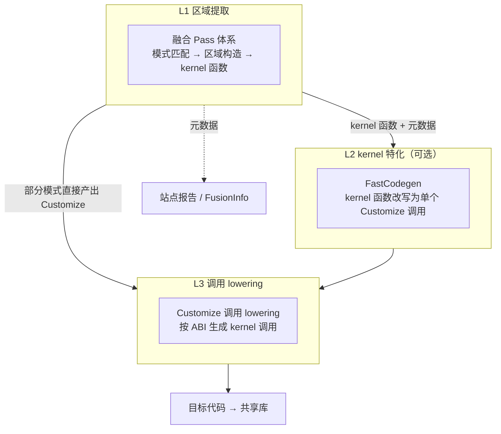
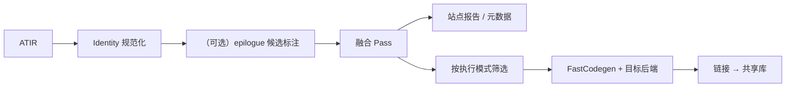
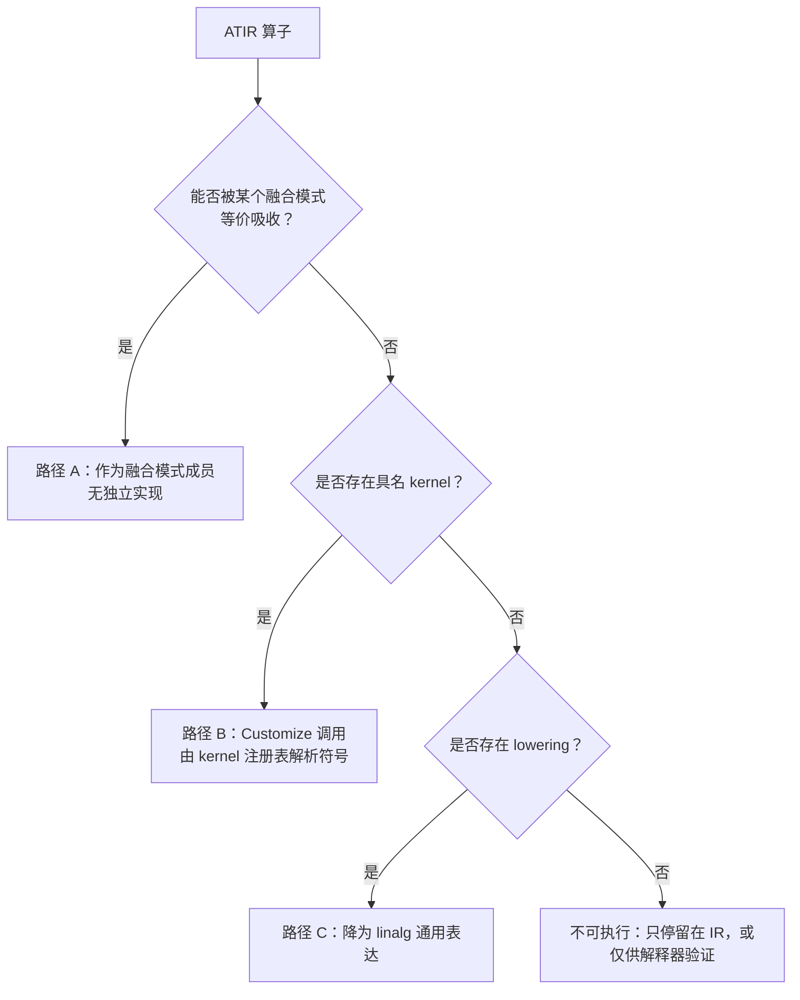

# ANNC 融合优化与算子实现设计

| 文档控制项 | 内容                                                                                                                                                                                                                                                  |
| ----- | --------------------------------------------------------------------------------------------------------------------------------------------------------------------------------------------------------------------------------------------------- |
| 文档编号  | ANNC-ONNX-LLD-003                                                                                                                                                                                                                                   |
| 版本与日期 | 1.10，2026-10-20；迁移至新基线 `11bef0d0`（原基线 `c1622b87`）；同步条件注册的 KDNN MatMul 模式（#15）及其 AOT 分支、EP 白名单边界与常量折叠门控 |
| 文档状态  | 模块设计。描述当前设计意图与实现遵循度，差距见第 11 节                                                                                                                                                                                                                       |
| 评审对象  | ANNC 架构师、融合与后端开发、kernel 开发、测试负责人                                                                                                                                                                                                                    |
| 设计基线  | `annc/lib/Dialect/Atir/Passes/`、`annc/lib/FusionMetadata/`、`annc/lib/Conversion/`、`annc/lib/Target/aarch64/`、`annc/lib/Kernel/`、`annc/lib/Support/ThreadPool/`、`annc/tools/`、`frontends/onnx/onnx-pipeline/`、`addons/onnxruntime/`（源码基线 `11bef0d0`，分支 `upstream/dev`） |
| 上级文档  | [ANNC ONNX 支持整体方案设计](overall.md)（重点第 7.2、7.3、8.2 节）                                                                                                                                                                          |
| 关联文档  | [README](README.md)、[ep-design.md](ep-design.md)、[onnx-frontend-design.md](frontend-design.md)、[JIT 常量折叠设计](../jit-constant-folding/overview.md)、[架构决策记录](../../decisions/decisions.md)（ADR-013：ONNX EP 执行上下文——线程池入上下文、TF/ONNX 共用 ABI v3）                                                                                    |

## 1 概述

### 1.1 定位与作用

本文覆盖 ONNX 与 TF 两条链路共用的两个公共子系统。

- 融合优化：确定哪些算子构成一个区域（site）、区域由哪个 kernel 接管，是 ANNC 优化能力的入口。
- 算子实现：确定区域被接管之后的计算方式，即 ATIR 算子到 AArch64 原生代码的完整实现链路。

两者的交汇点是融合产物与元数据契约。融合阶段产出携带元数据的 kernel 函数，元数据描述该函数替代了哪些节点、参数如何排列以及使用何种 ABI，并传递给下游消费者（EP 或 TF converter）；算子实现阶段则将 kernel 函数转换为可加载的原生代码。

新增优化能力以“一个融合模式加对应 kernel”为交付单位。在源算子已有 ATIR 映射、消费者支持调用 ABI 与形状规则、kernel 已有 lowering 路径的条件下，扩展集中在模式与 kernel 实现。新增能力涉及上述契约时，须同步扩展前端、EP 或后端的相应部分。

### 1.2 设计目标与优先级

| 编号 | 目标                                        | 优先级 | 判据                                     |
| -- | ----------------------------------------- | --- | -------------------------------------- |
| G1 | 融合边界来源唯一：区域由公共 Pass 决定                    | 最高  | 报告描述区域契约，消费者校验自身支持与本次产物后申报             |
| G2 | 区域接口合法、计算语义等价：闭包完整、外部生产者保留在边界外、输出覆盖全部逃逸结果 | 最高  | 区域约束在构造阶段检查（§4），计算规格与数值验证另行成立（§5.1、§9） |
| G3 | 产物自描述：kernel 函数携带完整元数据                    | 高   | 消费者仅凭元数据即可独立解析产物                       |
| G4 | 算子实现复用：模式共享注册、公共 lowering 与后端基础设施         | 高   | 既有调用能力内的新 kernel 以注册规格与实现接入            |
| G5 | AOT 与 JIT 分流：执行模式显式，筛选与特化按模式处理            | 中   | 执行模式为函数级属性，筛选按属性进行                     |
| G6 | 可追溯：融合决策可被下游追踪，包括成员名单、模式名与指纹              | 中   | 报告包含成员名单与语义指纹                          |

### 1.3 范围

在范围内：ATIR 融合 Pass 体系与区域构造算法、融合元数据契约、算子实现链路（lowering、kernel 注册、调用约定、目标后端与编译驱动）以及验证体系。

本文范围之外的内容包括前端语义转换（见 [onnx-frontend-design.md](frontend-design.md)）、EP 侧消费（见 [ep-design.md](ep-design.md)）以及 TF 专属路径（converter 与运行时）的实现细节。

### 1.4 术语

本文沿用整体方案设计附录 B 的术语（site、pattern、AOT、JIT、ABI），并补充如下定义。

| 术语           | 含义                                                   |
| ------------ | ---------------------------------------------------- |
| 区域（site）     | 由若干原图节点组成、由单个生成 kernel 承担其全部计算的节点集合                  |
| 闭包           | 区域成员集合应满足的性质：成员的操作数要么是区域边界输入，要么由区域内的成员定义             |
| 边界输入 / 逃逸结果  | 从区域外进入的值 / 被区域外消费者使用的成员结果                            |
| 包含式 / 非包含式物化 | 融合后原图成员被 `call` 或 `Customize` 取代；或原图保留并加标记，由运行时按分组接管 |
| 执行模式         | 函数级属性：AOT 在执行推理前生成代码，可支持经验证的动态维；JIT 在运行期按形状特化        |
| 模板指纹         | 融合函数的语义身份，即去除名称与具体维度后的模板哈希，用于 JIT 缓存身份               |

## 2 设计约束、假设与原则

### 2.1 区域的三条约束

以下三条约束适用于任何新增融合模式，其依据来自 EP 侧的实现经验。

| 约束     | 含义                             | 违反后果                                 |
| ------ | ------------------------------ | ------------------------------------ |
| C1 完整性 | 区域覆盖模式规格要求替代的生产链，包括应被消除的形状与掩码链 | 遗漏链上计算会继续执行，或遗漏外部依赖使替代函数缺少输入         |
| C2 边界性 | 反向闭包在声明的边界输入处停止，上游生产者保留在区域外    | 源张量的上游链路被整条并入区域，图上丢失该部分计算，形状仍可能保持一致  |
| C3 封闭性 | 区域外使用的成员结果必须全部声明为输出            | 运行时为逃逸值追加额外输出，而接管方未写入该输出，下游读取到未初始化内存 |

### 2.2 交付约束

融合产物的消费者（ORT EP 与 TF converter）通过元数据获取调用所需信息。元数据必须自包含，涵盖成员名单、参数排列、ABI 与动态维规则。产物中的函数与元数据须能经序列化后重建；站点报告采用纯 JSON，函数形态由一组属性标识。

消费者各自支持一定的能力范围，例如仅支持 AOT 或 `mlir_ciface`。执行模式与 ABI 必须作为显式字段，供消费者进行能力校验。

### 2.3 设计原则

1. 合法性与等价性分别论证。模式匹配及闭包、逃逸与结构检查负责区域接口：输入覆盖依赖，输出覆盖外部需求，区域可由一个函数接管。替代计算的等价性由计算规格与数值验证确认。克隆式提取在完整保留值映射、常量与属性时保存原 ATIR 计算，后续特化与 lowering 仍需验证。直接 Customize 式以注册 kernel 取代原成员，须按统一规格明确公式、类型、形状、广播、计算顺序与异常值行为，并完成 §9 的精度链验证。
2. 融合依赖可用实现。融合前检查目标 kernel，缺少实现路径的模式跳过融合。
3. 常量可追溯。凡进入生成代码的常量，必须显式记录在 §4.4 的实参、属性或函数体保留通道中。
4. 属性携带语义。模式特化参数（如桶数、padding）进入元数据，并作为缓存身份的一部分。
5. AOT 与 JIT 分流。执行模式记录在函数上，编译流水线按模式分别筛选和处理。

## 3 总体设计

### 3.1 分层结构



L1 负责区域提取：读取 ATIR，确定区域边界，产出带 kernel 标记、模式名、执行模式与元数据的私有函数，并由此确定公共导出接口。

L2 是可选的 kernel 特化层：保留可供匹配、验证或 JIT 特化的克隆计算，随后将满足实现规格的函数体改写为 `atir.Customize`。主推模式在 L1 已识别替代语义及常量通道，可直接生成 Customize，随后沿注册 kernel 路径完成调用 lowering（#11 的上下文路径在 L1 保留主图并加标记，见 §3.2）。

L3 负责调用 lowering：根据公共融合 ABI 与内部 `CustomOpSchema` 解析注册符号，适配内部调用并生成代码。公共导出接口与内部 schema 分别约定参数顺序，两者的对应关系由该层处理。

### 3.2 产物形态

融合产物统一表示为“带契约的私有函数”，其组成元素如下表所示。

| 元素   | 语义                                               |
| ---- | ------------------------------------------------ |
| 函数标记 | 标识该函数为融合 kernel，供筛选、特化与报告三个环节识别                  |
| 模式名  | 语义标签（如 `layer_norm`、`masked_mul`），同时存在于函数属性与元数据中 |
| 执行模式 | 取值为 AOT 或 JIT                                    |
| 元数据块 | 契约主体，包含成员名单、实参、输出、ABI、参数排列、模式属性、指纹与动态维           |
| C 符号 | 由函数名派生的稳定符号（`_mlir_ciface_` 前缀），供动态加载            |

物化方式由原图能否表示调用边界决定。包含式用 `call @fused_*` 替代成员，并把声明输出替换为已写入的输出缓冲，适合输出形状和缓冲协议已明确的模式。

非包含式保留原成员与端口，供框架重写、分组和参考计算使用；同时另建 kernel 函数，并按模式给成员加“已物化”标记：FTDMM（#11）标记全部成员；MatMul 的 execution v2 分支只标记锚点（Add/Relu 不标记），其通用 JIT 分支不加标记、直接重写或删除成员。上下文 ABI（v2）采用运行期输出分配，超出原 main 图的预分配缓冲调用表达范围，因此使用该方式；FTDMM 在融合阶段保留主图并只做标记，主图函数随 AOT 裁剪（`PruneFunc`）删除（§3.3）。推理时的接管与执行范围由消费者的能力申报和图改写结果确定。

### 3.3 编排与顺序约束



编排遵循以下顺序。

1. 先规范化，再融合，使匹配形态稳定。
2. epilogue 标注若启用，应先于融合执行。融合阶段校验并消费标注，标注不一致时使 Pass 失败。
3. 基线 ONNX pipeline 在融合后先读取未裁剪模块生成报告，再执行 `PruneFunc(execution-mode=aot)`。报告覆盖融合区域，但首期只发布 AOT：`--atir-prune-func=execution-mode=aot` 只保留 `execution_mode=aot` 且带 `fusion.pattern` 的函数，JIT 站点不入库、不进入申报清单，共享库只包含筛选后成功编译的 AOT 符号。目标消费者在申报前须同时校验执行模式、ABI 支持、符号存在性及参数/输出契约，拒绝不支持的站点并给出原因（见 [ep-design.md](ep-design.md) §4.3）。
4. 特化与后端处理仅作用于筛选后保留的函数。

### 3.4 Pass 体系与职责

| Pass         | 职责                                  | 备注                   |
| ------------ | ----------------------------------- | -------------------- |
| Identity 规范化 | 消除语义等价的透传，稳定匹配形态                    | 融合前置                 |
| 融合 Pass      | 默认构建 14 个模式类，KDNN 构建 15 个；区域构造与元数据产出                  | 核心                   |
| 配置驱动融合       | 以外部配置声明模式                           | 实验性，与内置模式并行，产物默认 AOT |
| 块融合          | 属性级融合（例如将 Relu 折叠进生产者属性），不产生 kernel | 能力范围窄，未进入默认流水线       |
| 逐元素融合        | 未实现                                 | 见 §11                |
| epilogue 标注  | 产生候选标注，交由融合 Pass 消费并建立区域            | ONNX 链路未启用           |
| 按模式筛选        | 删除无模式标记的函数；按执行模式过滤                  | AOT 与 JIT 的分流点       |
| Kernel 特化    | 将 kernel 函数改写为 Customize 调用         | 对应 L2                |

## 4 区域模型

### 4.1 区域构造算法

区域构造以模式语义为起点。模式先声明数据输入、需保留的权重/系数、输出与常量通道，再按这些切边值收集成员、检查依赖闭包，并核对实际边界。过程如下。

```
按模式语义声明切边值与输出
  → 从锚点反向 DFS 收集生产链，遇到声明切边值即停止
  → 校验闭包：每个成员依赖由声明输入、显式常量通道或成员满足
  → 核对构造后的实际边界与声明相符，排除意外切边和上游吞并
  → 校验逃逸：被外部消费的成员结果均已声明为输出
  → 校验结构约束（模式特定的类型、形状与消费者约束）
```

实现上存在两条语义一致的路径，如下表所示。

| 路径      | 应用                     | 特点                              |
| ------- | ---------------------- | ------------------------------- |
| 闭包检查式   | 以数据流闭包为主体的模式           | 模式声明切边值、输出及常量通道，公共遍历与检查工具验证完整依赖 |
| 显式结构匹配式 | 需要精确控制成员的模式（矩阵类与形状消除类） | 直接列举结构，配合逃逸检查与单消费者约束            |

### 4.2 边界与逃逸

声明切边值是模式识别时确定的语义输入，用于限定反向遍历的停止位置。实际边界是构造完成后，成员操作数中由区域外定义的值，由公共工具按稳定遍历顺序收集。实际边界必须与声明相符；发现遗漏输入时，应拒绝该候选。

IR 的输出/临时 Buffer 与保留的 Constant 属于构造设施，分别归入缓冲协议或 §4.4 的常量通道。来源成员名单按 §4.5 收集原图计算节点；报告 `args` 收录逻辑数据输入，属性常量和函数体常量由各自通道供给。

逃逸结果是成员结果中被非成员使用的值，必须与声明输出完整对应。报告 `outputs` 保持约定顺序，供下游映射端口。共享边界输入可继续供区域外使用；发现未声明的中间结果逃逸时，必须拒绝融合。完整性 C1 覆盖模式规格要求替代的生产链，边界输入的上游仍在区域外执行。

### 4.3 重叠与重复防护

| 机制        | 作用                                                 |
| --------- | -------------------------------------------------- |
| 原图改写与物化标记 | 包含式替换结果、删除已无使用者的成员；非包含式按模式加物化标记（FTDMM 标记全部成员，MatMul execution v2 分支只标记锚点），相应模式守卫拒绝已标记锚点    |
| 锚点互斥与收益排序 | 同一锚点按 PatternBenefit 竞争；一次成功改写后，后续匹配基于更新后的 IR 重新判断 |
| 名字去重      | 同名 kernel 或簇名自动附加序号后缀，保证符号唯一                       |

设计目标是最终站点成员集合两两不交，并使相同输入、配置与模式优先级产生可复现的结果。每次物化都须在当前 IR 上重新完成匹配与边界检查，确认候选成员有效后再修改。

当前实现采用顺序贪婪改写，通过移除、替换或标记成员以及锚点守卫防止重复匹配：FTDMM 对全部成员设置物化标记，MatMul 的 execution v2 分支只标记锚点，包含式模式通过替换或删除成员使后续匹配失效；守卫范围主要覆盖同一锚点，锚点之外被其他模式的既有站点占用的成员不必然被排除。跨锚点共享、非包含式锚点外成员重叠与同收益竞争，须通过反例和重复运行验证；消费者也须在申报前拒绝成员重叠的站点。上述设计沿用现有贪婪策略。

### 4.4 常量的处理策略

| 策略   | 机制                                | 适用情形                     |
| ---- | --------------------------------- | ------------------------ |
| 实参化  | 常量作为 kernel 的边界输入，在运行期传入          | 权重与归一化系数等数据性常量           |
| 属性化  | 常量读取为模式属性，进入元数据，lowering 时物化为调用实参 | 影响代码形态的量，如 padding 与尺寸阈值 |
| 随体保留 | 常量保留在被克隆的 kernel 函数体内             | 语义上属于区域内部的小常量            |

属性化与随体保留的常量内容直接影响生成代码，缓存身份必须覆盖其内容或可靠的身份/版本。实参化常量的载荷在运行期传入；其中参与匹配、常量折叠、布局或实现选择的内容，同样影响产物，也须纳入缓存身份。权重、padding、轴与形状常量的归属由模式规格明确，影响代码的常量变化必须形成相应的缓存身份（GAP-01，见 [ep-design.md](ep-design.md) §6.2）。

磁盘缓存淘汰负责磁盘条目的保留策略；已加载代码的寿命由会话/调用的引用关系决定，引用期间必须保持有效。具体所有权与释放协议见 EP 文档，自动 LRU 的能力与行为仍需另行确认。

### 4.5 成员名单与来源信息

成员名单是下游（EP 的 ORT 分组与 TF 的图改写）定位区域的唯一依据，其取材来源、排除范围与记录形式分别约定如下。

- 成员名取自节点的来源信息，使用前端写入的原始节点名。
- 成员名单排除 ONNX initializer、图 Input 以及作为常量/缓冲设施的 ATIR Constant、Buffer。ONNX 显式 Constant 是原图节点，其值若作为边界输入使用，应保留区域外的生产者；计算成员仍按原图来源名记录。
- 名单以名字与结果序号的形式记录，与下游的节点及端口模型对应。

## 5 融合模式目录

默认构建注册 14 个模式类；启用 `ANNC_ENABLE_KDNN_ADAPTOR` 时另注册 #15 KDNN MatMul 模式，合计 15 个，构成 TF 与 ONNX 共用的融合能力目录。执行模式中，JIT 仅用于默认构建下的 MatMul 家族；#15 与其余模式为 AOT。AOT 标记描述代码生成方式；ONNX 的实际运行能力还取决于前端映射、pipeline 和 EP，须按下述条件逐层核验。下表给出各模式的识别骨架。

| #   | 模式名                              | 识别骨架                                                       | 执行模式 | ABI                 | 产物                                   |
| --- | -------------------------------- | ---------------------------------------------------------- | ---- | ------------------- | ------------------------------------ |
| 1   | `dnn_embedding_hash_bucket`      | embedding 链（Reshape→SparseSegment→HashBucket→…→ExpandDims） | AOT  | `mlir_ciface`       | 克隆链与桶数属性                             |
| 2   | `matmul_add_relu`（V2 分支）         | MatMul→Add→Relu，Add 具有双输出                                  | JIT  | `annc_execution_v2` | v2 kernel（非包含式）                      |
| 2'  | `matmul_add…`（epilogue 分支）       | MatMul 与已标注的 epilogue 链                                    | JIT  | `mlir_ciface`       | 克隆 matmul 与 epilogue                 |
| 2'' | `matmul`                         | 单独的 MatMul                                                 | JIT  | `mlir_ciface`       | 克隆 matmul                            |
| 3   | `kp_sparse_dynamic_stitch`       | DynamicStitch 及 Range、FloorMod 结构                          | AOT  | `mlir_ciface`       | 克隆 kernel 函数并生成调用                    |
| 4   | `kp_target_behavior_interaction` | ConcatV2、Pack、Gather 与 Fill 构成的交互结构                        | AOT  | `mlir_ciface`       | 同上                                   |
| 5   | `kp_embedding_action_id_gather`  | ConcatV2 与 Gather 结构                                       | AOT  | `mlir_ciface`       | 同上                                   |
| 6   | `kp_sparse_segment_reduce`       | StridedSlice 且 num\_segments 为 0                           | AOT  | `annc_execution_v2` | v2 kernel（双输出）                       |
| 7   | `kp_embedding_padding`           | 以 Reshape 为锚点的 padding 结构                                  | AOT  | `annc_execution_v2` | v2 kernel                            |
| 8   | `kp_embedding_padding_fast`      | 以 StridedSlice 为锚点的 padding 结构                             | AOT  | `annc_execution_v2` | v2 kernel                            |
| 9   | `kp_sparse_reshape`              | SparseReshape                                              | AOT  | `annc_execution_v2` | v2 kernel                            |
| 10  | `kp_sparse_select`               | 以 ConcatV2 为锚点的 select 结构                                  | AOT  | `annc_execution_v2` | v2 kernel（三输出）                       |
| 11  | `tensordot_matmul`               | 展平、MatMul（常量权重）与恢复形状，输入秩为 3                                | AOT  | `annc_execution_v2` | 直接生成 `Customize("TensordotMatMul")`  |
| 12  | `masked_mul`                     | mask 链（Equal→Not→Cast→Unsqueeze→\[Tile]）及消费该 mask 的 Mul    | AOT  | `annc_execution_v2` | 直接生成 `Customize("MaskedMul…"/"…Flat")`，多输出       |
| 13  | `batched_matmul_add`             | 秩为 3 或 4 的 MatMul 加偏置 Add（可选前导仿射）                        | AOT  | `annc_execution_v2` | 直接生成 `Customize("BatchedMatMulAdd"/"BatchedMatMulAdd4")` |
| 14  | `layer_norm`                     | 12 个节点构成的归一化链，系数为常量                                        | AOT  | `annc_execution_v2` | 直接生成 `Customize("LayerNorm")`        |
| 15  | `matmul`／`matmul_add`／`matmul_add_relu`（KDNN AOT 分支） | 单独 MatMul 或 MatMul→Add→Relu；无转置、epilogue、`rhs_format`；唯一逃逸输出 | AOT  | `annc_execution_v2` | KDNN kernel（仅 `ANNC_ENABLE_KDNN_ADAPTOR` 构建且 `ANNC_GEMM=1`） |

默认构建注册 14 个模式类（#1–#14）；`ANNC_ENABLE_KDNN_ADAPTOR=ON` 时另注册 #15，合计 15 个。2 号类内部包含 V2、epilogue 与 plain 三条分支，故上表列出 17 行。#12 `masked_mul`、#13 `batched_matmul_add`、#14 `layer_norm` 的融合模式与 kernel 文件已在当前复核基线 `11bef0d0` 中实现（`tests/unit/kernels/` 另有 `masked_mul_context_test` 用例），三者与 #11 一并产出上下文 ABI（`annc_execution_v2`）站点（`custom.op_name` 分别为 `MaskedMul*`／`BatchedMatMulAdd(4)`／`LayerNorm` 与 `TensordotMatMul`）。默认构建的 ONNX AOT 载体即这四个上下文站点；`matmul` 家族为 JIT，prune 阶段被裁剪。KDNN adaptor 构建且 `ANNC_GEMM=1` 时，plain `matmul` 改由 #15 产出 AOT 站点，`matmul_add`／`matmul_add_relu` 虽然也生成 AOT 站点，但不在 EP 白名单内，无法申报。

ONNX 可执行能力需逐层成立：公共目录中有模式 → ONNX 导入能形成该模式所需 ATIR → 本次 pipeline 能完成 AOT lowering 与链接 → EP 支持导出 ABI、类型、形状与输出协议。pipeline 只编译 AOT 函数；默认构建的 ONNX AOT 载体是 #11–#14 四个上下文站点（`tensordot_matmul`／`masked_mul`／`layer_norm`／`batched_matmul_add`）。默认构建的 matmul 家族（#2 各分支）为 JIT：EP 白名单虽包含 `matmul`，但当前 pipeline 不为其产出可接管产物。KDNN adaptor 构建且 `ANNC_GEMM=1` 时，plain `matmul` 由 #15 产出 `aot + annc_execution_v2` 站点，可进入白名单；`matmul_add`／`matmul_add_relu` 站点不在白名单内。TF/KP 专用模式的实际产出范围也须经过上述各层核验；“可交付”的结论保留给通过指定平台验收的组合（见整体方案 §4.3）。

\#6–#10 的公共 ABI 为 v2（`annc_execution_v2`）；EP 申报前按 pattern 白名单（`matmul`、`tensordot_matmul`、`masked_mul`、`layer_norm`、`batched_matmul_add`）、`execution_mode=aot` 与 `abi` 过滤，执行路径以上下文 ABI（`annc_execution_v2`）为主、`mlir_ciface` 为兼容。若未来将新 pattern 纳入白名单而未接入其对应 ABI，仍可能错误调用。GAP-02 的触发范围取决于模型形态、编译产物与消费者预检结果。

模式的设计共性可作为新增模式的检查项：锚点、切边值与结构约束明确；容量或规模阈值（如权重元素数、站点数上限）属于实现选择条件，实际性能收益仍需测量；融合前查询 kernel 可用性（四个主推模式在该查询中关闭 kdnn；#15 则以 `enableKdnn=true` 探测 KDNN kernel）；来源成员名单排除常量与输入，输出覆盖全部逃逸结果。

### 5.1 ONNX 主推模式规格

四个主推模式（#11–#14）均以注册 kernel 替代成员计算：模式识别与常量通道在 L1 完成，随后直接生成 `Customize` 调用；四者均走上下文 ABI（`annc_execution_v2`），融合阶段保留主图并只做物化标记，输出由 kernel 经执行上下文按槽位分配。三者（#12–#14）已在当前基线中实现。统一规格包含计算公式与顺序、输入输出 shape/dtype、布局和广播限制、边界、特化常量、实现路径、拒绝条件及验证要点。匹配器、kernel 和测试按这些规格对齐，EP 消费其接口契约。下表分别列出静态匹配条件与运行期 kernel 检查，支持范围以各项规格为准，数值等价性按 §9 验证。

#### #11 `tensordot_matmul`（注册 kernel：`TensordotMatMul`）

| 项                | 规格                                                                                                                                                                                          |
| ---------------- | ------------------------------------------------------------------------------------------------------------------------------------------------------------------------------------------- |
| 计算语义             | `out[i,j,n] = Σₖ input[i,j,k]·weight[k,n]`；展平为 `[d0·d1,K]`，与权重相乘再恢复 `[d0,d1,N]`。free 轴恰为 `[0,1]`、contract 轴为 `[2]` 时无需搬数据；当前 kernel 以 f32 从 k=0 顺序累加，与框架 GEMM 的累加次序差异按 §9 验证                |
| 输入输出 shape/dtype | 输入 `[d0,d1,K]` f32，权重 `[K,N]` f32 常量，输出 `[d0,d1,N]` f32；K/N 静态为正，已知输入末维须等于 K；未知前导维从运行期描述符读取，输出 N 在报告中固定                                                                                     |
| 布局与语义限制          | 连续 row-major；恒等 Transpose；展平/恢复限于前导维，bias、Relu 关闭。一般轴置换与其他 Tensordot 形式超出该模式范围；运行期 kernel 复核 K、输出形状及步长                                                                                      |
| 边界输入输出           | 边界输入为展平前的输入与权重常量；输出为反展平 Reshape 的结果，是唯一逃逸值，允许被下游继续消费                                                                                                                                        |
| 特化常量             | 权重以 fixed 实参进入 `args`；轴、perm 与目标形状常量用于匹配并消除相应形状链，无额外模式属性；K/N 与阈值参与产物选择，缓存须保留其身份                                                                                                             |
| 实现路径（当前上下文路径）    | 融合函数 `(context,input,weight) -> output`，体内一次 `atir.Customize`；内部 schema 为 `(input,weight) -> Result(output)`，经 Common 调用 lowering 适配到 aarch64 `tensordot_matmul` 注册包装；报告 `args` 顺序为 `(input,weight)`、`kernel_arg_order` 为空数组；ABI 为 `annc_execution_v2`，输出由 kernel 经上下文槽位分配。kernel 侧在原生 MLAS 路径可用时走单 SGEMM，否则行并行标量（MLAS 默认关闭）。主图区域保留并给全部成员加物化标记，主图函数由 AOT 裁剪阶段删除（§3.2）          |
| 实现路径（兼容的预分配输出路径） | 导出函数 `(input,weight,output)`，逻辑列表为 `(weight,input,output)`，两者由 `kernel_arg_order={1,0,2}` 对应；该形态下 EP 的兼容契约要求 `args` 为 `(weight,input)` 且排列恰为 `{1,0,2}`，调用后不读取返回状态（[ep-design.md](ep-design.md) §4.3）。当前基线本模式产出的是上下文站点，该路径保留用于消费既有 `mlir_ciface` 产物          |
| 拒绝条件             | 已物化；kernel 不可用；权重非常量、无载荷、维非正或 K·N>512；Transpose 非恒等、free/contract 轴或展平/恢复目标不符；展平结果或 MatMul 有额外消费者；输出 Buffer/类型不合；未声明结果逃逸。基线匹配显式排除 bias/Relu；左、右与输出转置已显式拒绝（`getLeftTranspose()`/`getRightTranspose()`/`getOutputTranspose()` 任一为真即不匹配）；其他 MatMul 属性的完整校验仍待核实，扩展输入范围前须确认规范化行为或补齐语义守卫 |
| 验证要点             | 目标：FileCheck 覆盖主图保留与物化标记、来源名单、排列、非法轴与额外消费者反例；数值验证全部输出、K/N 边界与阈值两侧、空前导维、经验证的动态维变化和长归约。现有：FileCheck 用例（主图保留与物化标记、来源名单、排列、非恒等 perm 与缺 ONNX 标记的拒绝）与两个有限的 Python 端到端用例（AOT、上下文）；FTDMM kernel 的参考计算、运行期形状变化与形状拒绝专项用例尚缺；ORT 精度链见 §9                                                                |

基线源码以对应 ORT 模式为参照，并要求 free 轴恰为前导维。ANNC 连续线性读取的正确性由该轴条件论证，替代计算的等价性再按 §9 验证。

#### #12 `masked_mul`（注册 kernel：`MaskedMul<实参数>[Flat]`）

| 项                | 规格                                                                                                                                                                               |
| ---------------- | -------------------------------------------------------------------------------------------------------------------------------------------------------------------------------- |
| 计算语义             | 每个输出 q 都满足 `out_q[b,t,n] = data_q[b,t,n]·float(ids[b,t] != padding)`。kernel 逐元素乘以 0/1，保留被屏蔽的 Inf 乘 0 产生 NaN，以及 NaN 与有符号零的源链行为；填零或直接复制会改变这些结果。mask 链整体消除                          |
| 输入输出 shape/dtype | 每个 data/output 为 `[d0,d1,N_q]` f32，共享 ids 为 `[d0,d1]` i64；前两维静态可知时须一致，动态前缀由 kernel 复核；报告每路输出保持其自己的形状与端口                                                                          |
| 布局与语义限制          | 连续 row-major；Unsqueeze 仅末轴；可选 Tile 倍数为 `[1,1,N_q]` 且 N\_q≥1，不搬移逐元素信息；无 Tile 时由 Mul 做末轴广播；静态零末维不匹配                                                                                |
| 边界输入输出           | 边界输入为各 Mul 的 data 与共享的 ids；一个区域覆盖最多 4 个 Mul，分别声明各 Mul 的结果为输出                                                                                                                     |
| 特化常量             | padding 由 Equal 的可读一致整数常量取得，存于 Customize schema 的 `custom.attr.padding`，lowering 将其物化为内部调用的 i64 实参；导出函数形参保持为 data、ids 和输出。padding 直接进入代码，必须参与缓存身份/版本                             |
| 实现路径             | 上下文 ABI（`annc_execution_v2`）：融合函数 `(context,data_0…,ids) -> (output_0…)`，`kernel_arg_order` 为空数组，每个输出由 kernel 经上下文按槽位分配；内部 schema 为 `(arg_0…arg_n,ids)` 加 `Result(output_0…[,flat])`，padding/argMap/divisor 等作为 i64 属性携带；算子名 `MaskedMul<实参数>[Flat]`，经 Common lowering 调用 aarch64 `masked_mul`     |
| 拒绝条件             | 任一类型/形状、bool Not 编码、padding/轴/Tile 常量或 kernel 可用性不合；链值有 Mul 外消费者；超过 4 路；重复 data 实参（基线限制）；某 data 来自本站成员；成员间有离开集合再返回的路径；不存在支配全部实参且先于全部输出使用的调用点；逃逸结果不等于全部 Mul 输出                    |
| 验证要点             | FileCheck 核对共享 mask 的全部 Mul 和多输出一起接管、调用点及反例；数值验证每一路，覆盖 padding=0/非零/负值、NaN/±Inf/±0、Tile 有无、不同末维与 batch 变化，以及同形不同 padding 的重复缓存。已有 `tests/unit/kernels/masked_mul_context_test.cpp`（真实算术下的实参别名、被选 Sum 输入、多输出与 SIMD 尾）与端到端 `masked_mul_context_e2e.py`；多路错误码传播见 §11 |

#### #13 `batched_matmul_add`（注册 kernel：`BatchedMatMulAdd` / `BatchedMatMulAdd4`）

| 项                | 规格                                                                                                                                                          |
| ---------------- | ----------------------------------------------------------------------------------------------------------------------------------------------------------- |
| 计算语义             | `out[...] = (Σₖ data[...]·weight[...]) + bias[...]`；累加器从零开始，以 f32 完成整个 k 轴求和，再加一次偏置，保留源链的舍入顺序。支持秩 3（单批权重）与秩 4（双批权重）两种形态                                                       |
| 输入输出 shape/dtype | 秩 3：data `[d0,d1,K]`、权重 `[1,K,N]`、bias `[1,1,N]`；秩 4：data `[B0,B1,M,K]`、权重 `[W0,W1,K,N]`、bias `[B0,B1,1,N]`；均为有载荷的 f32（data 为输入，权重与 bias 为常量），输出同形 f32；K/N 静态为正，输出末维须已知等于 N |
| 布局与语义限制          | 连续 row-major；广播限于上述有载荷常量与行偏置，转置和激活关闭；运行期复核 K/N、前导维、输出形状与步长                                                                                                   |
| 边界输入输出           | 边界输入为 data、权重与偏置；输出为 Add 的结果，是唯一逃逸值                                                                                                                         |
| 特化常量             | 无模式属性；权重与偏置以 fixed 实参进入 args，其静态形状参与匹配。可选的前导仿射链在前置阶段折叠为 kernel 函数内的私有常量（`atir.constant @pre_affine_weight/@pre_affine_bias`）；使能折叠的图在模型签名中保留 initializer 数值（[ep-design.md](ep-design.md) §6.2）                              |
| 实现路径             | 上下文 ABI（`annc_execution_v2`）：融合函数 `(context,data,weight,bias) -> output`，`kernel_arg_order` 为空数组、单输出由 kernel 经上下文槽位 0 分配；算子名按秩取 `BatchedMatMulAdd`／`BatchedMatMulAdd4`，经 Common lowering 调用 aarch64 `batched_matmul_add`。kernel 侧在原生 MLAS 路径可用时经 `MlasGemmBatch`，否则回退行并行标量（MLAS 默认关闭） |
| 拒绝条件             | 已物化、kernel 不可用、输出 Buffer/类型不合；输出非 f32 或秩非 3/4；Add 非两输入；常量秩/前导维/K/N 不符；MatMul 带 bias、Relu、任一转置、起始偏移、尺寸或 rhs\_format 标注，Add 带 Relu/标量；MatMul 结果被本 Add 之外的节点消费；除 Add 结果外有逃逸    |
| 验证要点             | FileCheck 检查节点合并、前导仿射折叠（`@pre_affine_weight/@pre_affine_bias`）、参数与额外消费者反例；数值验证全量输出、bias 在归约后相加、N 分块及尾部、长 K、batch 变化、异常值与错误布局；已有 kernel 参考 GTest 与端到端 `batched_matmul_add_context_e2e.py`，完整精度链见 §9                              |

#### #14 `layer_norm`（注册 kernel：`LayerNorm`）

| 项                | 规格                                                                                                                                                                                   |
| ---------------- | ------------------------------------------------------------------------------------------------------------------------------------------------------------------------------------ |
| 计算语义             | 每行 `μ=Σx/C`，`d=x−μ`，`v=Σ(d·d)/C`，`r=1/sqrt(v+eps)`，`g_n=r·gamma_n`，`y_n=x_n·g_n+(beta_n−μ·g_n)`。上述 Reciprocal/Sqrt、乘法与减加分解顺序属于计算规格，kernel 须按该分解执行。均值/方差当前用 f32 顺序累加，需检验与 ORT 归约顺序的误差 |
| 输入输出 shape/dtype | input/output `[R,C]` f32；gamma/beta `[C]` f32，eps 为秩 0 f32，有载荷常量；两次 ReduceMean 仅末轴（轴 1 或 −1）且 keepdims，均值类型的末维为 1；kernel 要求 C>0 并复核系数长度                                              |
| 布局与语义限制          | 连续 row-major；支持范围为 rank2 的上述分解链及指定轴，其他 LayerNormalization 形式须另行扩展规格；eps 原样加到方差后再开方。基线未对 eps 正值/有限性作匹配或 kernel 数值守卫，NaN/Inf 与负值行为必须按源链验证                                              |
| 边界输入输出           | 边界输入为输入与三个系数（均以实参传入；输入允许被链外消费者继续使用）；输出为链尾 Add 的结果，是唯一逃逸值                                                                                                                             |
| 特化常量             | 无模式属性；gamma、beta、eps 以 fixed 实参进入 args；轴常量用于匹配，系数/epsilon 内容若用于折叠或特化须纳入缓存身份                                                                                                          |
| 实现路径             | 上下文 ABI（`annc_execution_v2`）：融合函数 `(context,input,gamma,beta,eps) -> output`，`kernel_arg_order` 为空数组、单输出由 kernel 经上下文槽位 0 分配；Customize schema `(input,gamma,beta,eps)` → Common lowering → aarch64 `layer_norm`；匹配成员为 12 个计算节点。kernel 对末轴长度 ≥256 走 NEON 向量化行路径，否则标量 |
| 拒绝条件             | 已物化、kernel 不可用、输出 Buffer/类型不合；系数秩/dtype/常量载荷不符；非末轴或不 keepdims；源链分解、操作数关系或中间消费者集合不符；均值/方差等中间值共享或逃逸；基线还要求 gamma 仅供本 gMul 使用；链内 Add 带 Relu/标量                                           |
| 验证要点             | FileCheck 核对整链、排列与共享中间值反例；数值验证全输出、常量行/近零方差、大幅值、长末轴（含 NEON 路径）、epsilon 边界、NaN/Inf、系数长度与 batch 变化，记录归约误差。已有 GTest 覆盖同分解参考、常量行和 gamma 长度拒绝，端到端 `layer_norm_context_e2e.py`；ORT 原图参考验证按 §9 补齐 |

### 5.2 贯穿示例：`tensordot_matmul`（当前基线）

本节用一个可复现的示例把融合、报告、绑定与执行串起来；其余模式与 [ep-design.md](ep-design.md) 的各节引用同一示例，避免兼容路径比主路径更具体。示例 IR 与检查项取自 `tests/FileCheck/Dialect/Atir/tensordot-matmul-context-fusion.mlir`（`annc-opt --atir-op-fusion`）。

**源区块**：输入 `x[1,1,32]f32`，权重常量 `w[32,16]f32`。区块含 16 个计算成员（端到端用例同样断言 16 个成员名）：`Transpose`（恒等 perm）、`Shape`、`Cast`、两个 `Gather`、两个 `Prod`、两个 `ExpandDims`、展平目标的 `Concat` 与 `Cast`、展平 `Reshape`、`MatMul`、恢复目标的 `Concat` 与 `Cast`、恢复 `Reshape` → `out[1,1,16]f32`。

**融合产物**：私有函数 `@fused_tensordot_matmul_`，首参为 `!llvm.ptr`（执行上下文），函数属性含 `annc.execution_mode="aot"` 与 `annc.kernel`；体内一次 `atir.Customize`（`custom.op_name="TensordotMatMul"`、`custom.arg_names=["input","weight"]`、`custom.arg_ranks=[3,2]`）。主图 `@main` 保留，区块内的 `atir.MatMul` 被标记 `annc.fusion_materialized`。

**报告关键字段**：`pattern="tensordot_matmul"`、`execution_mode="aot"`、`abi="annc_execution_v2"`、`kernel_arg_order=[]`、`args` 顺序 `(input, weight)`（角色 `dynamic`、`fixed`）、`outputs` 为恢复形状后的结果、`member_node_names` 记录区块来源名（含 `transpose:0`、`Shape:0`、`MatMul:0`、`out` 等）。

**EP 侧消费**：申报前按白名单、`aot` 与 `abi` 放行（[ep-design.md](ep-design.md) §4.3）；首次执行按 rank 3 + f32 绑定输入、rank 2 + f32 绑定权重，形状链常量等额外界外输入被忽略；kernel 经 `allocate_output(0, {d0,d1,n})` 提供输出维度，EP 校验槽位、秩与元素类型后交由 ORT 分配。

**动态维（声明存在，验证待补）**：本示例的类型是静态的（`1x1x32`／`1x1x16`）；K=32、N=16 是编译期固定条件。端到端夹具的模型声明的则是动态维（`batch`、`rows` 符号维），但用例只喂入固定的一组尺寸、也不改变它。因此“同一会话内改变前导维而复用同一 kernel”目前只有模式声明与 kernel 从描述符读尺寸的依据，尚无改变尺寸的验证用例；该结论须补一个显式声明动态维并改变尺寸的用例后才能成立（见 GAP-07）。

**拒绝示例**：同一区块但 `perm` 改为非恒等（`[1,0,2]`）时，两侧 kernel 会算错，模式拒绝融合——FileCheck 断言不出现 `fused_tensordot_matmul` 函数；模块缺少 ONNX 前端标记（`annc.contract_version`）时同样不成站点，该模式只服务 ONNX 宿主。

## 6 元数据契约

元数据契约是融合子系统的对外类型定义，位于公共头文件中，由两个框架链路与两个下游（EP 与 TF converter）共用。

### 6.1 模型

```
FusionInfo
├─ 身份：name（簇名）、pattern（语义标签）、templateFingerprint（模板身份）
├─ 执行：executionMode（aot/jit）、abi（mlir_ciface / annc_execution_v2）
├─ 契约：args[]（role/tf_name/shape/rank/dtype）、outputs[]、kernelArgOrder
├─ 定位：memberNodeNames[]（被替代的原图节点）
├─ 特化：patternAttrs（模式属性）、dynamicDims
└─ 保留：symbolicSignature、fallbackFunction（占位字段，运行时未消费）
```

输入角色用于记录形状用途：`constant` 为编译期常量，`fixed` 为本次特化约定中形状不变的实参，`dynamic` 为可提供运行期尺寸的主输入。reshape 关系与输出动态维的推导规则，仍须由形状契约明确并验证。当前 EP 尚未实现通用的动态维求值：上下文路径直接使用 kernel 给出的维度，兼容路径按 `{d0,d1,n}` 求值（[ep-design.md](ep-design.md) §6.3）。目标规则（按声明关系求值，并在申报前拒绝关系不明的区域）落地前，形状关系超出实现范围时应先扩展契约与消费者实现。

### 6.2 关键抽象

参数排列 `kernelArgOrder` 适用于本文 `mlir_ciface` 的预分配输出协议，用于解耦导出函数形参序与 `[args…,outputs…]` 逻辑索引空间（§7.3 第二层）。`kernelArgOrder[p]` 为导出函数第 p 个形参所取的逻辑槽位；`outputs[k]` 对应下游融合节点第 k 个输出，排列中的输出槽位据此供给 memref 描述符（见 [ep-design.md](ep-design.md) §6.3）。完整排列的长度为 args 与 outputs 数之和，每个索引须在范围内且恰出现一次，并与导出函数实际签名相符。

导出函数形参序由 `kernelArgOrder` 独立记录，注册 kernel 的参数顺序由内部 schema 规定。消费者须读取实际排列，按逻辑槽位装配输入和输出。

在 `mlir_ciface` 站点的预分配输出协议下，逻辑列表“\[args…outputs…]”与导出函数形参序可以不同，两者由 `kernel_arg_order` 对应；EP 的兼容契约对 `tensordot_matmul` 要求排列 `{1,0,2}`、对 `matmul` 要求 `{0,1,2}`（[ep-design.md](ep-design.md) §4.3）。FTDMM 的当前主路径走上下文 ABI `annc_execution_v2`，`kernel_arg_order` 为空数组：v2 禁止携带非空排列，该空数组不参与参数装配。v2 通过上下文输出槽位分配结果，其上下文、输入顺序与输出槽位采用 §7.3 的独立协议。

模板指纹是融合函数的语义身份，其计算过程为：克隆函数，去除来源身份与元数据，将具体维度全部动态化，重建函数类型，最后以规范化形式打印并取哈希。影响代码生成的属性（如转置语义与模式属性）必须保留；与语义无关的配置（如线程数，见 ADR-009）从指纹中排除。JIT 缓存身份在模板指纹的基础上，还须包含实际形状。

### 6.3 校验不变量

| 编号 | 不变量                                             |
| -- | ----------------------------------------------- |
| M1 | 标识与契约字段必填；执行模式与 ABI 属于公共契约集合；消费者另行检查自身支持子集      |
| M2 | 输出角色必须为 output；输出端点不得重复；端点语法必须合法（`node:port`）   |
| M3 | 每项 shape 的长度与 rank 一致；dtype 必填                  |
| M4 | JIT 模式必须携带模板指纹，且指纹格式符合约定                        |
| M5 | v2 不得携带非空的 kernelArgOrder；序列化保留空数组合法，且不用于装配输出形参 |
| M6 | `mlir_ciface` 的参数排列完整、无重复、无越界，且与实际导出签名及输出端口对应   |

M1–M5 对应公共 `validateFusionInfo` 的现有检查。M6 是完整消费契约的目标检查，当前公共校验器尚未强制验证完整排列与真实导出签名。EP 已有本地站点校验（上下文站点要求排列为空，并校验 dtype、秩、参数秩互异与输出契约；兼容站点校验排列取值），编译产物与元数据的共同契约验证仍待补齐（[ep-design.md](ep-design.md) §4.3）。

### 6.4 序列化契约

元数据以键值字典挂在 kernel 函数上，可序列化为 JSON；站点报告复用该序列化方式，由顶层 schema、契约版本与站点数组组成。目标版本策略是校验 schema 与契约版本，兼容保持既有语义的增量字段。未知可选字段可跳过；ABI 或必需语义超出识别范围、版本不兼容时，应拒绝消费。JSON 解析完成后，还须通过契约与执行能力校验。当前 EP 只读取报告 schema（`annc-ep-site-report/1`），尚未读取 `contract_version`；契约版本与完整能力校验需随 GAP-04 收敛。

## 7 算子实现设计

### 7.1 实现落点

ATIR 算子的实现按语义粒度分为三种落点。



当前通用逐算子 kernel 主要覆盖矩阵家族，Add/Relu 等另有通用 lowering（`ConvertAtirToLinalg`）与 Customize 调用 lowering；其余具名 kernel 多为融合产物级。该 pass 有两条入口：命令行 `--convert-atir-to-linalg`，以及 AArch64 目标流水线 `--annc-aarch64-gemm-pipeline` 的第二道 pass；ONNX 与 TF 的 AOT 链路走的都是后者，融合 kernel 的调用生成（符号解析与状态码调用）也在该 pass 内完成。ONNX 链路只对裁剪后的 AOT 融合函数运行该流水线，未融合算子在裁剪时随主图移除，不会到达该 pass。转置、索引、归约、Softmax 等普通算子的前端负责将语义映射到 ATIR，逐算子 AOT 执行还依赖相应 lowering 与 kernel。ONNX 整图导入提供匹配所需的上下文、来源与边界元数据；ANNC 只编译接管融合区域，未融合节点不进入产物，继续由 ORT CPU 执行（见 §11）。

覆盖率低仍可能有收益，例如占节点数约 1% 的区域也可能消除热点上的调度与形状计算。性能评价以实测为准，同时记录整图导入/匹配、首次编译、缓存复用、跨 EP 交接与稳态推理的成本，以及接管区域的时间占比。节点覆盖率描述接管规模，实测耗时用于衡量加速效果；低覆盖场景也须计入首次会话成本。

### 7.2 Kernel 注册与选择

kernel 通过统一注册体系管理，供融合与 lowering 查询、选择和调用。

| 设计要素  | 约定                                                                                                                                 |
| ----- | ---------------------------------------------------------------------------------------------------------------------------------- |
| 注册单元  | 规格（算子类型、后端、类型约束、ABI 与符号）的声明与实现位于同一处，包装在构建期生成                                                                                       |
| 符号约定  | 统一前缀加规格派生名；包装负责参数适配与状态码返回                                                                                                          |
| 选择策略  | 多后端按优先级解析（打包库、加速库、通用实现）；可用能力受构建开关与目标平台约束                                                                                           |
| 可用性查询 | 融合前与 lowering 前均可查询是否存在可用 kernel，将实现可用性作为处理条件                                                                                      |
| 并行运行时 | 现状：已实现。上下文 ABI v3 在结构尾部携带 `thread_pool`，kernel 经 `resolveThreadPool` 取池（上下文优先、TLS 回退）；EP 经 `KernelContext_ParallelFor` 复用 ORT intra-op 池，失败则在本线程内联执行，嵌套判定用 `thread_local` 深度；另有受版本校验、默认可用的原生池路径与默认关闭的 MLAS 路径（FTDMM/BMM）；TF 侧由 addon 适配 TF 线程池。剩余风险：EP 与 kernel 须同源构建（`thread_pool` 虚表不在尺寸/版本校验内）、原生池私有布局须随宿主版本重新验证、嵌套判定依赖 `thread_local`、池不可用时静默串行 |

### 7.3 调用约定（ABI）

调用约定分为三个层次。

第一层是区域逻辑接口：报告的 args 与 outputs 描述输入、输出端口、类型和形状。

第二层是消费者加载的融合函数导出接口：`mlir_ciface` 根据 `kernelArgOrder` 装配预分配输出与输入描述符；v2 传入执行上下文，并通过回调获得输出。

第三层是融合函数内部注册 kernel 的调用 schema：`CustomOpSchema` 规定 memref 与属性标量的顺序，由 Common lowering 适配。各注册 kernel 遵循各自的 schema：上下文 ABI 的 schema 用 `Result` 描述输出、由上下文提供输出缓冲——FTDMM 的 schema 只含 kernel 实参（`MemRefArg(input,3)`、`MemRefArg(weight,2)` 与 `Result(output,3)`），执行上下文是外层融合函数的首参，不属于该 schema；预分配输出路径的 schema 以 output 为首项。

| 约定                                 | 第二层语义                                                                    | 使用范围                                                                                  |
| ---------------------------------- | ------------------------------------------------------------------------ | ------------------------------------------------------------------------------------- |
| `mlir_ciface`（兼容路径）            | 输入与预分配输出均为 memref 描述符指针，形参序由完整 kernelArgOrder 给出；本文 kernel 导出协议返回 i32 状态 | #1、#3–#5 等；是否为 AOT 与该 ABI 独立，MatMul JIT 模板也可采用它                               |
| `annc_execution_v2`（当前主路径） | 首参为 AnncExecutionContext 指针（ABI v3 尾部携带 `thread_pool`），随后为构造时确定顺序的输入描述符；通过上下文输出槽位分配数据；最终导出返回 i32 状态 | 运行期分配输出的模式（AOT #6–#10、#11 `tensordot_matmul`/FTDMM、#12–#14 `masked_mul`/`layer_norm`/`batched_matmul_add`、JIT MatMul+Add+Relu）；多输出按各自分配协议选择 ABI |

第三层的适配发生在 Common 调用 lowering：按 schema 消费 Customize 操作数，校验 rank/typeVar，将 i64 属性物化为调用点常量，解析注册符号并生成状态码调用。注册包装和融合导出符号都可能带 `_mlir_ciface_` 前缀，各自的参数列表由所属接口规定。消费者加载融合函数，须遵循第二层导出接口。

v2 在特化/lowering 边界的中间 IR 可写成 `(context,inputs…) -> (tensor results…)`，Customize 的有序结果只允许由同一父函数的 return 使用。公共 lowering 验证这些结果后，将父函数结果与 return 改为单一 i32 状态，作为最终共享库导出协议。输出由注册 kernel 调用上下文 `allocate_output(slot,desc)` 提供，临时内存经 `allocate_temp` 分配，错误可经 `report_error` 报告。

支持 v2 的消费者须实现上下文版本/结构大小、输出槽位顺序、dtype/rank/dims、内存所有权与回调寿命的完整协议。当前 EP 的上下文执行路径已接入（`annc_execution_v2`，含 ABI v3 上下文与线程池），`mlir_ciface` 预分配输出路径作为兼容路径保留。

公共契约负责表达合法 ABI，消费者负责实现并校验自身支持的调用路径。消费者在对应执行路径完成前，应拒绝申报使用该 ABI 的站点。状态 0 为成功，非 0 按消费者错误模型传播。多次内部调用的状态汇总仍须专项验证，确保每路输出调用的错误都能传到最终 i32 状态；当前差距见 §11。

### 7.4 目标后端与代码生成策略

| 策略                     | 适用对象            | 说明                                                                            |
| ---------------------- | --------------- | ----------------------------------------------------------------------------- |
| 融合函数整体特化               | 矩阵类             | kernel 函数经专用后端流水线生成目标代码，流程包括缓冲化、计划解析、多级 tiling、微内核、ABI lowering 与调度校验         |
| Customize 调用与注册 kernel | 其余模式            | 通用链路：lowering 到调用，机器码来自注册的 kernel 实现                                          |
| JIT 模板                 | 矩阵家族（ONNX 链路之外） | 保留模板，运行期按形状特化（见 [JIT 常量折叠设计](../jit-constant-folding/overview.md)） |

后端负责 ATIR、计划与调用约定，融合规格和具名 kernel 负责模式语义。新模式所用的 ATIR、dtype/layout、内部 schema 与外部 ABI 已受现有路径支持时，可复用既有后端。涉及新增数据类型、调用协议、动态输出关系或缺失 lowering 时，须扩展相应层，并完成对应验证。

### 7.5 编译驱动

从 lowered MLIR 到可加载产物的驱动链路为：MLIR 文本 lowering、LLVM IR、优化、目标码与链接。每次导出图编译生成一个共享库，由消费者加载。共享库包含本次筛选后成功编译的 AOT kernel 符号，报告范围见 §3.3。工具链定位与归档目录约束由驱动预检，目标汇编与微内核产物按 NEON/SVE 选择。

AOT 在推理调用前完成代码生成，并可通过运行期 memref 读取已经验证的动态维。例如，代码可以在声明并验证过的动态 batch 范围内复用。编译期特化的 fixed 维、rank、dtype、布局或影响匹配/代码的常量发生变化时，应以新图/新会话重新编译，或在能力申报阶段按配置保留给 CPU。

已申报站点的执行失败按消费者错误模型处理。首期范围不含任意形状 JIT、任意 reshape 输出推导或会话内重新划分区域。

## 8 失败模型与不变量

### 8.1 失败分类

| 级别         | 触发条件                          | 语义                          |
| ---------- | ----------------------------- | --------------------------- |
| 匹配失败（正常情形） | 结构不满足、闭包不成立、存在逃逸结果、kernel 不可用 | 不融合，静默继续                    |
| Pass 失败    | 标注校验失败、贪婪改写失败                 | 编译流水线失败。防止标注与融合结果漂移是设计上的强约束 |
| 裁剪清理       | 筛选后无函数                        | 正常情形，零区域是合法结局               |
| 运行时失败      | kernel 返回非 0、参数计划不完整          | 由消费者（EP）转换为请求级错误            |

### 8.2 不变量

| 编号 | 不变量                                                       |
| -- | --------------------------------------------------------- |
| F1 | 区域闭包完整、无未声明逃逸；来源计算成员名单排除 initializer、图 Input 与 IR 常量/缓冲设施 |
| F2 | 成员名取自来源信息且全局唯一，重名由前端去重保证                                  |
| F3 | 元数据满足 M1–M6；AOT/JIT 与公共合法 ABI、消费者支持 ABI 分别明确              |
| F4 | 进入生成代码的常量必须经由 §4.4 所述三条通道之一                               |
| F5 | kernel 符号与元数据中的名字一致，且可被动态解析                               |

## 9 质量属性设计

| 属性   | 设计手段                                                                            |
| ---- | ------------------------------------------------------------------------------- |
| 正确性  | C1–C3 与结构检查验证区域接口；§5.1 规格及下述精度链验证替代计算；M1–M6 验证元数据与调用对应关系                        |
| 可测试性 | FileCheck 覆盖融合形态与反例；kernel GTest 隔离实现错误；ORT 原图到融合模型的对照覆盖导入、lowering、ABI、输出形状和数值 |
| 可维护性 | 模式以类、统一规格与元数据组织；在既有 ATIR/ABI/形状能力内扩展可复用前端与后端；配置驱动模式用于受限试验                       |
| 性能   | 模式规模限制和 kernel 可用性控制候选；矩阵路径采用专用后端；实测冷启动、缓存复用与稳态推理收益，低节点覆盖仍需评估整图导入成本             |
| 可移植性 | 后端按目标目录隔离（当前为 aarch64）；ABI 抽象使调用约定可以演进                                          |

### 9.1 完整精度验证链

以同一 ONNX 模型、同一输入与常量，在关闭图优化的 ORT CPU 上执行原图，作为可信基准。验证分为三段，并分别保留失败定位信息。

| 阶段               | 对照与检查目标                                                                                 |
| ---------------- | --------------------------------------------------------------------------------------- |
| 源图 → ATIR        | ONNX 导入语义对照原图，核对输入/输出端点、shape/dtype、广播、轴、常量和每个被替代区域的输出；解释器只有在对应 Op 实现完整时才能提供辅助参考        |
| ATIR 区域 → kernel | 将固定区域输入送入原计算与替代 kernel，逐一对照全部声明输出；检查公式、归约/偏置/epsilon 顺序、异常值、缓冲布局及状态码                    |
| 原 ONNX → 融合模型    | 原图 ORT CPU 参考与启用 ANNC EP 的完整模型逐输出对照，同时检查报告、符号、ABI 排列、输出分配及下游结果；同一会话重复调用和缓存命中也必须满足相同精度要求 |

输出数量、顺序、shape 与 dtype 必须完全一致；整数、布尔、索引与形状结果必须精确一致。浮点有限值可采用 `abs(actual−reference) ≤ atol + rtol·abs(reference)`。f32 的 `rtol=1e-4、atol=1e-5` 为待评审建议，统一门禁阈值仍待批准。

各模式应根据误差来源、目标模型与长归约数据评审阈值，并记录最大绝对/相对误差。错误轴、输出排列或计算顺序属于语义问题，应先修正，再进行容差验收。NaN 位置、Inf 符号与适用场景下的有符号零单独核对。

### 9.2 覆盖与发布门禁

测试矩阵至少覆盖 §5.1 的四个模式、共享消费者/额外消费者、所有输出、NaN/Inf、长归约与大幅值、零或单位维及尺寸边界、Tile/广播边界、padding 与 epsilon 边界、参数排列和错误布局/状态。

动态形状测试应在同一会话中改变已声明且已验证的运行期维度（至少 batch），逐次与 CPU 原图比较。多线程会话（并行执行）与单线程会话的全部输出须逐位一致：首期模式按行或元素划分并行，行内累加顺序不变。fixed 维、rank、dtype、布局或特化常量变化时，须检验旧产物被排除，并验证新图/新会话编译或事先配置 CPU 的路径。测试还须覆盖重复执行、冷/热缓存及同名同形但不同常量（尤其 padding），确认已加载代码在会话引用期间有效。

FileCheck 检验 IR 形态、成员名单、元数据与拒绝行为；已有 kernel GTest 覆盖矩阵家族与运行期基础设施，通过同公式参考验证局部实现。端到端精度验收须完成上述 ORT 精度链，覆盖导入至融合的全部输出、形状变化与缓存复用。发布须按整体方案 R-09 形成完整证据，当前仍有 GAP-07 发布阻断项。

## 10 扩展点与演进

| 扩展        | 设计路径                                                | 检查项                                                                                                                                |
| --------- | --------------------------------------------------- | ---------------------------------------------------------------------------------------------------------------------------------- |
| 新增融合模式    | 在融合 Pass 中增加模式类，完成规格、声明切边值/输出、结构与闭包/逃逸检查、函数构造和元数据装配 | 满足 C1–C3 与 M1–M6；常量通道明确；kernel 可用；执行模式与 ABI 支持分别明确；按 §5.1 补齐规格、FileCheck 正反例及 §9 全输出精度链；在既有 ATIR/ABI/形状能力内复用前端、EP 与后端，超出范围时同步扩展相应层 |
| 新增 kernel | 在 kernel 注册体系中增加规格与实现；必要时增加 FastCodegen 特化重写        | 符号、ABI 与类型约束须与模式匹配；补充数值测试                                                                                                          |
| 新增调用约定    | 元数据 ABI 枚举、调用 lowering 与消费者过滤三处同时演进                 | 消费者仅申报已识别且实现对应路径的约定                                                                                                                |
| 新增目标后端    | 新增目标目录与后端流水线，复用调用约定与元数据                             | 各目标的 pass 集合保持独立                                                                                                                   |
| 配置驱动模式    | 以外部配置声明结构，适用于验证期的试验场景                               | 产物默认为 AOT；复杂语义仍需内置模式实现                                                                                                             |

## 11 现状与目标差距

| 编号     | 主题            | 设计目标                                                     | 当前实现                                                                             | 影响                                                                               |
| ------ | ------------- | -------------------------------------------------------- | -------------------------------------------------------------------------------- | -------------------------------------------------------------------------------- |
| GAP-02 | 跨模块 ABI 一致性   | 消费者仅申报其执行模式、ABI 及形状/类型/输出协议支持的产物                         | 公共目录 #6–#14 为 AOT/v2；EP 已按 pattern 白名单（`matmul`、`tensordot_matmul`、`masked_mul`、`layer_norm`、`batched_matmul_add`）、`execution_mode=aot` 与 `abi` 过滤后申报，执行路径以 `annc_execution_v2` 为主、`mlir_ciface` 为兼容       | 白名单前置拦截了 #6–#10 等未支持模式；若未来纳入新 pattern 而未接入其 ABI 仍可能错调，触发范围取决于模型、产物与预检结果     |
| GAP-01 | 缓存身份（§4.4 推论） | 影响代码的常量纳入缓存身份                                            | 缓存键对同时含 Mul 与 MatMul 的图保留 initializer 数值，其余图仍清空载荷；未覆盖 EP 身份、目标 ISA 与完整配置                                                            | 未纳入保留集合的图上，同名同形而数值不同的常量碰撞时仍可能加载并执行错误 kernel（触发条件见 [ep-design.md](ep-design.md) §6.2） |
| GAP-06 | 逐元素融合         | 提供通用逐元素融合能力                                              | 未实现                                                                              | 逐元素类算子只能依赖专用模式或保留在 IR 中                                                          |
| GAP-06 | 未融合算子的落点      | 后续按收益扩展常见算子的 AOT 实现                                      | 通用 kernel 主要覆盖矩阵家族，部分 Op 另有 lowering；ONNX mapping 提供语义导入，逐算子 AOT 路径仍待扩展          | 未融合的转置、索引、归约、Softmax 等留在 ORT CPU；整图导入用于识别与元数据，ANNC 编译接管范围为融合区域                   |
| FD-L01 | 配置驱动融合的元数据    | 与内置模式同级                                                  | 函数属性已显式写入 `annc.execution_mode=aot`；元数据中未显式给出执行模式、参数排列与指纹字段，消费方按缺省 aot 与空排列处理                                                                   | 该路径的产物无法参与 JIT 与严格校验；消费方依赖缺省值而非显式字段                                                             |
| GAP-04 | 报告的消费过滤       | 完整报告与本次产物区分；申报前校验 execution\_mode、ABI 能力、符号及调用契约，按理由诊断拒绝 | 报告生成先于 AOT 裁剪；EP 已按 pattern 白名单、`execution_mode=aot`、`abi` 过滤并做成员/符号预检；首期只发布 AOT，JIT 站点不入库                            | 仍缺少完整调用契约（M6）校验与按理由的拒绝诊断；申报与产物关系难观测，见 [ep-design.md](ep-design.md) §10  |
| GAP-07 | 测试与精度门禁       | FileCheck、kernel 数值测试和完整 ORT 精度链进入 CI 并满足 R-09           | FileCheck 未接入 CTest；`tests/unit/kernels/` 现有用例覆盖矩阵家族（GEMM 规划、微内核、epilogue）、kernel 注册、优先级解析、执行上下文与 `masked_mul_context_test`；新增 FileCheck 与四个上下文端到端用例（`masked-mul/layer-norm/batched-matmul-add-context-fusion.mlir` 与对应 e2e）；导入至融合的全输出精度、shape 变化和缓存复用证据仍待补齐           | P0 发布阻断：发布前须补齐完整精度证据                                                             |
| FD-L02 | 公共参数契约校验      | mlir\_ciface 完整排列及实际导出/输出协议共同验证（M6）                      | 公共 validateFusionInfo 检查 M1–M5，未验证完整排列与实际导出签名；EP 另有调用计划局部检查（含名称置换）                      | 元数据解析与 dlsym 完成后，仍需验证实际调用排列，防止参数错位                                               |
| FD-L03 | 多输出错误传播       | 每路 kernel 失败均传到最终融合函数状态，覆盖所有输出调用                         | MaskedMul 以单次 Customize 携带多路 `Result`（每路输出一槽）；公共 mlir\_ciface lowering 仅在父函数无结果时设置返回状态，多路 call 状态汇总尚未验证 | 多输出完整性及每路错误传播仍需专项验证与修正，最终状态须反映全部输出调用的结果                                          |
| GAP-08 | 并行执行接入       | Compute 前向 kernel 提供线程池，复用 ORT intra-op 池（§7.2）              | 已在新基线上闭合：上下文 ABI v3 携带 `thread_pool`，kernel 经 `resolveThreadPool` 取池（上下文优先、TLS 回退），EP 经 `KernelContext_ParallelFor` 复用 ORT intra-op 池，失败内联回退；另有受版本校验的原生池路径与默认关闭的 MLAS 路径       | 剩余风险：EP 与 kernel 须同源构建（`thread_pool` 虚表不在尺寸/版本校验内）、原生池私有布局须随宿主版本重新验证、嵌套判定依赖 `thread_local`、池不可用静默串行 |
| FD-L04 | ONNX 主推 kernel 库存 | 公共目录支持 #11–#14 主推模式                     | 已闭合：内置 kernel 含 `tensordot_matmul`（#11）、`masked_mul`(#12)、`batched_matmul_add`(#13)、`layer_norm`(#14) 与 matmul 家族；前四者均已合入当前基线 | 默认构建的 ONNX AOT 链路由四个上下文 ABI 站点承载，matmul 家族为 JIT、prune 阶段被裁剪；KDNN adaptor 构建且 `ANNC_GEMM=1` 时 plain `matmul` 转为 AOT 站点，但其端到端覆盖仍待验证 |

编号沿用 [README](README.md) 第 7 节的全局差距登记；`FD-Lxx` 为模块局部差距，编号稳定、不复用。C1–C3 与 F1–F5 对应整体方案 §7.2 的目标约束在实现侧的落实。上表沿用既有差距项，收敛路径见整体方案工作包 WP-02 与 WP-03。

## 附录 A 逐算子实现状态

下表按“独立 lowering／被融合吸收／仅解释器／尚无实现”分列当前基线的算子落点。通用 lowering 由 `ConvertAtirToLinalg` 提供（`annc/lib/Conversion/AtirToLinalg/`，覆盖 Constant、MatMul、Add、Relu、Buffer、Reshape 特例与 Customize 调用）。该 pass 是 AArch64 目标流水线（`--annc-aarch64-gemm-pipeline`）的一环，ONNX/TF 的 AOT 链路经该流水线间接执行它，因此“独立 lowering”列既是能力库存，也是 ONNX AOT 链路实际经过的落点；不在该列、也未被融合吸收的算子仍随主图在裁剪时移除。解释器（`annc/lib/Dialect/Atir/Interfaces/Interpret/`）当前只服务于 OpVerify 的参考执行，不是生产执行路径。

| 类别    | 算子                                      | 独立 lowering                                  | 被融合吸收                          | 仅解释器 / 尚无实现                  |
| ----- | --------------------------------------- | ------------------------------------------ | ------------------------------ | ---------------------------- |
| 矩阵    | MatMul                                  | 有（linalg）；注册 kernel（多后端）与专用后端流水线（AOT 主路径）    | 矩阵类模式（含 FTDMM）                  | —                            |
| 逐元素   | Add / Relu                              | 有（linalg）                                  | 可被矩阵类模式吸收                      | —                            |
| 逐元素   | Sub / Mul / Div / Pow / Mod / Min / Max | 无                                          | 可被融合吸收                         | 无独立 AOT 实现；Pow 的解释器为空实现      |
| 激活    | Sigmoid / Sqrt / Abs / Reciprocal       | 无                                          | Sigmoid 可作为矩阵 epilogue 发射      | 仅解释器                         |
| 形状    | Constant / Buffer                       | 有（常量物化与缓冲分配）                               | 属构造设施，不计入计算成员（权重是否为常量本身就是匹配条件）                    | —                            |
| 形状    | Reshape                                 | 特例：仅“在末维前插入单位维”的 2D→3D 常量扩展                | 可为 padding 模式锚点                | 其余情形无 AOT 实现                  |
| 形状    | Shape                                   | 无                                          | 可被矩阵类模式吸收（FTDMM 形状链成员）           | 仅解释器                         |
| 形状    | Concat / Load                           | 无                                          | Concat 为 FTDMM 模式内部成员；Load 不参与融合 | 均仅解释器                        |
| 形状    | Transpose / ExpandDims / Tile / Expand  | 无                                          | Transpose、ExpandDims、Tile 为模式内部成员（Expand 不参与） | 仅解释器                         |
| 归约    | ReduceProd → Prod                       | 无                                          | 可被矩阵类模式吸收（FTDMM 形状链成员）           | 仅解释器（实现完整）                   |
| 归约    | ReduceSum → Sum                         | 无                                          | 不参与融合                          | 仅解释器（实现完整）                   |
| 归约    | ReduceMean / Softmax                    | 无                                          | 不参与融合                          | 解释器为空实现且不在分发表中，AOT 路径尚无实现     |
| 索引    | Gather                                  | 无                                          | 可被矩阵类模式吸收（FTDMM 形状链成员）；另有融合产物级 KP kernel               | 仅解释器                         |
| 索引    | Slice / StridedSlice                    | 无                                          | 另有融合产物级 KP kernel               | 仅解释器                         |
| 类型与比较 | Cast                                    | 无                                          | 可被矩阵类模式吸收（FTDMM 形状链成员）           | 仅解释器                         |
| 类型与比较 | Where / Compare / And                   | 无                                          | 不参与融合                          | 仅解释器                         |
| 调用    | Customize                               | 全部 kernel 调用的落点（生成调用，不是 linalg）             | —                              | —                            |

“仅解释器”表示该算子当前只用于验证链路，AOT 执行仍需相应 lowering 或 kernel；未融合算子的计算保留在原 ORT 图中由 CPU EP 执行。多数逐元素算子实际以路径 A（被融合吸收）方式执行。

## 附录 B 源码位置索引（文件级）

| 源码                                                        | 内容                                               |
| --------------------------------------------------------- | ------------------------------------------------ |
| `annc/lib/Dialect/Atir/Passes/OpFusion.cpp`               | 融合 Pass：模式目录、区域构造、kernel 函数与元数据装配                |
| `annc/lib/Dialect/Atir/Passes/Patterns/`                  | 模式基类、边界与逃逸工具、FastCodegen 自定义重写与注册表               |
| `annc/lib/Dialect/Atir/Passes/`（其余 Pass）                  | Identity 规范化、epilogue 标注、配置驱动融合、块融合、裁剪、特化与后端策略选择 |
| `annc/lib/Dialect/Atir/TemplateFingerprint.cpp`           | 模板指纹计算                                           |
| `annc/lib/FusionMetadata/`、`annc/include/FusionMetadata/` | 元数据模型、校验、JSON 序列化与端点语法                           |
| `annc/lib/Conversion/Common/`                             | Customize 调用 lowering（ABI 与常量物化）与类型转换器           |
| `annc/lib/Conversion/AtirToLinalg/`                      | 通用 lowering 的算子覆盖；既可由 `--convert-atir-to-linalg` 直接触发，也随 AArch64 目标流水线（`--annc-aarch64-gemm-pipeline`）间接执行      |
| `annc/lib/Target/aarch64/`                                | 矩阵类专用后端流水线与 pass 集合                              |
| `annc/lib/Kernel/`、`annc/include/Kernel/`                 | kernel 注册表、优先级解析、内置 kernel，以及 memref、状态码与执行上下文契约 |
| `annc/lib/Support/ThreadPool/`                            | 并行运行时与面向生成代码的 C 入口                               |
| `annc/tools/annc*`                                        | 编译驱动、汇编工具与验证工具                                   |
| `frontends/onnx/onnx-pipeline/annc-onnx-pipeline.cpp`     | 整图导入、融合、报告生成、AOT 筛选与产物链接的实际顺序                    |
| `addons/onnxruntime/annc_ep.cpp`、`annc_ep_compile.cc`     | 报告读取、站点预检、参数/输出装配、缓存身份与已加载产物消费                   |
| `tests/FileCheck/`、`tests/unit/kernels/`、`tests/unit/annc/` | 形态回归、kernel 数值测试与指纹缓存测试                          |

