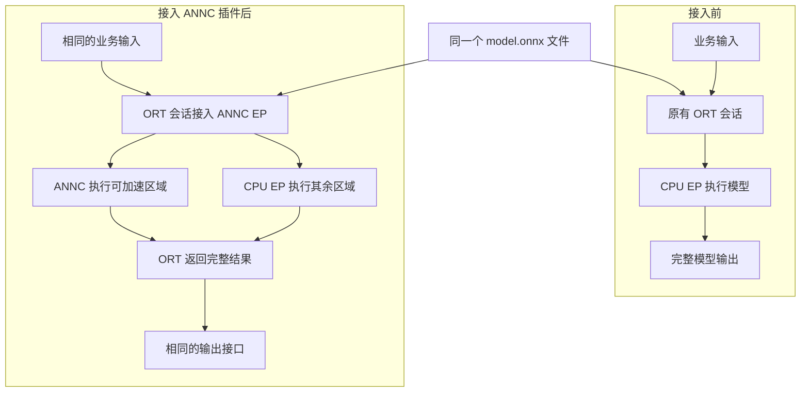
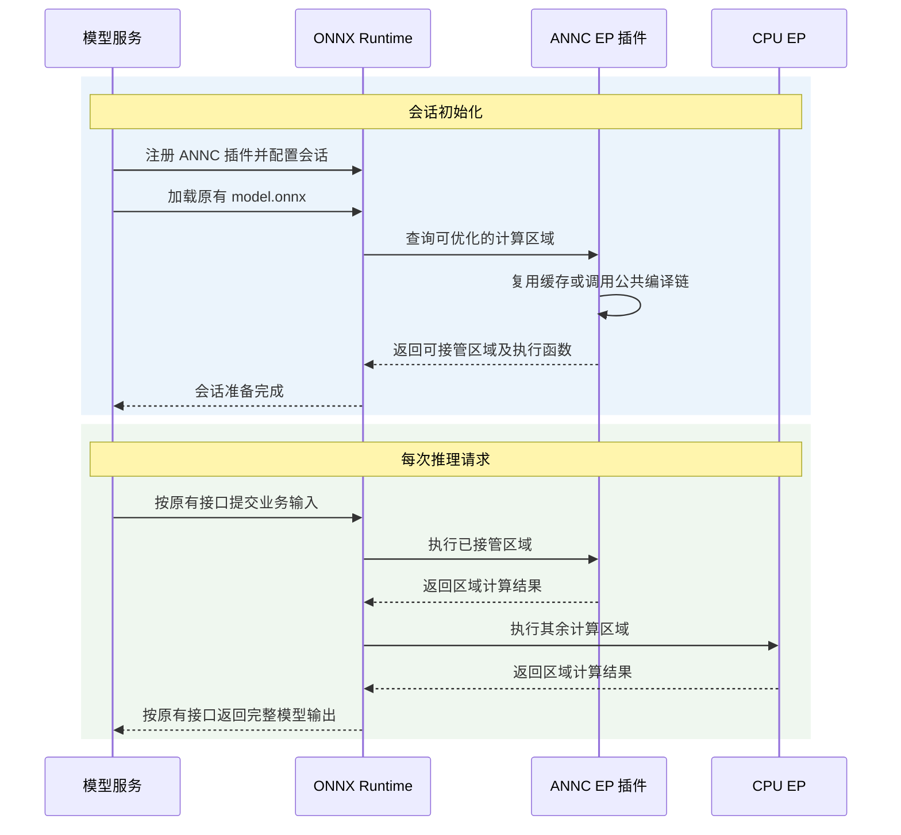
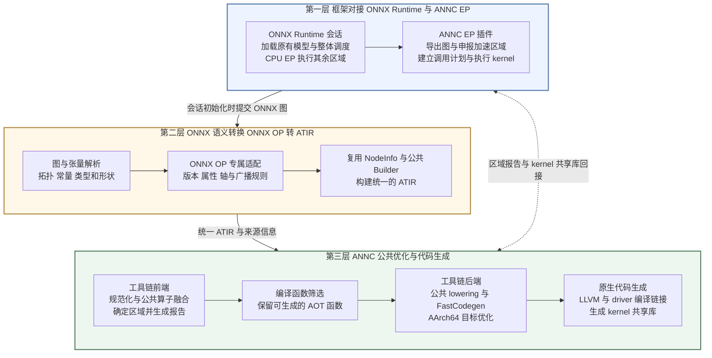
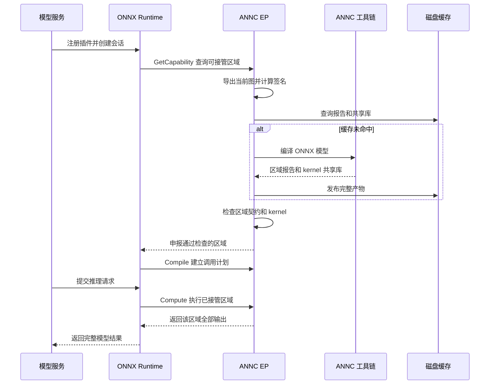

# ANNC ONNX 支持整体方案设计

| 文档控制项 | 内容                                                                                                                                           |
| ----- | -------------------------------------------------------------------------------------------------------------------------------------------- |
| 文档编号  | ANNC-ONNX-HLD-001                                                                                                                            |
| 版本与日期 | 2.0，2026-10-16；迁移至新基线 `4c5435fd`（masked_mul / batched_matmul_add / layer_norm 三个上下文站点合入）；同步白名单、参数契约、并行路径、缓存身份与测试基础事实。                                                                                                                              |
| 文档状态  | 待架构评审；方案建议尚未成为发布承诺                                                                                                                           |
| 评审对象  | ANNC 架构师、产品负责人、开发负责人、测试负责人、交付负责人                                                                                                             |
| 源码基线  | Git 提交 `4c5435fd`（分支 `upstream/dev`）；现状描述以该工作区中的源码为准                                                                                                  |
| 文档层级  | 整体方案设计，覆盖需求、架构、接口、质量、验证和交付；模块实现细节在详细设计中展开                                                                                                    |
| 关联文档  | [ANNC 总体架构](../../architecture/overview.md)、[架构决策索引](../../decisions/README.md)、模块详细设计（[文档集索引](README.md)：EP / ONNX 前端 / 融合与算子实现） |

## 1 背景

### 1.1 本方案要解决的问题

ANNC 已经具备把计算图转换为 ATIR、进行融合优化、生成 AArch64 原生代码的能力。ONNX 支持的目标，是让使用 ONNX Runtime 的推理业务也能复用这些能力，减少同一套 CPU 优化在不同框架中的重复开发。

推荐方案是：**由 ONNX Runtime 继续管理整个模型，ANNC 只接管能够正确编译的计算区域。** ONNX 前端负责准确翻译模型，已有 ATIR 优化负责决定融合边界，ONNX Runtime 插件负责把这些区域连接回模型执行流程。其余区域由 ONNX Runtime 的 CPU 执行提供者执行。

### 1.2 本次评审的核心结论

1. 保持 ANNC 的三层架构，ONNX 与 TensorFlow 共用 ATIR、融合 Pass、公共 lowering 和 AArch64 后端。
2. 采用 ONNX Runtime 的独立插件 EP（Execution Provider，执行提供者）接口。ANNC EP 把 ANNC 的 CPU 编译与计算能力接入 ORT；应用在创建会话时注册插件并选择其 CPU 执行设备，业务输入输出和模型接口保持一致。
3. 延续“会话初始化时编译、磁盘缓存复用、推理时调用原生 kernel”的路径。已验证模式可在同一会话内按实际 batch 等动态维度复用代码，输入类型、rank、固定维度和输出形状关系须始终满足编译契约。按请求形状进行 JIT 特化属于后续扩展范围。
4. 首期支持清单按经过验证的融合模式、类型、形状条件和 ONNX Runtime 版本发布。每项能力以对应组合的验收结果为依据。
5. EP 在能力查询阶段向 ORT 提交准备接管的原节点集合，ORT 据此建立融合分组；这个过程称为区域申报。申报前完成兼容性与产物检查，准备失败可以放弃接管。ORT 接受分组后，调用计划建立失败会使会话初始化失败，执行失败会使当前请求失败；当前没有在失败后用相同输入自动重放原 CPU 子图的机制。
6. 缓存语义、运行接口校验、前端语义保真和多会话隔离是首期发布门槛。交付验收须覆盖模型导入、代码生成与真实宿主执行的完整链路。
7. AOT kernel 的并行执行复用 ORT 的 intra-op 线程池（经其 `KernelContext_ParallelFor` 借用入口适配），EP 与 kernel 不自建线程池；现状：已实现——EP 在执行上下文（ABI v3）中携带线程池句柄，kernel 侧优先取上下文池、缺失时回退 TLS 注入池，池不可用时在本线程内联串行执行。设计见模块详细设计。

### 1.3 现有基础与交付缺口

| 方面   | 源码中的现有基础                                         | 达到可交付状态还需完成                            |
| ---- | ------------------------------------------------ | -------------------------------------- |
| 模型导入 | ONNX 解析、类型和形状推导、独立算子映射表、诊断报告                     | 明确逐算子的语义边界，补齐可选输入、动态参数、类型和广播的负例        |
| 编译链路 | `annc-onnx2atir`、`annc-opt`、`annc-asm`、`annc` 串联 | 明确 AOT 模式清单，保证报告、实际产物和 EP 能力一致         |
| 框架接入 | 独立 EP、区域申报、调用计划、多输出缓冲区分配、上下文 ABI v3 与线程池复用                         | 在接管前完整检查 dtype、rank、维度、ABI、参数顺序和输出集合 |
| 缓存   | 模型签名、磁盘缓存、跨进程文件锁、完成标记                            | 把影响代码的常量、版本、目标和配置纳入签名，验证缓存损坏和升级场景      |
| 测试   | 52 个前端 GTest 定义（本轮计数）、6 个前端 pytest 定义，以及 EP 侧 GTest、两组宿主夹具与四个上下文端到端用例 | 补齐真实 ORT 宿主的完整差分与失败等级矩阵，区分执行、跳过和失败 |
| 部署   | 前端和插件构建开关、工具链安装、可配置缓存目录                          | 固定验收版本矩阵、资源预算、权限约束、灰度和回退操作             |

本表依据源码梳理现有机制和测试定义。本次完成的是源码核对与文档编制；目标平台的测试结果和性能数据需在发布前按第 10 节提交可复现报告。

## 2 需求与范围

### 2.1 使用者和价值

| 使用者      | 需要什么                          | 本方案提供什么                   |
| -------- | ----------------------------- | ------------------------- |
| 模型服务开发者  | 在既有 ONNX Runtime 服务中使用 CPU 优化 | 注册插件后，由运行时自动分配可支持区域       |
| 模型与算法工程师 | 知道模型哪些部分能加速、哪些不能              | 导入诊断、融合区域报告及未接管原因         |
| 编译器开发者   | 复用已有优化，避免按框架重复实现              | ONNX 专属语义适配与公共 ATIR 优化相分离 |
| 测试与交付工程师 | 可重复验证、可定位问题、可关闭加速             | 固定版本矩阵、差分测试、运行日志与会话重建流程   |
| 架构师      | 判断边界是否合理、风险是否可控               | 方案比较、接口契约、发布门槛与待决策事项      |

### 2.2 交付范围

面向 openEuler 与 AArch64 CPU 推理，完成 ONNX 模型导入、符合条件的 ATIR 融合区域编译、ONNX Runtime 回接，以及必要的构建、测试、部署和诊断。模型中的剩余区域使用同一 ONNX Runtime 会话的 CPU EP。

原模型使用外部权重文件时，首期依赖 ORT 完成加载，再由 EP 导出内联 initializer；独立 CLI 的外部数据加载器留待后续扩展，两条入口的支持范围分别公布。

ONNX 算子版本以现有默认域 opset 13 为起点；ORT SDK 与宿主以仓库约定的 1.26.0 为首期验收基线。openEuler 的具体版本、CPU 型号和指令集、线程配置、客户模型集在方案评审时固定。版本兼容性通过真实宿主上的加载与执行测试确认。

首期运行支持按“融合模式 × dtype × 输入输出形状 × ABI”公布。优先验证已有 AOT 融合模式，计算数据以 f32 为首期建议基线；形状和索引计算使用模式明确定义的整数类型。每个运行数据类型都需通过对应模式的 EP 接口与数值验收。

形状支持分为固定条件与运行时可变维度。固定条件包括 rank、收缩轴大小、权重与偏置形状等模式约束；允许变化的维度必须有明确的数据来源和输出规则。例如，经验证支持动态 batch 的模式可以接受同一模型中 batch 从 1 变为 8，而不重新编译；改变固定的特征维、参数类型或无法推导的输出尺寸则超出该区域的契约。首期仅验收 ANNC CPU EP 与 ORT CPU EP 的组合，GPU 混合执行另行验证，见第 3.3 节。

| 首期候选模式               | 通俗解释                 | 进入发布清单前的重点                 |
| -------------------- | -------------------- | -------------------------- |
| `tensordot_matmul`   | 将展平、矩阵乘法和恢复形状组成的计算合并 | 轴排列、边界闭包、动态 batch 和固定权重条件  |
| `masked_mul`         | 将掩码生成和多个乘法合并         | padding 常量身份、NaN 语义和多输出顺序  |
| `batched_matmul_add` | 将批量矩阵乘法和偏置加法合并       | batch 形状、广播语义及输入输出类型       |
| `layer_norm`         | 将一组层归一化计算合并          | 归约轴、epsilon 标量输入、数值误差和完整边界 |

四个候选模式均已作为上下文 ABI（`annc_execution_v2`）站点合入当前基线（patterns 由 `!249` 引入）。ONNX AOT 链路的实际载体为 #11 `tensordot_matmul`（FTDMM）与 #12–#14 三个上下文站点；`matmul` 家族走模板/JIT 路径，在 prune 阶段被裁剪，EP 白名单含 `matmul` 不代表存在可接管产物。“可交付”的结论保留给通过指定平台验收的组合；当前组合的能力状态以模块详细设计的差距登记为准。M0/M1 固定具体输入范围和首期候选清单；验收通过的组合进入正式发布清单。

### 2.3 不纳入首期的范围

- 全量 ONNX 算子实现、训练算子和训练流程。
- ONNX `If`、`Loop`、`Scan` 控制流的整体编译，以及模型本地函数的展开。
- 任意数据相关输出形状、未知 rank 的执行，以及按请求形状 JIT 特化的通用机制。
- int8 量化、f16、bf16、字符串、复数等运行数据类型的通用加速。
- GPU、NPU、非 AArch64 后端，以及跨机器编译和分发 kernel 的服务。
- 为 ONNX 单独维护一套优化 IR、融合匹配器或 kernel 注册系统。
- 恢复已经移除的离线 manifest 部署路径；CLI 产物主要服务开发调试和 EP 编译调用。

原模型能够由目标 ORT 宿主正确加载和执行，是使用 CPU EP 承接其余计算的前提。模型自身的加载或执行问题按 ORT 的原有错误处理流程解决。

### 2.4 功能需求

“必须”项构成首期交付条件；“后续”项在独立立项和评审后进入相应版本。

| 编号    | 需求                      | 优先级 | 成功判据                                            |
| ----- | ----------------------- | --- | ----------------------------------------------- |
| FR-01 | 准确读取模型结构、张量、常量和属性       | 必须  | 有效模型保持语义；损坏模型明确报错；无节点被静默丢弃                      |
| FR-02 | 管理 domain 和 opset 的支持边界 | 必须  | 加速路径以通过验证的 domain/opset 组合为准；宽松导入用于诊断，版本支持须单独验收 |
| FR-03 | 准确处理类型、形状、轴、广播和可选输入     | 必须  | 逐算子正例与负例通过；未知语义不按猜测执行                           |
| FR-04 | 保留不支持节点及原因，允许其余区域优化     | 必须  | 诊断可追溯；未接管区域继续交给 CPU EP                          |
| FR-05 | 复用公共 ATIR 融合及后端生成能力     | 必须  | 融合决策只有一个来源，ONNX 适配不侵入目标后端                       |
| FR-06 | 精确申报融合区域并建立执行调用计划       | 必须  | 区域、边界输入、全部输出和参数顺序与 kernel 一致                    |
| FR-07 | 在会话初始化阶段编译并复用缓存         | 必须  | 冷缓存生成有效产物；热缓存正确复用；语义变化使缓存失效                     |
| FR-08 | 明确失败处理与关闭加速流程           | 必须  | 接管前失败保留可用的 CPU 路径；接管后错误可定位                      |
| FR-09 | 提供构建安装、运行配置和诊断信息        | 必须  | 完整安装包在目标宿主可加载、可执行、可复现                           |
| FR-10 | 保持 TensorFlow 及公共接口的兼容性 | 必须  | 共享模块变更后既有 TF 测试和构建组合无回归                         |
| FR-11 | 按真实请求形状 JIT、量化和扩展 opset | 后续  | 独立评审语义、缓存、资源和运行接口后再进入范围                         |

## 3 典型使用场景

### 3.1 同一个 ONNX 模型接入插件即可自动优化

**ONNX 模型文件无需改动，在 ONNX Runtime 会话中接入 ANNC EP 插件，即可自动完成可支持区域的优化、编译和执行回接。** 业务继续加载原有 `model.onnx`，沿用输入张量、推理调用和输出接口。编译工具由插件自动调用。

EP 是 Execution Provider（执行提供者）的缩写，是 ORT 接受计算能力并调用它的扩展接口。ANNC EP 是 ANNC 实现的插件：它把可加速区域连接到生成的 AArch64 CPU 函数，同时让 ORT 继续管理整个模型。“ANNC 设备”是插件在 ORT 中暴露的逻辑执行选项，对应宿主 CPU。

例如，一个推荐服务已经通过 ORT 加载 `model.onnx`，接收用户特征并返回预测结果。接入 ANNC 后，这个模型文件和请求处理方式继续使用，服务只在会话初始化处增加插件注册及 ANNC 设备选择。优化发生在会话内部，业务每次仍然提交输入、获取完整模型输出。

下图展示同一个模型接入前后的推理方式：

这里的“端到端”指模型加载、自动优化、执行回接到完整输出的流程由 ORT 与插件协作完成。实际加速范围由已支持的融合模式、类型和形状决定；ORT 继续负责整个模型的调度和结果返回。

### 3.2 从接入插件到一次推理完成

从模型服务的使用角度，整个过程分为三步：**接入插件 → 创建会话 → 按原有方式推理**。

| 阶段   | 业务侧操作                               | ORT 与 ANNC 自动完成的工作                 |
| ---- | ----------------------------------- | ---------------------------------- |
| 接入插件 | 在应用初始化时注册 ANNC EP，将其 CPU 执行设备加入会话选项 | 枚举支持的 CPU 设备，将插件纳入该会话的执行提供者列表      |
| 创建会话 | 加载原有 ONNX 模型，创建 ORT 会话              | 分析模型、识别可优化区域、复用缓存或编译代码，并建立执行关系     |
| 执行推理 | 继续调用原有 ORT 推理接口，传入输入并读取输出           | ANNC 执行接管区域，CPU EP 执行其余区域，返回完整模型结果 |

初始化和请求执行的关系如下。上半部分在会话创建时完成，下半部分随每次请求执行：

图中两类区域的执行次序是示意，实际按模型中的数据依赖调度。首次创建会话可能包含编译开销，后续符合缓存复用条件的会话可以减少重复编译；会话准备完成后，正常请求直接复用已准备好的代码。服务可先用既有样本完成预热，再接收业务流量。

### 3.3 区域协同执行与设备选择

假设模型中的计算顺序是 `A → B → C → D`，B、C 满足 ANNC 的融合条件。接入插件后，ORT 可以按 `CPU 执行 A → ANNC 合并执行 B 和 C → CPU 执行 D` 完成同一次推理。业务仍然提交 A 的输入、读取 D 的输出，中间各区域由 ORT 自动调度。

这一方式允许先加速模型中已支持的热点区域，再逐步扩展覆盖。没有被接管的节点继续使用 CPU EP；模型没有可加速区域时，也可以沿原有 CPU 路径运行。

ONNX 文件描述计算图，模型由 CPU 还是 GPU 执行取决于 ORT 会话配置的执行提供者及其优先级。ANNC 插件在设备枚举阶段返回 CPU 设备。会话初始化时，ORT 按已配置提供者的能力分配区域；分组确定后，后续请求沿该执行关系运行，ANNC kernel 始终在分配给它的宿主 CPU 上执行。[ORT 执行提供者机制](https://onnxruntime.ai/docs/execution-providers/)

已有 GPU 服务接入时，应先决定继续使用原 GPU 会话，还是建立 ANNC CPU 会话并完成正确性与性能对照。若同时配置 GPU EP 和 ANNC EP，GPU 区域的执行由相应 GPU EP 负责，跨设备的数据搬运由 ORT 及相应提供者协调；这种组合在单独验收后进入支持范围。ANNC kernel 使用宿主 CPU 可访问的内存，GPU 上的数据需先由相应提供者完成搬运。[ORT 输入输出与设备数据](https://onnxruntime.ai/docs/api/python/api_summary.html)

设备类型在插件枚举和会话配置阶段确定，模型区域是否可接管在能力查询与产物预检阶段判断，实际输入的类型、形状和内存条件在执行入口复核。接管前完整检查与执行时复核仍有待补齐项，发布时必须通过目标平台测试证明这些边界成立。

### 3.4 接入特点和效果确认

| 特点       | 对模型服务的意义                              |
| -------- | ------------------------------------- |
| 模型文件无需改动 | 继续使用同一个 ONNX 文件和业务算子                  |
| 接入点集中    | 在会话初始化处注册插件、选择 ANNC 设备，原有请求处理逻辑继续使用   |
| 优化执行自动衔接 | 模型分析、融合、编译和执行回接由插件与 ORT 自动串联          |
| 部分区域也能受益 | ANNC 与 CPU EP 在同一个会话中协同执行，逐步覆盖模型热点    |
| 推理接口保持一致 | 业务仍通过 ORT 传入输入、取得完整输出，优化后的计算语义应与原模型一致 |
| 缓存减少重复准备 | 符合复用条件的产物可用于后续会话，正常请求执行已准备好的函数        |

确认效果时，先观察会话实际接管了哪些区域，再用相同输入比较 CPU 会话与 ANNC 会话的全部输出，最后测量预热后的完整模型延迟和吞吐。效果确认以全部输出的正确性对照和端到端测量结果为准。

### 3.5 无法加速或执行异常时的使用边界

在接管区域之前，如果某段计算无法编译或准备失败，EP 可以放弃申报，ORT 继续按正常分区规则将它交给 CPU EP。此时区域仍保留在原 ORT 图中，按正常分区结果执行。若模型含有当前前端整体拒绝的结构，此次初始化可能不产生加速区域。

ORT 接受申报后，区域被替换为 ANNC 融合节点。执行失败后的 CPU 重试需要保留原子图，以相同输入重放计算，并协调输出与调度；该能力尚未实现。插件注册、融合分组或调用计划建立错误可能使初始化失败，已接管区域的执行错误会返回 ORT。服务关闭加速时应切换到经过准备的 CPU 会话，或以未追加 ANNC EP 的配置重建会话，具体操作边界见第 7.7 节。

## 4 设计约束与现状边界

### 4.1 外部格式和框架接口

ONNX 中的 IR 版本、opset 版本和算子 domain 分别描述模型结构、算子语义版本和算子命名空间。兼容性检查须同时确认这三项及具体算子语义。本方案以仓库支持的组合为准，新增组合逐项验证。[ONNX IR 规范](https://onnx.ai/onnx/repo-docs/IR.html)

ORT 通过 `GetCapability` 分配节点或子图；独立插件导出 `CreateEpFactories` 与 `ReleaseEpFactory`，应用注册插件后在会话选项中选择设备。沿用此边界能让图执行管理继续留在 ORT。[ORT EP 机制](https://onnxruntime.ai/docs/execution-providers/)、[插件使用接口](https://onnxruntime.ai/docs/execution-providers/plugin-ep-libraries/usage.html)

### 4.2 项目内部约束

- 遵循根 `AGENTS.md` 的“先理解、复用优先、最小改动、不越界、改完即验证”原则。
- ONNX 专属语义适配放在 `frontends/onnx/`，ORT 框架接口放在 `addons/onnxruntime/`。
- 算子语义、融合与后端实现继续使用既有 ATIR、`Conversion/Common`、Target 和 Kernel 模块。
- ONNX 模型导入可独立运行；ONNX-only 构建可以关闭 TF 前端及 addon。
- 首期使用本机配套的 ANNC 和 LLVM 工具完成编译。
- 公共 Builder、FusionMetadata 或 Pass 的变更须同时验证 TF 和 ONNX 路径。

### 4.3 支持层次与验收依据

| 层次  | 含义                                | 确认依据                            |
| --- | --------------------------------- | ------------------------------- |
| 能导入 | 前端可把某节点表达为 ATIR 或 opaque，旁路报告记录原因 | 检查语义映射与诊断；运行支持继续检查后续实现链路        |
| 能生成 | 某个融合模式满足后端条件并生成了 kernel           | 检查生成代码，并核对 ORT 参数、输出与 kernel 契约 |
| 能交付 | 指定版本、类型、形状和模式经过端到端验证              | 以该组合的验收报告为准，发布清单明确其适用范围         |

前端当前映射表有 39 个 ONNX 算子名称，部分算子共享映射行。该数量用于描述导入映射范围，运行支持覆盖率按已验收的模式组合另行统计。具体清单及限制见附录 A。

### 4.4 依赖与投入边界

| 依赖                     | 当前关系                                   | 交付约束                                 |
| ---------------------- | -------------------------------------- | ------------------------------------ |
| LLVM 与 MLIR            | 默认源码基线 21.1.3，公共后端复用                   | 外部工具链模式需单独固定并验证版本                    |
| protobuf 与 ONNX schema | 复用仓库 schema 和 protobuf，构建脚本生成 proto 源码 | protoc 与链接库匹配；手工 CMake 前准备好生成文件      |
| nlohmann json          | 公共报告和 EP 使用                            | 默认基线 3.11.3；system JSON 与 EP 组合需专门验证 |
| ORT SDK 与宿主            | EP 可选依赖，默认构建不下载 SDK                    | 首期按 1.26.0 成套验证；新增版本逐项验收             |
| Python 测试包             | 前端 pytest 需要 onnx，宿主验证按测试驱动选择依赖        | 提供独立测试依赖清单；关键依赖缺失时阻断验收并报告原因          |
| kernel 和系统依赖           | 使用实际选定模式所需的归档和动态库                      | 记录来源、许可证、摘要与安装位置                     |

新增投入主要是语义和接口收敛、真实宿主测试、缓存与并发加固及部署资料。保守缓存签名增加常量摘要成本，插件接入增加初始化和运维配置成本；投入回报根据端到端测量结果评估。

根构建要求 CMake 至少 3.21 和 C++17。EP 依赖外部 ORT 的 C/C++ 头文件，由宿主提供 ORT API，当前实现采用 Linux/POSIX 的进程、文件锁和动态库机制。静态 protobuf 可能带来 Abseil 等链接依赖，纳入安装验证；EP 当前固定引用 vendored JSON 头文件，system JSON 与 EP 组合需完成专门的构建和安装验证。

## 5 备选方案与取舍

| 方案            | 做法                             | 收益                       | 代价与问题                         | 结论                 |
| ------------- | ------------------------------ | ------------------------ | ----------------------------- | ------------------ |
| A 共享编译器加独立 EP | ONNX 转 ATIR，公共 Pass 决定融合，EP 回接 | 复用最多，职责清楚，剩余区域可留给 CPU EP | 需管理初始化编译、区域契约和版本兼容            | 推荐，延续已有主路径         |
| B 离线改写模型加清单   | 先生成共享库，再重写 ONNX 模型或提供匹配清单      | 可把编译移出服务启动流程             | 需维护产物与模型绑定、独立匹配和分发协议；仓库旧路径已移除 | 首期不恢复；以后有明确部署需求再评审 |
| C 独立运行时执行整个模型 | ANNC 实现完整模型执行、调度与内存管理          | 执行边界统一                   | 算子覆盖、内存规划和框架生态投入大，超出当前定位      | 不采用                |

方案 A 的主要代价是首次初始化包含编译开销。通过缓存和服务就绪前的会话预热解决这一问题，比首期新增远程编译、离线分发或另一套运行时更符合最小改动原则。

融合匹配统一由 ATIR Pass 负责，EP 负责验证区域并执行产物。新增优化沿用同一套匹配规则，保持编译决策的一致性。

## 6 总体架构

### 6.1 ONNX 接入的分层职责

按 ONNX 接入链路，自上而下分为三个展示区域：**框架对接 → ONNX OP 转 ATIR → ANNC 公共优化与代码生成**。上层负责接住模型和推理请求，中间负责准确翻译算子语义，下层复用公共能力生成可执行代码。

实线表示模型进入编译器的处理方向，虚线表示 EP 获取编译产物并完成执行回接。融合区域报告描述“替代哪些节点、使用哪些输入输出”，共享库提供“如何执行这段计算”；EP 检查并加载这些产物后，由 ORT 在后续推理中调用。编译驱动与缓存服务于产物准备和复用，具体时序见 6.3。

| 展示区域           | 主要职责                                     | 与既有架构的对应关系             |
| -------------- | ---------------------------------------- | ---------------------- |
| 框架对接           | 管理 ORT 图的导出、区域接管和运行调用，维持完整模型执行           | 框架对接层中的 ORT 接入部分       |
| ONNX OP 转 ATIR | 解析模型事实、处理 ONNX 专属语义，通过公共 Builder 构建 ATIR | 框架对接层中的格式适配入口，复用公共构建组件 |
| ANNC 公共优化与代码生成 | 公共融合确定优化区域，筛选函数，再进行 lowering、目标优化和链接     | 一并展开既有工具链前端与工具链后端      |

该图以 ONNX 使用链路组织展示，沿用总体架构和 ADR-002 中的职责边界。ONNX 的版本、轴和广播差异在语义转换阶段收敛，公共优化与后端继续围绕 ATIR 工作。

### 6.2 模块划分

| 模块            | 主要职责                      | 输入与输出                          | 复用与扩展位置                                          |
| ------------- | ------------------------- | ------------------------------ | ------------------------------------------------ |
| ORT EP        | 接入框架、导出图、申报区域、执行 kernel（含执行上下文与线程池复用）   | ORT 图和张量 → 编译模型及运行输出           | `addons/onnxruntime/`                            |
| 模型加载与图解析      | 读取 protobuf、规范节点、确定拓扑     | ONNX 模型 → 已解析图                 | `onnx_frontend.*`                                |
| 张量解析与常量解码     | 确定 dtype、rank、shape 和常量内容 | 已解析图 → 张量描述与诊断                 | `onnx_tensor_resolver.*`、`onnx_tensor_decoder.*` |
| ONNX 语义适配     | 转换属性、可选输入和算子语义            | 节点描述 → NodeInfo 与 ONNX 映射      | adapter、transformers、ONNX op spec                |
| 公共 Builder    | 创建 ATIR、保留来源和诊断           | NodeInfo → ATIR                | `annc/lib/Builder/`                              |
| 公共融合          | 识别区域、收集边界、选择模式            | ATIR → 融合函数及元数据                | `Dialect/Atir/Passes/OpFusion.cpp`               |
| ONNX pipeline | 串联工具、写报告、控制产物             | 模型 → `sites.json` 和 kernel 共享库 | `frontends/onnx/onnx-pipeline/`                  |
| 公共后端          | lowering、目标优化、链接          | 融合函数 → AArch64 代码              | Conversion、Target、Kernel、driver                  |
| 编译驱动与缓存       | 指纹、锁、超时、缓存读取与发布           | 模型和环境 → 可复用产物                  | `annc_ep_compile.*` 与 graph export               |

### 6.3 编译与执行流程

图中给出了目标流程。当前已具备主要链路，接管前的完整契约检查仍需补齐。现有 ANNC 在 `GetCapability` 阶段生成共享库；`Compile` 回调负责匹配区域、校验输出契约并绑定 kernel，参数到输入的绑定在首次执行时按秩与元素类型完成（见 ep-design §6.3）。

## 7 关键设计

**ONNX 前端负责算子语义映射，计算实现复用 ANNC 公共能力。** 前端把 ONNX 算子的计算含义、属性和输入输出转换成已有 ATIR 表达，再交给公共融合、lowering、目标后端和 kernel 库完成优化与执行。

### 7.1 ONNX 前端的语义保真

**映射与复用方式：** 优先把 ONNX Op 映射到语义一致的已有 ATIR Op；遇到名称、属性位置或默认值不同的情况，先做等价转换，再交给公共 Builder 构建。每条映射规则需保证计算语义一致，并完成相应的参数转换。

IR 是模型在编译器中的表示，Op 是其中表达某项计算的节点。ONNX 前端确实需要为所支持的 ONNX Op 编写版本、属性和输入输出转换规则；这些规则使用已有 ATIR Op 重建等价的模型图，属于“ONNX 图 → ATIR 图”的 IR 转换。转换后的模型使用 ANNC 已有的 IR 定义。生成代码和调用 kernel 的实现由公共 lowering、目标后端和 kernel 库承担。

| ONNX 算子           | 复用的 ATIR 表达       | ONNX 接入层负责什么                     |
| ----------------- | ----------------- | -------------------------------- |
| MatMul            | `atir.MatMul`     | 按已有转换器构建矩阵乘法表达，保留输入输出类型和形状       |
| Sigmoid           | `atir.Logistic`   | 将同一种计算的不同名称映射到已有表达               |
| Sum               | `atir.Add`        | 按 ONNX 的逐元素求和语义映射，使用加法表达         |
| Transpose         | `atir.Transpose`  | 把 ONNX 的 perm 属性转换成 ATIR 所需的置换参数 |
| GlobalAveragePool | `atir.ReduceMean` | 转换为空间维度上的平均值归约，并保持输出维度规则         |

这些例子展示已有映射入口；最终是否能够执行，还需满足相应类型、形状、融合模式及后端条件。映射完成后，执行代码由公共 lowering 生成，或调用已有 kernel。

ONNX 与 TensorFlow 分别维护语义映射规则，复用同一个构建引擎和后续优化能力。扩展 ONNX 支持时，首先检索已有 ATIR Op、转换器、lowering 和 kernel；已有表达无法准确承载语义时，再按公共模块扩展流程评审新增能力。无法等价映射的节点保留为显式不支持边界。

沿用模型加载、图解析、张量解析、语义适配和 Builder 的分工，各阶段通过明确的数据契约交接。当前 resolver 优先保留规则推导结果，模型声明用于补缺口。首期需增加两者的冲突检查，并逐算子验证推导规则；无法确认的内容保留为未知状态并记录诊断，相关区域通过语义检查后方可生成代码。

ONNX 与 TensorFlow 即使算子同名，含义也可能不同。例如 ONNX `Sum` 是多个张量逐元素相加，TF 的 `Sum` 通常表示归约。两者共享构建引擎，但使用各自映射表。轴参数、广播规则、属性默认值和算子版本也应在 ONNX 适配层确认后再交给公共 ATIR。

**首期需收敛的规则：**

- 可选输入按原位置解释；中间输入缺省时保留空位，使后续参数维持原有身份。
- axes 的缺省状态和运行时取值状态分别处理：前者按算子版本解释默认语义，后者保留动态状态并检查后续支持条件。
- 对 Slice 的步长、负轴、索引范围，Reshape 的 0 和 -1，Reduce 的 keepdims，Softmax 的轴等逐项验证。
- 广播支持需同时验证形状推导、目标 ATIR Op 和 lowering 的语义一致性。
- 类型支持按 Op 与 dtype 的组合验证，覆盖常量解码、ATIR 表达和后续执行链路。
- 保留或明确拒绝符号维度关系；当前将符号维度转为动态大小后，不保留同名符号的相等约束。
- 不支持节点用 `atir.opaque` 保留结构，provenance 和导入 JSON 记录原因。opaque 标记优化边界，其对应计算仍由原 ORT 图执行。

当前前端默认拒绝非 opset 13 模型；`--relaxed-opset` 提供按节点分析的诊断入口，其他 opset 的正式支持需单独验收。`--strict` 将任何回退视为错误。新增 opset 时应补充对应版本的语义适配与差分测试。

### 7.2 融合边界只由公共 Pass 决定

融合报告描述哪些原节点组成一个 kernel，以及需要哪些外部输入和输出。EP 按报告中的成员名单申报区域，融合模式由公共 Pass 统一确定。

区域申报发生在 ORT 的 `GetCapability` 能力查询期间：EP 将通过检查的成员集合交给 `AddNodesToFuse`，ORT 随后建立融合分组并调用 `Compile` 建立执行计划。报告只是编译器给 EP 的区域说明，向 ORT 提交分组才是接管流程的交接点。未申报节点仍属于原 ORT 图，继续由其他提供者按正常流程执行。

融合区域必须满足四项条件：计算闭包完整；遍历在边界输入处停止；全部被区域外使用的结果都列为输出；成员集合与已接管区域互斥。成员名单仅包含原图计算节点，常量和图输入按边界数据处理。

现有导出采用规范节点名和张量名并保留映射，EP 将报告中的成员映射到原 ORT 节点，记录节点 ID 集合，在 `Compile` 时匹配对应区域。实参张量名的双向映射由导出侧生成、当前消费路径尚未使用；执行期的参数绑定按 rank＋元素类型完成（见 ep-design §6.3）。区域以成员节点 ID 集合标识，输入输出以张量名关联，二者分别维护。

**目标约束：** 在首次申报前完成全部候选区域的检查，只有能建立完整调用计划的区域才进入申报。对于多输出区域，kernel、ORT 分组和调用计划须对全部输出的集合及顺序保持一致。

### 7.3 会话初始化编译

现有 pipeline 顺序如下：

1. `annc-onnx2atir` 将 ORT 提供给 EP 的当前主图整体导入 ATIR，主要中间产物使用 MLIR bytecode，降低大型文本 IR 的存储和读取开销。
2. `annc-opt` 进行 Identity 规范化与 OpFusion。
3. pipeline 读取融合函数并生成 `sites.json`。
4. 以 `--atir-prune-func=execution-mode=aot` 只保留 `execution_mode=aot` 且带 `fusion.pattern` 的函数（JIT 站点被裁剪），调用 `annc-asm` 进行 FastCodegen 和 AArch64 后端处理。
5. `annc` 链接生成一个模型级 `libannc_kernels.so`。

当前路径即使最终只融合约 1% 的节点，也先分析这张主图。公共 Pass 需要类型、形状、常量、数据依赖和全部边界信息才能确定区域；当前 EP 没有在导入前另做一次模式匹配和按覆盖比例裁图。未支持节点保留为 opaque，其他未融合节点保留必要的分析上下文；随后只保留选中的 AOT 融合函数生成代码，其余计算继续在原 ORT 图上执行。整图导入的成本属于冷启动和热缓存身份准备开销，应与实际端到端收益一起测量。

前端返回 2 表示“导入完成但存在回退节点”，pipeline 可以继续分析可融合区域。暂不融合的算子在 ATIR 中提供依赖和区域边界上下文，其计算保留在原 ORT 图中。零融合区域作为正常结果返回空报告，共享库仅在存在可生成区域时产出。前端硬错误或后续阶段失败应返回失败，由 EP 决定不接管。

当前 pipeline 只接受 `aot` 执行模式。AOT 表示在计算执行前生成代码。满足模式契约的动态维度可通过运行时张量描述符传入，已验证的 kernel 使用实际尺寸完成计算。公共 Pass 中标为 `jit` 的模式依赖另一条按实际形状特化的路径，在 prune 阶段被裁剪，不进入当前 ONNX EP 编译产物与申报清单（首期只发布 AOT）。前端能够表达某个算子、公共 Pass 能识别某个模式、该模式在 ONNX EP 可执行是不同的能力条件。

**目标约束：** 发布报告中的可接管区域须同时满足实际产物、执行模式和 EP ABI 支持条件。零区域正常返回，在首期 CPU 会话中由 CPU EP 执行完整模型。

### 7.4 运行接口和内存

ORT 负责输入张量和输出缓冲区。EP 读取输入地址和维度，按照报告顺序组织 memref 描述符，主路径经上下文 ABI（站点 `abi=annc_execution_v2`，符号名 `_mlir_ciface_<kernel_name>`，首参为执行上下文，输出经上下文回调分配）调用 kernel；`mlir_ciface` 为兼容路径。memref 可以理解为“数据地址、偏移、各维大小和步长”的组合，张量内存的分配与生命周期由 ORT 统一管理。

`kernel_arg_order` 表示参数在“输入列表加输出列表”中的排列；上下文站点的该字段为空数组，兼容路径要求其为完整排列。两条路径的执行期参数绑定均按秩与元素类型完成，不读取该排列。多输出时必须分配并写入每个输出，且输出顺序与 ORT 的实际边界顺序一致。

当前兼容路径的签名固定为两个输入（秩 3 与秩 2）加一个秩 3 输出；上下文站点接受 1 至 14 个 kernel 实参（外加执行上下文），输入 dtype 为 f32／i64、输出 dtype 为 f32，参数与输出 rank 为 0 至 4；重复 rank 或多输出时要求站点名称已解析，否则在申报前丢弃。输入可以包含标量，标量输出当前会在兼容路径被拒绝。输出形状的当前实现按路径分叉：上下文路径由 kernel 给出维度、EP 校验，兼容路径按 `{d0,d1,n}` 求值；两条路径都不支持一般的形状表达式或数据相关输出形状。

kernel 的并行执行复用 ORT 的 intra-op 线程池：EP 在执行上下文（ABI v3）中携带线程池句柄，kernel 的并行循环经 ORT 的 `KernelContext_ParallelFor` 入口（1.17 起提供）提交到会话线程池，EP 与 kernel 不自建线程。实现另有受版本校验的可选原生池路径（按 ORT 私有布局直接取 operator pool，构建期 `ANNC_EP_NATIVE_POOL` 控制是否编译，运行时无关闭开关；FTDMM/BMM 在其非空时可用 MLAS，否则走标量行路径），默认关闭。现状：已实现（GAP-08 编号保留，已在新基线上闭合）。剩余风险：EP 与 kernel 必须同源构建（`thread_pool` 句柄背后的虚表不在尺寸/版本校验内，原生池的私有布局与归档须随宿主版本重新验证）；嵌套并行判定依赖 thread_local；池不可用时静默串行回退。线程数声明与并行收益在目标平台实测后固定发布配置（详见 ep-design §6.6）。

同一会话内的形状变化只允许发生在区域已声明可变的维度上，且所有固定条件和输出关系仍成立。例如动态 batch 可以由每次请求的实际输入维度提供；固定的收缩维度或权重形状发生变化时，原调用计划失效。目标设计要求申报前筛掉无法建立形状契约的区域，执行时拒绝违约输入，业务需要改变固定条件时，应使用对应模型重建会话，或切换到已验证的 CPU 会话。违约请求按执行错误返回，逐请求 JIT 和自动 CPU 重放属于后续能力。当前完整形状与类型复核尚未实现，动态支持必须逐模式验收。

**接管前必须校验：** 执行模式、ABI、dtype、rank、固定维度、动态维度规则、参数上限、完整参数排列、ORT 边界输入输出集合、目标设备和连续内存条件。报告中的 dtype、rank 和 shape 须完整传递到运行时。

**执行时必须复核：** 实际输入类型、rank、固定维度及容量乘积无溢出；输出尺寸可确定且非负；每个输出只分配一次。参数顺序按完整排列校验，覆盖长度、取值范围和唯一性。

`annc_execution_v2`（执行上下文 ABI，当前版本 v3）是主路径：kernel 首参为执行上下文，输出经上下文回调分配，站点不带 `kernel_arg_order`。`mlir_ciface`（预分配输出、按 `kernel_arg_order` 排列实参）为兼容路径。EP 在申报前按 `execution_mode`/`abi` 过滤，要求 `execution_mode=aot`，模式白名单为 `matmul`、`tensordot_matmul`、`masked_mul`、`layer_norm`、`batched_matmul_add`（白名单包含 `matmul`，但当前它只产生 JIT 站点、无 AOT 产物）。执行上下文 ABI 的设计依据见 [ADR-013](../../decisions/decisions.md#adr-013) 与模块详细设计。

### 7.5 缓存语义和生命周期

缓存的作用是避免重复编译，**缓存命中必须意味着生成代码的语义和运行环境相同**。

现有缓存位于 `<cache>/v1/<签名前两位>/<签名>/`，包含报告、共享库和 `DONE` 标记，冷缓存使用 `flock` 控制相同签名的跨进程编译。当前模型签名（前缀 `annc-ep-cache-key-v1`）剔除 producer/doc/图名等易变字段，并在图中**同时含 Mul 与 MatMul** 时保留 initializer 数值、其余情况清空 initializer 载荷；工具链+配置指纹（前缀 `annc-ep-config-v1`）覆盖工具链输出与代码生成相关环境变量，并以 `annc-ep-kernel-libs-v1` 记录 `ANNC_KERNEL_LIB_PATH` 下每个 kernel 归档的大小与修改时间。完整发布身份（EP 构建版本、目标 ISA、全部编译期常量）仍需补齐。

这仍有正确性风险：某些融合模式（如 `masked_mul` 的 padding）将常量写入生成代码，而当前仅在“同时含 Mul 与 MatMul”的图上保留 initializer 数值，其余图仍清空载荷。若两个模型结构、dtype 和 shape 相同，仅这类常量不同，签名可能相同，后一个模型会使用前一个模型的代码。常量是否影响生成代码取决于其用途；运行参数与编译期内嵌常量需分别确认。

**首期建议采用保守方案：** 对模型语义和全部常量内容计算摘要，纳入缓存键；摘要计算复用已有 SHA-256 能力。某类常量经过代码依赖分析和差分测试，确认仅作为运行参数后，可从代码身份中排除。这样会降低不同权重模型间的复用率，但便于先保证正确性。

缓存键还应包含 EP 构建身份、目标架构和指令集、ABI 和缓存格式版本，以及 kernel 库的内容级身份（当前以归档大小与修改时间为代理）。缓存格式升级和旧目录隔离列为待实现项，当前 `v1` 仍沿用上述签名方式。

发布与读取遵循以下规则：

- 先在独立目录生成并校验所有文件，再完成原子发布；读取时同时校验完成标记、文件内容和接口契约。
- 相同签名只允许一个编译任务，等待锁也应受初始化预算约束。
- 读到损坏或不兼容产物时视为未命中，在允许范围内重建；重建失败则在申报前放弃加速。
- 零区域缓存以有效空报告作为完整结果：读取侧对空站点报告不要求共享库，可热命中；非空报告的共享库缺失、报告解析失败按未命中处理，并在锁内二次检查后重建。
- 已加载共享库的有效期覆盖全部活动调用，磁盘条目清理与进程内句柄释放分别管理。
- 缓存容量、淘汰策略和维护操作在发布前明确；有界 LRU 和完整在线淘汰机制仍需实现。

缓存生命周期由 EP 和交付运维共同管理：EP 负责查询、编译、校验和发布，服务部署负责设置私有缓存目录、容量配额、版本保留期和清理时点。当前没有自动容量淘汰或有界 LRU，模型、常量或版本持续增加时，磁盘条目和进程内库句柄也可能持续增长。会话销毁后，磁盘条目仍待运维清理，进程级句柄保留至进程退出。

| 资源          | 有效期与责任              | 终止或升级处理                                |
| ----------- | ------------------- | -------------------------------------- |
| 临时导出模型与工作文件 | 归本次任务所有，由 EP 编译驱动管理 | 任务完成或失败后按诊断保留策略清理；活动任务之间不得共用路径         |
| 磁盘缓存条目      | 跨会话复用，由服务账号持有       | 运维按配额和保留期清理过期条目；先停止旧命名空间写入并等待活动编译结束    |
| 已加载库与函数句柄   | 当前在进程级表中保留，含解析失败记录  | 活动调用期间不得卸载；当前通过进程退出释放，发布需固定加载预算和重启维护规则 |

模型常量、EP 或工具链版本、kernel 库、ABI、目标架构与指令集、影响代码的配置发生变化时，目标缓存身份应变化。业务之间使用私有目录隔离，部署升级使用新的缓存命名空间；旧条目可在服务排空后按保留策略清理。当前签名字段不完整，且进程级共享库句柄与符号负缓存保留至进程结束，因此升级时应切换缓存目录并重启宿主进程，再完成预热与验证。配额耗尽时受控停止生成新缓存，并按接管前失败路径处理；自动清理与配额联动仍需作为交付能力补齐。

### 7.6 并发和资源隔离

相同签名的编译锁用于协调同一产物的生成，不同会话的图导出则需要独立工作路径。当前每次能力查询在缓存根下新建 `tmp-<pid>-<序号>` 导出目录，编译驱动为本次查询的局部对象，同一 EP 实例上的能力查询由实例级状态锁串行化。仍待验证与补齐的是多实例、多进程并发下的行为，临时导出目录的回收，以及并发压力与竞态测试的证据。

每次图导出和编译任务应有独立工作目录，在明确计算签名后再通过缓存锁复用产物。会话拥有自己的区域映射和调用状态，进程共享的代码句柄须同步访问。当前 KernelTable 保留加载与解析失败的负缓存，编译驱动按次探测工具链（不跨查询缓存）；首期需明确失败重试、库版本隔离与进程重启规则。

编译工作限制时间、内存、磁盘与并行度。当前包含子进程超时和进程组终止逻辑，默认超时为 600 秒；子进程输出管道为非阻塞读取并配合 poll，读取本身不会阻塞超时逻辑。无期限的文件锁等待与缺少覆盖全部阶段的总预算仍可能使初始化超出预期时限。首期必须验证无输出挂起子进程、锁占用和进程树终止，并实现覆盖全部阶段的总预算。kernel 经执行上下文复用 ORT intra-op 线程池执行（池句柄随上下文传入），不自建线程池，无线程数叠加；线程数声明与并行收益需在 ORT 宿主中实测，并据此固定发布配置。

### 7.7 失败处理与服务回退

| 失败阶段            | 当前行为边界                        | 目标处理                     |
| --------------- | ----------------------------- | ------------------------ |
| 插件注册之前          | 插件或宿主版本错误可能使注册失败              | 服务初始化检查，支持配置关闭 ANNC      |
| 图导出或工具链准备       | 无法导出、无法定位工具时不申报               | 记录阶段和原因，继续 CPU 路径        |
| 编译或读取缓存         | 编译失败、超时可导致不申报                 | 保留可诊断信息，损坏缓存允许受控重建       |
| 候选区域预检          | 无法解析成员或符号的区域可被丢弃              | 扩展为完整契约校验，明确每个丢弃原因       |
| ORT 接收融合分组      | `AddNodesToFuse` 返回错误可导致初始化失败 | 提前验证边界；分组错误按初始化失败处理      |
| `Compile` 建调用计划 | 不合法的计划可能使会话创建失败               | 将可预先检查的条件前移，并验证全部输出顺序    |
| `Compute` 执行    | 当前错误返回 ORT，没有原 CPU 子图重试       | 明确报错；服务可关闭 EP 后重建 CPU 会话 |

部署时先创建并预热会话，通过后再标为就绪。加速出现异常时，交付操作是停止向异常会话发送新请求，按业务容灾策略切换到已经准备好的 CPU 会话或关闭插件后重建会话。是否常驻备用 CPU 会话由产品和运维评估内存成本；服务回退由会话切换流程统一完成。

## 8 关键接口契约

### 8.1 模型到 ATIR

ONNX 图边按张量名连接，经 NodeInfo 进入公共 Builder，来源信息沿用既有 `tf.*` metadata 字段。当前可选输入空位和符号维度关系未完整保留，原始位置、版本和属性的保真要求属于首期需补齐的契约。普通节点的 `tf.name` 承载来源节点名；Constant 使用输出张量名，节点名不同时另存 `tf.onnx_node`。ONNX 路径沿用这些字段名以兼容公共元数据接口。

契约要求：无静默删节点、无未经证明的轴默认替换、无 dtype 猜测；转换失败必须能够指出节点、算子、版本和原因。详细 JSON 字段沿用现有报告结构，改动时升级契约版本并同步测试。

### 8.2 pipeline 到 EP 的区域报告

现有顶层字段为 `schema = annc-ep-site-report/1`、`contract_version = 1.0.0` 和 `sites`。每个 site 复用公共 FusionMetadata。

| 字段                        | 通俗解释           | 首期必须检查                            |
| ------------------------- | -------------- | --------------------------------- |
| `member_node_names`       | kernel 替代哪些原节点 | 成员真实存在、集合有效、无重叠、边界完整              |
| `kernel_name`             | 共享库中调用哪一个函数    | 名称与符号一致，产物可信且版本匹配                 |
| `execution_mode`、`abi`    | 如何准备和调用代码      | 只接管 EP 实际实现的组合                    |
| `args`                    | 从区域外传入哪些张量     | 名称、role、dtype、rank、shape 与 ORT 一致 |
| `outputs`                 | 区域向外提供哪些结果     | 全量覆盖边界，名称、顺序和形状一致                 |
| `kernel_arg_order`        | 函数参数的实际排列      | 是输入输出索引空间的完整排列                    |
| `pattern`、`pattern_attrs` | 融合模式及必要语义参数    | 与已认证模式一致，影响代码的值进入身份校验             |
| `template_fingerprint`    | 公共融合函数的语义标识    | 用于追踪融合语义；缓存键还需覆盖模型内容和运行环境         |

`tf_name` 是现有输入输出名字段，在 ONNX 路径里表示导出图的张量名。首期保留该字段以复用公共契约，在文档和代码注释中解释清楚；若改成框架无关字段，需作为版本化公共接口变更另行评审。

`symbolic_signature`、`fallback_function` 等字段沿用公共契约；ONNX EP 的通用符号形状求值与运行时回退仍属待扩展能力。当前 EP 读取报告时校验 schema、`execution_mode`、`abi` 与模式白名单（`matmul`、`tensordot_matmul`、`masked_mul`、`layer_norm`、`batched_matmul_add`），非 `aot` 或非白名单站点在申报前被拒绝；上下文站点另有参数数、rank、输入 dtype 与输出契约等检查（ep-design §4.3）；契约版本、固定维度与输出端点校验仍属首期补齐项。

### 8.3 外部配置和兼容性

| 配置或接口                            | 现状                      | 方案要求                     |
| -------------------------------- | ----------------------- | ------------------------ |
| `ANNC_ENABLE_ONNX`               | 默认 ON                   | 可独立关闭；同时控制前端和相关 proto 构建 |
| `ANNC_ENABLE_ONNXRUNTIME_EP`     | 默认 OFF                  | 开启时要求 ONNX 前端与外部 ORT SDK |
| `ANNC_ONNXRUNTIME_INCLUDE_DIR`   | 检查必要头文件存在               | 构建及宿主加载测试同时确认版本          |
| `ANNC_EP_PIPELINE`               | 指定 pipeline 路径，也有默认查找逻辑 | 发布部署使用受控的绝对路径            |
| `ANNC_EP_CACHE_DIR`              | 指定缓存目录                  | 按服务身份隔离，可写权限受控           |
| `ANNC_EP_COMPILE`                | 值为 0 时禁用编译路径            | 作为关闭加速的配置入口，变更后重建会话验证    |
| `ANNC_EP_COMPILE_TIMEOUT_S`      | 默认 600 秒                | 配合锁等待和全部初始化阶段建立总预算       |
| `ANNC_EP_DEBUG`、`ANNC_EP_TIMING` | 调试和执行计时                 | 日常关闭详细调试，保留必要故障诊断        |
| `ANNC_EP_KEEP_TEMPS`             | 可保留工作文件                 | 限诊断使用，明确权限和清理期限          |
| `ANNC_EP_NOOP`                   | 测量辅助，分配输出而不计算           | 生产禁用，验收配置确认未开启           |
| `ANNC_EP_NUM_THREADS`            | 声明 intra-op 并行度，供 kernel 并行判定 | 当前实现未读取该变量，适配器按硬件并发度取值；接入后应与会话 intra_op_num_threads 一致 |
| `ANNC_EP_FUSION_TENSORDOT_MATMUL` | 值为 0 时 OpFusion 跳过 FusedTensordotMatmul matcher，不生成该算子 | 默认开启；EP 申报过滤作为兜底；开关进入缓存指纹 |
| `ANNC_EP_FUSION_LAYER_NORM`      | 值为 0 时 OpFusion 跳过 LayerNormalization matcher，不生成该算子 | 默认开启；EP 申报过滤作为兜底；开关进入缓存指纹 |
| `ANNC_EP_FUSION_MASKED_MUL`      | 值为 0 时 OpFusion 跳过 FusedMaskedMul matcher，不生成该算子 | 默认开启；EP 申报过滤作为兜底；开关进入缓存指纹 |
| `ANNC_EP_FUSION_BATCHED_MATMUL_ADD` | 值为 0 时 OpFusion 跳过 FusedBatchedMatmulAdd matcher，不生成该算子 | 默认开启；EP 申报过滤作为兜底；开关进入缓存指纹 |

插件加载应使用绝对路径。安装包须同时提供 `libannc_ep.so`、配套 ANNC 工具、LLVM 工具和 kernel 归档。共享配置或 CLI 参数变化须同步 help、README、测试与版本清单。

## 9 可靠性 安全和可维护性

### 9.1 正确性优先于覆盖率

区域接管以语义明确、契约完整为前提。dtype、axes、广播或输出形状无法确认时，保留诊断并停止该区域的加速，避免产生静默错误。首期优先关闭第 12 节的正确性风险，再按客户热点扩展模式。

完整模型编译目前是一个任务，某个可融合函数的 lowering 失败可能使整次编译失去加速。首期沿用模型级编译并统计失败原因。按区域独立编译可作为后续扩展，届时需同时设计产物和失败管理机制。

### 9.2 模型与外部数据安全

ONNX 的外部数据可以将张量内容放在模型文件之外，加载器需解释路径、偏移和长度。规范定义了相对模型目录的存储关系；产品仍需执行更明确的目录与大小限制。[ONNX 外部数据规范](https://onnx.ai/onnx/repo-docs/ExternalData.html)

建议发布要求：限制模型大小、节点数、张量大小及元素数乘积。业务通过 ORT 加载 external data 时，以受控模型目录及文件权限限定访问范围，并验证 offset、length、文件边界和宿主的拒绝行为；覆盖 `..`、绝对路径、符号链接越界和整数溢出负例。来源未确认的模型不能进入生产编译链路。

EP 导出的是 ORT 已处理的图，initializer 会内联到导出模型。独立 CLI 则拒绝 external data，需要验证其明确报错；两条入口分别验收：EP 验证内联导出路径，CLI 验证对外部文件的明确拒绝。

### 9.3 子进程与共享库安全

编译在子进程中执行，可靠超时按第 7.6 节补齐。文件访问通过服务账号权限、受控目录和私有工作目录约束；工具使用受控路径与参数列表，并设置资源上限，禁止运行时下载依赖。

缓存中存有将被执行的共享库，因此缓存目录是代码信任边界。缓存目录仅向受信任身份开放写权限，加载前校验产物身份与完整性。第三方 EP、kernel 库和编译工具纳入发布来源、签名或摘要及许可证清单。

kernel 在 ORT 宿主进程中执行，生成代码越界或使用不兼容指令可能影响宿主。运行接口检查、目标兼容测试和故障注入共同降低执行风险。

### 9.4 可诊断性

诊断分三层：前端说明为何没有准确映射；pipeline 说明哪个阶段失败；EP 说明缓存、区域申报和执行状态。统一关联模型摘要、会话标识、区域标识和工具链身份，避免只留下一个“编译失败”。

首期需统计导入回退原因、候选区域数、成功接管数、编译耗时、缓存命中、失败阶段和执行耗时。现有 stderr、DEBUG 和 TIMING 提供基础；建议补齐稳定的结构化记录，并接入服务现有的日志与监控流程。

日志和默认诊断报告不记录权重原始值或用户请求内容。临时导出模型可能包含模型知识产权和权重，按模型文件的权限和清理要求处理。

### 9.5 可维护性

保持 ONNX 与 TF 的语义表分离，公共 Builder、FusionMetadata 和 lowering 复用。新增算子先查已有 ATIR、transformer 和 kernel；只有现有抽象确实无法准确表达时，才新增公共能力，并同步两条前端的测试。

现有 OpFusion 文件较大，新增复杂模式时按项目模块治理规则评估拆分。首期不把无关重构混入接口和正确性修复，按照可独立评审的变更包交付。

## 10 验证与验收

### 10.1 当前测试基础

仓库前端测试文件定义了 52 个 GTest（本轮计数，随开发变动，以 CI 为准），pytest 文件定义了 6 个 CLI 契约测试，覆盖部分图解析、形状推导、常量导入、opaque、诊断、strict 和退出码行为。GTest 在启用 ONNX 且 `BUILD_TESTING` 开启时注册。这些测试覆盖部分导入与接口行为。精度验收还需复用共享 ATIR 的融合 FileCheck 和 kernel 数值测试，分别检查代码形态与计算实现，再通过真实 ORT 会话的全部输出差分确认完整模型正确性。

pytest 在缺少 ONNX Python 包或工具二进制时会跳过；`requirements.txt` 当前未声明 `onnx`、`onnxruntime`。ORT addon 已注册独立自动测试目标：`annc-ep-compile-test` 与 `annc-ep-execution-test` 两个 GTest 可执行文件、`AnncEpAotFixture` 与 `AnncEpContextFixture` 两组宿主夹具，以及 `AnncEpFtdmmAotE2e` 与 `AnncEpFtdmmContextE2e`/`AnncEpMaskedMulContextE2e`/`AnncEpLayerNormContextE2e`/`AnncEpBatchedMatMulAddContextE2e` 五个端到端用例（上下文用例按 pipeline 目标条件注册），随 `BUILD_TESTING` 在 ctest 中运行。仍缺的是真实 ORT 宿主下的完整差分与失败等级矩阵（见 10.5 与 R-09）。

当前 Jenkins 的 pytest 使用 `|| true`，没有执行 CTest 和 FileCheck，也没有形成 EP 与 pipeline 的完整安装验收。交付流水线需在现有 nightly 基础上，将规定套件和真实 ORT 测试设为发布阻断检查。

以上为源码检查结论。本次变更仅编制方案及同步文档，没有执行目标平台编译或模型推理；下面的测试是交付要求。

### 10.2 分层验证

| 层次     | 核心检查                               | 重点负例                                      |
| ------ | ---------------------------------- | ----------------------------------------- |
| 前端单元   | 模型结构、类型、形状、常量、属性和版本                | 可选输入空位、动态 axes、冲突 shape、广播、损坏数据           |
| 前端契约   | ATIR 与 JSON 报告、退出码、strict          | 未支持 domain、opset、未知类型和 sparse initializer |
| 编译集成   | bytecode、融合、prune、lowering、链接和报告   | 零区域、JIT 站点未被裁剪、产物缺失、模式和 ABI 不支持           |
| ORT 宿主 | 注册、区域申报、调用计划和全部模型输出                | 错误 dtype、rank、固定维度、输出顺序、符号或接口版本           |
| 缓存并发   | 冷热缓存、跨进程锁、多会话和升级                   | 常量变更、损坏后重试、零区域复用、升级、固定临时文件覆盖              |
| 性能资源   | 启动、稳态延迟、吞吐、并行收益、RSS、缓存、库句柄和临时文件 | 长进程多模型、磁盘满、无输出挂起、无期限锁等待、进程树回收及线程数声明不一致 |
| 安全部署   | 模型目录、共享库来源、安装完整性                   | 外部路径越界、符号链接、可写缓存篡改、生产 NOOP                |
| 跨框架回归  | 公共 Builder、FusionMetadata、Pass 与后端 | TF 原路径的输入输出、构建开关组合和旧接口回归                  |

### 10.3 数值验证规则

数值验收覆盖三个交接点：前端映射保持原算子语义；原始计算链与融合 kernel 的全部区域输出一致；真实 ORT 会话完成回接后，全部模型输出一致。使用同一 ORT 版本的 CPU EP 作为执行基线，并固定输入、模型常量和运行配置。测试集同时包含真实模型输入和专门构造的边界输入，并对三个交接点分别保留验证证据。

整数、布尔和索引结果要求精确一致。f32 的一般算子建议从 `rtol=1e-4`、`atol=1e-5` 开始评审，归约、归一化和特殊数值场景根据算法误差单独评审，测试前冻结各类误差门槛。比较同时检查输出个数、shape、dtype、NaN 和 Inf 行为。

必须覆盖标量输入、零长度维度（支持则正确处理，不支持则提前拒绝）、负轴、极端值、多输出和输出被多分支使用。归约与归一化覆盖较长归约轴、小方差和不同数值尺度；掩码计算按 NaN / Inf 的乘法语义验证，包括 Inf 乘零产生 NaN 的情况。对允许动态维变化的模式，在同一会话中按不同 batch 连续执行并逐次对照，同时以固定维度越界作为拒绝负例。冷缓存、热缓存及会话重建后的数值结果都需一致。缓存测试至少包含“同结构但 padding 值不同”的反例，以及权重内容、形状常量、EP 构建、kernel 库和目标配置的变化。

### 10.4 性能与资源测量

评审先固定至少两个包含首期热点模式的模型，以及一个不能产生融合区域的对照模型。冻结模型摘要、输入分布、opset、CPU 型号、指令集、核绑定、ORT 优化级别、线程数和 ANNC 版本。

分别测量冷缓存会话创建、热缓存会话创建、完成预热后的推理，以及多会话并发。每个配置至少 5 次独立重复，每次包含足量请求以稳定统计中位数和 P95；报告样本数、离散程度和测量方法，以重复测量的统计结果判断收益。

建议门槛为：选定热点模型的稳态端到端中位延迟至少改善 5%，P95 无显著退化；没有接管区域的模型稳态性能退化不超过 3%。门槛测量以已接入的并行执行（复用 ORT intra-op 线程池）为前提，并同时记录线程数声明与会话线程配置。若达到指标需要修改线程或运行配置，CPU 基线也使用公平的调优配置。上述数值为待评审的建议门槛，实际结果由测量报告给出。

冷启动预算、额外 RSS 上限、缓存容量和并发编译数由实际服务 SLO 与测量报告确定，必须在发布前记录成数值。热缓存测试还需区分“没有重新编译”与“仍需导出和读取整图”的开销。针对融合比例很低的模型，同时记录融合节点比例、初始化成本、实际热点耗时与整体收益，分析各项成本及收益的关系；GPU 服务切换 CPU 方案另计设备迁移和数据搬运成本。

### 10.5 需求追踪与发布门槛

| 验收项         | 对应需求与质量目标                   | 通过证据                                       | 发布门槛                                          |
| ----------- | --------------------------- | ------------------------------------------ | --------------------------------------------- |
| AT-01 前端保真  | FR-01 至 FR-04；语义保真（第 9.1 节） | 逐算子语义与负例报告，输出 ATIR 和诊断快照                   | 全部发布范围用例通过，未支持语义明确拒绝                          |
| AT-02 完整链路  | FR-05、FR-06；数值正确性（第 10.3 节） | ORT CPU 与 ANNC 的全部输出差分，区域和输出映射记录           | 全部发布模式及多输出用例通过                                |
| AT-03 失败边界  | FR-08；故障可诊断（第 7.7 节）        | 工具缺失、超时、分组错误、ABI 错误及执行错误注入                 | 行为与第 7.7 节一致，无静默错误输出                          |
| AT-04 缓存语义  | FR-07；代码身份一致（第 7.5 节）       | 编译常量与版本变更测试、损坏恢复测试                         | padding 等内容变更不误命中，旧版本不被误加载                    |
| AT-05 并发隔离  | FR-07；并发与资源隔离（第 7.6 节）      | 多线程多进程、多模型多会话压力记录                          | 无数据竞态、串用产物、覆盖导出文件或死锁                          |
| AT-06 性能资源  | 端到端收益与资源预算（第 10.4 节）        | 可重复 benchmark 与资源报告                        | 达到评审冻结的门槛，启动资源预算有明确数值                         |
| AT-07 安全部署  | FR-09；可信部署（第 9.2、9.3 节）     | 版本矩阵、权限负例、来源清单、安装验证                        | 移除 build tree 后可运行；验证 lib/lib64、声明支持的重定位及权限范围 |
| AT-08 跨框架回归 | FR-10；公共模块兼容（第 9.5 节）       | TF/ONNX/core、EP ON/OFF、已声明支持的系统依赖组合及共享模块回归 | 原有支持路径无回归，文档和支持清单同步                           |

CI 必须报告“收集数、实际执行数、跳过数和通过数”，关键套件须实际执行并通过；缺失或跳过时阻断验收。EP、pipeline 和缓存用例应进入固定目标平台流水线。

## 11 开发分解与交付计划

### 11.1 工作包及职责

| 工作包           | 主要内容                | 交付物                     | 牵头角色          |
| ------------- | ------------------- | ----------------------- | ------------- |
| WP-01 支持基线    | 固定模型、版本、模式、类型和形状范围  | 发布支持矩阵、测试输入与摘要          | 产品负责人和架构师     |
| WP-02 前端正确性   | 可选输入、动态参数、广播与类型语义门禁 | 前端详细设计、修复及差分测试          | 前端开发负责人       |
| WP-03 区域与 ABI | 报告校验、模式过滤、调用顺序和多输出  | 契约文档、EP 与 pipeline 集成测试 | 框架接入负责人       |
| WP-04 缓存与并发   | 内容签名、发布身份、独立目录及生命周期 | 缓存详细设计、升级与压力测试          | Runtime 开发负责人 |
| WP-05 部署与安全   | 安装包、权限、资源预算及故障定位    | 部署手册、操作说明和来源清单          | 交付负责人         |
| WP-06 端到端验收   | 数值、性能、资源及 TF 回归     | 可复现验收报告、发布限制            | 测试负责人         |

工作包可以在契约冻结后并行推进，但公共接口、缓存格式和运行支持矩阵必须先明确。跨层变更按项目要求进行设计评审；代码提交围绕单一目标拆分，避免将无关重构混入。

### 11.2 阶段与退出条件

| 阶段        | 输入               | 退出条件                                | 后续允许开展的工作   |
| --------- | ---------------- | ----------------------------------- | ----------- |
| M0 方案评审   | 本文与候选客户模型        | 第 12 节决策明确，首期范围与质量门槛冻结              | 模块详细设计与任务排期 |
| M1 详细设计评审 | 支持矩阵、接口和风险清单     | 编译常量身份、ABI、边界输出、并发和安全规则可实施          | 分工作包实现和测试   |
| M2 集成验证   | 完整安装包与自动测试       | AT-01 至 AT-05 和 AT-08 通过，无未关闭正确性阻断项 | 性能与部署验收     |
| M3 发布评审   | 数值、性能、资源、安全和版本报告 | 全部 AT 项达标，限制和操作说明完整                 | 小范围部署和观察    |
| M4 扩展评审   | 首期运行反馈与热点分析      | 新模式或新版本有独立收益和风险证据                   | 按新增需求迭代     |

M0 后由开发负责人按实际资源给出人力估算、责任人、开始结束日期及关键路径，项目经理纳入正式计划。

### 11.3 发布包与资料

发布包包括 EP 共享库、ONNX 前端和 pipeline、公共编译工具、配套 LLVM 工具、kernel 归档及必要依赖。提供构建配置、版本与摘要清单、许可证、测试结果和支持矩阵。

同步维护 README 的构建与配置说明、ONNX 前端和 ORT addon 文档、总体架构文档、CLI help、测试依赖及 CI。重大方案决策进入 ADR，待评审项明确标为 proposed；评审通过后再变为 accepted。

## 12 风险与架构评审决策

### 12.1 风险清单

本表基于源码机制与覆盖缺口分析风险，具体触发条件和后果需通过故障注入验证。优先级 P0 表示需在首期发布前关闭，P1 表示需给出受控范围、验证证据或明确延期决策。

| 编号   | 风险与影响                                            | 依据          | 优先级 | 收敛措施及验证                                      |
| ---- | ------------------------------------------------ | ----------- | --- | -------------------------------------------- |
| R-01 | initializer 内容从签名移除，但 padding 等被内嵌，可能复用语义不同的代码   | S07、S09、S10 | P0  | 首期全部常量参与摘要；执行常量变更差分测试                        |
| R-02 | dtype、ABI、执行模式和固定维度未完整校验，可能错误调用                  | S05、S06     | P0  | 契约信息全程传递，接管前与执行时校验，故障注入                      |
| R-03 | 可选输入位置、动态 axes、空 axes 属性及 Expand 目标 shape 可能被误解释 | S02、S03     | P0  | 保留位置和未知状态；验证 noop、动态 axes 及 Expand；未验证组合不得接管 |
| R-04 | 多输出虽已有调用逻辑，区域完整性及输出排列仍需证明                        | S05、S08、S09 | P0  | 完整边界比对、多消费者与多输出差分测试                          |
| R-05 | 多会话、多实例并发行为未验证：导出目录与驱动状态已按任务隔离，并发压力与竞态证据仍缺失                          | S05、S06     | P0  | 多会话多模型压力与竞态检查；临时导出目录回收                        |
| R-06 | 指纹不完整，报告版本及目标检查不足，升级可能误复用                        | S06、S07、S08 | P0  | 发布身份和目标进 key，版本化缓存，升级兼容负例                    |
| R-07 | 外部数据或共享可写缓存可能越界访问或引入不可信代码                        | S04、S06     | P0  | 目录和权限约束、内容校验、路径及篡改负例                         |
| R-08 | 首次整图编译、锁等待和多模型初始化影响服务就绪                          | S05、S06、S08 | P1  | 总初始化预算、资源限额、预热与 CPU 会话操作流程                   |
| R-09 | 仅前端测试不足以证明真实 ORT 执行，测试可能被跳过                      | S11、S12、S13 | P0  | 固定宿主端到端 CI；关键 skip 不得通过发布门禁                  |
| R-10 | 融合减少节点但未必减少总耗时，并行收益依赖线程池复用与线程数声明                          | S05、S09     | P1  | 公平 CPU 对照，端到端与线程配置实验                         |
| R-11 | 公共 Builder 或融合修复影响 TF 已有路径                       | S03、S09、S14 | P0  | 共享模块双前端回归，分阶段独立评审                            |
| R-12 | 无期限文件锁等待及缺少总初始化预算可能使初始化超出预期时限（子进程输出读取已为非阻塞＋轮询，不再构成风险）                       | S06         | P0  | 锁占用故障注入，验证总预算和子进程回收                    |
| R-13 | 库加载失败与符号缺失只丢弃站点并写负缓存，恢复须换路径或重启进程；长进程资源持续累积                  | S05、S06、S08 | P1  | 多模型长进程、负缓存恢复与临时文件预算验证              |

### 12.2 本次需要明确的决策

| 编号   | 架构决策                         | 推荐意见                              | 评审应输出什么                     |
| ---- | ---------------------------- | --------------------------------- | --------------------------- |
| D-01 | 是否采用共享 ATIR 加独立 ORT EP 的整体方案 | 采用方案 A，保持三层架构                     | 通过、附条件通过或调整方向及理由            |
| D-02 | 首期支持哪些版本和融合模式                | opset 13、ORT 1.26.0 起步；逐模式固定类型和形状 | 具体模型、openEuler、CPU、指令集和模式清单 |
| D-03 | 缓存是否先保留所有常量语义                | 保守纳入全部内容，再评估权重跨模型复用               | 签名字段、格式升级和旧缓存处理规则           |
| D-04 | ABI、动态形状和多输出如何收敛             | 明确上下文 ABI（`annc_execution_v2`）为主、`mlir_ciface` 为兼容子集；拒绝未验证组合      | 接管条件、输出排列及动态维度的精确定义         |
| D-05 | 是否实现执行阶段自动 CPU 重试            | 首期不引入；使用可诊断错误与会话切换                | 服务可用性要求、CPU 备用会话及内存取舍       |
| D-06 | 冷启动与资源预算是多少                  | 依据服务 SLO 和测量冻结，先完成预热再就绪           | 初始化时限、编译并发数、RSS 和缓存容量数值     |
| D-07 | 性能收益和测试门禁是否采用本文建议            | 采用差分与故障注入；评审 5% 收益及 3% 退化门槛       | 固定模型集、数值误差、性能门槛和 CI 责任人     |
| D-08 | 原型中的正确性缺口能否带入发布              | P0 全部关闭；P1 必须有受控范围与证据             | 风险关闭人、退出条件与发布阻断规则           |

评审结论应记录决策、条件、责任角色和完成时点。首期范围或性能预算尚待冻结时，可对架构方向作附条件通过；发布仍须满足 M3 的全部退出条件。

## 附录 A 前端支持清单与解释

### A.1 现有映射入口

| 类别     | ONNX 算子名称                                                                         |
| ------ | --------------------------------------------------------------------------------- |
| 常量     | Constant                                                                          |
| 逐元素与激活 | Sum、Add、Sub、Mul、Div、Mod、Pow、Min、Max、Relu、Sigmoid、Sqrt、Abs、Identity、Reciprocal、Not |
| 比较与选择  | Equal、Greater、Less、And、Where                                                      |
| 形状与索引  | Shape、Cast、Reshape、Squeeze、Unsqueeze、Transpose、Concat、Gather、Tile、Expand、Slice    |
| 矩阵     | MatMul                                                                            |
| 归约     | ReduceSum、ReduceMean、ReduceProd、GlobalAveragePool                                 |
| 其他     | Softmax                                                                           |

列表来自 ONNX op spec，合计 39 个映射名称。正式执行清单按融合模式和验收组合另行发布。LeakyRelu、Tanh、Or、ReduceMax 等目前具有局部形状推导规则，ATIR 映射仍需补充。

### A.2 主要现有边界

| 对象                   | 边界                                                                       |
| -------------------- | ------------------------------------------------------------------------ |
| domain 与 opset       | 默认域按 opset 13；其他 domain 的算子无通用映射；宽松版本导入用于分析                              |
| 控制流与函数               | If、Loop、Scan、图属性、本地函数等不支持整体导入；嵌套 ORT 图不接管                                |
| initializer          | 独立导入支持内联常量，拒绝 external data；EP 可导出 ORT 已加载的内联内容；稀疏 initializer 不提供通用解码支持 |
| Softmax              | 仅映射最后一维；显式 axis 且 rank 未知时回退                                             |
| Slice                | 仅映射输入全静态、参数可读为常量且步长为 1 的路径；可选空位保真需补齐                                     |
| Unsqueeze 与 Constant | Unsqueeze 仅映射一个常量 axis；Constant 节点仅支持 value 的 TENSOR 编码                  |
| Reshape 等形状算子        | 仅在语义、常量条件和 ATIR 表达能力一致时映射；动态 shape 还需通过后续模式与执行契约检查                       |
| 符号维度                 | 符号维度与未知维度均转为 -1，同名符号的相等约束未保留                                             |
| dtype                | 解析层类型范围宽于首期运行支持；typed-field、raw\_data 与有符号语义需分别验证                        |
| 运行输入输出               | 兼容路径固定 2 个输入与 1 个输出；上下文站点 1 至 14 个实参（输入 f32/i64、输出 f32）、至少 1 个输出；rank 上限 4；任意数据相关输出不支持                        |

产品支持表按已验收融合模式组织，列明版本、dtype、形状、常量要求、ABI、测试编号和限制。A.1 用于查询前端映射入口。

## 附录 B 术语

| 术语                 | 本文中的含义                                     |
| ------------------ | ------------------------------------------ |
| IPD                | 集成产品开发；本文采用常见的需求、方案、质量、验证与交付结构，评审阶段按项目流程执行 |
| ONNX               | 描述模型计算图、张量和算子语义的交换格式                       |
| ONNX Runtime 或 ORT | 加载和执行 ONNX 模型的运行时                          |
| EP                 | 执行提供者；向 ORT 说明能处理哪些计算并实际执行                 |
| ATIR               | ANNC 的公共中间表示，隔离框架语义适配与优化、后端                |
| 融合区域或 site         | 一组原图节点，由一个生成 kernel 接管其计算                  |
| lowering           | 把较高层算子逐步转为可生成机器代码的较低层表示                    |
| kernel             | 完成某段计算的原生函数                                |
| AOT                | 在该段计算执行之前生成代码；本方案由会话初始化触发                  |
| JIT 特化             | 依据执行时实际形状或配置生成专用代码；列为后续扩展能力                |
| dtype rank shape   | 数据类型、维度个数、各维大小；三者需要分别判断                    |
| ABI                | 生成函数和调用方约定的数据布局、参数及返回方式                    |
| opaque             | 前端对不支持节点的显式表示，用于保留结构并标记优化边界                |

## 附录 C 源码与资料依据

以下路径用于审查事实和定位详细设计。现有说明与源码不一致时，本方案采用源码事实；版本、性能和发布能力仍以验收报告为准。

| 编号  | 依据                                                                                                                                                                                                                                                                                                            | 重点内容                                 |
| --- | ------------------------------------------------------------------------------------------------------------------------------------------------------------------------------------------------------------------------------------------------------------------------------------------------------------- | ------------------------------------ |
| S01 | [ONNX CLI](../../../frontends/onnx/onnx2atir/annc-onnx2atir.cpp)                                                                                                                                                                                                                                                 | opset 13、诊断、strict、退出码和契约版本          |
| S02 | [图加载与解析](../../../frontends/onnx/onnx2atir/onnx_frontend.cpp)、[张量解析](../../../frontends/onnx/onnx2atir/onnx_tensor_resolver.cpp)                                                                                                                                                                                    | 拓扑、控制流、可选输入、类型和形状                    |
| S03 | [ONNX 适配](../../../frontends/onnx/onnx2atir/onnx_node_info_adapter.cpp)、[转换器](../../../frontends/onnx/onnx2atir/onnx_transformers.cpp)、[映射表](../../../frontends/onnx/onnx2atir/onnx_op_spec_table.inc)、[公共 Builder](../../../annc/lib/Builder/MLIROpBuilder.cpp)、[共享形状转换](../../../annc/lib/Builder/Transformers/Matrix.cpp) | 语义适配、39 个映射名称和公共构建能力                 |
| S04 | [张量解码](../../../frontends/onnx/onnx2atir/onnx_tensor_decoder.cpp)                                                                                                                                                                                                                                                | raw data、typed fields 和外部数据拒绝        |
| S05 | [ORT EP](../../../addons/onnxruntime/annc_ep.cpp)                                                                                                                                                                                                                                                                | GetCapability、区域身份、调用计划、Compute 和多输出 |
| S06 | [EP 编译驱动](../../../addons/onnxruntime/annc_ep_compile.cc)                                                                                                                                                                                                                                                        | 报告读取、锁、缓存、超时及工作目录                    |
| S07 | [图导出和签名](../../../addons/onnxruntime/annc_ep_graph_export.cc)                                                                                                                                                                                                                                                    | 规范命名、initializer 内容处理、缓存签名           |
| S08 | [ONNX pipeline](../../../frontends/onnx/onnx-pipeline/annc-onnx-pipeline.cpp)                                                                                                                                                                                                                                    | bytecode、AOT、报告、工具链指纹和产物             |
| S09 | [公共融合 Pass](../../../annc/lib/Dialect/Atir/Passes/OpFusion.cpp)                                                                                                                                                                                                                                                  | 模式、区域闭包、边界输出和 padding 常量             |
| S10 | [Customize 公共 lowering](../../../annc/lib/Conversion/Common/CustomizeCallLowering.cpp)                                                                                                                                                                                                                           | 编译常量的 materialize                    |
| S11 | [前端 GTest](../../../frontends/onnx/onnx2atir/test/onnx_frontend_test.cpp)、[前端 CMake](../../../frontends/onnx/onnx2atir/CMakeLists.txt)                                                                                                                                                                              | 测试定义与注册                              |
| S12 | [前端 pytest](../../../tests/test_onnx_frontend.py)、[Python 依赖](../../../requirements.txt)                                                                                                                                                                                                                            | CLI 契约测试与跳过条件                        |
| S13 | [根 CMake](../../../CMakeLists.txt)、[EP CMake](../../../addons/onnxruntime/CMakeLists.txt)、[构建脚本](../../../build.sh)、[Jenkins](../../../Jenkinsfile)                                                                                                                                                                       | 开关、SDK、安装和 CI 门禁                     |
| S14 | [元数据定义](../../../annc/include/FusionMetadata/FusionMetadata.h)、[JSON 契约](../../../annc/lib/FusionMetadata/FusionMetadataJson.cpp)                                                                                                                                                                                   | args、outputs、ABI 与参数排列               |
| S15 | [EP 说明](../../../addons/onnxruntime/README.md)、[项目 README](../../../README.md)                                                                                                                                                                                                                                      | 接入用法；部分缓存和单输出表述需与源码同步                |

外部接口参考使用 ONNX 和 ONNX Runtime 官方资料，访问日期为 2026-10-12。项目版本范围以仓库约定和验收矩阵为准。
