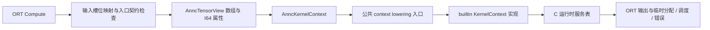

# Kernel Context 与统一 Runtime ABI 设计

本文统一描述公共 Kernel Context ABI、编译器 lowering、TensorFlow 与 ONNX Runtime 宿主适配。手写 builtin 的迁移范围见第 8 节，ORT 专属契约与验证记录见[第 9 节](#9-onnx-runtime-接入)。普通生成代码和多 builtin 组合尚未整体迁移。

公共模块的文件分层见[第 2.2 节](#22-公共模块文件与分层)，C++ 接口与线程调度见第 3.4、3.5 节。测试入口与验证范围见本文[手写 kernel 验证](#83-验证)。

## 1. 需求与设计结论

将 `annc/lib/Kernel/builtin_kernels/` 的手写算子入参封装到 context，并将普通 MemRef ABI 和 Execution V2 ABI 统一为一个接口：

```cpp
extern "C" AnncStatusCode annc_kernel_<symbol>(AnncKernelContext* context);
```

新产物统一使用 `annc_context_v3` ABI。手写 kernel、融合函数外部入口、编译器生成的 customcall 和 TF runtime 使用相同的 C 调用协议。输入、输出、属性、分配、线程服务和错误状态均通过 context 获取。输出 shape 是否静态可知不再决定 ABI。

普通 MemRef 的张量描述能力继续保留，Execution V2 的分配与错误回调能力合入新协议。新协议独立定义版本化 C struct，不能直接扩大原 V2 struct 或在旧符号下改变函数签名。

kernel 负责计算与动态输出形状；Context 提供框架无关的 tensor 表示和服务协议；
宿主负责参数绑定、内存所有权、线程池和执行状态。公共层不依赖 TensorFlow、
ONNX Runtime、LLVM/MLIR、kernel registry 或具体线程池实现。

```text
框架 tensor / 站点参数
  → 宿主适配层：绑定输入、输出、属性与服务
  → AnncKernelContext：稳定的 C 调用边界
  → KernelContext：kernel 使用的轻量 C++ 封装
  → 算法；需要分配或调度时回调宿主
```

Context 不承担图执行、算子选择或参数排列推导。编译期 schema 约定输入、输出
和属性的槽位、类型与 rank，融合/调用侧按该约定绑定，kernel 按相同索引访问。

## 2. 已有实现与参考范围

### 2.1 迁移前的两条路径（历史背景）

| 项目 | 普通 MemRef ABI | Execution V2 ABI |
| --- | --- | --- |
| 注册 ABI | `mlir_ciface` | `annc_execution_v2` |
| 算子参数 | 输出 descriptor + 输入 descriptor + 少量标量 | execution + 输入 descriptor |
| 输出 | 调用者先分配 | kernel 调用 allocate_output |
| 线程池 | wrapper 读取 TLS | wrapper 读取 TLS |
| 错误 | wrapper 返回 int32，调用链传播不完整 | 回调错误与 int32 返回值并存 |

迁移涉及的实现（TF 的 V2 执行入口已删除，历史 IR lowering 与兼容定义仍保留）：

- `ExecutionContext.h`：保留 execution ABI v2–v4 的兼容定义与 packed-B helper，不能与 `AnncKernelContext` 互相强转；公共状态码、元素类型、分配标志和 `AnncTensorDesc` 现归 `KernelContext.h`。
- 原 `ExecutionContextUtils.h`：V2 字节数检查、分配和 MemRef 构造；现使用 `KernelContextUtils.h`。
- `annc/include/Kernel/MemRefTypes.h`：actual-rank descriptor，以及与其布局不同的固定容量 AnncMemRef。
- `annc/include/Kernel/BuiltinKernelSpecDefine.h` 与 `builtin_kernels/BuiltinKernelWrapper.cpp.in`：集中生成 wrapper。
- `annc/lib/Conversion/Common/CustomizeCallLowering.cpp`：保留普通 MemRef 调用及历史 V2 IR 参数和结果 lowering；保留历史 IR 解析不代表宿主接受 V2 产物。
- `ConfigFusionMaterialize.cpp`、`CustomFusionPatternBase.h`：融合函数与输出 buffer/result 的构造。
- `tensorflow_addons/context/annc_fused_op.cc` 与 `tensorflow_addons/context/annc_fused_op_context.cc`：分别保留普通 MemRef 与 v3 执行入口；V2 执行入口、allocator 回调和专用 profiling 已删除。框架线程池适配位于 `tensorflow_addons/context/ThreadPool.h/.cc`。

现有 KernelRegistry 按算子、backend、类型变量和 ABI 查找符号。类型变量约束没有反射 C 形参或属性 payload 的能力。新方案复用此 registry，不增加 RAL 式运行时字符串 dispatcher。

### 2.2 公共模块文件与分层

| 文件 | 职责 |
| --- | --- |
| [KernelContext.h](../../../context/include/Context/KernelContext.h) | C ABI：状态码、tensor、属性、调用上下文和运行时服务 |
| [KernelContextUtils.h](../../../context/include/Context/KernelContextUtils.h) | C++ 访问、分配、调度和入口封装 |
| [StringRef.h](../../../context/include/Context/StringRef.h) | 借用字符串视图，兼供旧 MemRef 表示使用 |
| [ThreadPool.h](../../../context/include/Context/ThreadPool.h) | 宿主线程池抽象、调度选项及 TLS 访问声明 |
| [Parallel.h](../../../context/include/Context/Parallel.h) | 通用同步调度与生成代码桥接声明 |
| [RowParallel.h](../../../context/include/Context/RowParallel.h) | 行任务的成本估算、分片粒度与调度选项封装 |
| [ThreadPool.cpp](../../../context/lib/ThreadPool.cpp)、[Parallel.cpp](../../../context/lib/Parallel.cpp) | TLS 与同步调度桥接，不创建线程 |
| [CMakeLists.txt](../../../context/CMakeLists.txt) | 头文件目标 `ANNCContext`、静态桥接库 `ANNCThreadPool` 和安装规则 |

CMake 使用方链接 `ANNCContext`；使用 TLS/生成代码桥接时另链接 `ANNCThreadPool`。
手动编译公共 Kernel 头文件时同时增加 `-I<仓库>/annc/include` 和
`-I<仓库>/context/include`；安装后两组头文件统一位于安装前缀的 `include/` 下。
`ANNCContext` 不生成动态库，`ANNCThreadPool` 是静态库。

C ABI 只暴露普通结构、指针和函数指针；STL、框架对象与线程池虚表不跨越此边界。
C++ `KernelContext` 借用 `AnncKernelContext*`，不复制 tensor 或持有执行资源。
旧 `AnncExecutionContext` 继续引用公共状态码与分配描述，但布局不变，
不能与新 `AnncKernelContext` 互相强转。

## 3. 统一 C ABI

### 3.1 Tensor 描述

增加独立的 `AnncTensorView`，它表示借用的数据与布局，不表示分配请求或 Tensor 所有权：

```c
typedef struct {
  void* allocated;
  void* aligned;
  int64_t offset;              /* 元素单位 */
  const int64_t* sizes;        /* rank 个元素，rank 0 时可为 NULL */
  const int64_t* strides;      /* 元素单位，rank 0 时可为 NULL */
  uint32_t element_type;
  uint32_t rank;
  uint32_t layout;             /* 普通 strided 或已定义的 packed 格式 */
  uint32_t flags;              /* 只读、已绑定等协议标志 */
} AnncTensorView;
```

实际字段、枚举值、对齐与 offsetof 以 [KernelContext.h](../../../context/include/Context/KernelContext.h) 为准，并须与 LLVM 镜像及布局测试保持一致。element_type 覆盖当前实际输入的 F32/I32/I64/String；string 元素使用 AnncStringRef，不直接暴露 TF tstring。分配服务可以拒绝不支持的输出元素类型，例如 string。

数据地址为 aligned + offset * element_size。完整保留 allocated/aligned/offset/sizes/strides，零拷贝封装。旧 ranked descriptor 和新 view 之间按字段转换；禁止把 actual-rank descriptor 强转为固定容量 AnncMemRef。

初期按现有能力支持 rank 0–8；TF adapter 需要补齐当前只构造 rank 0–6 descriptor 的路径。rank 上限是可验证的实现边界，不影响输入数量由 count 描述。空 tensor 的数据指针可为空；rank 0 tensor 是一个元素，不能当作空 tensor。

辅助层支持非负 offset/strides。连续 `2 × 3` tensor 的 sizes 为 `[2, 3]`、strides 为 `[3, 1]`。
`contextData<T>(view)` 根据 `aligned` 和 `offset` 获取指针，不转换数值类型。
空 tensor 仍须用 `ANNC_TENSOR_BOUND` 标志表示绑定。
`AnncTensorDesc` 表达分配请求，包含类型、rank、dims、flags 等信息；
`AnncTensorView` 表达分配得到或预先绑定的实际 tensor，二者职责不同。
`AnncStringRef` 只包含字符串指针和长度，不拥有字符数据。

layout 与 dtype/rank 分开。已有 packed RHS 按既有格式、元数据和消费规则处理，不能仅凭二维 F32 就作为普通 dense 矩阵读取。一般 view 不承担整个预打包元数据，相关契约继续由已有 GEMM plan/权重元数据管理。

### 3.2 属性 payload

context 按 schema 顺序保存 typed 属性槽：

```c
typedef struct {
  uint32_t kind;               /* 当前为 I64；资源使用独立数组 */
  uint32_t reserved;
  const void* data;            /* 指向值或数组，非指向 MLIR Attribute */
  uint64_t count;
} AnncAttributeView;
```

`AnncAttributeView` 的 I64 标量属性要求 `count == 1`、`reserved == 0`；读取失败时记录错误。

当前 I64AttrArg 确有运行时传输用途，例如 hash bucket 的 num_buckets，必须进入 attrs。rank 0 的 pack/gt 等 tensor 仍进入 inputs；tensor 类型的 begin/new_shape 等数组同样保留输入语义。后续有真正的数组属性时再增加对应 kind，不能将现有数组 tensor 无条件转成属性。

独立的 `resources` / `num_resources` 用于节点实例的只读 kernel 特性资源：
`resources` 指向 `AnncResourceView` 数组，每项含结构大小、类型标识、版本、
payload 指针和描述字节数。kernel 通过 `getResource(type, version, bytes)` 查找，
资源不进入 `attrs`，不占用或重排 I64 的位置索引。数量为零时可传空指针，非零时必须提供数组。
类型、版本或描述大小不匹配时，`getResource` 返回空指针，供可选优化回退。
实例 owner 保证描述、类型标识与其引用内存覆盖全部同步执行，最后一次调用完成后释放。
资源引用只存在于内存中的运行时融合调用元数据；禁止将地址写入 IR 或 JSON 报告。
现用于 ONNX MLAS packed-B：初始化/释放沿用 EP 的实例打包代码，Context 只提供
通用传递通道，不定义 MLAS 字段。缺少或不兼容的可选资源使用原始输入路径。
Context 的 C/LLVM 镜像同步增加资源指针和数量，折叠常量替换只更新输入指针，
保留资源引用。TensorView 布局不变；TF 绑定空资源列表。

specialization 信息与运行 payload 分开。ActionIdGather 的 R1/R2 编码进专用 op 名并由 tensor rank 校验；DynamicStitch 使用单一 op 名，N 明确声明为 I64AttrArg，由实现从属性槽位 0 读取并校验实际输入数量。不能沿用旧 spec 与 schema 不一致的形参声明。

不使用 runtime map<string, any>。属性名、顺序和类型由编译期 schema
明确；kernel 按槽位校验并读取属性，使用 `context.getI64Attr(0)` 返回 optional，
属性索引独立于 tensor 输入索引。
运行时只传递属性的 kind、data 和 count，不传递属性名称或属性 schema。

### 3.3 服务与调用 context

服务表集中提供输出/临时分配、错误报告和同步并行。以下结构摘要对应当前 C ABI；回调原型和请求定义见 `KernelContext.h`：

```c
typedef struct {
  uint32_t struct_size;
  uint32_t abi_version;
  void* opaque;
  AnncContextAllocateOutput allocate_output;
  AnncContextAllocateTemp allocate_temp;
  AnncContextReportError report_error;
  AnncContextGetStatus get_status;
  AnncContextParallelFor parallel_for;
  AnncContextNumThreads num_threads;
  AnncContextShard shard;
  AnncContextNativeThreadPool native_thread_pool;
} AnncRuntimeServices;

typedef struct {
  uint32_t struct_size;
  uint32_t abi_version;
  const AnncTensorView* inputs;
  uint32_t num_inputs;
  AnncTensorView* outputs;
  uint32_t num_outputs;
  const AnncAttributeView* attrs;
  uint32_t num_attrs;
  const AnncResourceView* resources;
  uint32_t num_resources;
  const AnncRuntimeServices* services;
} AnncKernelContext;

typedef AnncStatusCode (*AnncKernelFn)(AnncKernelContext*);
```

- context 的 num_outputs 始终是语义结果数量，包含尚未分配的输出；不以是否预分配改变数量。
- allocate_output 接收当前调用的局部 output index、dtype、rank、dims、flags，返回完整 view，并由统一 helper 更新 outputs[index]。
- allocate_temp 接收分配请求并返回 view；临时张量由 opaque 指向的执行 owner 保管，kernel 不自行释放。
- 分配回调复制必要的 shape/stride 元数据，不能保留指向 kernel 栈上 dims 的指针。返回 view 的元数据在约定执行期间有效。
- get_status 用于检查共享的首次执行错误；report_error 同步复制消息，不保留传入 char*。
- parallel_for 接收工作量、粒度/成本提示、C callback 和 task opaque；返回前全部任务完成，null callback 或非法范围应明确失败。
- num_threads 查询宿主线程数；嵌套并行保护由宿主回调处理。
- shard 与 native_thread_pool 为可选尾部服务，分别提供限并行度调度和原生线程池互操作。

服务表用 C callbacks 隔离框架和 C++ ABI。TF adapter 内部继续复用 AnncThreadPool；KDNN adapter 可用一个实现既有 AnncThreadPool 接口的服务代理，继承其 vendor virtual 接口，不把 virtual 对象当作新 C ABI 的必需字段。

有效 context 的分配、错误、`parallel_for` 和 `num_threads` 服务必须存在；standalone driver 和测试提供自己的服务实现。串行执行可以由 parallel_for 的串行实现提供。kernel 实现不重复核对输入、输出和属性总数；访问参数与申请输出时仍检查槽位边界，并校验对应的 view 或分配请求。

`AnncRuntimeServices` 的 `opaque` 指向宿主私有状态，回调通过它找到分配器、
框架执行上下文和错误记录；公共层不解释该对象的类型。

| 服务 | 用途 | 是否必需 |
| --- | --- | --- |
| `allocate_output` | 按局部输出槽位分配并返回视图 | 必需 |
| `allocate_temp` | 分配临时 tensor 并返回视图 | 必需 |
| `report_error` / `get_status` | 记录错误 / 查询执行状态 | 必需 |
| `parallel_for` / `num_threads` | 同步并行执行 / 查询线程数 | 必需 |
| `shard` | 传递最大并行度和单位工作成本 | 可选 |
| `native_thread_pool` | 按 provider 借用兼容的原生线程池 | 可选 |

通过版本和结构大小检查基础前缀，访问可选字段前检查 `struct_size` 是否覆盖该字段。
这允许同版本服务表追加可选尾字段，不允许任意改变已有字段布局或含义。

### 3.4 C++ 开发接口

| 方法 | 行为 |
| --- | --- |
| `getInput(slot)` | 获取连续输入视图 |
| `getStridedInput(slot)` | 获取允许非连续布局的输入视图 |
| `getI64Attr(slot)` | 获取 I64 标量属性 |
| `getResource(type, version, bytes)` | 按特性 ABI 获取只读资源 |
| `numInputs()` | 查询输入数量 |
| `allocateOutput<T>(slot, dims, flags)` | 分配或复用输出，rank 从 dims 数量推导 |
| `allocateTemp<T, Rank>(dims, &view)` | 请求临时 tensor |
| `getThreadPool()` | 获取借用的调度句柄 |
| `error(code, message)` / `status()` | 上报错误并返回错误码 / 查询状态 |

`allocateOutput` 对未绑定槽位调用宿主分配，对已绑定槽位检查类型、shape、连续布局
和可写性后复用。它既用于动态形状输出，也用于预先分配的输出；没有单独的 getOutput。
flags 可省略，需清零时使用 `ANNC_ALLOCATION_ZERO`。

输入访问检查槽位、视图结构、布局与寻址算术；不会按 kernel schema 再验证期望
的 dtype/rank。固定契约由编译器和调用入口保证，动态索引边界、形状关系与算法溢出
仍由对应实现处理。视图检查没有底层分配容量信息，不能证明实际 buffer 容量足够。

`invokeContextKernel` 检查基础 ABI、创建 C++ view 并处理状态传播，
将调用线程捕获的 bad_alloc 和其他异常转换成错误码。它不替代宿主或工作线程内部
的异常边界。算法内部 SIMD、hash、GEMM helper 仍可使用显式参数。

手写实现使用轻量 C++ view，封装检查和现有 helper：

```cpp
AnncStatusCode matmulImpl(KernelContext& context);

const auto* lhs = context.getInput(0);
const auto* rhs = context.getInput(1);
auto* output = context.allocateOutput<float>(0, {m, n});
if (!output) return context.status();
// rank 从形状推导，标量输出使用 {}；临时空间仍使用 typed 请求。
const int64_t scratchSize = 16;
AnncTensorView scratch{};
auto code = context.allocateTemp<int64_t, 1>(&scratchSize, &scratch);
```

线程池也从 context 获取，调用形式参考 TensorFlow kernel 的 `Shard`：

```cpp
auto workers = context.getThreadPool();
return annc::kernels::Shard(workers.numThreads(), workers, rows, costPerRow,
                           [&](int64_t begin, int64_t end) {
                             // 处理 [begin, end)，返回前所有任务完成。
                           });
```

`KernelThreadPool` 是借用 C 服务表的轻量句柄，不创建线程或传递框架 C++ 对象。
普通区间任务也可调用 `workers.parallelFor(total, fn)`。
服务表尾部追加可选 `shard`，传递最大并行度和单位成本；读取可选字段前检查
对应的 `struct_size`。TF adapter 复用 `AnncThreadPool`，在框架边界调用 TensorFlow
`Shard`；嵌套并行由 runtime 串行处理。旧 runtime 缺少新服务时 shard 串行回退，
已有 `parallel_for` 仍保留调度能力；仅有分配/错误前缀的 runtime 会被拒绝。
2026-10-26 检视调整将调度加入必需前缀，相关宿主和 kernel 需配套重编译。
线程池抽象与 TLS 桥接集中在根目录 `context/`，框架 adapter 提供实际线程池；
通用层不创建线程，嵌套调用由 adapter 串行处理。
Gather、Padding、SparseReshape 的并行阈值参考下载 kernel，ActionIdGather 使用输出行宽作为成本。
DynamicStitch 按下载参考实现使用 `Shard`，最大并行度取宿主线程数，单位成本固定为 120；
单线程及缺少 shard 服务时串行执行。性能仍需目标平台实测。

extern C wrapper 负责版本/基础协议校验、创建 C++ view、异常边界和返回码转换。
输入、输出和属性由实现按槽位校验；builtin 执行路径不扫描名称 schema。新 ABI 的 wrapper 无需再恢复旧的多个形参。内部 SIMD、hash、GEMM helper 仍可使用紧凑的显式参数。

统一使用 AnncStatusCode 作为新入口返回类型。旧 KernelStatus 在迁移期显式转换；数值 2/3 的含义不同，不能强转。LLVM/MLIR、STL、std::function、Expected 和 C++ class 不出现在公开 C struct 中。

### 3.5 线程池与行任务调度

共享线程池接口、行任务调度辅助和 TLS 桥接位于 `context/include/Context/` 和
`context/lib/`；所有调用方（包括生成式 GEMM）直接引用 `Context/ThreadPool.h`、
`Context/Parallel.h` 或 `Context/RowParallel.h`，不保留旧路径的转发头。

两类调用共用宿主调度能力，但入口不同：

- Context kernel：`getThreadPool()` 返回 `KernelThreadPool`，通过 C 服务表回调宿主，
  不需要读取 TLS，也不把 C++ 线程池虚表传入 Context ABI。
- 生成代码及已有 C++ 调用方：使用 `annc::threadpool::AnncThreadPool` 抽象。
  宿主设置当前线程的借用池，生成代码通过 `annc_threadpool_*` 桥接函数访问；
  相关调用方链接 `ANNCThreadPool`。移动这些公共头文件不改变生成式 GEMM 的参数 ABI。

对于 `annc::threadpool::parallel_for`，`ParallelForOptions::max_parallelism`
仅在公共辅助函数中作为串并行开关：值小于等于 1 时串行；大于 1 或未设置时允许并行
（仍受任务粒度、线程数和嵌套并行检查约束）。选项原样传给宿主的
`AnncThreadPool::parallel_for`，大于 1 的具体上限需要宿主实现支持；公共辅助函数
本身不保证该上限。因此，设置为 2 和 4 在未实现限流的宿主上可能使用相同的并行度。
下述 Context `shard` 接口则要求遵守并行度上限，缺少对应宿主服务时退回串行。

`KernelThreadPool` 提供以下方法：

| 方法 | 行为 |
| --- | --- |
| `numThreads()` | 查询线程数，非正值归一为 1 |
| `parallelFor(total, task)` | 同步处理 `[0, total)`，task 接收 `[begin, end)` |
| `shard(maxParallelism, total, costPerUnit, task)` | 带并行度上限和成本提示的同步分片 |
| `nativePool(provider)` | 按 provider 获取兼容的宿主原生池，不可用时返回空句柄 |

`annc::kernels::Shard(...)` 是 `shard` 的便捷函数。服务表缺少可选 `shard` 回调时，
带并行度上限的请求串行执行；`parallelFor` 的嵌套并行保护由宿主回调负责。
ORT 使用的原生池 provider 为 `"onnxruntime"`，句柄仅在本次同步调用期间有效。

`RowParallel.h` 只计算调度提示，不执行任务、不持有线程池：

- `cost::elementRow(...)`、`cost::dotRow(...)` 等估算单位行的工作成本。
- `grainForRowWork(...)` 按每行元素操作数估算分片粒度。
- `rowOptions(costPerUnit, elementsPerRow)` 将成本与粒度合并为 `ParallelForOptions`，
  供 `annc::threadpool::parallel_for` 使用。Context kernel 也可取成本值传给 `Shard`。

## 4. 输出与分配统一

手写 kernel 通过 `allocateOutput<T>(slot, {dims...}, flags)` 获取结果 buffer；
slot 按共享 schema 的结果顺序绑定，`T` 指定元素类型，rank 从维度数量推导；
动态维度由算法计算。直接返回 view，失败返回 nullptr 并记录 status；flags 可省略，
需要清零时指定 `ANNC_ALLOCATION_ZERO`。形状列表仅在同步分配期间借用，
返回 view 的形状、strides 和存储由 runtime 持有。

直接调用 C 服务 `allocate_output` 时，kernel 必须在成功返回前将回调返回的 view
写入 `context->outputs[slot]`；可以直接将该槽位地址作为回调的 `result` 参数。
`allocateOutput<T>` helper 已按此方式绑定，无需额外回写。kernel 只能写 tensor 元素，
必须保留分配返回的存储指针、offset、dtype、rank、layout 和 shape/stride 指针，
保留已绑定、可写标志，不得修改宿主持有的 shape/stride 内容。TF 与 ORT 在返回后
都检查输出槽是否绑定到对应的宿主分配；仅调用分配回调但没有绑定输出槽会报错。

helper 对不同输出状态的处理如下：

| 输出状态 | allocateOutput 行为 |
| --- | --- |
| 调用者已绑定 buffer | 检查 dtype、shape、layout、可写性，复用 buffer |
| 尚未绑定 | 调用 allocate_output，填充该 slot |
| slot 已分配后再次请求相同结果 | 复用；不重复分配 |
| 已绑定但请求不同 shape/dtype | 报错；不静默替换或释放调用者 buffer |

预分配与执行时分配是同一个 ABI 的两种 slot 状态。flags 中的“已绑定”必须显式表示；不能仅凭 data 非空判断，否则零长度输出无法区分。

MatMul 根据输入 shape 请求 [M,N]；Gather 根据 unique 结果请求实际输出 shape；二者调用相同的服务。TF 可以继续预绑定能够可靠推导 shape 的输出以保留性能，也可以让 kernel 分配。动态输出不再要求调用前猜测尺寸。

输出 slot 可按任意顺序首次分配。ZERO 请求由 helper/adapter 保证对逻辑元素生效；借用的非连续 view 不能直接按 dense bytes memset。最终明确各 kernel 的布局要求，unsupported stride 必须拒绝或按元素处理。当前 TF 分配回调没有完整兑现 ZERO 请求，迁移应补齐并避免不必要的重复清零。

输出 slot 是当前调用的局部索引。模型边界调用可直接对应 TF output index；多个 customcall 的局部 output 0 不能都直接映射到模型 output 0。

首期保留现有执行范围：边界动态输出，以及编译器已规划 buffer 的中间结果。局部 context 绑定该中间结果 buffer，allocateOutput 复用它。数据相关的动态中间结果需要执行 owner 分配和父函数 SSA/descriptor 取回机制，目前 V2 并未支持；若遇到此用法，首期明确拒绝，后续独立补充。统一 ABI 不自动承诺完整的动态图执行器。

## 5. 编译器与 Runtime 调用流程

### 5.1 框架入口

TensorFlow 与 ONNX Runtime 的 builtin 调用共用 `AnncKernelContext`。
框架适配层将框架 tensor 包装成视图，并提供分配、错误和线程服务：

| 适配层 | 实现位置 | 职责 |
| --- | --- | --- |
| TensorFlow | `tensorflow_addons/context/` | 绑定 TF tensor，提供输出/临时分配与 TF 线程池服务 |
| ONNX Runtime | `addons/onnxruntime/context/annc_ep_execution.*` | 按站点契约绑定 ORT 输入输出，提供分配、调度及原生线程池句柄 |

一次同步调用按以下顺序执行：

1. 根据所选 kernel 的契约排列输入、输出和属性，检查入口参数。
2. 创建 tensor 视图、服务表及 Context，绑定本次执行的宿主状态。
3. 调用 kernel；由 kernel 按索引读取参数、请求输出并执行计算。
4. 检查返回码、宿主错误状态与输出绑定情况，向框架交付输出。
5. 调用结束后释放本次临时资源，输出继续由框架持有。

```text
TF ANNCFusedOp
  → 校验 fusion ABI 与 kernel schema
  → Tensor → AnncTensorView[]，构造执行 owner 与服务表
  → 构造 AnncKernelContext，输入/输出按语义顺序排列
  → AnncKernelFn(&context)
  → 检查返回码、执行状态及全部输出绑定
  → 发布 TF 输出，释放本次临时资源
```

融合函数入口和 builtin callee 均为一个 pointer 参数、一个 i32 状态返回。若融合函数只包含一次 builtin 调用，生成入口可校验后转发 context；若输入/输出/attrs 顺序不同，显式构造局部 view，不能无条件转发。

新 ABI 直接用匹配的 AnncKernelFn 调用，不经旧 CallMlirCiface 的按参数数目 switch。input/output count 可变；输入数量不再受七/八参数分发限制，仍需合理数量和内存边界校验。

### 5.2 公共 lowering

- ATIR/CustomizeOp 中保持张量 SSA operands/results 和明确 schema，继续进行 shape 推导、类型检查、alias 分析和 backend 选择。
- 从旧 schema 的 output MemRefArg 迁移为显式 ResultSpec。普通预分配 buffer 可以在 bufferization 后绑定到 output view；融合 matcher 不应再因 ABI 决定结果是否为 operand。
- 在 `Conversion/Common` 增加公共 context 调用构造工具，复用现有 CustomizeCallLowering 的 schema 解析和类型绑定。
- 靠近 LLVM lowering 时构造 stack view arrays、属性值存储和局部 context，调用所选新符号 `(!llvm.ptr) -> i32`。
- 从父入口 context 取得服务，子调用传递相同执行 owner 或有明确 output 映射的局部服务 handle；不能将任意当前 kernel 的 slot 解释为 TF 全局 slot。
- 已规划的 buffer 用字段转换构造 view，outputs 的物理 slot 存储可由 kernel 更新。局部 arrays 保持有效直到同步调用完成。
- 返回非零或共享执行状态失败时跳转到统一清理/返回路径。不能只返回最后一个 customcall 的状态并继续消费失败结果。

LLVM struct、C sizeof/alignof/offsetof 必须由同一份布局定义或生成工具保持一致。初期新增的是公共 packing helper 和 entry lowering，无需新增完整 runtime dialect 或 RAL dispatcher。MLIR 的 emit_c_interface 命名与 MemRef 解包逻辑不得被误用来再次展开 context payload。

### 5.3 MLIR 自动生成的 GEMM 入口

本次重构保留生成式 GEMM 的原有调用路径：融合函数继续使用 `mlir_ciface`/MemRef ABI，不新增普通 MatMul 或单输出 MatMul+Bias/Relu 提前转入 context builtin 的分流。手写 builtin 的 context 适配及已有双输出 builtin 路径保留；TF/ORT 运行时继续支持两种 ABI。

以下为后续统一入口的设计，尚未实现，不属于本次迁移范围。若将新 ABI 扩展到 ANNCFused 加载的 MLIR 自动生成融合入口，需要生成 context entry wrapper：

1. 校验 inputs、准备/复用输出；
2. 生成 actual-rank MemRef 值，调用现有内部计算函数；
3. 为既有线程/外部调用路径提供服务桥接；
4. 捕获可报告的运行时失败并返回统一状态。

内部 Linalg/GEMM pipeline 可以保持显式 MemRef，外部汇编微内核、PackB、KDNN API 和线程任务 callback 使用其既有契约。运行时可失败的生成分配/调用必须有状态及清理路径；单纯将 void 内部计算函数包成“总是返回成功”不能满足新的错误契约。

过渡期已有 GEMM TLS threadpool hook 可以在新入口适配层继续设置/恢复；新手写 kernel 直接使用显式服务。主 ABI 统一不要求同时重写所有汇编任务接口或 vendor 库。

## 6. 生命周期、并发与错误

| 对象 | 生命周期和所有者 |
| --- | --- |
| 代码、权重、packed 数据 | 现有可执行对象/共享库持有，执行期间保活 |
| 框架线程池 | 框架持有，服务表借用 |
| 执行 owner、首次错误、临时分配 | 本次融合执行；TF/driver adapter 管理 |
| kernel context、局部 slots 和 attrs | 单次同步调用；栈上构造或 caller 拥有 |
| view 的数据 | 输入借用、输出由框架持有、临时由执行 owner 持有 |

无需额外建立 RuntimeContext → ExecutionContext → KernelContext 三层继承。上述生命周期通过 C context、服务 opaque 和现有可执行 owner 表达。

- 所有 task 必须完成后才返回；禁止异步保留 context、descriptor、属性值或 task opaque。
- 每次执行的状态独立，首次错误以线程安全方式保留；不使用进程全局错误状态。
- 失败返回码是权威结果之一：回调记录错误时即使 kernel 返回 OK，caller 仍失败；kernel 返回非零且无详细错误时，caller 生成包含 kernel/状态码的诊断。
- 同一个执行内返回码与详细回调错误不一致时保留首次记录的错误作为诊断，并确保最终非 OK；错误 helper 同时返回对应状态减少分歧。
- 无 C++ exception 穿过 C 边界。bad_alloc 转换为 ALLOCATION_FAILED，其余异常转换为 INTERNAL；未提供有效 context 时直接返回 INVALID_ARGUMENT，避免调用未经校验的回调。
- kernel 失败后临时资源由执行 owner 清理。已创建但不完整的 TF 输出不作为成功结果交付。
- 并行失败通常在工作完成后收敛；不能因一个 worker 失败立即释放仍被其他 worker 使用的 buffer。

## 7. 注册、Schema 与 ABI 迁移

### 7.1 统一注册与声明

复用 KernelRegistry/KernelPriorityResolver；新 builtin 统一 `.Abi("annc_context_v3")`，继续按 op/backend/类型约束选择实现，packed 门控保持现有语义。

调整 ANNC_KERNEL spec，使 wrapper 参数声明固定为 AnncKernelContext*，body 调用单参数实现。参数角色、rank、dtype 和属性在已有 CustomOpSchema 与 builtin 接口表中显式描述，并以测试/校验保证对应。现有宏是文本展开，不能从 opaque body 自动推导这些内容。

新符号用明确 context 前缀与稳定的 spec 标识；避免为新协议继续依赖源码行号表达长期符号身份。旧 _mlir_ciface 符号不能在原名称下变更签名。

### 7.2 Metadata 和缓存

- ConfigFusion、内置融合 pattern、Fusion Metadata、converter 和 ANNCFused attr 的 ABI 值统一为 annc_context_v3。
- 新协议固定 inputs/outputs 的独立语义顺序；旧 kernel_arg_order 只由迁移 adapter 解释，不进入新 kernel 的位置约定。
- 元数据保留输出类型/rank/shape、输入绑定以及 specialization；外部边界 attrs 与内部 customcall attrs 明确来源。
- 更新 SelectKernel/SpecializeShapes/JIT 参数 shape 收集：输入 shape 来自真实 Tensor，动态结果 shape 不为 key 或分配被猜测；静态输出信息由模板/shape 推导提供。
- 目前 BuildJitCacheKey 显式序列化 schema、template fingerprint 和 argument dims，没有独立 ABI 字段。迁移应更新 cache/template schema 并加入明确 ABI 身份，确保旧 ABI 相同语义/shape 的产物不会被当成新函数指针使用。
- 新 .so 导出固定布局的 ABI descriptor 查询符号，host 在调用前核对 magic、版本和布局身份。kernel entry 同样检查 context 版本。descriptor 查询使用固定初始协议，不能先按未知版本解释其布局。

### 7.3 兼容策略

TF/配置融合迁移后，新配置不再选择 `annc_execution_v2`，TF 与 ORT 宿主拒绝该 ABI。
Fusion Metadata 读取和公共 lowering 仍保留历史 V2 IR 兼容；不自动改写为 v3，也不据此允许宿主执行。存量 V2
配置、ATIR 模板、GraphDef 和共享库需按 v3 契约重新生成。普通 `mlir_ciface`
兼容路径及 `_mlir_ciface_` 符号包装继续保留，不能将符号前缀视为 ABI 版本。


建议新编译器、新 TF addon 和重新生成的 AOT/JIT 产物协调升级。新路径对未知/旧 ABI 明确报错，要求重新生成产物。

若部署必须兼容存量 .so，在 TF 加载边界保留独立 legacy adapter，基于元数据明确选择旧函数指针和输出规则。它不能伪造新 ABI 或注册成新 builtin；其存在不改变新产物只生成一种接口的要求。删除时按部署窗口完成。

## 8. 手写 builtin kernel 迁移

### 8.1 接口与范围

`Context/KernelContext.h` 定义实际 C 协议；原有 11 类 aarch64 实现、
6 个 KDNN 适配实现（普通 GEMM、Add、AddRelu 及 packed 变体），以及 ONNX 四类融合的 14 个 spec 统一为
`Impl(KernelContext&)`，导出 `AnncStatusCode (*)(AnncKernelContext*)`。
MatMul/Gather 独立试点已删除，测试转向正式 spec。内部汇编/vendor API 不受此约束；
通用编译生成的 GEMM pipeline 和旧产物兼容加载仍保留，不能据此宣称整体 ABI 迁移完成。

通用 `CustomOpSchema` 提供参数描述、元数据生成与类型推导能力；具体 kernel 的定义集中在
`BuiltinKernelSchema.cpp`，通过与框架无关的 `getContextKernelSchema()` 查询编译期输入/输出顺序与 rank/type 约束。
逻辑名称不写入运行时元数据。实现使用 `getInput(index)` 获取输入并校验
索引、实际 view 与布局，失败记录状态。动态分派直接读取 view 中的
element_type 和 rank；固定 dtype/rank 契约由编译器和调用入口保证，
kernel 不重复添加静态契约检查。
`allocateOutput<T>(slot, {dims...}, flags)` 处理预绑定或动态输出，
动态维度由算法计算。临时空间使用 `allocateTemp<T, Rank>`；并行、线程数、错误和
分配均经 context 服务访问，计算循环复用已取得的数据指针。
输入、输出和属性分别按共享 schema 中各自类别的规范顺序编号；runtime 的传输重排
仍在调用前完成。context 不传递输入/输出 schema；调用方须满足选中 kernel 的
输入契约。算法依赖实际数据的索引边界、形状关系和溢出检查保留。
context 不持久化参数名称。图 endpoint 名称仍用于 TF 重连和 ORT 初始化绑定。

普通 kernel 消费 dense F32/I32/I64，hash 输入额外支持 `AnncStringRef`。
KDNN 通过 `getStridedInput(index)` 和 TensorInfo 保留真实 strides/offset。
KDNN GEMM 保留既有适配逻辑，不因删除 runtime schema 新增重复的 bias 类型/rank 检查。packed
格式仍由 `RunWithPackedB` 消费。
导出 token 跨后端唯一，例如 `ContextV3_MatMul_float`、
`ContextV3_MatMul_kdnn_float` 与 `ContextV3_MatMul_kdnn_packed_float`。

| 类别 | context 边界 |
| --- | --- |
| MatMul / Add / AddRelu / 双输出 | lhs、rhs、可选 bias → output / add / relu |
| Gather | data、keys、begin → unique_values、unique_indices、gathered |
| ActionIdGather | params、indices1、indices2、pack_dim、pack → output；特化名和编译期 schema 保留 rank/type 约束，impl 从 context 读取 rank/dtype 并在内部选择类型实现 |
| SparseDynamicStitch | 单入口 x、variable_0…variable_N-1 → output；属性槽位 0 为 N（N > 1），校验输入数量恰为 N+1；N=8/12/36 内部特化，其他 N 走运行时通用路径 |
| Hash embedding | input、embedding_weight → output；整数属性槽位 0（num_buckets） |
| Padding / Reshape / SegmentReduce / Select / TargetInteraction | 采用共享 schema 约定的输入、输出槽位 |

SparseDynamicStitch 的计算和分派参考 `embedding_fused_sparse_dynamic_stitch_new.cc`：
N=8/12/36 时，行宽 3/4/6/8/10/16 使用固定宽度 NEON 复制，其他宽度使用 `memcpy`；
其他 N 的全部行宽使用运行时 N 与 `memcpy`。N=8 用移位和掩码解码索引。
保留 36 项内联指针/行数存储，超过 36 项才使用堆存储；负索引或行越界时记录错误并继续当前分片。
kernel 按参考实现展平 dense x；现有图融合/schema 仍限定 x 为一维 int64，变量表为等宽二维 float32。
内置融合与配置融合均把 N 写入 `context_i64_attrs`，随后由 converter/宿主传入 Context；
旧的 `KPFusedSparseDynamicStitchN{N}` 导出入口已合并，相关 AOT 共享库与模型元数据需重新生成。

2026-10-30 本地 macOS arm64 验证：生产 runner 的 ASan/UBSan 数值检查通过，
Stitch 覆盖 N=2～17、36、37 与行宽 1/2/3/4/6/8/10/16/17，另含空输入、
标量/二维 x 展平、非法 N/索引和线程服务失败。使用当前源码构建的独立 LLVM/MLIR 21
验证工具通过三个相关 FileCheck 文件的 8 条 RUN 命令，并验证 N=36 原子图经
OpFusion、FastCodegen、Context entry lowering 后保留 N 属性并调用统一入口。
该验证不替代正式 CMake 构建、真实 TF/ORT 宿主执行或 openEuler/鲲鹏性能验收；
本机 TF 测试因缺少 TensorFlow 跳过，全链路 Stitch 测试因非 Linux AArch64 跳过。

所有手写 kernel 的 spec 统一调用 `invokeContextKernel(context, impl)`，impl
均只接收 `KernelContext&`；MaskedMul 以 lambda 包装内部 arity 模板特化。dtype 分派留在实现内部，Sum/Mean
等不同运算使用不同入口函数，保持语义可辨。

rank 0 的 pack 等值属于 tensor 输入，不能变为静态 attrs。
真正的 I64 属性由 schema 顺序派生 `fusion.metadata.context_i64_attrs`，经 JSON、
converter 和 TF attr 传给 context，并纳入 JIT cache 身份；
lowering 按属性槽位检查值与 schema 一致。TF 字符串由 owner 保存稳定的
`AnncStringRef` 数组，借用 Tensor 中的
字节，支持嵌入 NUL；字符串不作为输出/临时 tensor 分配。

### 8.2 编译器与兼容边界

OpFusion 复用语义 matcher、共享 schema 和 registry，生成只有 tensor 参数/结果的
private kernel，其 body 为单个 CustomizeOp；原始子图保留供 fallback。公共 lowering
将完整边界转换为 `(!llvm.ptr) -> i32`。普通入口直接转交同一个 context；
ONNX BMM 折叠常量通过公共 `ContextInputOverrides` 创建私有常量 view 和局部输入数组，
局部 context 共享原输出、属性与服务，避免读取未折叠的边界权重。
多个 builtin 的组合或一般边界重排仍明确拒绝，尚未引入中间结果 context 封装。

融合边界按数组顺序定义输入、输出槽位。converter 生成
`context_input_order[canonical] = transport`，TF adapter 按同一映射构造 view
并收集 JIT shape，维持 constant/fixed/dynamic 传输分组与规范槽位的一致性。
TF endpoint 名称仅用于 GraphDef 重连，不作为 context 参数名称。

context version 保持 3；运行时输入/输出 schema 数组、context 尾部指针、
AnncTensorSchema 类型及 helper 中的 schema 校验分支均已删除。
TF adapter 在调用 kernel 前检查输入 dtype 及提供的 input_ranks，
在输出分配回调中检查 dtype/rank。编译阶段的 CustomOpSchema 和 lowering
元数据保留，TensorView 仍携带实际 dtype、rank、shape 和 strides。
getInput/getStridedInput 检查槽位、实际 view 与布局，不再读取预期类型 schema；
直接调用 kernel 的调用方须遵守算法的 dtype/rank 契约。

`ANNC_CONTEXT_BASE_SIZE` 等于 sizeof(AnncKernelContext)。2026-11-02 在 attrs
与 services 之间增加独立的资源指针和数量，必需前缀与 LLVM 镜像同步更新。
此前不含资源字段或带名称 schema 扩展的库必须与编译器、TF/ORT 调用方一起重编译，
不能仅凭版本号相同混用。新 kernel 仍忽略当前布局之后未知的扩展尾部。新符号使用显式
ContextV3 token，不在旧符号下替换 ABI。
owner 保活 tensor、shape、stride 与属性直到同步调用返回；错误服务保留首次错误。

### 8.3 验证

```bash
python3 -I tests/unit/kernels/run_context_kernels.py
ANNC_CONTEXT_SANITIZE=1 python3 -I tests/unit/kernels/run_context_kernels.py

python3 -I tests/unit/kernels/run_context_kernels.py \
  --annc-asm build/bin/annc-asm \
  --mlir-opt /path/to/mlir-opt \
  --mlir-translate /path/to/mlir-translate \
  --llc /path/to/llc

```

host runner 从全部正式 aarch64 spec 生成独立 wrapper TU，覆盖 30 个特化的数值、
多输出、动态分配、offset、空输入、错误和服务契约，已接入 CTest。
`--annc-asm` 额外将 MatMul/Gather fixture 编译为 LLVM object 并实际调用生成入口。
2026-10-20 删除运行时 schema 后，47 个非 KDNN 特化在 ASan/UBSan 下通过测试，
包含数值、动态数据错误处理、当前 context 尺寸、截断 context 拒绝
和旧较大 context 尾部忽略。独立 TensorFlow adapter 集成用例已移除，
不再将固定类型/rank 的入口校验作为单独测试入口，也不要求所有 kernel 直接入口拒绝错误类型/rank。
上述 2026-10-20 验证未执行 LLVM/MLIR 编译链、完整项目 CMake 构建或真实 KDNN 数值测试。
本轮仍未运行 TF/KDNN。

### 索引访问回归验证

生产 kernel runner 对全部 30 个非 KDNN 特化使用不带 schema 的
context 执行数值及错误用例，并验证非交换 MatMul 的输入槽位顺序、索引越界、
非法 view 元数据、strided/dense 布局约束及多个 I64 属性按索引读取。

## 9. ONNX Runtime 接入

本节描述 ORT 专属的槽位绑定、服务适配、实例资源和验证；公共 ABI、输出绑定与生命周期契约见第 3、4、6 节。历史 EP 设计中的图导出、融合边界、缓存签名和 CPU 回退策略仍适用。

### 9.1 目标与边界

ONNX 的四类融合 kernel 从 `annc_execution_v2` 迁到根目录 `context/` 的
`annc_context_v3`，与 TensorFlow builtin 复用相同的 tensor view、整数属性、
分配、错误和线程服务协议。入口只有一个参数：

```cpp
AnncStatusCode kernel(AnncKernelContext* context);
// 实现侧
AnncStatusCode impl(annc::kernels::KernelContext& context);
```

保留已有数学实现、NEON、MLAS 选择和 ORT 调度策略。普通生成代码的 `mlir_ciface`
预分配输出路径继续存在；本次不增加多 builtin 组合执行，不改变融合 pattern 的语义。
`_mlir_ciface_` 是导出符号前缀，不能据此判断使用哪种参数协议。

### 9.2 调用链与职责



- `BuiltinKernelSchema.cpp` 的 `getContextKernelSchema()` 统一定义 TF/ONNX 共用的编译期槽位、rank、类型和属性值。
- `OpFusion.cpp` 复用现有 matcher 与 registry，生成 tensor SSA 边界和单个 CustomizeOp，报告 ABI 与属性。
- `Conversion/Context/LowerContextKernelEntries.cpp` 验证完整边界，复用 `Conversion/Common` 工具降低为一个 pointer 入参、i32 返回码的入口。
- `annc_ep_site.cc` 校验站点报告；EP 在初始化/绑定阶段按图名称解析输入和输出的槽位映射。
  兼容无名称绑定时，只允许 rank/dtype 能唯一确定的映射；二义绑定拒绝执行。
- `context/annc_ep_execution.*` 每次 Compute 验证实际输入契约，借用 ORT 数据构造 view，调用 `AnncKernelFn`。
- kernel 使用数字索引取参。context 不包含参数名、运行时 schema 或 ORT 对象类型。

图名称仍是初始化绑定所需的信息，不用于 kernel 每次读取参数时查找。
固定 dtype/rank 契约由编译器和入口保证；kernel 保留数据相关的形状关系、索引和溢出检查。

### 9.3 槽位契约

输入、输出、属性分别从 0 编号，输出不占输入槽位。

| 家族 / spec | 输入槽位顺序 | 输出槽位顺序 | I64 属性 |
| --- | --- | --- | --- |
| TensordotMatMul | x: f32 rank3，W: f32 rank2 | f32 rank3 | 无 |
| LayerNorm | x: f32 rank2，gamma/beta: f32 rank1，epsilon: f32 rank0 | f32 rank2 | 无 |
| BatchedMatMulAdd / 4D | data、W、bias，均为 f32 rank3 / rank4 | f32 同 rank | 无 |
| MaskedMul N / Flat | N 个 f32 rank3 tensor，随后 ids: i64 rank2 | raw Mul、fed Mul，最后可选 flat rank2 | 8 个，见下表 |

共 14 个 spec：1 个 TensordotMatMul、1 个 LayerNorm、2 个 BMM、10 个 MaskedMul。
MaskedMul 的 N 为 1/2/3/4/6/7/11，Flat 变体为 1/3/4。N 包括数据实参与 Sum 的其他输入。
内部保留 arity 模板特化；所有导出入口都只接收 context。

epsilon 继续是标量 tensor，可由运行时传入；不把它变成静态整数属性。
MaskedMul 的编译期参数通过 `fusion.metadata.context_i64_attrs` 和站点 JSON 的
`context_i64_attrs` 进入 `AnncAttributeView[]`：

| 属性槽 | 内容 |
| --- | --- |
| 0 | dataArgs：前缀数据实参数量 |
| 1 | rawMuls：原始 Mul 输出数量 |
| 2 | fedMuls：Sum 后续 Mul 输出数量 |
| 3 | argMap：每 4 bit 指定一个 raw Mul 对应的数据输入 |
| 4 | sumMask：参与 Sum 的 raw Mul 位集合 |
| 5 | interiorKind：后续计算种类 |
| 6 | divisorBits：f32 除数的位表示，存入 i64 |
| 7 | padding：mask 的 padding 值 |

argMap 最多表示 16 个 raw Mul；raw + fed 最多 64，另可有一个 flat 输出。
EP 的通用 context 数组不再受旧 14 实参 switch 限制；支持 rank0–8 的 f32/i32/i64 输入，
当前四类 builtin 的实际约束仍以上表为准，输出为 f32。不存在按该通用范围自动放宽算子契约的行为。

### 9.4 输出、临时空间和生命周期

```cpp
const auto* x = context.getInput(0);
auto attr = context.getI64Attr(0);  // 仅有属性的 kernel 使用
if (!x || !attr) return context.status();
auto* y = context.allocateOutput<float>(0, {x->sizes[0], x->sizes[1]});
if (!y) return context.status();
```

输入 buffer 归 ORT；输入 shape/stride、属性存储和 context 在同步调用期间有效，不复制 tensor 数据。
输出通过 `KernelContext_GetOutput` 分配，规范 slot 映射到融合节点的实际输出索引。
分配回调检查槽位、重复请求、dtype、rank、shape 和字节数溢出；标量可以没有 dims，
空 tensor 可以没有数据指针。回调不修改传入的分配请求。

临时空间来自 ORT allocator，仅本次 Compute 持有；`ANNC_ALLOCATION_ZERO` 显式要求置零，
普通分配不保证初始值。shape/stride 保存在地址稳定的容器中，后续分配不会使已有 view 悬空。
所有并行任务完成后，执行 owner 释放临时 buffer，再释放 allocator 句柄；输出继续由 ORT 持有。
禁止异步保留 context 或其中任何借用指针。

返回码、服务状态、首个详细错误和全部输出绑定共同决定成功；任一失败都返回 `OrtStatus`。
ORT 保存每次输出分配返回的独立 view，kernel 返回后逐槽检查存储指针、offset、
dtype、rank、layout、shape/stride 指针及已绑定、可写标志，与 TF 的检查保持一致。
直接调用 C 分配回调的 kernel 必须把返回的 view 写入 `context->outputs[slot]`；
公共 `allocateOutput<T>` helper 已自动完成绑定。只分配未回写，或替换输出 view 的
存储和元数据，都会导致本次调用失败。
分配和首次错误记录支持并行回调，后续错误不覆盖首次诊断。C++ 异常不能穿过 kernel 的 C 入口。
执行失败仍按既有 EP 契约终止本次 Run，不承诺回退重跑 CPU 子图。

### 9.5 线程服务与 MLAS

kernel 通过 `context.getThreadPool()` 获取借用句柄，使用 `Shard` 或 `parallelFor`。
ORT 适配层继续负责成本估计、最大并行度、原生 operator pool 与公开 API 调度，嵌套区域串行。
较小的 maxParallelism 也必须遵守；服务同步返回并传播失败。

为复用 MLAS，在 `AnncRuntimeServices` 尾部追加可选 C 回调 `native_thread_pool`。
读取前用 `ANNC_RUNTIME_SERVICES_NATIVE_POOL_SIZE` 检查尺寸；旧 runtime 缺字段时返回 null，
context ABI version 仍为 3。2026-10-26 检视后，必需前缀包含
`parallel_for` 和 `num_threads`，宿主与 kernel 需配套重编译。调用方式：

```cpp
void* pool = context.getThreadPool().nativePool("onnxruntime");
```

未知 provider、不可用或版本不匹配返回 null。只有 ONNX kernel 与 ORT 适配层理解该原生句柄，
通用层不依赖 ORT，不传递 ANNC C++ 线程池虚表。FTDMM/BMM 在 MLAS 已启用且句柄非空时
沿用 MLAS 路径，否则使用原有计算路径。原生布局与链接归档仍须来自匹配的宿主 ORT 构建；
provider 字符串和版本字符串本身不能证明私有 ABI 兼容。TF 的可选回调保持为空。

通用服务表不包含 `packed_b`。`ANNC_EP_PACKED_B` 在会话初始化时控制可选准备：
Compile 按准确的输入名称、f32 rank/shape、constant initializer 属性与字节数构造
不可变权重计划；BMM 通过同一生成库的 effective-weight accessor 选取前仿射折叠
后的真实权重，无法确认来源则保留 raw-B。CreateState 沿用重构前 EP 的
`BuildPackedState` 和 `PackedOwner`：每个 slice 单独 `posix_memalign` 分配并
调用 `MlasGemmPackB`，ReleaseState 析构 owner 时逐块 `free`。权重计划、打包
和释放流程恢复原代码，只将原 `context_call.packed_b` 绑定适配为资源引用；
不新增 kernel 打包/释放入口，不在 Compute 中分配打包缓冲区或重新打包。

packed-B 由节点实例持有，其只读资源引用记录在运行时融合调用元数据
`ContextCall.resources` 中；Compute 构造 context 时直接绑定独立的
`resources` / `num_resources`，不再把资源放进 `attrs`。I64 槽位顺序保持不变。kernel 按
`annc.mlas.packed_b`、版本与完整 shape 选择 packed slice，广播 batch 复用 slice。
资源描述和内部内存在所有同步调用结束前有效，不能原地更新，也不与其他实例混用。
IR `fusion.metadata` 与序列化 `sites.json` 不存放运行时地址。`allocate_temp` 仍仅对
单次 Compute 有效，不承担实例权重存储。TF 未绑定此可选资源时继续使用原有路径。

关闭开关、MLAS 不支持、权重可变/来源不明或可选准备分配失败时使用 raw-B；执行期间
不再打包。缓存指纹已更新，部署时需要配套重编工具链、EP 和 kernel 归档。
本地替身回归验证重复/并发读取不重新打包及 packed/raw 数值一致；目标 ORT/MLAS
端到端和性能恢复幅度仍待重新验收，既有验收日志不覆盖本次生命周期调整。

### 9.6 lowering 与折叠常量

普通单 builtin 边界按相同输入、输出和属性顺序，直接转发调用方 context。
BMM 的常量前仿射折叠已存在：原始 W/bias 的图名称仍用于 EP 边界绑定，计算必须消费
折叠后的常量。不能因为改为 context 调用而误用原始输入。

公共 `ContextInputOverrides` 为静态 dense f32 常量创建 private LLVM global，
构造局部输入 view 数组，逐槽复用原输入或替换为常量 view；局部 context 共享原输出数组、
属性、实例资源与服务。kernel 返回后局部栈对象失效，常量数据由共享库持有。
编译阶段检查替换槽位与边界 shape/dtype 一致。此 helper 不承担 ONNX 匹配逻辑。
折叠权重迁为 LLVM global 后，lowering 保留 `annc.effective_weight_global`，并复用
`__annc_effective_weight_<func>` 及 size accessor 导出实际地址和元素数，保留既有编译器接口。
未标记折叠权重时，两个 accessor 均返回 0；标记的 global 不存在、类型不受支持，
或 LLVM global 不是数组类型时，生成 accessor 会报错并终止 Pass。
EP 在初始化计划中通过同库 accessor 复制有效权重，节点实例初始化时由 EP
打包，确保 packed-B 与 `ContextInputOverrides` 替换后的 view 对应同一份数据。
已有 FileCheck 覆盖常量替换；本次实例资源传递的目标平台闭环尚未重跑，不能沿用
此前测试作为新实现的验证证据。

一般边界重排、多个 CustomizeOp、运行时中间值组合尚不支持，会明确拒绝 lowering。
不能据此认为普通生成函数和任意融合子图均已统一为 context。

### 9.7 迁移与缓存

四类 builtin 仅注册 `annc_context_v3` 和唯一 `ContextV3_*` token。
EP 拒绝 `annc_execution_v2` 站点；不能只改 JSON 标签复用旧共享库。
缓存目录升级为 `$ANNC_EP_CACHE_DIR/context-v3/<前2位>/<签名>/`，旧缓存不参与查找，
工具链、EP、kernel 归档与站点报告须配套重新生成。原有模型/常量和配置签名规则继续适用。

普通 `mlir_ciface` 站点仍按旧独立路径调用。源码中的历史 V2 IR lowering/兼容定义本次未整体清理，
保留不代表 EP 会接受 V2 产物。这里不改变 CLI、融合开关或公开 Python API。
