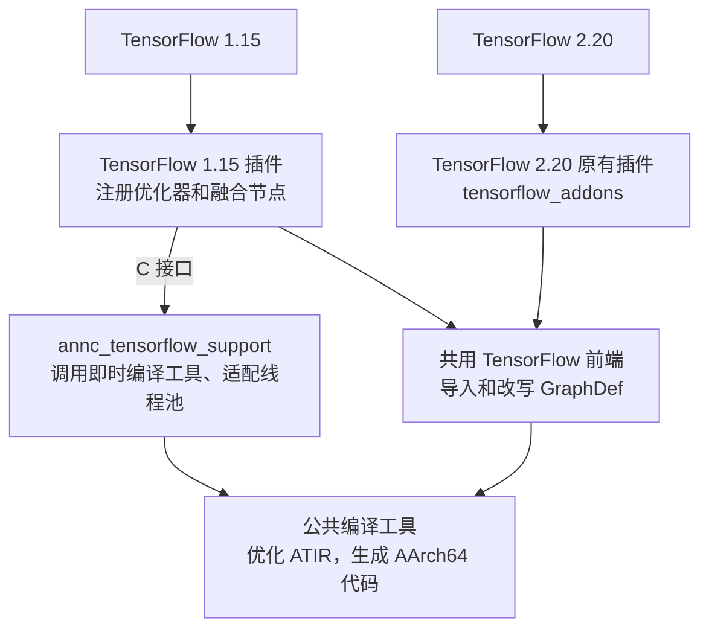
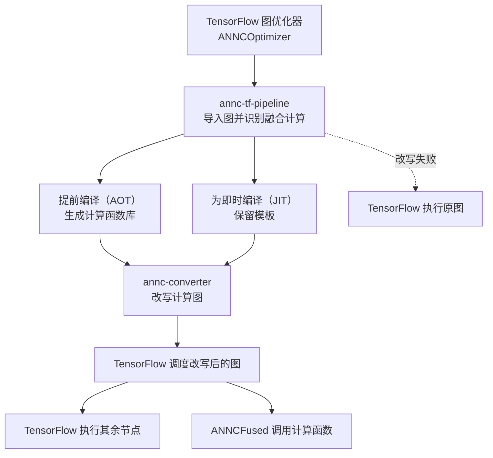
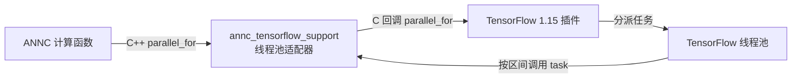
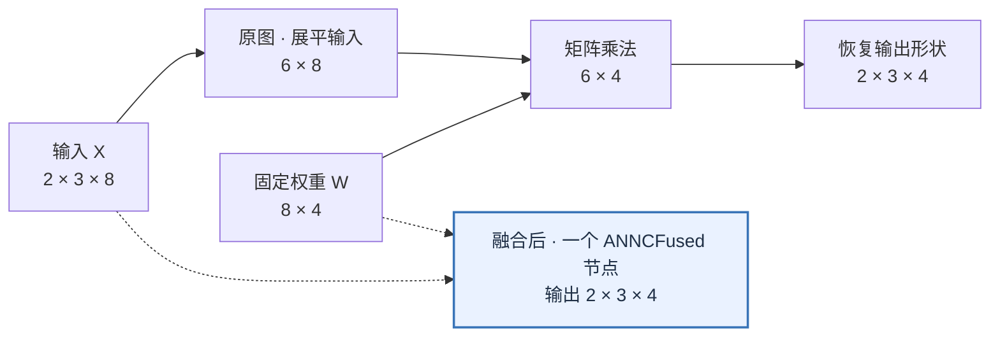
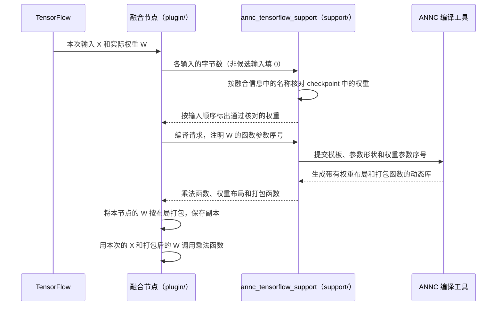

# ANNC 支持 TensorFlow 1.15 设计方案

| 文档控制项 | 内容 |
| --- | --- |
| 文档编号 | ANNC-TF115-HLD-001 |
| 版本与日期 | 1.1，2026-11-24 |
| 文档状态 | TensorFlow 1.15 接入已合入 `dev` |
| 源码基线 | `dev` 分支 `846ac64` |
| 责任人 | ANNC TensorFlow 接入维护者 |
| 目标读者 | 熟悉模型推理的开发、测试及技术负责人。文中术语见[附录 A](#附录-a-术语表) |
| 关联文档 | [总体架构](../../architecture/overview.md)、[运行时接入](../../architecture/runtime-integration.md)、[独立插件与共用前端的架构决策 ADR-016](../../decisions/decisions.md#adr-016) |

## 1 目标与范围

**让 TensorFlow 1.15 能够通过 ANNC 插件使用已有算子融合与常量折叠能力，并支持对符合条件的 tensordot 做整段融合。** 为隔离 TensorFlow 版本差异，将 TensorFlow 1.15 插件放入独立模块，同时参照 ONNX 整理 TensorFlow 前端的职责与目录。

| 目标 | 预期结果 |
| --- | --- |
| TensorFlow 1.15 基础接入 | 插件可以构建、加载和注册，图中的可融合计算实际交给 ANNC 执行 |
| tensordot 优化效果 | 将符合条件的 tensordot 子图融合为一个节点。开启 ANNC 后，三个专项样例的稳态 QPS 相比关闭时等权平均提升至少 10% |
| 常量折叠 | TensorFlow 1.15 沿用 ATIR 已有的编译期求值规则。矩阵乘法可预打包固定权重，计算结果与原图一致 |
| 模块清晰、便于扩展 | 两版插件共用 `frontends/tensorflow/` 中的图处理工具。TensorFlow 1.15 插件将直接调用 TensorFlow 的代码与调用 ANNC 即时编译工具的代码分开构建 |
| 构建共存 | TensorFlow 1.15 和 2.20 插件分别构建，每次选择一个版本 |

TensorFlow 2.20 插件继续从原目录 `tensorflow_addons/` 构建，沿用原有的注册名称和插件库名。TensorFlow 1.15 接入已有的 AOT/JIT 流程，仍由 `ANNCFused` 按现有协议调用计算函数。tensordot 整段融合复用公共后端的矩阵乘法实现，常量折叠沿用已有规则。

## 2 总体方案

### 2.1 模块如何划分

在 TensorFlow 会话中启用 ANNC 后，图优化组件 Grappler 在执行前调用 `ANNCOptimizer` 处理计算图（GraphDef）。插件把图交给 TensorFlow 前端，前端把它转换为 ANNC 用来分析和优化计算的表示（ATIR）。图 1 给出两版插件与前端工具的关系。TensorFlow 1.15 的融合节点插件还通过静态库 `annc_tensorflow_support` 调用 ANNC 即时编译工具、适配 TensorFlow 线程池。



*图 1　两版 TensorFlow 插件与公共编译工具*

| 目录 | 主要职责 |
| --- | --- |
| `addons/tensorflow/plugin/` | 与 TensorFlow 1.15 交换图、张量和执行结果。`1_15/` 子目录负责校验配套的 TensorFlow 软件开发包（SDK）、构建插件和提供 TensorFlow 线程池回调 |
| `addons/tensorflow/support/` | 构建 `annc_tensorflow_support`，管理即时编译生成的动态库，并提供线程池适配器 |
| `tensorflow_addons/` | 构建 TensorFlow 2.20 原有插件 |
| `frontends/tensorflow/` | 集中处理 TensorFlow 图的导入、编译流程编排和 GraphDef 改写 |
| `annc/` | 提供公共图构建器、ATIR 优化和代码生成工具 |

图 1 中的前端工具使用项目生成的 GraphDef 读写代码，可独立于 TensorFlow 运行库构建。TensorFlow 1.15 和 2.20 插件的默认图优化流程因此可以调用同一套工具。

### 2.2 本次修改在流程中的位置

**TensorFlow 1.15 插件沿用 TensorFlow 2.20 插件已有的“图转换 → 融合 → 图改写 → 执行”流程。** 如图 2 所示，`ANNCOptimizer` 在图执行前调用编译工具，把可融合的一组算子替换为一个 `ANNCFused` 节点。TensorFlow 仍然调度整张图，融合节点负责调用 ANNC 生成的计算函数。



*图 2　TensorFlow 2.20 已有的 ANNC 图优化与执行流程*

TensorFlow 1.15 插件中的 `ANNCOptimizer` 按本版 Grappler 接口实现。它把本次收到的 GraphDef 和调用方要读取的输出（如 `Y:0`，即节点 `Y` 的第一个输出）交给 `annc-tf-pipeline`。前端从这些输出向前查找需要导入的节点。优化器读回改写后的图，交还给 TensorFlow 1.15 调度。

执行到 `ANNCFused` 时，TensorFlow 1.15 调用本版插件注册的融合节点。节点读取输入张量，调用 ANNC 生成的计算函数，并将输出张量交给 TensorFlow。

## 3 关键设计

### 3.1 TensorFlow 1.15 插件适配与构建

TensorFlow 1.15 插件使用该版本的接口注册图优化器 `ANNCOptimizer` 和 CPU 融合节点 `ANNCFused`，注册名称和节点属性沿用 TensorFlow 2.20 插件的约定。TensorFlow 1.15 的 Grappler 还要求优化器实现 `Feedback`。ANNC 的优化不依赖执行反馈，该方法可直接返回。

优化器只改写 Grappler 在这次调用中传入的图节点，随图保留函数库。Grappler 若单独提交某个函数体，优化器按同一方式处理。图中已有 `ANNCFused`，或任一请求的输出名称包含 `restore`（忽略大小写）时，优化器直接交回原图。后一个条件用于跳过模型权重恢复操作，也会匹配名称含有该词的普通输出。读回改写的图后，优化器按已注册的 `ANNCFused` 定义补齐默认属性。工具报告失败、图读取失败或无法取得算子定义时，也由 TensorFlow 执行原图。

执行融合节点时，插件按节点的 `abi` 属性调用计算函数。采用 `mlir_ciface` 时，融合节点分配输出缓冲区，计算函数把结果写入其中。采用 `annc_context_v3` 时，融合节点提供执行上下文，供计算函数读取输入、申请输出和报告错误。JIT 编译失败、插件发现的参数错误以及执行上下文报告的错误，都通过 TensorFlow 的算子状态返回。

#### 3.1.1 插件的编译与链接

图优化器和融合节点直接调用 TensorFlow 1.15 的 C++ 接口，因此编译时须使用与 TensorFlow 1.15 相同的 C++ 标准和标准库 ABI（应用二进制接口），例如 C++14 和 ABI 0。调用即时编译（JIT）工具的代码用到了 C++17 的文件系统接口。适配 TensorFlow 线程池的代码实现 ANNC 的 C++ 线程池接口，需要与 ANNC 计算代码使用相同的标准库 ABI（ABI 1）。

为满足这两组编译要求，在 `addons/tensorflow/` 下将源文件分到两个目录。融合节点通过 C++ 接口访问 JIT 缓存。这个接口直接传递 `std::string`，要求缓存库和融合节点使用兼容的标准库 ABI，因此将缓存库放在插件一侧，随融合节点采用同一组编译设置。

| 源码目录 | 构建目标 | 编译设置 |
| --- | --- | --- |
| `plugin/` | 图优化器、融合节点、JIT 缓存静态库 | 与 TensorFlow 1.15 相同的 C++ 标准和标准库 ABI |
| `support/` | 静态库 `annc_tensorflow_support`，负责调用 JIT 工具和适配线程池 | C++17、ABI 1 |

插件还要按实际参数个数调用 `mlir_ciface` 函数。TensorFlow 2.20 插件用 C++17 的 `if constexpr` 选择对应的函数签名。为支持 C++14，1.15 插件用模板特化处理零参数的情况，保留原有的 0 至 64 个指针参数及其顺序。

融合节点插件链接 JIT 缓存库，缓存库将 `annc_tensorflow_support` 声明为可传递的链接依赖（CMake 的 `PUBLIC`），两者最终一起链接进 `libannc_fused_op.so`。融合节点插件通过 C 接口调用 `annc_tensorflow_support`，跨库函数在 C++ 中使用 `extern "C"` 声明。图优化器单独生成 `libannc_optimizer.so`。

#### 3.1.2 融合节点插件与 `annc_tensorflow_support` 的 C 接口

**JIT 编译接口**

JIT 缓存未命中时，融合节点需要按当前输入形状编译 ATIR 中指定的函数。TensorFlow 1.15 插件沿用 TensorFlow 2.20 插件的 C++ 入口 `tensorflow::CompileAnncJitKernel`。融合节点通过返回的 `Status` 判断编译是否成功，成功时从 `executable` 取得可执行结果，供本次推理和后续命中同一缓存项的推理使用。

```cpp
Status CompileAnncJitKernel(
    const AnncJitCompileRequest& request,
    std::shared_ptr<annc::jit::JitExecutable>* executable);
```

第一个参数的类型 `tensorflow::AnncJitCompileRequest` 用 `std::string` 保存 ATIR 文件路径和函数名。如果 TensorFlow 1.15 是用 ABI 0 编译的，插件与按 ABI 1 编译的 `annc_tensorflow_support` 对这种字符串的内存布局有不同约定。因此，插件用 `const char*` 跨库传递字符串，调用 `anncCompileJitKernel` 同步请求编译。缓存用完编译产物后，插件调用 `anncReleaseJitKernel` 释放产物。

```c
void anncCompileJitKernel(const AnncJitCompileRequest* request,
                          AnncJitKernelResult* result);
void anncReleaseJitKernel(AnncJitKernel* kernel);
```

C 接口使用单独定义的同名请求类型，在 C++ 中写作 `::AnncJitCompileRequest`。插件将 C++ 请求中的数据传给这个结构体，指定编译目标、计算函数各参数的形状和编译选项。形状按函数参数顺序传递。对于第 3.3 节的 tensordot，这些参数还包括输出缓冲区。

```c
#include <stddef.h>
#include <stdint.h>

typedef void (*AnncJitLogCallback)(void* context, int warning,
                                   const char* message);

typedef struct {
  const char* atir_module_path;
  const char* kernel_name;
  int64_t intra_thread_count;
  const int64_t* const* argument_dims;
  const size_t* argument_ranks;
  size_t argument_count;
  AnncJitLogCallback log;
  void* log_context;
  int enable_prepack;
  const int64_t* immutable_arguments;
  size_t immutable_argument_count;
} AnncJitCompileRequest;
```

`anncCompileJitKernel` 通过 `AnncJitKernelResult` 交回编译状态和产物。`AnncJitKernel` 只公开类型名，插件通过句柄持有编译产物。

```c
#include "Kernel/PackedRhs.h"

typedef struct AnncJitKernel AnncJitKernel;

typedef enum {
  ANNC_JIT_OK,
  ANNC_JIT_INVALID_ARGUMENT,
  ANNC_JIT_NOT_FOUND,
  ANNC_JIT_INTERNAL
} AnncJitStatus;

typedef struct {
  AnncJitKernel* kernel;
  AnncJitStatus status;
  const char* error;
  const char* work_dir;
  const char* shared_library_path;
  void* kernel_function;
  void* set_thread_pool_function;
  void* get_thread_pool_function;
  const AnncPackedRhsSpec* packed_rhs_specs;
  size_t packed_rhs_count;
  AnncPreparePackedRhs prepare_rhs;
} AnncJitKernelResult;
```

编译为同步调用。插件保证请求中的数组、字符串和日志上下文在调用期间有效，编译接口通过 `result` 交回状态。日志回调在本次调用中执行，C++ 异常须在产生它的一侧处理。

- **成功时**（`ANNC_JIT_OK`），编译接口返回供融合节点执行的函数地址和产物句柄。结果中借用的字符串、函数地址和权重布局描述在句柄释放前有效。缓存和正在执行的调用都用完该结果后，插件调用 `anncReleaseJitKernel` 归还句柄，由 `annc_tensorflow_support` 释放产物。
- **失败时**，`*executable` 为空，插件根据状态码和错误消息构造 TensorFlow `Status`。失败也可能返回非空句柄，此时插件须先复制错误消息，再调用 `anncReleaseJitKernel` 归还句柄。

第 3.4 节的 JIT 权重预打包通过两个 C 接口查询预打包开关和可作为固定权重的输入。

```c
int anncTensorFlowPrepackEnabled(void);
void anncFindImmutableInputs(const char* atir_path, const char* kernel_name,
                             const char* fingerprint, int constants, int fixed,
                             int dynamic, const size_t* input_bytes,
                             uint8_t* eligible, AnncJitLogCallback log,
                             void* log_context);
```

`input_bytes` 和 `eligible` 都由插件分配，按 TensorFlow 节点的输入顺序各留 `constants + fixed + dynamic` 项。插件在候选输入的位置填入张量字节数，其余位置填 0。`annc_tensorflow_support` 在 `eligible` 的对应位置写回检查结果，通过为 1，未通过或无法确认为 0。

**线程池适配接口**

ANNC 计算函数通过 `AnncThreadPool::parallel_for` 把 `[0, total)` 范围内的工作交给线程池。TensorFlow 2.20 插件中的 `TensorFlowAnncThreadPool` 实现这个 C++ 接口，使用 TensorFlow 的算子内线程池分段执行任务 `fn`。

```cpp
virtual void parallel_for(
    std::int64_t total, const ParallelForOptions& options,
    const std::function<void(std::int64_t, std::int64_t)>& fn) = 0;
```

第二个参数 `options` 的类型 `ParallelForOptions` 用 C++17 的 `std::optional` 表示可选的调度参数。TensorFlow 1.15 插件按 C++14 编译时无法直接实现这个接口，因此在 `annc_tensorflow_support` 中实现 `AnncThreadPool` 适配器，由插件提供访问 TensorFlow 线程池的 C 回调。适配器用整数传递调度参数，并为任务 `fn` 提供 C 函数指针 `task` 和任务上下文 `task_context`。TensorFlow 线程池按区间调用 `task` 时，由适配器执行对应的 `fn(begin, end)`。



```c
typedef struct AnncThreadPoolAdapter AnncThreadPoolAdapter;

typedef void (*AnncThreadPoolTask)(void* task_context, int64_t begin,
                                   int64_t end);
typedef struct {
  void* context;
  int (*num_threads)(void*);
  int (*in_parallel_region)(void*);
  int (*parallel_for)(void*, int64_t total, int64_t block_size,
                      int64_t cost_per_unit, int max_parallelism,
                      AnncThreadPoolTask task, void* task_context);
} AnncThreadPoolCallbacks;

AnncThreadPoolAdapter* anncCreateThreadPoolAdapter(
    const AnncThreadPoolCallbacks* callbacks);
void anncDestroyThreadPoolAdapter(AnncThreadPoolAdapter* adapter);
```

C 回调以整数表示调度选项。正的 `max_parallelism` 优先限制并行度，0 表示调用方未设上限。未设上限时，正的 `block_size` 指定固定分块，0 表示由 TensorFlow 按 `cost_per_unit` 分配工作。

- `context` 指向 TensorFlow 管理的线程池，须在适配器使用期间有效。插件有线程池可用时调用 `anncCreateThreadPoolAdapter`，由适配器复制回调表，创建失败时向 TensorFlow 报错。返回的指针就是 ANNC 计算函数需要的 `AnncThreadPool` 接口地址。插件将该地址原样交给执行上下文的 `AnncRuntimeServices.thread_pool`。对 `mlir_ciface`，插件使用计算库成对提供的读取和设置函数绑定适配器，调用结束后恢复原线程池。适配器由插件调用 `anncDestroyThreadPoolAdapter` 释放。
- `task_context` 只在本次调度期间有效，因此插件的 `parallel_for` 回调须等所有区间执行完毕再返回。返回 0 表示成功，非零表示调度失败。任务抛出的 C++ 异常由适配器在调度结束后报告，避免异常穿过 C 接口。

AOT 融合节点在首次执行时才加载动态库。要让首次 `mlir_ciface` 调用也使用 TensorFlow 线程池，插件须在加载完成后取得并绑定线程池入口。本文基线在加载前读取入口，因而首次调用跳过绑定，后续调用才能使用库提供的这两个函数。

#### 3.1.3 选择 TensorFlow 版本与安装插件

TensorFlow 1.15 和 2.20 的插件使用相同的注册名称，各自采用的 C++ 标准和 ABI 可能不同。一次构建只选择一个版本。运行 `./build.sh --enable-tf` 时，CMake 用指定的 Python 解释器查询已安装的 TensorFlow 版本。1.15.x 选择 `plugin/1_15/`，2.20.x 选择原有的 `tensorflow_addons/`，其他版本在配置阶段报错。在本文的源码基线上，同时启用 TensorFlow 1.15 插件和 ONNX Runtime 插件（例如使用 `--all`）也会在配置阶段报错。构建步骤见[从源码构建](../../guides/build-from-source.md)。

CMake 通过 TensorFlow 的 Python 接口读取编译选项。若其中缺少 C++ 标准或标准库 ABI，须显式指定构建这份 TensorFlow 时使用的值。显式指定的值与读取到的值冲突时，配置失败。默认由运行 TensorFlow 的进程提供所需符号，也可显式链接同版 TensorFlow 库。[附录 B 构建与功能配置](#附录-b-构建与功能配置)

| 产物 | TensorFlow 1.15 | TensorFlow 2.20 |
| --- | --- | --- |
| 插件文件名 | `libannc_optimizer.so`、`libannc_fused_op.so` | 同左 |
| 插件构建目录（相对构建根目录） | `lib/tensorflow/1.15/` | `lib/` |
| 插件安装目录（相对安装前缀） | `${CMAKE_INSTALL_LIBDIR}/` | `${CMAKE_INSTALL_LIBDIR}/` |

同一 TensorFlow 版本的优化器库 `libannc_optimizer.so` 和融合节点库 `libannc_fused_op.so` 须成对安装。优化器默认从自身目录加载融合节点库。两版的库名和安装目录相同，需同时保留时应使用不同的安装前缀。

### 3.2 TensorFlow 图的导入与改写

公共构建器 `MLIRBuilder` 原先既负责连接输入、构建 ATIR，也负责解释 TensorFlow 算子和控制流。本次将 TensorFlow 特有的规则移入 TensorFlow 1.15 和 2.20 共用的前端。`annc-tf2atir`、`annc-tf-pipeline` 和 `annc-converter` 从 `annc/tools/` 迁入 `frontends/tensorflow/`，沿用原有命令名称、参数和安装位置。

| 构图环节 | 分工 |
| --- | --- |
| 读取节点 | `annc-tf2atir` 把 GraphDef 中的节点整理成已有的 `NodeInfo`，记录节点名称、算子类型、输入和输出。像 `MatMul` 这样的算子需要图中的 `_output_shapes` 注解，其中可以有未知维度。缺少必要注解会使导入失败，优化器交回原图。导入工具用 `TfMLIRBuilder` 构图。 |
| 解释节点 | `TfMLIRBuilder` 继承 `MLIRBuilder`，负责 TensorFlow 控制流和算子表。表中的每条 `OpSpec` 说明一类 TensorFlow 算子怎样映射到 ATIR。张量类型解析和构图共用这张表。 |
| 构建普通算子 | 公共构建器 `MLIRBuilder` 通过 `lookupSpec` 向前端查询规则，再连接输入、创建 ATIR 算子。查不到规则时，用 `atir.opaque` 占位并保留原节点信息。 |

以循环入口 `Merge` 为例，它的一个输入是循环初值，另一个来自上一轮的 `NextIteration`。构图时初值已经就绪，回传上一轮结果的节点却可能还没建好。如果按普通算子的规则先查找全部输入，构图就会在这里失败。为把已有的循环处理规则移到 TensorFlow 前端，公共构建器新增 `buildFrontendNode` 接口，在解析输入前先把当前节点交给前端处理。

```cpp
virtual const OpSpec* lookupSpec(llvm::StringRef opType) const = 0;
virtual std::optional<mlir::LogicalResult> buildFrontendNode(
    const NodeInfo& node);
```

对于 `Merge`，前端先用已就绪的初值构建节点，在节点属性中保留回边的输入名称和位置。前端将两个结果（选中的值和对应的输入序号）按原输出名登记到公共构建器，再返回成功。若没有输入就绪，前端返回失败，构图终止。对于 `MatMul` 等普通算子，前端返回 `std::nullopt`，由公共构建器按表中的规则构图。

**图改写与输出名称。** 迁入 `frontends/tensorflow/converter/` 的 `annc-converter` 在原 GraphDef 中把下游的数据输入接到融合节点，沿用原图的循环回边和函数库。对没有数据下游的输出节点，改写器按原端口顺序建立同名别名。建立别名时若端口无法一一对应，改写器报告失败。

例如 `Z` 使用 `Y:0`，调用方同时请求 `Y:0` 和 `Z:0`。仅把 `Z` 接到融合节点，能算出 `Z:0`，却会丢失 `Y:0` 这个名字。控制依赖还约束执行顺序。若 `Y` 通过 `^Gate` 等待 `Gate` 完成，融合后仍须先执行 `Gate`。若节点 `After` 通过 `^Y` 等待 `Y`，它也须等融合计算完成。

本文基线只把请求列表传给导入器。有数据下游时，改写器会跳过别名检查，删除原节点也可能丢失未被融合的端口。新融合节点只连接数据输入，其他节点的控制依赖仍引用原名。要接管上述图，`annc-tf-pipeline` 须把请求的输出传给改写器。改写器须保留请求的名称、所有仍被下游读取的端口，以及跨越融合范围的执行顺序。无法保留时，应报告失败，让优化器交回原图。

<a id="41-整段-tensordot-如何识别与执行"></a>

### 3.3 tensordot 整段融合与执行

TensorFlow 将这里的 `tf.tensordot` 展开为展平输入、矩阵乘法、恢复输出形状。原有 TensorFlow 规则可以优化中间的 `MatMul`，公共 ATIR 融合已有针对 ONNX 图的整段识别规则。为使 TensorFlow 1.15 也能将这段计算交给一次融合调用，扩展公共规则以识别 TensorFlow 的形状计算方式，并为 TensorFlow 生成使用现有 GEMM 后端的函数。图 3 以形状为 `2 × 3 × 8` 的输入为例。



*图 3　实线是原图的三步计算，虚线是融合后的调用。两条路径使用相同的输入和权重，输出形状也相同*

启用 GEMM 优化后，先在 `MatMul` 处尝试整段匹配。条件不满足时，普通矩阵乘法规则仍可独立匹配。

| 检查对象 | 整段融合的条件 |
| --- | --- |
| 输入与权重 | 输入 `X` 是三维张量，权重 `W` 是 ATIR 中可以读到数值的二维常量，两者均为 32 位浮点数。权重的两个维度已知且为正数。匹配器可以越过权重上保持原形状的 `Reshape` 和恒等转置来识别常量。输入末维已知时须等于权重第一维 |
| 形状变化 | 输入为 `[B,S,K]`、权重为 `[K,N]` 时，须展平为 `[B×S,K]`，再恢复为 `[B,S,N]`。若 `K` 已知，展平也接受让 TensorFlow 推算行数的 `[-1,K]`。目标形状可以是常量，也可以由图中的算子计算 |
| 转置和附加计算 | 只接受维度顺序未变的转置。若排列由 `ConcatV2` 将常量维度列表拼出，如将 `[0,1]` 与 `[2]` 拼成 `[0,1,2]`，TensorFlow 前端须读出这个排列，公共匹配器核实维度顺序。无法确认时放弃整段融合。矩阵乘法须关闭转置标志，且自身不带偏置或 ReLU 激活 |
| 中间结果 | 只有最终输出供这段计算以外的节点使用。例如，如果另一个节点也要读取矩阵乘法的结果，就不能把这几步合成一个节点 |

例如，在动态图中，`Gather` 从同一份 `Shape(X)` 分别取出前两维和末维，`Prod` 分别求积，`Pack` 将两项组成展平形状 `[B×S,K]`。恢复输出形状时，`ConcatV2` 将同一输入的前两维与常量 `N` 拼成 `[B,S,N]`。匹配器须核对这些维度的来源，才能把形状计算一并融合。

整段匹配成功时，公共融合规则的 TensorFlow 分支用 `atir.Dot` 表示三维输入与二维权重的乘法。该分支应在创建计算函数前，用 `X` 的前两维和 `W` 的第二维确定输出形状 `[B,S,N]`。函数的输出缓冲区类型和融合元数据使用同一份形状，后续图改写器从元数据生成节点属性。计算函数通过 `mlir_ciface` 接收输入、权重和输出缓冲区。ONNX 分支沿用原有的专用计算函数。

| 输入形状 | 计算函数如何生成 |
| --- | --- |
| 所有维度已知 | 提前编译（AOT），输出形状也须在图优化时确定，才能生成动态库。 |
| 含运行时才能确定的维度 | 即时编译（JIT），保留 ATIR 模板及其指纹。执行时用实际形状替换未知维度，再生成可缓存的计算函数。 |

图 3 中有 `B=2` 个样本，每个样本有 `S=3` 个位置，每个位置的 `K=8` 个输入值经同一组权重得到 `N=4` 个输出值。AOT 与 JIT 在形状确定后采用同一套转换。公共 ATIR 到 Linalg 的转换要求输入末维与权重第一维相等，将连续的输入和输出缓冲区看作二维矩阵，为 `atir.Dot` 生成 `linalg.matmul`，并保留权重在 checkpoint 中的名称。AArch64 后端用已有的 GEMM 直接写入最终输出。若 `B` 或 `S` 为 0，输出仍是 `[B,S,N]`，无需执行矩阵乘法。

图中 `ANNCFused` 的两个输入依次是固定权重 `W` 和输入张量 `X`，计算函数需要的参数顺序是 `(X, W, 输出)`。`annc-converter` 在 `kernel_arg_order` 中记录这两种顺序的对应关系，并从融合元数据取得输出形状。节点为 `[B,S,N]` 分配输出，再调用计算函数。

本文基线直接沿用原图的输出形状注解。AOT 在生成矩阵乘法时仍遇到未知维度，会编译失败，优化器交回原图。JIT 允许 `B`、`S` 未知，执行时从 `X` 取得实际大小。若输出末维也未知，基线插件会取到 `X` 的末维 `K`。在 `K ≠ N` 时这会给出错误的输出形状，因此只有融合规则能确定输出宽度 `N` 时才应接管这类图。

### 3.4 常量折叠与固定权重

TensorFlow 1.15 前端沿用 ATIR 的常量折叠规则。例如，对形状为 `[2,3]` 的输入，`Size` 的折叠规则返回整数值 `6`。要在编译后的图中消除这次计算，还须创建与 `Size` 结果同类型的常量并替换对它的引用。本文基线的 ATIR 方言已有求值规则，默认编译流程没有将这个值写成常量节点的步骤。[MLIR 对折叠结果的约定](https://mlir.llvm.org/docs/Canonicalization/#generating-constants-from-attributes)

矩阵乘法还可以把固定权重预先排列成计算函数所需的布局。设置 `ANNC_GEMM=3` 或 `99` 后，若后端选中 AOT 预打包，编译器从模型权重文件（checkpoint）读取权重，把打包后的数值链接到动态库。checkpoint 必须与部署的权重一致，权重更新后须重新生成动态库。JIT 则在执行时从融合节点的输入取得权重，TensorFlow 1.15 插件通过第 3.1.2 节的 C 接口接入已有的 JIT 预打包流程。

一个融合节点连续两次计算 `Y = X × W`。如果模型保证权重 `W` 的值在节点生命周期内保持不变，节点就可以在首次执行时按乘法函数要求的顺序排列 `W`，保存一份副本。下次输入从 `X₁` 换成 `X₂`，只要函数要求的权重布局相同，节点就能复用副本。这就是**权重预打包**。

对启用了预打包的 `mlir_ciface` JIT 矩阵乘法，融合节点首次执行时从常量输入和形状固定的输入中选出二维 `float32` 张量。`annc_tensorflow_support` 按融合信息中的名称查找 checkpoint，核对类型和字节数，按图节点的输入顺序返回结果。形状固定的张量仍可能改变数值，这项核对无法判断权重以后是否会变。节点保留通过核对的输入张量，模型若要更新权重，须为新权重创建新的融合节点。



*图 4　JIT 编译缓存未命中且后端选中预打包时，一个融合节点从提交请求到使用权重副本的过程*

在第 3.3 节的例子里，`W` 是图节点 `(W, X)` 的第一个输入，也是计算函数 `(X, W, 输出)` 的第二个参数。插件按 `kernel_arg_order` 换算，把函数参数序号 `1` 填入编译请求的 `immutable_arguments`。公共 GEMM 后端据此识别固定权重，并根据实际形状和使用方式决定是否生成预打包布局。若原定预打包的权重须改为运行时打包，后端会在生成代码前按新的打包开销重新安排线程分工。

启用预打包时，动态库须同时提供布局查询和打包函数。`annc_tensorflow_support` 通过查询取得布局描述 `AnncPackedRhsSpec` 及其数量，并向插件返回打包函数 `prepare_rhs`。成功返回零份布局时，节点传入原权重，由计算函数直接使用或在运行时打包。缺少任一函数或布局信息无效时，插件向 TensorFlow 报错。

有布局时，融合节点把布局中的函数参数序号映射回图输入，取自己的 `W` 打包。执行时用副本的地址传入 `W`，保留原张量的逻辑形状。相同模板、调用接口、实际参数形状和预打包设置（含固定权重参数位置）的节点可以共享编译代码，各自持有权重副本。编译时会按算子内线程数安排任务，进程级缓存命中时不会重新检查线程数，使用同一缓存的会话须保持线程数、编译配置和目标一致。[JIT 代码与权重缓存设计](../jit-constant-folding/cache-separation.md#缓存身份与布局)

## 4 验收方案

### 4.1 功能与兼容性

在 openEuler 的鲲鹏 AArch64 环境中，用同一份 TensorFlow 1.15 分别执行原图和改写后的图。AOT 固定权重用例需要配套的 GEMM-ASM 内核包和处理器调优文件。若用 `tf.import_graph_def` 重建测试图，先将 TensorFlow 推断的 `_output_shapes` 写回相应节点。专测未知维度时，最后设置末端 `Reshape` 的形状注解，并核对 `annc-tf-pipeline` 收到的图中仍有指定的未知维度。[支持平台](../../../README.md#支持范围与接入前提)

比较请求输出的数量、类型、形状和数值。tensordot 样例使用有限的浮点数，每个元素的绝对误差上限为 `1e-5 × max(1, abs(原图值))`。对预期融合的用例，从 TensorFlow 的执行记录（`RunMetadata`）确认 `ANNCFused` 实际运行，并沿数据连接核实预期的输出确实使用了融合结果。

| 验收项 | 应观察到的结果 |
| --- | --- |
| 插件构建与加载 | TensorFlow 1.15 插件可仅用本版 SDK 构建。在由 TensorFlow 进程提供所需函数和显式链接 TensorFlow 库的两种构建中，分别加载插件并比较融合加法与原生加法的结果。在 C++14 下检查 `mlir_ciface` 的零参数、多参数和 64 个参数调用，超过 64 个参数应报告错误 |
| 跨 ABI 调用 | 用 C++14、标准库 ABI 0 的调用端连接 C++17、ABI 1 的静态库。JIT 成功和失败都应能释放句柄。在线程池入口齐全的 AOT `mlir_ciface` 用例中，分别观察首次和再次调用是否绑定 TensorFlow 线程池、完成分段任务、遵守并行度上限并恢复原线程池 |
| 基础矩阵乘法 | 融合节点执行普通矩阵乘法，计算结果与原图一致 |
| tensordot 整段融合 | 实际执行的节点标记为 `tensordot_matmul`，其融合元数据表明展平、矩阵乘法和恢复形状都属于这一个节点。静态形状采用 AOT，动态形状采用 JIT，空批次也得到正确结果。非恒等转置、形状不符或中间结果被其他节点使用时，应拒绝整段融合 |
| tensordot 输出形状 | 给定 `W=[8,4]`。AOT 用 `X=[2,3,8]` 和输出注解 `[?,3,4]`，JIT 用 `X=[?,3,8]` 和输出注解 `[?,3,?]`。检查融合函数与元数据中的输出形状，AOT 应为 `[2,3,4]`，JIT 模板应为 `[?,3,4]`。无法确定输出时应放弃整段融合，并由 TensorFlow 得到正确结果 |
| 常量折叠 | 对 `[2,3]` 输入检查 `Size` 折叠规则返回 `6`，含未知维度时不返回常量。这验证规则的编译期求值能力。若要证明整图中的 `Size` 已被消除，还需在 ATIR 中看到后续节点改用同类型的常量 `6`。此项受第 3.4 节所述的默认流程限制 |
| AOT 固定权重 | 选择满足预打包条件的固定权重，分别开启和关闭预打包。开启时打包数据应链接到动态库，两种配置的计算结果均与原图一致 |
| JIT 固定权重 | 复用同一份改写图和 JIT 模板，为两个节点换上不同的固定权重。选取使两份参考结果不同的同一输入，在同一进程中让两节点各执行两次。单权重预打包用例须确认两节点使用同一缓存键、合计只编译一次，产物返回一份布局，且两节点的输出各自与参考结果一致。另用 checkpoint 核对不通过的权重，验证产物返回零份布局且使用原权重计算 |
| 失败处理 | 图优化阶段 `annc-tf-pipeline` 失败时，优化器交回原图，由 TensorFlow 继续执行。执行融合节点期间 JIT 编译失败时，节点向 TensorFlow 报告算子错误 |
| 公共前端回归 | 图改写后保留循环连接和函数库。用第 3.2 节的图同时读取 `Y:0`、`Z:0` 并执行 `After`。在改写图中分别确认从 `Gate` 到融合节点、再从融合节点到 `After` 的依赖路径。另查多输出节点中下游使用的未融合端口仍然有效。无法保留输出或依赖时应返回原图。TensorFlow 2.20 与 ONNX 分别运行既有用例 |

验收记录保留源码版本、宿主环境、改写前后的图、实际执行记录和输出对照。配置检查、宿主执行和因缺少条件而跳过的用例分别记录。

### 4.2 tensordot 性能

**P01、P02、P03 各测五轮，三个样例的 QPS 提升率等权平均达到 10% 即达标。** 三组均使用 TensorFlow 1.15 的静态 `float32` 张量。计算 `tf.tensordot(X, W, axes=[[2], [0]])`，沿输入的最后一维与权重的第一维相乘求和。开启 ANNC 时采用 AOT 整段融合。

| 样例 | 输入 `X [B,S,K]` | 固定权重 `W [K,N]` |
| --- | --- | --- |
| P01 | `[1,32,128]` | `[128,64]` |
| P02 | `[8,64,256]` | `[256,128]` |
| P03 | `[16,128,512]` | `[512,256]` |

三组 AOT 样例使用 AArch64 矩阵乘法内核。构建 ANNC 时通过 `ANNC_GEMM_PACKAGE_DIR` 指定配套的完整 GEMM-ASM 内核包，运行时通过 `ANNC_GEMM_CONFIG` 指定处理器调优文件。普通 GEMM 和权重预打包使用同一套内核。计时前按第 4.1 节确认开启侧实际执行了整段融合，关闭侧执行原图，并核对输出一致。保存各组的图、权重和输入数据或其生成方法，复测时沿用。

| 项目 | 测量约定 |
| --- | --- |
| 对照 | 用普通 GEMM（`ANNC_GEMM=1`）测量整段融合。两侧使用同一原图、TensorFlow 版本、机器、输入、CPU 绑定、构建和调优文件，仅将 Grappler 中 `ANNCOptimizer` 的字符串参数 `enabled` 分别设为 `true`、`false`。另测权重预打包（`ANNC_GEMM=3`）时，单独报告该模式的三组结果 |
| 并行度 | TensorFlow 算子内（intra-op）和算子间（inter-op）的线程数均为 1，每次只执行一个请求，记录实际 CPU 与线程配置 |
| 计时范围 | 初始化、编译、输入准备和预热放在计时前。两侧的 `Session.run` 使用相同输入并取回相同输出，每完成一次计一个请求 |
| 统计 | 交替测量五轮，每轮开启和关闭各测至少 5 秒。各自的 QPS 等于完成的请求数除以实测秒数 |

每轮提升率为 `(本轮开启时的 QPS / 本轮关闭时的 QPS − 1) × 100%`。先对每个样例的五轮提升率取算术平均，再对 P01、P02、P03 的结果取算术平均。报告同时列出三个样例各自的提升率和三组的平均值。

## 附录 A 术语表

| 术语 | 本文含义 |
| --- | --- |
| Grappler | TensorFlow 在执行计算图前对图进行优化的组件。ANNC 插件通过它取得并改写计算图 |
| GraphDef | TensorFlow 描述计算图的格式，记录节点、属性和节点之间的连接 |
| 输出端口、别名 | 一个节点可以有多个输出，`Y:0` 表示节点 `Y` 的第一个输出。改写器可以用同名节点转发融合结果，使调用方仍能按原端口读取 |
| `ANNCOptimizer` | 注册到 Grappler 的 ANNC 图优化器，调用前端工具处理图并向 TensorFlow 返回结果 |
| 算子融合、`ANNCFused` | 算子融合将图中的一组计算合在一起执行。`ANNCFused` 是改写后留在 TensorFlow 图中的节点，负责调用合并后的计算函数 |
| TensorFlow 前端、ATIR | 前端负责读写 TensorFlow 图，并将其转换成 ATIR。ATIR 是 ANNC 用来分析、优化计算以及生成代码的中间表示 |
| Linalg | MLIR 中表示线性代数运算的方言，`linalg.matmul` 表示矩阵乘法 |
| TensorFlow SDK | 构建插件所用的开发包，包括头文件、编译设置，以及显式链接时使用的同版 TensorFlow 库 |
| ABI（应用二进制接口） | 分别编译的程序或库相互调用时，对函数参数和数据表示共同遵守的约定。构建表中的 ABI 0 和 ABI 1 指 GNU C++ 标准库的两种 ABI 设置 |
| 句柄 | 用来引用某项资源的标识。融合节点插件用句柄持有编译产物，用完后调用 `anncReleaseJitKernel` 释放 |
| 线程池、回调 | 线程池复用一组线程来执行任务。融合节点插件提供回调，将 ANNC 的并行任务交给 TensorFlow 线程池执行 |
| 融合元数据 | 记录每个融合节点对应原图中的哪些算子、使用哪个计算函数以及采用何种执行模式的信息 |
| `tensordot` | 沿指定维度把两个张量的元素相乘并求和。本文的样例沿输入最后一维和权重第一维计算 |
| GEMM | 通用矩阵乘法。本文用它计算展平后的输入矩阵与权重矩阵的乘积 |
| 静态形状 / 动态形状 | 静态形状的每个维度在图优化时都已知。动态形状至少有一维要到运行时才能确定，例如一次输入的样本数 |
| AOT / JIT、模板指纹 | AOT 在图优化时提前编译。JIT 保存待编译函数的 ATIR 模板，执行时按实际形状编译。模板指纹标识模板内容，供缓存识别可复用的代码 |
| 计算函数（kernel）、`mlir_ciface`、`annc_context_v3` | kernel 是插件调用的原生计算函数。`mlir_ciface` 按函数参数传入张量缓冲区及其形状等信息。`annc_context_v3` 传入一个执行上下文，函数通过它访问张量和运行时服务 |
| 常量折叠 | 利用编译时已知的值提前求出结果，例如根据已知形状求出元素数 |
| checkpoint | TensorFlow 保存模型参数的文件。AOT 可以从中读取权重，JIT 用它核对哪些输入可以预打包 |
| 权重预打包（PackB） | 把矩阵乘法右侧的固定权重预先按计算函数需要的顺序排列，以便重复使用 |
| `RunMetadata` | TensorFlow 为一次执行记录的信息。专项用例从中查看实际执行的图和运行过的节点 |
| 本文的 QPS | 每秒完成的推理请求数，专项测试中一次 `Session.run` 计一次 |

## 附录 B 构建与功能配置

| 设置时机 | 参数 | TensorFlow 1.15 使用方式 |
| --- | --- | --- |
| 构建时 | `ANNC_ENABLE_TENSORFLOW`、`ANNC_ENABLE_TENSORFLOW_ADDON` | 分别控制 TensorFlow 前端和插件的构建，构建插件须启用前端 |
| 构建时 | `ANNC_TENSORFLOW_PYTHON_EXECUTABLE` | 用于导入 TensorFlow 并查询其版本和编译选项的 Python 解释器路径 |
| 构建时 | `ANNC_TENSORFLOW_INCLUDE_DIR` | TensorFlow 1.15 的头文件目录，配置时检查头文件中的版本号 |
| 构建时 | `ANNC_TENSORFLOW_CXX_STANDARD` | 构建 TensorFlow 1.15 时使用的 C++ 标准，取 `14` 或 `17` |
| 构建时 | `ANNC_TENSORFLOW_CXX11_ABI` | 构建 TensorFlow 1.15 时使用的 C++ 标准库 ABI，取 `0` 或 `1` |
| 构建时 | `ANNC_TENSORFLOW_PRELOAD` | 默认 `ON`，由运行 TensorFlow 的进程提供所需符号。`OFF` 时显式链接同版 TensorFlow 库 |
| 构建时 | `ANNC_TENSORFLOW_LIBRARIES` | 仅在 `ANNC_TENSORFLOW_PRELOAD=OFF` 时指定同版 `libtensorflow_cc` 与 `libtensorflow_framework`。显式链接模式下留空时，用所选 Python 解释器查询 TensorFlow 库目录，再从该目录查找 |
| 运行前 | `ANNC_FUSED_OP_PATH` | 可指定配套的融合节点库，默认从优化器所在目录加载 |
| 运行前 | `ANNC_GEMM` | `0` 或未设置时关闭自动 GEMM 融合。`1` 为基础模式，`2` 启用乘法后续运算的融合，`3` 启用权重预打包，`99` 同时启用后续运算融合和权重预打包 |
| 运行前 | `ANNC_GEMM_CONFIG` | 指向与目标处理器相匹配的 GEMM 调优 JSON 文件，本文的 AOT 和 JIT 矩阵乘法代码生成均使用它 |
| 运行前 | `ANNC_DEMO_CHECKPOINT_DIR` | 指定用于固定权重预打包的 TensorFlow checkpoint 目录 |

有关这些环境变量的其他取值和默认行为，见[环境变量参考](../../guides/environment-variables.md)。
