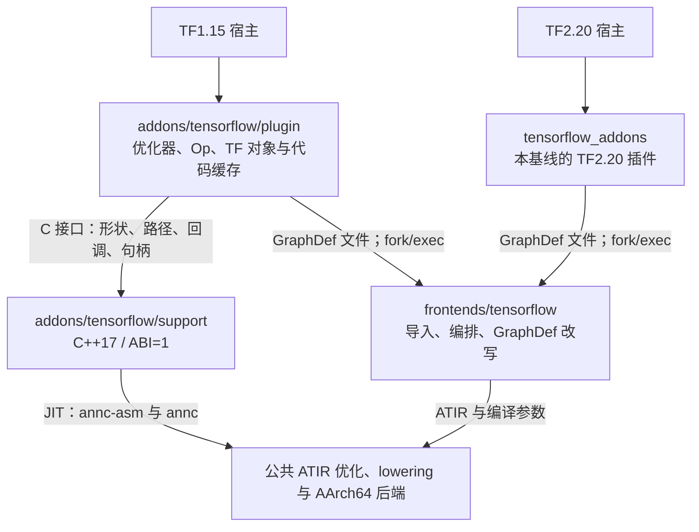
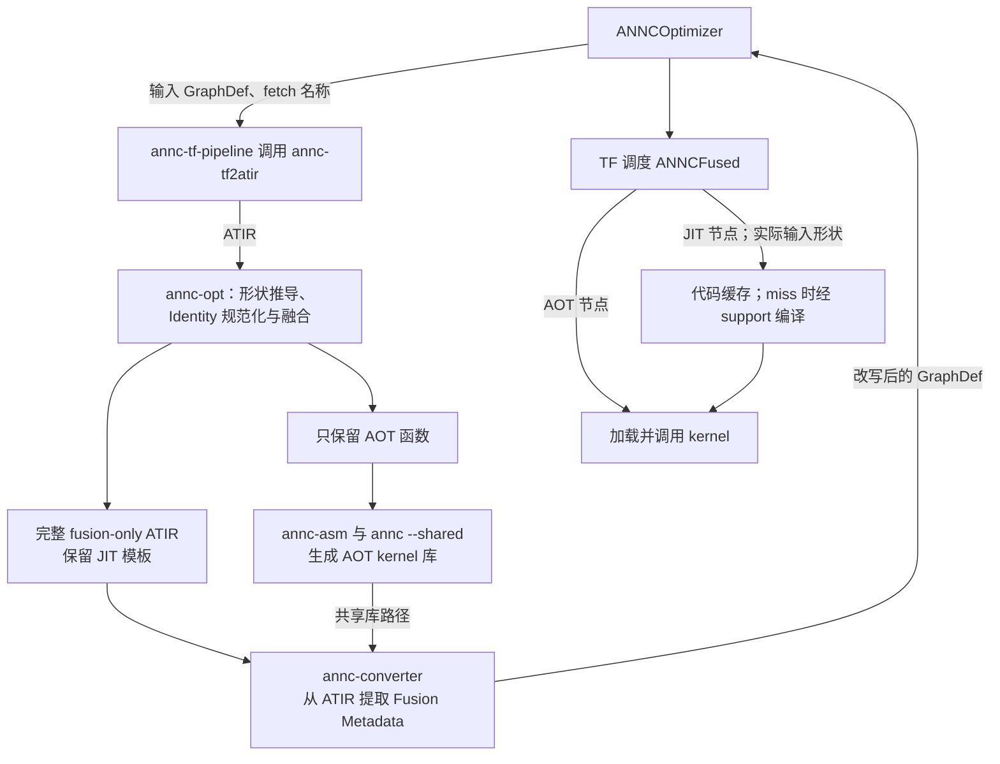
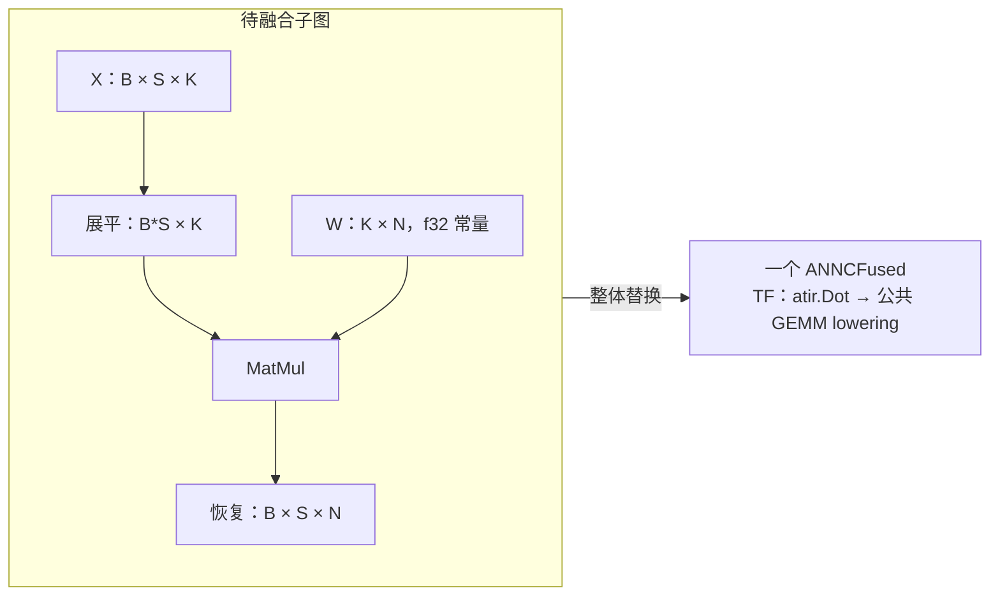

# ANNC 支持 TensorFlow 1.15 设计方案

| 文档控制项 | 内容 |
| --- | --- |
| 文档编号 | ANNC-TF115-HLD-001 |
| 版本与日期 | 2.0，2026-11-11 |
| 文档状态 | 当前实现说明；功能与性能验收范围见第 5 节 |
| 源码基线 | `20d0f8a`（包含 TF1.15 JIT 预打包适配；TF2.20 仍使用 `tensorflow_addons/`） |
| 责任人 | ANNC TensorFlow 接入维护者 |
| 目标读者 | 开发、测试及技术负责人 |
| 关联文档 | [总体架构](../../architecture/overview.md)、[运行时接入](../../architecture/runtime-integration.md)、[ADR-016 历史提案](../../decisions/decisions.md#adr-016)、[JIT 缓存契约](../jit-constant-folding/cache-separation.md) |

## 1 目标、现状与差距

ANNC 通过 Grappler 优化器 `ANNCOptimizer` 和自定义 Op `ANNCFused` 接入 TF1.15。优化器调用独立 TF 前端工具，把可融合子图改写成 `ANNCFused`；Op 在 TF 进程中加载 AOT kernel，或按实际输入形状编译并缓存 JIT kernel。公共 ATIR 优化、lowering 和 AArch64 后端继续复用。

本文按源码说明已落地的结构、接口和执行条件。与最初设计相比，主要变化如下。

| 最初设计 | 当前实现 |
| --- | --- |
| `tf1_15` 实现 TF 接口，`common` 提供普通 C++ 函数 | `plugin/` 保存 TF 对象相关实现，`plugin/1_15/` 选择 SDK 并适配线程池；`support/` 通过 C 接口提供 JIT 编译和 ANNC 线程池桥接 |
| C++17 辅助源文件直接编入插件，全部使用 TF ABI | 辅助实现构建为 `annc_tensorflow_support` 静态库，固定 C++17 / ABI=1；插件和缓存库匹配 TF SDK，通过 C 接口跨 ABI |
| 版本专用开关，`--all` 同时构建两版 TF 与 ORT | `--enable-tf` 从指定 Python 探测 TF1.15 或 TF2.20，每次选择一个版本；TF1.15 与 ORT EP 同时启用会被拒绝 |
| tensordot 仅用于测试普通 MatMul 优化 | 已有完整 `tensordot_matmul` 子图匹配；TF 静态形状走 AOT，动态形状走 JIT，复用 GEMM 代码生成 |
| JIT 从 checkpoint 预计算权重并链入 kernel | JIT 代码不内嵌权重；checkpoint 用于准入检查，各 Op 从自身 Tensor 准备 packed RHS，代码与权重缓存分离 |

TF 前端迁移、TF1.15 插件、tensordot 匹配和 JIT 预打包均已有源码与回归入口。TF2.20 在本基线仍使用旧插件目录。目标平台为 openEuler + AArch64（鲲鹏 920 系列）；目标平台功能验收及 QPS 提升至少 10% 的性能指标仍需具体执行记录，验收入口与证据要求见第 5 节。

## 2 模块职责与执行流程

### 2.1 插件、support 与前端的边界



图 1：两版插件共用独立前端工具；TF1.15 在宿主进程内通过 C 接口隔离 TF SDK 与 ANNC 的 C++ 编译环境。

| 位置 | 当前职责 |
| --- | --- |
| `addons/tensorflow/plugin/` | `ANNCOptimizer`、Op 注册、Tensor/Context 适配、JIT 代码缓存、每节点权重缓存及兼容声明 |
| `addons/tensorflow/plugin/1_15/` | TF1.15 SDK 校验、插件构建目标、TF1.15 线程池回调 |
| `addons/tensorflow/support/` | JIT 工具调用、动态库句柄、checkpoint 准入检查、ANNC 线程池适配；不依赖 TF 头文件 |
| `tensorflow_addons/` | 本基线的 TF2.20 插件及会话配置样例 |
| `frontends/tensorflow/{tf2atir,tf-pipeline,converter}` | GraphDef 导入、编排、融合节点构造与图重写 |
| `annc/` | 公共 Builder、ATIR、Fusion Metadata、公共 lowering、后端和 kernel |

当前优化器仍在 [`plugin/optimizer.cc`](../../../addons/tensorflow/plugin/optimizer.cc) 内完成图序列化、文件操作及子进程管理，并未提取原提案中的 `common/optimizer_pipeline`。`support` 的边界是跨 C++ 标准与 ABI 的运行时服务，不是所有插件辅助函数的集合。

### 2.2 图优化与 AOT/JIT 执行



图 2：执行模式按 fusion 分配；没有 AOT 函数时跳过 AOT 编译。`annc-fusion-metadata` 在启用 `--dump-fusion-metadata` 时额外导出 JSON，不是 converter 的必经前置工具。

AOT 节点写入 `shared_lib_path`，JIT 节点写入 `atir_module_path` 和模板指纹。pipeline 的工作目录必须保留运行期所需的共享库或 ATIR。优化器将 Grappler fetch 逐项传为 `--output_tensor`；converter 保留输出名称、端口及未融合图内容，不能只按节点数量判断重写是否正确。

优化器关闭、restore fetch 或图中已有 `ANNCFused` 时返回原图。写图、pipeline 执行、读图或补 Op 默认属性失败时也返回原图。成功重写后，优化器补充 `ANNCFused` 的默认属性，并为未指定设备的节点填写 CPU 设备。**回退发生在图优化阶段**；已替换成 `ANNCFused` 后的 JIT、加载或执行错误按 TF 错误返回，不承诺重新执行原子图。

### 2.3 TF 前端与公共 Builder

[`TfMLIRBuilder`](../../../frontends/tensorflow/tf2atir/tf_mlir_builder.cpp) 继承公共 `MLIRBuilder`，通过 `lookupSpec` 和 `buildFrontendNode` 提供 TF 算子表与控制流镜像处理。TF 类型解析复用同一份算子表；公共 Builder 保留节点连接、ATIR 构建和元数据能力。Switch、Merge 等控制流在普通输入解析之前交给前端处理，保留循环回边记录。

三个工具保持原名称、命令行入口与 `bin/` 安装位置，使用项目生成的 Protobuf，不链接 TF 运行库，因此可供两版插件调用。当前处理对象为顶层 GraphDef，优化器的 `UsesFunctionLibrary()` 返回 `false`；保留图的函数库不等于优化函数体。StableHLO / TF V2 工具是另一条开发路线，不是 TF1.15 接入的前置条件。

## 3 SDK、ABI 与运行时接口

### 3.1 一次构建选择一个 TF SDK

[`addons/tensorflow/CMakeLists.txt`](../../../addons/tensorflow/CMakeLists.txt) 使用 `ANNC_TENSORFLOW_PYTHON_EXECUTABLE` 查询 TF 版本与 `tf.sysconfig.get_compile_flags()`，仅接受 1.15.x 和 2.20.x。SDK 未报告标准或 ABI 时必须显式指定；显式值与探测值冲突会报错。TF1.15 接受 C++14 / C++17、`_GLIBCXX_USE_CXX11_ABI=0/1`，不能仅凭 TF 版本推断 ABI。

| 构建入口 | 选择结果 |
| --- | --- |
| `./build.sh --enable-tf` | TF 前端与一个 TF 版本的插件；关闭 ONNX 与 ORT EP |
| `./build.sh --enable-ort` | ONNX 前端与 ORT EP；关闭 TF |
| `./build.sh --all` | 所选 TF 与 ONNX / ORT EP；当前 TF1.15 + ORT EP 组合被 CMake 拒绝 |
| 不传框架选择参数 | TF 前端与所选 TF 插件、ONNX 前端；ORT EP 关闭 |

共用开关为 `ANNC_ENABLE_TENSORFLOW` 和 `ANNC_ENABLE_TENSORFLOW_ADDON`。源码没有 `--enable-tf1_15`、`--enable-tf2_20` 或 `ANNC_ENABLE_TF1_15_ADDON`；`--enable-ort-ep`、`--enable-all` 分别是 `--enable-ort`、`--all` 的兼容别名。

| 产物 | TF1.15 | TF2.20（本基线） |
| --- | --- | --- |
| CMake 目标 | `annc_optimizer_1_15`、`annc_fused_op_1_15`、`annc_jit_cache_1_15` | `annc_optimizer`、`annc_fused_op`、`annc_jit_cache` |
| 插件文件名 | `libannc_optimizer.so`、`libannc_fused_op.so` | 同左 |
| 插件安装目录 | `lib/tensorflow/1.15/`，不随 `CMAKE_INSTALL_LIBDIR` 改为 `lib64` | `${CMAKE_INSTALL_LIBDIR}/` |

两版插件需分别配置构建并由匹配版本的宿主加载。优化器默认从自身目录加载同版 fused-op，也可用 `ANNC_FUSED_OP_PATH` 指定。构建命令与完整参数见[从源码构建](../../guides/build-from-source.md#tensorflow-sdk-选择与-tf115-构建)。

TF1.15 默认 `ANNC_TENSORFLOW_PRELOAD=ON`，由宿主提供 TF 符号，此时不得同时设置 `ANNC_TENSORFLOW_LIBRARIES`。linked 模式设为 `OFF`，要求恰好一份同 SDK 的 `libtensorflow_cc` 与 `libtensorflow_framework`；支持无版本后缀、`.so.1` 及 `.so.1.x`。配置阶段检查头文件版本、库存在及文件名，实际二进制兼容性仍须由链接和宿主执行验证。

### 3.2 C 接口隔离编译环境与资源所有权

| 构建部分 | 标准与 ABI | 所有权及职责 |
| --- | --- | --- |
| TF1.15 optimizer / fused-op / JIT 缓存静态库 | 与所选 TF SDK 一致 | TF 对象、状态、Tensor 引用、代码缓存与节点权重缓存 |
| `annc_tensorflow_support` 静态库 | C++17、ABI=1、隐藏内部符号 | 编译工具调用、动态库及工作目录、ANNC 线程池适配器 |
| 独立前端与 LLVM/MLIR | ANNC 工具链设置 | 通过文件与子进程调用，不受 TF ABI 设置影响 |

[`support/c_api.h`](../../../addons/tensorflow/support/c_api.h) 只传递 C 标量、借用的字符串/数组、函数指针和不透明句柄。`std::string`、`std::vector`、TF Status 与 C++17 类型不跨越该边界。这样，TF ABI=0 的插件也可调用 ABI=1 的 support，并由分配资源的一侧释放资源。

`anncCompileJitKernel` 同步读取路径、形状、预打包开关及不可变参数索引，返回状态、错误文本、入口地址和 `AnncJitKernel` 句柄。失败结果也可能携带需释放的句柄。返回字符串、布局及函数地址随句柄有效；插件先接管句柄，再检查状态并复制所需信息。缓存淘汰后若没有调用方持有 executable，最终通过 `anncReleaseJitKernel` 卸载库并按临时文件策略清理目录。C++ RAII 包装见 [`cxx_api.h`](../../../addons/tensorflow/support/cxx_api.h)。

TF 兼容声明集中在 [`plugin/compat.h`](../../../addons/tensorflow/plugin/compat.h)，包括旧版成功状态、字符串类型和线程注解；`optimizer.h` 为 TF1.15 补 `Feedback` 空实现。`ciface_dispatch.h` 使用 C++14 模板特化处理递归终点。

### 3.3 线程池与 kernel 调用

TF1.15 的 [`threadpool_callbacks.cc`](../../../addons/tensorflow/plugin/1_15/threadpool_callbacks.cc) 提供线程数、是否在线程池内和区间调度回调。按 cost 调度调用 `ParallelFor`，按固定块大小调度调用 `TransformRangeConcurrently`。support 将这些回调包装为 ANNC 线程池，借用 TF pool；回调同步完成且不得抛异常。调用结束先恢复 kernel 原有线程池，再销毁适配器。

TF tensordot 使用 `mlir_ciface`，Op 分配输出并按 `kernel_arg_order` 调整参数。其他 Context kernel 通过 `annc_context_v3` 回调 TF 分配、错误及线程池服务。本基线仍保留 `annc_execution_v2` 兼容执行分支；JIT 预打包仅对 `mlir_ciface` 开启。通用 Context 契约见[Kernel Context 设计](../runtime/kernel-context-runtime-design.md)。

## 4 tensordot 融合与常量折叠

### 4.1 整段 tensordot 如何识别与执行

[`OpFusion.cpp`](../../../annc/lib/Dialect/Atir/Passes/OpFusion.cpp) 中的 `FuseTensordotMatMulAsFuncCallPattern` 优先于普通 MatMul 匹配，将符合条件的形状计算、展平、MatMul 和恢复形状组成一个 `tensordot_matmul` fusion。TF 在 `ANNC_GEMM` 非 0 时注册该规则；ONNX 使用自身融合开关，不能把 TF 的门控条件套到 EP。



图 3：符合条件时，上述计算子图被一个融合节点替代；TF kernel 保留三维输入/输出描述，通过公共 GEMM 路径生成矩阵计算。

| 检查对象 | 当前约束 |
| --- | --- |
| 输入与权重 | 输入 rank 3、f32；RHS 为带常量数据的 rank 2 f32，K/N 静态且为正；已知输入末维须与 K 一致 |
| 布局与形状链 | 按前导维展平、末维收缩，输出恢复前导维并追加 N；接受可证明等价的常量、部分折叠和动态形状链 |
| 转置 | 可省略恒等 Transpose；非恒等输入/权重转置及 MatMul 转置标志不满足此规则 |
| 子图边界 | 展平结果只供当前 MatMul，MatMul 结果只供恢复 Reshape；除最终输出外不得有中间结果逃逸 |
| epilogue | 当前整段匹配拒绝带 bias 或 ReLU 的 MatMul |

不满足条件只表示不能做这次整段融合，普通 MatMul 等其他规则仍可能匹配。TF 分支生成 `atir.Dot`，走公共 lowering 与 AArch64 GEMM；ONNX 分支走 `TensordotMatMul` Context builtin。两条路径共享匹配逻辑，但执行契约不同。

| 路径 | ABI | 执行模式 |
| --- | --- | --- |
| TF tensordot，输入形状全静态 | `mlir_ciface` | AOT |
| TF tensordot，输入含动态维度 | `mlir_ciface` | JIT，按实际形状特化 |
| ONNX tensordot | `annc_context_v3` | AOT，输出由 Context 分配 |

TF GraphDef 的输入仍按 fixed 在前、dynamic 在后分组。converter 根据元数据生成 `kernel_arg_order`，将节点输入映射回 kernel 的 input、weight、output 顺序；动态输出维度由运行期实际输入推导。空 batch 及非法形状的处理由相应 lowering、运行时和反例用例覆盖。

### 4.2 ATIR 折叠、AOT 预打包与 JIT 预打包

ATIR 算子折叠继续按各自规则执行，例如 [`SizeOp::fold`](../../../annc/lib/Dialect/Atir/AtirOps.cpp) 对静态形状的处理。`ANNC_GEMM=3/99` 控制 GEMM 预打包，不控制所有 ATIR 折叠；原生预打包能力随产物构建，无额外编译开关。

AOT / 手工 pass 仍可读取 checkpoint，生成包含权重数据的预计算 C 并链接到 kernel。TF JIT 则遵循 [ADR-017](../../decisions/decisions.md#adr-017) 的代码与权重分离契约：

1. 每个 Op 首次需要预打包时，通过 support 读取 fusion metadata 与 `ANNC_DEMO_CHECKPOINT_DIR` 指定的 checkpoint，校验名称、f32 类型和字节数；通过准入的输入必须在该 Op 生命周期内保持不可变。checkpoint 不用于生成 JIT 权重快照。
2. 插件把不可变输入转换为 kernel 参数索引，通过 C 请求传给 support。support 写 `immutable_inputs.json`，向 `annc-asm` 传 `jit-inputs` / `packed-c`，向 `annc` 传 `--packed-rhs-c`，生成布局和准备入口，不内嵌权重。
3. 进程级代码缓存按模板、实际形状、ABI 与不可变参数槽复用 executable。每个 Op 的 `PackedRhsCache` 从自身首次输入 Tensor 准备数据，按完整布局复用；相同模板但不同权重不会共用 packed 数据。
4. 执行时用 packed buffer 替换对应 RHS descriptor 的数据指针，保持原逻辑形状与调用协议。连续相同 shape 可同时复用最近的 executable 与 binding。

元数据或 checkpoint 不可用、输入未通过准入时使用普通 packing；编译、布局或分配错误仍按错误返回。当前支持连续二维 f32、单一 GEMM 消费者等既有条件；可变权重、原地更新和运行期间改变 SVE VL 不在该契约内。模型更新应创建新节点实例。详细身份、生命周期及布局约束见[JIT 实现契约](../jit-constant-folding/cache-separation.md)。

`20d0f8a` 将上述预打包参数、准入服务及 packed RHS 返回结果接入 TF1.15 的 C 边界，并让 support 复用公共 `CheckpointReader`。源码入口为 [`fused_op_prepack.cc`](../../../addons/tensorflow/plugin/fused_op_prepack.cc)、[`fused_op_jit.cc`](../../../addons/tensorflow/plugin/fused_op_jit.cc) 和 [`support/jit_compiler.cc`](../../../addons/tensorflow/support/jit_compiler.cc)。

## 5 验证入口与未完成的验收

### 5.1 按能力分层验证

| 验证层 | 已有入口与检查对象 | 证明边界 |
| --- | --- | --- |
| SDK 配置 | [`test_tf_plugin_sdk.py`](../../../tests/integration/cmake/test_tf_plugin_sdk.py)：版本、标准、ABI、库模式、切换 SDK 及负例 | 使用模拟 SDK，不加载 TF 库 |
| 插件接口 | `tf_dispatch_*`、`tf_threadpool_*`、`tf_jit_*` CTest：C++14/17、ABI 0/1 调用 support；JIT 用例执行真实工具 | 需已构建产物；GEMM JIT 项依赖完整 GEMM 包 |
| 宿主加载 | `TensorFlowPluginLoad`：preload 使用所选 Python；linked 使用同 SDK 的 C++ Session，执行 ANNCFused 并对照原生 Add | 两种构建模式需分别验证 |
| 融合形态 | [`tf-tensordot-fusion.mlir`](../../../tests/FileCheck/Dialect/Atir/tf-tensordot-fusion.mlir)、[`tensordot-gemm.mlir`](../../../tests/FileCheck/Conversion/tensordot-gemm.mlir)、[`tensordot-gemm-empty.mlir`](../../../tests/FileCheck/Conversion/tensordot-gemm-empty.mlir) | 检查 TF 融合、公共 GEMM lowering、空输出及反例；不代替宿主数值验证 |
| TF 专项 | [`test_tf_acceptance.py`](../../../tests/integration/tensorflow/test_tf_acceptance.py)：普通/动态 MatMul、静态/动态 tensordot、部分/未折叠形状、恒等转置、空 batch、非恒等转置/错误形状/外部使用反例 | runner 对照全部输出、融合成员、ABI、模式和 TF 实际执行记录 |
| JIT 权重隔离 | 同一专项中的 `TF-JIT-prepack-eligible/mismatch`，配合 `PackedRhsCacheTest` 与 [`test_jit_prepack.py`](../../../tests/integration/jit/test_jit_prepack.py) | 同模板不同权重、形状切换、准入失败、布局与数据复用需分别核对 |
| 公共回归 | TF 前端控制流、输出端口/别名、TF2.20、ONNX 前端及 EP 对应套件 | 不因 TF1.15 专项通过而自动视为通过 |

以下命令在仓库根目录、已配置对应构建环境后执行。TF 专项从 `build/CMakeCache.txt` 读取目标 TF Python，pytest 所在 Python 可以不同；非默认构建目录用 `ANNC_BUILD_DIR` 指定。需要目标 TF/NumPy、插件、编译工具、AArch64 工具链及 GEMM 依赖，详见[测试说明](../../../tests/README.md)。

```shell
python3 -m pytest tests/integration/cmake/test_tf_plugin_sdk.py -q
ctest --test-dir build -N
ctest --test-dir build -R '^(TensorFlowPluginLoad|tf_(dispatch|threadpool|jit)_)' --output-on-failure
bash tests/FileCheck/run.sh Dialect/Atir
bash tests/FileCheck/run.sh Conversion
ANNC_REQUIRE_E2E=1 python3 -m pytest tests/integration/tensorflow/test_tf_acceptance.py -v
```

专项 runner 保存 GraphDef、RunMetadata、输出对照及 `result.json` 等证据；pytest 默认在缺少配置或产物时跳过，`ANNC_REQUIRE_E2E=1` 将这类缺失改为失败。已有验收脚本验证功能，不包含 QPS 基准，也没有单独证明所有 ATIR 折叠规则均被覆盖。发布验收需留存具体平台、源码、SDK、依赖、命令和结果，分别记录通过、失败与跳过。

### 5.2 tensordot 性能指标

原需求保留：同一 TF1.15 专项样例开启 ANNC 后，稳态 QPS 相比关闭时提升至少 10%。先确认 `tensordot_matmul` 实际执行且结果正确，再测完整计算，不能仅测 kernel 或把普通 MatMul 命中当作整段融合证据。

| 项目 | 测量约定 |
| --- | --- |
| 对照 | 同一 TF1.15、机器、权重、输入、绑核、构建及其他 TF 优化设置，仅改变是否启用 ANNC |
| 并行度 | TF intra-op、inter-op 均为 1，单个执行请求，记录 CPU 与线程配置 |
| 计时范围 | 同一 feed/fetch 的 `Session.run`；初始化、编译、输入准备和预热在计时外 |
| 统计 | 开启/关闭交替五轮，每轮至少 5 秒，记录次数和耗时，以 QPS 中位数计算 `QPS_开启 / QPS_关闭 - 1` |

本基线的专项测试未提供上述性能测量与结果报告；10% 指标仍需目标平台证据。TF2.20 同样例可作参考，不能替代 TF1.15 自身对照。常量折叠与预打包分别验收，不要求所有功能在同一 tensordot 片段中同时生效。
