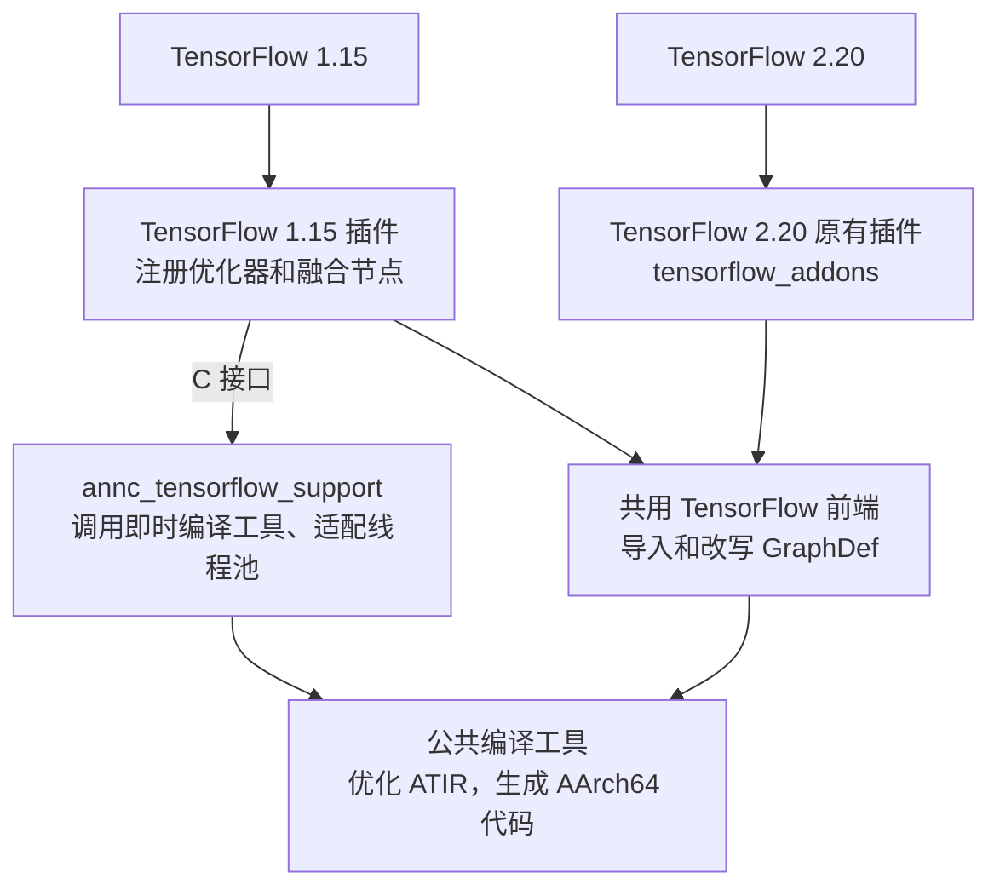
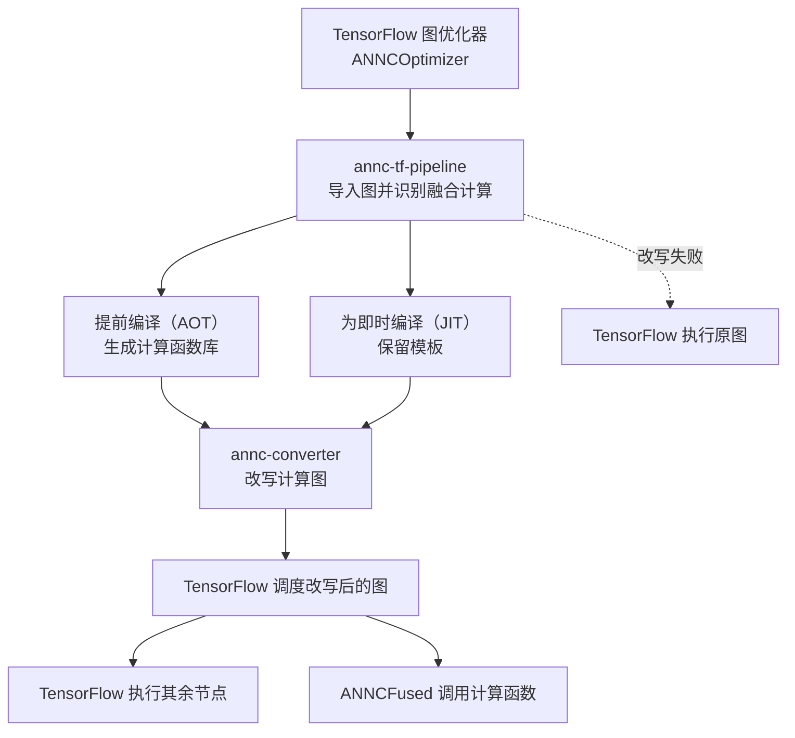
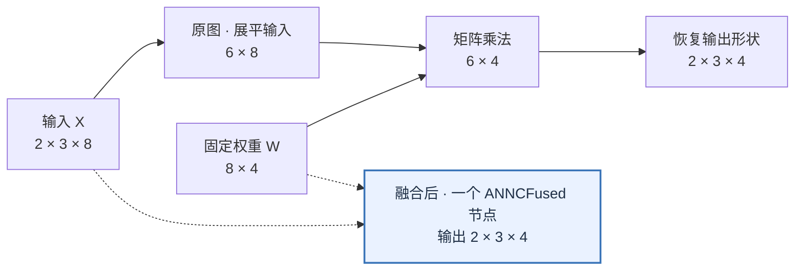
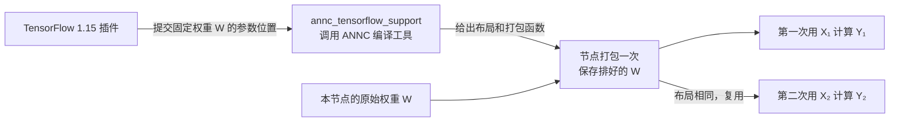

# ANNC 支持 TensorFlow 1.15 设计方案

| 文档控制项 | 内容 |
| --- | --- |
| 文档编号 | ANNC-TF115-HLD-001 |
| 版本与日期 | 1.1，2026-11-19 |
| 文档状态 | 对应实现已合入 `dev` |
| 源码基线 | `dev` 分支 `846ac64` |
| 责任人 | ANNC TensorFlow 接入维护者 |
| 目标读者 | 熟悉模型推理的开发、测试及技术负责人。文中术语见[附录 A](#附录-a-术语表) |
| 关联文档 | [总体架构](../../architecture/overview.md)、[运行时接入](../../architecture/runtime-integration.md)、[初版接入提案 ADR-016](../../decisions/decisions.md#adr-016) |

## 1 目标与范围

**让 TensorFlow 1.15 能够通过 ANNC 插件使用已有算子融合与常量折叠能力，并支持对符合条件的 tensordot 做整段融合。** 为隔离 TensorFlow 版本差异，将 TensorFlow 1.15 插件放入独立模块，同时参照 ONNX 整理 TensorFlow 前端的职责与目录。

| 目标 | 本次交付内容 |
| --- | --- |
| TensorFlow 1.15 基础接入 | 插件可以构建、加载和注册，图中的可融合计算实际交给 ANNC 执行 |
| tensordot 优化效果 | 将符合条件的 tensordot 子图融合为一个节点。专项样例开启 ANNC 后，稳态 QPS 相比关闭时平均提升至少 10% |
| 常量折叠 | 使能已有功能及其适用范围，确认优化实际生效、计算结果正确 |
| 模块清晰、便于扩展 | TensorFlow 前端进入 `frontends/tensorflow`；新插件区分公共代码与 TensorFlow 1.15 专属代码 |
| 构建共存 | 按目标 SDK 选择 TensorFlow 1.15 或 TensorFlow 2.20 插件，两个版本分别构建 |

TensorFlow 2.20 现有插件暂不迁移，源码、构建配置和已有库保持不变，待 TensorFlow 1.15 验证通过后再接入新结构。`ANNCFused` 的执行职责、已有 AOT/JIT 流程、公共后端和 kernel 调用协议保持。tensordot 整段融合复用已有的矩阵乘法实现。本次不新增通用常量表达式折叠能力。

## 2 总体方案

### 2.1 模块如何划分

TensorFlow 执行图前，图优化组件 Grappler 调用 `ANNCOptimizer` 处理计算图（GraphDef）。插件把图交给 TensorFlow 前端，前端把它转换为 ANNC 用来分析和优化计算的表示（ATIR）。图 1 给出两版插件与前端工具的关系。TensorFlow 1.15 的融合节点插件还通过静态库 `annc_tensorflow_support` 调用 ANNC 即时编译工具、适配 TensorFlow 线程池。



*图 1　两版 TensorFlow 插件与公共编译工具*

| 目录 | 主要职责 |
| --- | --- |
| `addons/tensorflow/plugin/` | 与 TensorFlow 1.15 交换图、张量和执行结果。`1_15/` 子目录负责校验配套的 TensorFlow 软件开发包（SDK）、构建插件和提供 TensorFlow 线程池回调 |
| `addons/tensorflow/support/` | 构建 `annc_tensorflow_support`，管理即时编译生成的动态库，并提供线程池适配器 |
| `tensorflow_addons/` | 构建 TensorFlow 2.20 原有插件 |
| `frontends/tensorflow/` | 集中处理 TensorFlow 图的导入、编译流程编排和 GraphDef 改写 |
| `annc/` | 提供公共图构建器、ATIR 优化和代码生成工具 |

TensorFlow 前端使用项目生成的 GraphDef 读写代码，可独立于 TensorFlow 运行库构建。两个版本的插件因此可以调用同一套工具。

### 2.2 本次修改在流程中的位置

**TensorFlow 1.15 插件沿用 TensorFlow 2.20 插件已有的“图转换 → 融合 → 图改写 → 执行”流程。** 如图 2 所示，`ANNCOptimizer` 在图执行前调用编译工具，把可融合的一组算子替换为一个 `ANNCFused` 节点。TensorFlow 仍然调度整张图，融合节点负责调用 ANNC 生成的计算函数。



*图 2　TensorFlow 2.20 已有的 ANNC 图优化与执行流程*

TensorFlow 1.15 插件中的 `ANNCOptimizer` 按本版 Grappler 接口实现，与 TensorFlow 2.20 插件共用一套前端工具。这个优化器把顶层计算图（GraphDef）交给 `annc-tf-pipeline` 子进程，并按名称指明调用方这次要读哪些输出，以便改写图时保留它们。工具完成改写后，优化器读回新图，交还给 TensorFlow 1.15 调度。

执行到 `ANNCFused` 时，TensorFlow 1.15 调用本版插件注册的融合节点。节点通过 TensorFlow 的算子接口读取输入张量、分配输出张量，再调用 ANNC 生成的计算函数。

## 3 关键设计

### 3.1 TensorFlow 1.15 插件适配与构建

TensorFlow 1.15 插件需要按本版 SDK 重新注册图优化器 `ANNCOptimizer` 和 CPU 融合节点 `ANNCFused`，注册名称和节点属性沿用 TensorFlow 2.20 插件的约定。TensorFlow 1.15 的 Grappler 还要求优化器实现 `Feedback`。ANNC 的优化不依赖执行反馈，该方法可直接返回。

优化器只改写顶层图，跳过已有 `ANNCFused` 的图和请求恢复权重的图。读回改写的图后，优化器按已注册的 `ANNCFused` 定义补齐默认属性。工具失败或改写结果不可用时，优化器交回原图，TensorFlow 可以照常执行。

执行融合节点时，插件按节点的 `abi` 属性调用计算函数。采用 `mlir_ciface` 时，融合节点分配输出缓冲区并传给计算函数。采用 `annc_context_v3` 时，融合节点提供执行上下文，供计算函数读取输入、申请输出。执行中的编译或计算错误通过 TensorFlow 的算子状态报告。

#### 3.1.1 插件的编译与链接

图优化器和融合节点直接调用 TensorFlow 1.15 的 C++ 接口，编译时需要匹配目标 TensorFlow SDK 的 C++ 标准和标准库 ABI（应用二进制接口），例如 C++14 和 ABI 0。调用即时编译（JIT）工具的代码用到了 C++17 的文件系统接口。适配 TensorFlow 线程池的代码实现 ANNC 的 C++ 线程池接口，需要与 ANNC 计算代码使用相同的标准库 ABI（ABI 1）。

为满足这两组编译要求，在 `addons/tensorflow/` 下将源文件分到两个目录。融合节点通过 C++ 接口访问 JIT 缓存，接口直接传递 `std::string`，因此缓存库与融合节点一起按目标 TensorFlow SDK 的设置编译。

| 源码目录 | 构建目标 | 编译设置 |
| --- | --- | --- |
| `plugin/` | 图优化器、融合节点、JIT 缓存静态库 | 目标 TensorFlow SDK 的 C++ 标准和标准库 ABI |
| `support/` | 静态库 `annc_tensorflow_support`，负责调用 JIT 工具和适配线程池 | C++17、ABI 1 |

融合节点插件链接 JIT 缓存库，缓存库将 `annc_tensorflow_support` 声明为可传递的链接依赖（CMake 的 `PUBLIC`），两者最终一起链接进 `libannc_fused_op.so`。融合节点插件通过 C 接口调用 `annc_tensorflow_support`，跨库函数在 C++ 中使用 `extern "C"` 声明。图优化器单独生成 `libannc_optimizer.so`。

#### 3.1.2 融合节点插件与 `annc_tensorflow_support` 的 C 接口

**JIT 编译接口**

JIT 缓存未命中时，融合节点需要按当前输入形状编译 ATIR 中指定的函数。TensorFlow 1.15 插件沿用 TensorFlow 2.20 插件的 C++ 入口 `tensorflow::CompileAnncJitKernel`。融合节点通过返回的 `Status` 判断编译是否成功，成功时从 `executable` 取得可执行结果，供本次推理和后续命中同一缓存项的推理使用。

```cpp
Status CompileAnncJitKernel(
    const AnncJitCompileRequest& request,
    std::shared_ptr<annc::jit::JitExecutable>* executable);
```

第一个参数的类型 `tensorflow::AnncJitCompileRequest` 用 `std::string` 保存 ATIR 文件路径和函数名。当目标 TensorFlow SDK 使用 ABI 0 时，插件与按 ABI 1 编译的 `annc_tensorflow_support` 对这种字符串的内存布局有不同约定。因此，插件用 `const char*` 跨库传递字符串，调用 `anncCompileJitKernel` 同步请求编译。缓存用完编译产物后，插件调用 `anncReleaseJitKernel` 释放产物。

```c
void anncCompileJitKernel(const AnncJitCompileRequest* request,
                          AnncJitKernelResult* result);
void anncReleaseJitKernel(AnncJitKernel* kernel);
```

C 接口使用单独定义的同名请求类型，在 C++ 中写作 `::AnncJitCompileRequest`。插件将 C++ 请求中的数据传给这个结构体，指定编译目标、计算函数各参数的形状和编译选项。形状按函数参数顺序传递。对于第 3.3 节的 tensordot，这些参数还包括输出缓冲区。

```c
#include <stddef.h>
#include <stdint.h>

typedef void (*AnncJitLogCallback)(void* context, int warning,
                                   const char* message);

typedef struct {
  const char* atir_module_path;
  const char* kernel_name;
  int64_t intra_thread_count;
  const int64_t* const* argument_dims;
  const size_t* argument_ranks;
  size_t argument_count;
  AnncJitLogCallback log;
  void* log_context;
  int enable_prepack;
  const int64_t* immutable_arguments;
  size_t immutable_argument_count;
} AnncJitCompileRequest;
```

`anncCompileJitKernel` 通过 `AnncJitKernelResult` 交回编译状态和产物。`AnncJitKernel` 只公开类型名，插件通过句柄持有编译产物。

```c
#include "Kernel/PackedRhs.h"

typedef struct AnncJitKernel AnncJitKernel;

typedef enum {
  ANNC_JIT_OK,
  ANNC_JIT_INVALID_ARGUMENT,
  ANNC_JIT_NOT_FOUND,
  ANNC_JIT_INTERNAL
} AnncJitStatus;

typedef struct {
  AnncJitKernel* kernel;
  AnncJitStatus status;
  const char* error;
  const char* work_dir;
  const char* shared_library_path;
  void* kernel_function;
  void* set_thread_pool_function;
  void* get_thread_pool_function;
  const AnncPackedRhsSpec* packed_rhs_specs;
  size_t packed_rhs_count;
  AnncPreparePackedRhs prepare_rhs;
} AnncJitKernelResult;
```

编译为同步调用。插件保证请求中的数组、字符串和日志上下文在调用期间有效，编译接口通过 `result` 交回状态。日志回调在本次调用中执行，C++ 异常须在产生它的一侧处理。

- **成功时**（`ANNC_JIT_OK`），编译接口返回供融合节点执行的函数地址和产物句柄。结果中借用的字符串、函数地址和权重布局描述在句柄释放前有效。缓存和正在执行的调用都用完该结果后，插件调用 `anncReleaseJitKernel` 归还句柄，由 `annc_tensorflow_support` 释放产物。
- **失败时**，`*executable` 为空，插件根据状态码和错误消息构造 TensorFlow `Status`。失败也可能返回非空句柄，此时插件须先复制错误消息，再调用 `anncReleaseJitKernel` 归还句柄。

第 3.4 节的 JIT 权重预打包通过两个 C 接口查询预打包开关和可作为固定权重的输入。

```c
int anncTensorFlowPrepackEnabled(void);
void anncFindImmutableInputs(const char* atir_path, const char* kernel_name,
                             const char* fingerprint, int constants, int fixed,
                             int dynamic, const size_t* input_bytes,
                             uint8_t* eligible, AnncJitLogCallback log,
                             void* log_context);
```

**线程池适配接口**

ANNC 计算函数通过 `AnncThreadPool::parallel_for` 把 `[0, total)` 范围内的工作交给线程池。TensorFlow 2.20 插件中的 `TensorFlowAnncThreadPool` 实现这个 C++ 接口，使用 TensorFlow 的算子内线程池分段执行任务 `fn`。

```cpp
virtual void parallel_for(
    std::int64_t total, const ParallelForOptions& options,
    const std::function<void(std::int64_t, std::int64_t)>& fn) = 0;
```

第二个参数 `options` 的类型 `ParallelForOptions` 用 C++17 的 `std::optional` 表示可选的调度参数。TensorFlow 1.15 插件按 C++14 编译时无法直接实现这个接口，因此在 `annc_tensorflow_support` 中实现 `AnncThreadPool` 适配器，由插件提供访问 TensorFlow 线程池的 C 回调。适配器用整数传递调度参数，并为任务 `fn` 提供 C 函数指针 `task` 和任务上下文 `task_context`。TensorFlow 线程池按区间调用 `task` 时，由适配器执行对应的 `fn(begin, end)`。


```c
typedef struct AnncThreadPoolAdapter AnncThreadPoolAdapter;

typedef void (*AnncThreadPoolTask)(void* task_context, int64_t begin,
                                   int64_t end);
typedef struct {
  void* context;
  int (*num_threads)(void*);
  int (*in_parallel_region)(void*);
  int (*parallel_for)(void*, int64_t total, int64_t block_size,
                      int64_t cost_per_unit, int max_parallelism,
                      AnncThreadPoolTask task, void* task_context);
} AnncThreadPoolCallbacks;

AnncThreadPoolAdapter* anncCreateThreadPoolAdapter(
    const AnncThreadPoolCallbacks* callbacks);
void anncDestroyThreadPoolAdapter(AnncThreadPoolAdapter* adapter);
```

C 回调以整数表示调度选项。正的 `max_parallelism` 优先限制并行度，0 表示调用方未设上限。未设上限时，正的 `block_size` 指定固定分块，0 表示由 TensorFlow 按 `cost_per_unit` 分配工作。

- `context` 指向 TensorFlow 管理的线程池，须在适配器使用期间有效。`anncCreateThreadPoolAdapter` 创建适配器时复制回调表。若创建接口返回空指针，插件向 TensorFlow 报告创建失败。融合计算结束或提前退出时，插件先恢复计算函数原先使用的线程池，再调用 `anncDestroyThreadPoolAdapter` 释放适配器。
- `task_context` 只在本次调度期间有效，因此插件的 `parallel_for` 回调须等所有区间执行完毕再返回。返回 0 表示成功，非零表示调度失败。任务抛出的 C++ 异常由适配器在调度结束后报告，避免异常穿过 C 接口。

#### 3.1.3 选择 TensorFlow 版本与安装插件

两个版本的 TensorFlow 插件使用相同的注册名称，但各自的 SDK 可能要求不同的 C++ 标准和 ABI。一次构建只选择一个版本。`./build.sh --enable-tf` 通过指定的 Python 环境识别 SDK 版本。1.15.x 选择 `plugin/1_15/`，2.20.x 选择原有的 `tensorflow_addons/`，其他版本在配置阶段报错。与 ONNX Runtime 执行插件（ORT EP）的构建组合见[从源码构建](../../guides/build-from-source.md)。

CMake 从目标 SDK 读取 C++ 标准和 ABI，SDK 未报告的值须显式指定。显式值与 SDK 冲突时配置失败。默认由运行 TensorFlow 的进程提供所需符号，也可显式链接同版 TensorFlow 库。[附录 C 构建与功能配置](#附录-c-构建与功能配置)

| 产物 | TensorFlow 1.15 | TensorFlow 2.20 |
| --- | --- | --- |
| 插件文件名 | `libannc_optimizer.so`、`libannc_fused_op.so` | 同左 |
| 插件构建目录（相对构建根目录） | `lib/tensorflow/1.15/` | `lib/` |
| 插件安装目录（相对安装前缀） | `${CMAKE_INSTALL_LIBDIR}/` | `${CMAKE_INSTALL_LIBDIR}/` |

同一 TensorFlow 版本的优化器库 `libannc_optimizer.so` 和融合节点库 `libannc_fused_op.so` 须成对安装。优化器默认从自身目录加载融合节点库。两版的库名和安装目录相同，需同时保留时应使用不同的安装前缀。

### 3.2 TensorFlow 图的导入与改写

公共构建器 `MLIRBuilder` 原先既负责连接输入、构建 ATIR，也负责解释 TensorFlow 算子和控制流。本次将 TensorFlow 特有的规则移入两版插件共用的前端 `frontends/tensorflow/`。这样，各前端自行解释本框架的节点，公共构建器按前端提供的规则连接输入、构建 ATIR。

| 职责 | 代码归属 |
| --- | --- |
| 导入 GraphDef、编排编译、改写 GraphDef | 将 `annc-tf2atir`、`annc-tf-pipeline`、`annc-converter` 从 `annc/tools/` 迁入 `frontends/tensorflow/`，沿用命令名称、参数和安装位置。 |
| 解释 TensorFlow 节点 | 将 TensorFlow 算子表、属性和控制流规则从公共构建器 `MLIRBuilder` 移入 TensorFlow 前端。导入工具把节点转换为 `NodeInfo`，交给新增的派生类 `TfMLIRBuilder`。张量类型解析与构图共用同一份 TensorFlow 算子表。 |
| 连接输入、构建 ATIR | 继续由 `MLIRBuilder` 负责。将原有的 `lookupSpec` 改为纯虚函数，由各前端提供算子表。TensorFlow 查不到规则时返回空指针，公共构建器用 `atir.opaque` 占位并保留节点信息。 |

TensorFlow 的循环有一处例外。构建循环入口 `Merge` 时，提供上一轮结果的 `NextIteration` 节点可能还未建好。因此，公共构建器在解析普通输入前先调用新增的 `buildFrontendNode`，让 TensorFlow 前端有机会处理循环回边。

```cpp
virtual const OpSpec* lookupSpec(llvm::StringRef opType) const = 0;
virtual std::optional<mlir::LogicalResult> buildFrontendNode(
    const NodeInfo& node);
```

TensorFlow 前端可以用已就绪的输入构建 `Merge`，同时在节点属性中保留回边的原输入名称，成功后公共构建器便可处理下一个节点。若 `Merge` 连一个可用输入都没有，前端返回失败并终止建图。对于普通节点，如 `MatMul`，前端返回 `std::nullopt`，公共构建器才按算子表建图。

改写工具在原 GraphDef 上替换融合涉及的节点和连接，保留循环回边、函数库，以及调用方仍需读取的输出名称和端口。

<a id="41-整段-tensordot-如何识别与执行"></a>

### 3.3 tensordot 整段融合与执行

TensorFlow 将这里的 `tf.tensordot` 展开为展平输入、矩阵乘法、恢复输出形状。原有 TensorFlow 规则可以优化中间的 `MatMul`，公共 ATIR 融合已有针对 ONNX 图的整段识别规则。为使 TensorFlow 1.15 也能将这段计算交给一次融合调用，扩展公共规则以识别 TensorFlow 的形状计算方式，并为 TensorFlow 生成使用现有 GEMM 后端的函数。图 3 以形状为 `2 × 3 × 8` 的输入为例。



*图 3　实线是原图的三步计算，虚线是融合后的调用。两条路径使用相同的输入和权重，输出形状也相同*

启用 GEMM 优化后，先在 `MatMul` 处尝试整段匹配。条件不满足时，普通矩阵乘法规则仍可独立匹配。

| 检查对象 | 整段融合的条件 |
| --- | --- |
| 输入与权重 | 输入和权重均为 32 位浮点数。权重是二维常量，两个维度已知且为正数。输入末维已知时须等于权重第一维 |
| 形状变化 | 输入形状为 `[B,S,K]`、权重为 `[K,N]` 时，展平目标须为 `[B×S,K]`，输出须恢复为 `[B,S,N]`。形状可来自常量，也可由 TensorFlow 的取维度、求积与拼接运算得出，匹配器须能验证维度的来源 |
| 转置和附加计算 | 只接受维度顺序未变的转置。矩阵乘法须关闭转置标志，且自身不带偏置或 ReLU 激活 |
| 中间结果 | 只有最终输出供这段计算以外的节点使用。例如，如果另一个节点也要读取矩阵乘法的结果，就不能把这几步合成一个节点 |

整段匹配成功时，TensorFlow 分支用 `atir.Dot` 表示三维输入与二维权重的乘法。生成的函数通过 `mlir_ciface` 接收输入、权重和输出缓冲区。ONNX 分支沿用原有的专用计算函数。

| 输入形状 | 计算函数如何生成 |
| --- | --- |
| 所有维度已知 | 提前编译（AOT），在图优化时生成动态库。 |
| 含运行时才能确定的维度 | 即时编译（JIT），保留 ATIR 模板及其指纹。执行时用实际形状替换未知维度，再生成可缓存的计算函数。 |

两条路径在形状确定后使用同一套转换。将连续存放的输入和输出各看作二维矩阵，调用已有的矩阵乘法实现，并保留权重在 checkpoint 中的名称供预打包使用。若 `B` 或 `S` 为 0，输出仍是 `[B,S,N]`，无需执行矩阵乘法。

图中 `ANNCFused` 的两个输入依次是固定权重 `W` 和输入张量 `X`。计算函数需要的参数顺序是 `(X, W, 输出)`，由 `annc-converter` 在 `kernel_arg_order` 中记录。输出形状为 `[B,S,N]`。图上未知的前两维取本次输入 `X` 的实际大小，末维 `N` 由固定权重决定。融合节点按这个形状分配输出，再按函数参数顺序调用。

### 3.4 常量折叠与固定权重

两版插件沿用 ANNC 已有的 ATIR 常量折叠规则，例如在编译期根据已知形状求出张量的元素数。提前编译（AOT）也可沿用已有流程，从模型权重文件（checkpoint）读取固定权重，打包后链接到动态库。本次要让 TensorFlow 1.15 插件在即时编译（JIT）时也能使用 TensorFlow 2.20 插件已有的固定权重预打包能力。

一个融合节点连续两次计算 `Y = X × W`。两次输入分别是 `X₁` 和 `X₂`，权重矩阵 `W` 在节点使用期间保持固定。乘法函数按块读取权重，同一块要用到的数在原矩阵中可能并不相邻。节点可以在第一次执行时，把 `W` 的数值按乘法函数读取的顺序排列，保存一份副本，这就是**权重预打包**。第二次输入虽变了，只要乘法函数要求的排列方式（布局）相同，节点就能直接使用这份副本。

ANNC 的 TensorFlow 1.15 插件通过静态库 `annc_tensorflow_support` 调用 ANNC 编译工具，在运行时生成乘法函数。为生成能直接使用这份副本的乘法函数，插件须在编译请求中指明固定权重 `W` 的参数位置。编译完成后，该库将乘法函数、权重布局和打包函数交回插件。执行时，节点从首次收到的输入张量取出 `W`，调用打包函数准备副本，并把乘法函数的权重参数指向这份副本。



**如何选出固定权重。** 对采用 `mlir_ciface` 接口的即时编译矩阵乘法，`ANNC_GEMM=3` 或 `99` 时启用预打包。插件从常量或固定输入中选出二维 `float32` 张量，`annc_tensorflow_support` 按权重名称、类型和字节数与 checkpoint 中的信息核对。无法确认的输入仍按普通方式打包。插件按 `kernel_arg_order` 将通过检查的输入在 TensorFlow 节点中的位置换算为计算函数的参数序号，填入编译请求。

**哪些结果可以共享。** 计算模板和参数形状相同的节点要共享编译代码，还须使用相同的预打包开关和可预打包参数位置。每个节点都向乘法函数传入自己的权重副本，因而共享代码的节点可以使用不同的权重值。[JIT 代码与权重缓存设计](../jit-constant-folding/cache-separation.md)

## 4 验收方案

### 4.1 功能与兼容性

在目标平台用同一 TensorFlow 1.15 环境分别执行原图和改写后的图。对每个请求的输出，比较形状、类型和数值。对预期融合的用例，还要从 TensorFlow 的执行记录（`RunMetadata`）确认 `ANNCFused` 实际运行，且请求的输出使用了它的结果。

| 验收项 | 应观察到的结果 | 验证依据 |
| --- | --- | --- |
| 插件构建与加载 | TensorFlow 1.15 插件可仅用本版 SDK 构建。在由 TensorFlow 进程提供所需函数和显式链接 TensorFlow 库的两种构建中，分别加载插件，比较融合加法与原生加法的结果 | [SDK 配置用例](../../../tests/integration/cmake/test_tf_plugin_sdk.py)、[宿主加载测试](../../../tests/CMakeLists.txt) |
| 基础融合与 tensordot | 普通矩阵乘法和符合条件的 tensordot 均由融合节点执行。静态 tensordot 采用 AOT，动态形状采用 JIT，空批次也得到正确结果。对非恒等转置、形状不符或中间结果被其他节点使用的反例，确认 ANNC 拒绝整段融合 | [融合形态用例](../../../tests/FileCheck/Dialect/Atir/tf-tensordot-fusion.mlir)、[TensorFlow 执行用例](../../../tests/integration/tensorflow/test_tf_acceptance.py) |
| 常量折叠与固定权重 | 静态形状的元素数折叠前后一致。AOT 预打包的数据已链接。JIT 下两个节点共用代码但权重不同时，各自得到正确输出。权重检查未通过时，普通打包结果仍正确 | 折叠前后的 ATIR 和 TensorFlow 输出、[TensorFlow 权重用例](../../../tests/integration/tensorflow/test_tf_acceptance.py)、[JIT 预打包回归](../../../tests/integration/jit/test_jit_prepack.py) |
| 改写失败与公共前端回归 | 编译流程失败时 TensorFlow 能执行原图。导入控制流并改写图后，循环连接、图的函数库和原有输出端口均得到保留。TensorFlow 2.20 与 ONNX 的既有用例分别验证 | [TensorFlow 执行用例](../../../tests/integration/tensorflow/test_tf_acceptance.py)、[TensorFlow 前端用例](../../../tests/unit/tensorflow/frontend/op_coverage_test.cpp)、[测试入口](../../../tests/README.md) |

目标平台验收使用 `ANNC_REQUIRE_E2E=1`，让 TensorFlow 专项在缺少环境或产物时报告失败。验收记录保留源码版本、宿主环境、图、实际执行记录和输出对照。配置检查、宿主执行和因缺少条件而跳过的用例分别记录。

### 4.2 tensordot 性能

**在同一 TensorFlow 1.15 专项样例上测量五轮，开启 ANNC 后的稳态 QPS 相比关闭时平均提升至少 10%。** 先核实两侧输出一致、开启侧确实执行了融合节点，再对相同的完整 tensordot 计算计时。一次 `Session.run` 完成计一个请求。

| 项目 | 测量约定 |
| --- | --- |
| 对照 | 固定 TensorFlow 1.15 版本、机器、模型权重、输入形状与数据、CPU 绑定、构建配置及其他 TensorFlow 优化设置，仅改变是否开启 ANNC |
| 并行度 | TensorFlow 算子内（intra-op）和算子间（inter-op）的线程数均为 1，每次只执行一个请求，记录实际 CPU 与线程配置 |
| 计时范围 | 初始化、编译、输入准备和预热放在计时前，两侧的 `Session.run` 使用相同输入并取回相同输出 |
| 统计 | 交替测量五轮，每轮开启和关闭各测至少 5 秒。各自的 QPS 等于完成的请求数除以实测秒数 |

每轮的提升率为 `(本轮开启时的 QPS / 本轮关闭时的 QPS − 1) × 100%`。将五轮提升率相加后除以 5，得到平均提升率。TensorFlow 2.20 的同样例结果可作参考。该源码基线尚无按上述口径记录的目标平台 QPS 结果。

## 附录 A 术语表

| 术语 | 本文含义 |
| --- | --- |
| Grappler | TensorFlow 在执行计算图前对图进行优化的组件。ANNC 插件通过它取得并改写计算图 |
| GraphDef | TensorFlow 描述计算图的格式，记录节点、属性和节点之间的连接 |
| `ANNCOptimizer` | 注册到 Grappler 的 ANNC 图优化器，调用前端工具处理图并向 TensorFlow 返回结果 |
| 算子融合、`ANNCFused` | 算子融合将图中的一组计算合在一起执行。`ANNCFused` 是改写后留在 TensorFlow 图中的节点，负责调用合并后的计算函数 |
| TensorFlow 前端、ATIR | 前端负责读写 TensorFlow 图，并将其转换成 ATIR。ATIR 是 ANNC 用来分析、优化计算以及生成代码的中间表示 |
| TensorFlow SDK | 构建插件所用的开发包，包括头文件、编译设置，以及显式链接时使用的同版 TensorFlow 库 |
| ABI（应用二进制接口） | 分别编译的程序或库相互调用时，对函数参数和数据表示共同遵守的约定 |
| 句柄 | 用来引用某项资源的标识。融合节点插件用句柄持有编译产物，用完后调用 `anncReleaseJitKernel` 释放 |
| 线程池、回调 | 线程池复用一组线程来执行任务。融合节点插件提供回调，将 ANNC 的并行任务交给 TensorFlow 线程池执行 |
| ORT EP | ONNX Runtime 的执行提供程序（Execution Provider），负责执行该运行时分配给它的计算 |
| `tensordot` | 沿指定维度把两个张量的元素相乘并求和。本文的样例沿输入最后一维和权重第一维计算 |
| GEMM | 通用矩阵乘法。本文用它计算展平后的输入矩阵与权重矩阵的乘积 |
| 静态形状 / 动态形状 | 静态形状的每个维度在图优化时都已知。动态形状至少有一维要到运行时才能确定，例如一次输入的样本数 |
| AOT / JIT | AOT 在图优化时提前编译。JIT 在执行时按照实际输入形状编译，可复用先前编译的结果 |
| 计算函数（kernel）、`mlir_ciface` | kernel 是 ANNC 为一段计算生成、可由插件直接调用的函数。`mlir_ciface` 是本文的 tensordot 函数使用的 C 调用接口 |
| 常量折叠 | 利用编译时已知的值提前求出结果，例如根据已知形状求出元素数 |
| checkpoint | TensorFlow 保存模型参数的文件。AOT 可以从中读取权重，JIT 用它核对哪些输入可以预打包 |
| 权重预打包（PackB） | 把矩阵乘法右侧的固定权重预先按计算函数需要的顺序排列，以便重复使用 |
| `RunMetadata` | TensorFlow 为一次执行记录的信息。专项用例从中查看实际执行的图和运行过的节点 |
| 本文的 QPS | 每秒完成的推理请求数，专项测试中一次 `Session.run` 计一次 |

## 附录 B 源码依据

| 设计问题 | 源码入口 |
| --- | --- |
| 哪个插件接收图，哪个节点执行计算 | [TensorFlow 1.15 优化器](../../../addons/tensorflow/plugin/optimizer.cc)、[融合节点](../../../addons/tensorflow/plugin/fused_op.cc) |
| 如何选择 TensorFlow 版本和编译设置，插件安装在哪里 | [版本选择](../../../addons/tensorflow/CMakeLists.txt)、[TensorFlow 1.15 构建与安装](../../../addons/tensorflow/plugin/1_15/CMakeLists.txt)、[TensorFlow 2.20 构建与安装](../../../tensorflow_addons/CMakeLists.txt)、[融合节点插件调用的 C 接口](../../../addons/tensorflow/support/c_api.h) |
| 如何导入并改写 TensorFlow 图 | [TensorFlow 图构建器](../../../frontends/tensorflow/tf2atir/tf_mlir_builder.cpp)、[编译流程](../../../frontends/tensorflow/tf-pipeline/annc-tf-pipeline.cpp)、[GraphDef 改写](../../../frontends/tensorflow/converter/GraphDefRewriter.cpp) |
| 哪些 tensordot 可以整段融合，输入如何传给函数 | [融合规则](../../../annc/lib/Dialect/Atir/Passes/OpFusion.cpp)、[融合节点构造](../../../frontends/tensorflow/converter/ANNCFusedNodeBuilder.cpp) |
| 哪些值可以提前求出，JIT 从哪里获取权重 | [ATIR 算子折叠](../../../annc/lib/Dialect/Atir/AtirOps.cpp)、[插件权重处理](../../../addons/tensorflow/plugin/fused_op_prepack.cc)、[JIT 编译](../../../addons/tensorflow/support/jit_compiler.cc) |

## 附录 C 构建与功能配置

| 设置时机 | 参数 | TensorFlow 1.15 使用方式 |
| --- | --- | --- |
| 构建时 | `ANNC_ENABLE_TENSORFLOW`、`ANNC_ENABLE_TENSORFLOW_ADDON` | 分别控制 TensorFlow 前端和插件的构建，构建插件须启用前端 |
| 构建时 | `ANNC_TENSORFLOW_PYTHON_EXECUTABLE` | 可导入目标 TensorFlow 的 Python 解释器路径，用于查询版本和 SDK 编译设置 |
| 构建时 | `ANNC_TENSORFLOW_INCLUDE_DIR` | 目标 TensorFlow 的头文件目录，构建时校验版本 |
| 构建时 | `ANNC_TENSORFLOW_CXX_STANDARD` | 插件使用的 C++ 标准，取 `14` 或 `17`，与目标 SDK 一致 |
| 构建时 | `ANNC_TENSORFLOW_CXX11_ABI` | TensorFlow 所用 C++ 标准库的 ABI，取 `0` 或 `1`，与目标 SDK 一致 |
| 构建时 | `ANNC_TENSORFLOW_PRELOAD` | 默认 `ON`，由运行 TensorFlow 的进程提供所需符号。`OFF` 时显式链接同版 TensorFlow 库 |
| 构建时 | `ANNC_TENSORFLOW_LIBRARIES` | 仅在 `ANNC_TENSORFLOW_PRELOAD=OFF` 时指定同版 `libtensorflow_cc` 与 `libtensorflow_framework`。显式链接模式下留空时，从目标 Python 的 TensorFlow 库目录查找 |
| 运行前 | `ANNC_FUSED_OP_PATH` | 可指定配套的融合节点库，默认从优化器所在目录加载 |
| 运行前 | `ANNC_GEMM` | `0` 或未设置时关闭自动 GEMM 融合。`1` 为基础模式，`2` 增加对乘法后续运算的融合，`3` 启用权重预打包，`99` 启用全部模式的功能 |
| 运行前 | `ANNC_DEMO_CHECKPOINT_DIR` | 指定用于固定权重预打包的 TensorFlow checkpoint 目录 |

有关这些环境变量的其他取值和默认行为，见[环境变量参考](../../guides/environment-variables.md)。
