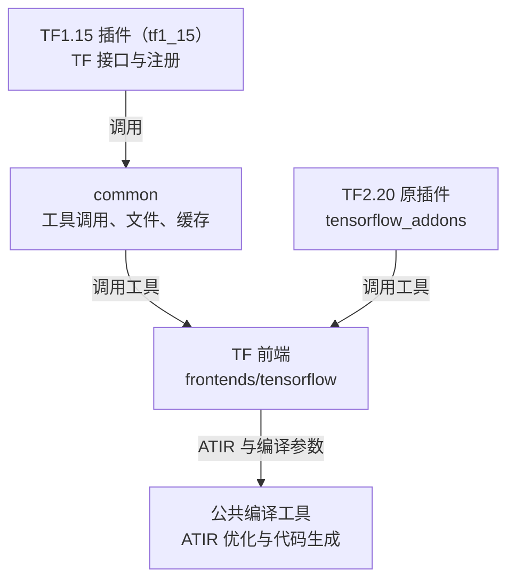
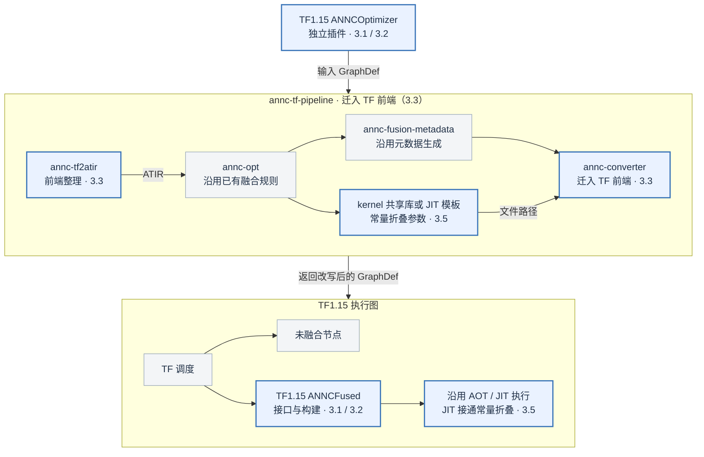
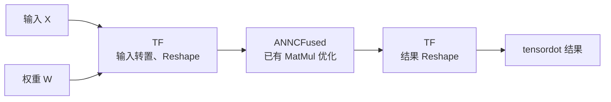
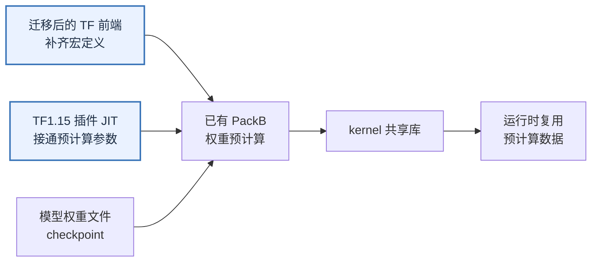

# ANNC 支持 TensorFlow 1.15 设计方案

| 文档控制项 | 内容 |
| --- | --- |
| 文档编号 | ANNC-TF115-HLD-001 |
| 版本与日期 | 1.0，2026-10-21 |
| 文档状态 | 待评审 |
| 源码基线 | `c1622b8` |
| 目标读者 | 开发、测试及技术负责人 |
| 关联文档 | [总体架构](../../architecture/overview.md)、[ONNX 整体方案](../onnx-support/overall.md)、[架构决策 ADR-016](../../decisions/decisions.md#adr-016) |

## 1 目标与范围

**让 TensorFlow 1.15 能够通过 ANNC 插件使用已有算子融合与常量折叠能力，并用 tensordot 测试已有优化效果。** 为隔离 TF 版本差异，将 TF1.15 插件放入独立模块，同时参照 ONNX 整理 TF 前端的职责与目录。

| 目标 | 本次交付内容 |
| --- | --- |
| TF1.15 基础接入 | 插件可以构建、加载和注册，图中的可融合计算实际交给 ANNC 执行 |
| tensordot 优化效果 | 使用已有 ANNC 优化；专项样例开启 ANNC 后的 QPS 相比关闭时提升至少 10% |
| 常量折叠 | 使能已有功能及其适用范围，确认优化实际生效、计算结果正确 |
| 模块清晰、便于扩展 | TF 前端进入 `frontends/tensorflow`；新插件区分公共代码与 TF1.15 专属代码 |
| 构建共存 | 可以分别选择 TF1.15、TF2.20、ORT，也可以一次构建全部插件 |

TF2.20 现有插件暂不迁移，源码、构建配置和已有库保持不变，待 TF1.15 验证通过后再接入新结构。`ANNCFused` 的执行职责、已有 AOT/JIT 流程、公共后端和 kernel 调用协议保持。本次不新增整段 tensordot 融合规则，也不新增通用常量表达式折叠能力。

已有缺陷仅在设计阶段确认直接阻碍上述目标时纳入必要修改；其他问题另行处理，不通过增加验收场景扩大本次范围。

## 2 总体方案

### 2.1 模块如何划分

**沿用 TF 的 Grappler 与 `ANNCFused` 接入方式，参照 ONNX 分开插件、前端和公共编译工具。** 当前 TF 接口与工具调用混在 `tensorflow_addons` 中，图处理又散布在 `annc` 下。本次把 TF1.15 接口放入独立插件模块，提取可复用的辅助代码，并将 TF 图处理集中到前端。

图 1：两版插件独立接入 TF，通过文件和命令行调用同一套前端工具。`common` 中的源码供两版 TF 插件复用，本次只编入 TF1.15 插件；TF2.20 原插件不依赖新插件。

TF1.15 的优化器直接实现该版本的 Grappler 接口，负责读写 TF 对象及向 TF 返回结果。公共代码接收图优化配置值、文件路径或序列化后的图数据，不接收 TF 的优化器、Tensor 或 Status 对象。**版本接口由各版本自己实现，公共代码通过普通函数调用复用。** 可复用源码复制并整理到新目录，TF2.20 保留原文件及构建关系，后续再迁入。

TF 前端使用项目生成的 Protobuf 读取 GraphDef，不链接 TF 运行库，因此两版插件可以调用相同的工具。节点和属性的实际差异在前端处理，ATIR 优化与后端继续共用。插件的 TF 头文件、库和编译配置按版本独立选择，详见第 3.2 节。

| 目录 | 主要职责 |
| --- | --- |
| `addons/tensorflow/common` | 工具调用、图优化配置值处理、文件、缓存及线程池辅助实现 |
| `addons/tensorflow/tf1_15` | TF1.15 优化器、Op、注册及 TF 线程池调用 |
| `tensorflow_addons` | 保留 TF2.20 原插件 |
| `frontends/tensorflow` | 集中 TF 图导入、流程编排和 GraphDef 改写 |
| `annc` | 保留公共 Builder、ATIR 优化和后端 |

### 2.2 本次修改在流程中的位置

**保留现有“图转换 → 融合 → 图改写 → 执行”流程，在对应位置接入 TF1.15。** 图中蓝框标出新增或修改，灰框表示直接复用；三个 TF 工具及其编排迁入 TF 前端。

图 2：修改位置与关键设计对应。蓝框中的工具或执行步骤并非全部新增，框内文字指出本次具体修改；其余编译与执行能力继续复用。

TF 继续管理整个计算图，`ANNCOptimizer` 调用工具并交回改写后的 GraphDef，`ANNCFused` 执行融合计算。AOT 使用图优化阶段编译的 kernel 共享库；JIT 使用模板按输入形状编译并复用缓存。

两个版本的插件调用同一套 TF 前端工具。工具名称、命令行参数和 `bin/` 安装位置沿用，仍可独立调用。

### 2.3 本次需要补齐什么

模块整理服务于 TF1.15 的接入目标，已有融合规则和后端计算能力继续复用；tensordot 用于检验接入后的优化效果。

| 目标 | 方案与复用 | 详细方案 |
| --- | --- | --- |
| TF1.15 使用算子融合 | 独立插件、TF 接口兼容、多版本构建，以及 TF 前端整理 | 3.1—3.3 |
| tensordot 优化效果 | 沿用已有优化规则，对比同一计算开启、关闭 ANNC 的结果与 QPS | 3.4、4.2 |
| TF1.15 使用已有常量折叠 | 迁移后保留编译开关与参数传递，接通新插件 | 3.5 |

TF2.20 插件迁移、公共后端重构和新增后端计算算法不在本次交付范围内。两版插件可以安装在同一目录树中，由对应 TF 进程加载；前端和 LLVM/MLIR 只构建一套。

## 3 关键设计

### 3.1 TF1.15 插件与公共代码

#### 3.1.1 将 TF 接口与工具调用分开

`annc_optimizer.cc` 中的优化器既实现 TF 接口，也负责将图写入文件、调用 `annc-tf-pipeline` 并读取结果。**直接在同一个类中增加版本判断，会使 TF 接口差异与可复用的工具调用流程继续耦合。**

在 `tf1_15` 中独立实现 `ANNCOptimizer`，直接继承 TF1.15 的 `CustomGraphOptimizer`；**将现有文件及子进程处理提取为公共函数**，放入 `common/optimizer_pipeline.h/.cc`。这样，TF 接口按版本实现，调用工具的流程可以复用。

| 工作 | 放置位置 |
| --- | --- |
| Grappler 接口、注册、图优化配置读取及图的序列化和解析 | `tf1_15` |
| 将结果交回 TF、处理 TF 状态和错误 | `tf1_15` |
| 图优化配置值处理、临时文件、工具参数、执行及清理 | `common` |

调用过程为：**版本代码序列化输入图 → 公共函数调用工具 → 版本代码解析结果图并交回 TF。** 公共函数接收图的字节串、图标识、输出名称和图优化配置，返回成功标志、结果字节串及错误文本，不包含 TF 头文件。配置优先级、工具参数和临时文件保留规则沿用。

#### 3.1.2 在 TF1.15 模块内处理接口差异

TF1.15 的 `CustomGraphOptimizer` 要求实现 `Feedback`，现有优化器没有该方法，不能直接用于该版本。**TF1.15 模块补充 `Feedback` 空实现**，其余优化处理沿用。[TF1.15 接口依据](https://github.com/tensorflow/tensorflow/blob/v1.15.0/tensorflow/core/grappler/optimizers/graph_optimizer.h)

成功状态及错误文本的 API 也存在版本差异，**由各版本插件自行处理 TF 状态**：TF1.15 使用 `Status()` 和 `ToString()`，TF2.20 原实现继续使用 `OkStatus()` 和 `message()`。公共函数只返回成功标志和错误文本，由版本代码转为 TF 状态，无须新增状态兼容接口。

`ANNCFused` 的 Op 注册和 Tensor 操作同样放在 `tf1_15`，执行流程复用，仅分离第 3.2 节所需的 C++17 辅助实现。注册名称、`parameter_map`、Op 输入输出、属性及错误处理行为沿用。

### 3.2 编译兼容与多版本构建

#### 3.2.1 TF1.15 独立选择构建依赖

当前优化器和融合 Op 共用所选 TF 的头文件、库、C++ 标准及标准库 ABI，默认从 Python 环境查找依赖。同版插件共用这些设置是正常的，**现有构建缺少为 TF1.15、TF2.20 分别指定依赖和编译参数的入口。**

因此，**TF1.15 使用独立构建目标，只读取为该版本指定的 TF SDK**（TF 头文件、构建配置及链接所需库）。构建配置校验所选 SDK 的版本，并使 C++ 标准、标准库 ABI 与该 TF 库保持一致；独立配置项集中列于附录 C。

单独选择 TF1.15 时关闭 TF2.20 插件构建，不进入 `tensorflow_addons`，不执行其 Python TF 检查，也不引用其中的源码或库。TF2.20 保留原配置入口。

链接方式直接复用：由运行 TF1.15 的进程提供所需接口，或在构建时链接同版 TF 库。对应配置见附录 C；工具定位继续使用 `ANNC_PIPELINE_PATH` 等现有配置。

#### 3.2.2 按源文件设置编译标准，链接到同一插件

当前插件统一使用 C++17。TF 头文件中的部分类型会随语言标准改变，接口代码的标准与目标 TF 不一致时，可能出现库符号不匹配；ANNC 的线程池接口和 JIT 文件操作又使用 `std::optional`、`std::filesystem`。**TF 接口代码须匹配目标 TF 的编译标准，ANNC 的 C++17 实现则需要分开编译。**

**线程池桥接和 JIT 实现按源文件编译，直接链接进 TF1.15 融合 Op 插件。** 源码按下表组织；目标 TF 使用 C++14 时，TF 接口源文件及供其调用的头文件采用 C++14 可用的声明，依赖 C++17 的实现单独编译。

| 源码位置 | 内容 | 编译方式 |
| --- | --- | --- |
| `tf1_15` | 优化器、Op、注册及 TF 线程池调用 | 按目标 TF 的标准编译 |
| `common/optimizer_pipeline.cc` | 图文件与工具调用 | 编入优化器，沿用目标 TF 的标准 |
| `common/annc_threadpool_adapter.cc`、`common/annc_fused_op_jit.cc` | ANNC 线程池桥接、JIT 文件与工具操作 | 按 C++17 编译，直接编入融合 Op |
| `common/annc_jit_cache.cc` | 编译缓存 | 按 C++17 单独构建缓存静态库 |

CMake 将公共源文件加入对应插件的源文件清单，插件目标采用所选 TF 的标准，仅对需要 C++17 的源文件单独设置编译选项。**这些源文件生成的目标文件直接参与插件链接，不另建 support 静态库。**

已有 JIT 缓存保留独立库组织，公共源码构建为 `annc_jit_cache_tf1_15`，供新插件链接；公开头文件使用 C++14 可用的声明。`common` 不包含 TF 头文件，`std::optional`、`std::filesystem` 留在实现内部。新插件、缓存库及相关测试统一使用目标 TF 的标准库 ABI；这些设置只作用于新目标，TF2.20 原插件及缓存库、独立前端工具和 LLVM/MLIR 不受影响。

**通过回调连接 TF 与 ANNC 线程池**

现有线程池桥接在同一份源码中同时依赖 TF 线程池与 ANNC 的 C++17 接口，并使用 TF2.20 的调度参数，不能直接用于按 C++14 编译的 TF1.15 接口代码。

**TF 线程池调用留在 TF1.15 模块，ANNC 的 C++17 接口由 `common/annc_threadpool_adapter.cc` 实现。** 两者通过线程数量、是否位于线程池工作线程及区间执行回调连接。按计算量分配时，TF1.15 模块调用 `ParallelFor`；按固定块大小分配时调用 `TransformRangeConcurrently`。接口声明不暴露 C++17 类型，桥接对象由 C++17 实现创建和销毁。kernel 仍使用 TF 线程池，调用结束先恢复当前线程原先绑定的 ANNC 线程池，再释放桥接对象。[接口依据](https://github.com/tensorflow/tensorflow/blob/v1.15.0/tensorflow/core/lib/core/threadpool.h)

**将 JIT 文件与工具操作放入公共源文件**

`annc_fused_op_jit.cc` 同时使用 TF Status 与 `std::filesystem`，其中的文件操作依赖 C++17，不能随 TF1.15 接口代码整体按 C++14 编译。

将创建目录、写形状文件及调用编译工具的实现整理到 `common/annc_fused_op_jit.cc`，接口接收路径和形状列表，返回编译结果及错误文本。**TF Status 留在 TF1.15 模块，由该模块向 TF 返回错误。** 缓存算法、编译步骤和清理时机复用。

**用 C++14 模板特化保留 kernel 调用方式**

`annc_ciface_dispatch.h` 按参数个数选择 kernel 的调用形式，其中用 C++17 的 `if constexpr` 控制模板递归是否继续。**TF1.15 模块改用 C++14 模板特化处理递归终点**，使该调用代码可以按 C++14 编译；参数顺序和调用协议沿用，TF2.20 原实现不改动。

#### 3.2.3 构建选择与二进制共存

现有构建只有一组 TF 插件目标，**无法同时生成两版 TF 插件**；两版插件沿用相同动态库文件名，也需要区分安装位置。

`build.sh` 按下表选择独立构建目标，`--all` 同时构建三个插件。**两版 TF 插件分别构建并安装到各自库目录**，两版 TF 共用的前端工具和 LLVM/MLIR 只构建一次。

| `build.sh` 入口 | TF1.15 插件 | TF2.20 插件 | ONNX 前端与 ORT 插件 |
| --- | --- | --- | --- |
| `--enable-tf1_15` | 构建 | — | — |
| `--enable-tf2_20` | — | 构建 | — |
| `--enable-ort` | — | — | 构建 |
| `--all` | 构建 | 构建 | 构建 |

无选择参数时保留现有默认组合：TF2.20 插件和 ONNX 前端，ORT 插件关闭。选择参数互斥，`--all` 构建全部插件；旧参数别名及 CMake 配置见附录 C。

| 产出 | TF1.15 | TF2.20 |
| --- | --- | --- |
| 动态库文件名 | `libannc_optimizer.so`、`libannc_fused_op.so` | 保留原文件名 |
| 构建与安装的库目录 | `lib/tensorflow/1.15/` | 保留原 `lib/` |

根 CMake 分别按两个插件开关注册目录，SDK 和编译参数使用独立变量。两版插件及各自的缓存库分别编译，插件由对应 TF 进程加载；优化器按自身目录定位同版 `libannc_fused_op.so`。

### 3.3 TF 前端处理

#### 3.3.1 将 TF 图处理集中到独立前端

TF 图导入、流程编排和 GraphDef 改写目前由 `annc/tools` 管理，与通用编译工具共用构建清单。**框架专属处理缺少独立的代码与构建管理边界**，新增 TF 工具也需要调整公共工具模块。

**本次将三个 TF 工具集中到 `frontends/tensorflow`，由前端统一注册和构建。** `annc-tf2atir`、`annc-tf-pipeline`、`annc-converter` 分别放入 `tf2atir`、`tf-pipeline`、`converter` 子目录；工具保持独立，沿用原调用顺序、名称、参数、Protobuf 生成及安装方式。

两版插件共用这些工具，按图中的节点与属性选择解析规则。已有图读取和改写能力直接复用，其图级信息、函数库、输出端口及别名保留纳入第 4 节回归；本次处理范围仍为顶层 GraphDef。

#### 3.3.2 将 TF 算子规则移出公共 Builder

公共 `MLIRBuilder` 默认查 TF 算子表，还直接处理 TF 属性及控制流。**TF 专属规则与共用构建能力混在一起，调整 TF 规则也需要修改公共 Builder。**

参照 `OnnxMLIRBuilder`，**由新增的 `TfMLIRBuilder` 提供 TF 节点规则**。该类继承公共构建器，`annc-tf2atir` 改为创建该类，原模块属性与输出保持。

| 迁入 TF 前端 | 留在公共 Builder |
| --- | --- |
| TF 算子表、属性默认值、TF 控制流 | 节点连接、ATIR 构建、元数据附加 |
| Transpose、Pack、Gather 的 TF 解释 | MatMul、Reshape 等共用构建能力 |

类型解析器复用同一份 TF 算子表。控制流图中的循环回边可能引用尚未构建的节点，不能按普通输入直接解析。**迁移后仍先处理 Switch、Merge 等控制流，再解析普通输入**：公共 Builder 在原位置调用 TF 前端的专属处理，沿用回边记录方式，不改变控制流语义。

TF 语义测试归入 `tests` 下的 TF 前端测试，ONNX-only 测试不再依赖 TF 表；Python Builder 公开接口保持不变。

### 3.4 使用 tensordot 检验已有优化效果

TF 将 `tf.tensordot` 展开为转置、Reshape、MatMul 等节点。ANNC 已有 MatMul 优化规则，可将符合条件的矩阵乘法生成 kernel，并通过 `ANNCFused` 执行。**TF1.15 接入后沿用这些规则，tensordot 作为正确性与性能测试的计算用例。**

下面以已有规则接管 MatMul 为例说明执行关系。未被已有规则选中的节点仍由 TF 执行，融合范围由原规则决定。

图 3：tensordot 测试中的一种已有优化路径。图中省略形状计算节点，保留 TF 与 ANNC 的执行分工。

本次复用现有图转换、融合、GraphDef 改写及 AOT/JIT 执行流程，接入修改见 3.1—3.3；不增加整段 tensordot 的识别、形状推导或专属改写规则。**验收检查已有优化是否实际执行，以及完整 tensordot 计算的结果与 QPS**，不要求转置、展平、乘法和恢复形状全部合成一次调用。性能口径见 4.2。

### 3.5 常量折叠接入

**常量折叠沿用 ANNC 已有能力及其适用条件。** ATIR 已有算子折叠继续复用，例如静态形状下的 `SizeOp::fold`。本次不新增常量折叠规则，也不扩大可折叠的运算范围。

需要接入的编译开关 `ANNC_ENABLE_CONSTANT_FOLDING` 控制 GEMM 固定权重预打包：编译时从模型权重文件（checkpoint）读取权重，按 kernel 所需布局完成 PackB 重排，运行时复用。**已有算子折叠与权重预打包分别沿用各自的触发条件和执行路径。** 权重读取与预计算算法沿用，修改集中在前端迁移和新插件构建两处。

**为迁移后的 `annc-tf-pipeline` 保留宏定义**

KDNN 和常量折叠的宏定义目前从 `annc` 目录向下传递，**`annc-tf-pipeline` 迁入 `frontends` 后不会自动继承**，原有预计算和链接分支将无法启用。

在迁移后的 `annc-tf-pipeline` 构建目标上显式设置原宏定义，继续生成权重预计算 C 源文件并交给后续链接步骤。

**为 TF1.15 JIT 接通预计算与链接参数**

现有 JIT 实现通过 `ANNC_ENABLE_CONSTANT_FOLDING` 决定是否传递预计算及链接参数；**新插件目标不会自动继承原插件的宏定义**，仅保留这些参数的代码还不能启用该路径。

为 `annc_fused_op_tf1_15` 设置原有宏定义，使直接编入该插件的 `common/annc_fused_op_jit.cc` 获得相同设置。沿用 `packed-c` 指定权重预计算 C 源文件的输出路径、`--packed-rhs-c` 将该文件编译并链入 kernel 共享库的参数传递。

图 4：GEMM 权重预打包路径的两处接入修改；权重读取、预计算、链接及执行流程复用。

权重预打包沿用固定二维 f32 权重的适用条件和 `ANNC_DEMO_CHECKPOINT_DIR` 配置；KDNN 来源使用已支持该功能的 `LOCAL` 或 `REMOTE` 配置。

验收同时保留已有算子折叠的回归，并检查权重预打包路径的数据生成、链接、运行时使用和结果正确性。**一个 GEMM 样例只证明该路径生效，不能代替其他已有折叠行为的回归**；权重可读取本身也不代表预打包功能完成。

## 4 验收方案

### 4.1 功能与兼容性

验收通过 TF1.15 专项样例完成，覆盖实际 Grappler 接入、图转换、融合、GraphDef 改写及 `ANNCFused` 执行，不以仅生成 ATIR 或插件成功加载作为完成依据。

| 验收项 | 用例与观察结果 |
| --- | --- |
| 基础算子融合 | 使用已有 MatMul 融合样例，对比关闭 ANNC 的结果；图中出现对应 `ANNCFused`，并确认 kernel 被执行 |
| tensordot 优化效果 | 同一 TF 测试计算开启、关闭 ANNC 的结果一致；确认已有优化实际执行，QPS 按 4.2 验收 |
| 常量折叠复用 | 沿用已有折叠用例及适用条件，确认 TF1.15 接入和前端迁移后结果与原有行为一致 |
| GEMM 权重预打包 | 固定二维 f32 权重，确认预计算数据生成、链接并被实际使用和复用；结果与关闭该优化时一致 |
| 重复执行 | AOT kernel 重复调用；JIT 相同模板及形状命中已有缓存 |
| 插件兼容 | 两种 TF 库链接配置下的插件加载、C++14 与 C++17 源文件共同构建的插件调用，以及不同参数个数的 kernel 调用 |
| TF1.15 独立构建 | 只提供 TF1.15 SDK、关闭 TF2.20 插件，完成构建并在 TF1.15 中运行；检查未引用 TF2.20 头文件或库 |
| 构建共存 | 四个构建入口、默认组合及旧别名；`--all` 只生成一套公共工具，两版插件在匹配版本的 TF 进程分别运行 |
| 回归 | TF2.20 插件、ONNX 前端及其已有融合行为；TF 控制流、输出端口、输出别名和图级信息保留 |

编译、链接及调用检查覆盖 TF1.15 插件中采用不同 C++ 标准的源文件，并保留已有缓存测试。独立调用检查不依赖系统 GTest，避免其 ABI 与 TF1.15 不一致；实际 JIT 与缓存使用由集成样例覆盖，测试统一放在 `tests/` 下。

### 4.2 tensordot 性能

**验收指标为同一 TF1.15 专项样例开启 ANNC 后，稳态 QPS 相比关闭 ANNC 提升至少 10%。** TF2.20 的同样例结果作为参考，不作为绝对性能一致的要求。

性能测试固定同一份 TF tensordot 计算、模型权重、输入形状与数据，优化范围沿用已有 ANNC 规则。比较完整计算的执行时间，不要求命中特定的整段融合模式。

| 项目 | 测量约定 |
| --- | --- |
| 对照 | 同一 TF1.15、机器、输入、CPU 绑定、构建配置及其他 TF 优化设置；仅改变是否启用 ANNC |
| 并行度 | TF intra-op、inter-op 均为 1，单个执行请求；记录实际 CPU 与线程配置 |
| 计时范围 | 初始化、编译、输入准备和预热在计时外；两侧均测相同 feed/fetch 的 `Session.run` |
| 统计 | 交替进行五轮开启/关闭测量，每轮至少 5 秒，记录完成次数和耗时，以 QPS 中位数计算提升 |

提升比例为 `QPS_开启 / QPS_关闭 - 1`。确认融合 kernel 实际执行且结果正确后，使用固定主样例统计性能。

图融合与常量折叠分别证明功能生效，tensordot 检验已有优化的效果；不要求在同一个 tensordot 片段内同时启用常量折叠，也不要求实际业务服务作为专项验收前置条件。

## 附录 A 术语表

ANNC 已有概念集中在此查阅；本次新增的类或称谓在正文首次出现时说明。

| 术语 | 本文含义 |
| --- | --- |
| TF | TensorFlow；本文涉及 TF1.15 和 TF2.20 两个版本 |
| ORT | ONNX Runtime；本文 ORT 插件指 ANNC 的 ONNX Runtime Execution Provider（EP） |
| TF SDK | 构建插件所用的 TF 头文件、构建配置，以及显式链接时所需的同版 TF 库 |
| TF 前端 | 处理 TF 图语义并连接公共编译工具的模块，包含导入、编排与 GraphDef 改写 |
| 公共 Builder | TF、ONNX 前端共用的 `MLIRBuilder` 基类，提供节点连接及 ATIR 构建能力 |
| 公共编译工具 | TF、ONNX 前端共用的 ATIR 优化与代码生成工具，如 `annc-opt`、`annc-asm`、`annc` |
| `TfMLIRBuilder` | 本次新增的 TF 图构建器，提供 TF 算子表及专属处理 |
| `ANNCOptimizer` | ANNC 的 Grappler 优化器，调用工具处理图并向 TF 返回结果 |
| `ANNCFused` | TF 图中的融合节点；由对应 Op 实现加载和调用 kernel |
| ATIR | ANNC 的中间表示，其文本文件采用 MLIR 格式 |
| 融合区域 | 准备由一个融合节点替换的一组原图节点 |
| 融合元数据 | 描述融合计算的输入、输出、函数、执行方式及与原图对应关系的信息；由 `annc-fusion-metadata` 导出为 JSON 文件 |
| kernel / kernel 共享库 | ANNC 生成的原生计算函数 / 包含该函数、供插件加载的 `.so` |
| AOT / JIT | 在图优化阶段编译 / 在实际执行时按输入形状编译，沿用现有模式 |
| JIT 模板 | 保存待编译融合函数的 ATIR MLIR 文件，执行时按输入形状编译 |
| JIT 缓存库 | 保存和复用 JIT 编译结果；本次从公共源码独立构建 `annc_jit_cache_tf1_15`，链接进 TF1.15 插件 |
| 线程池桥接 | 将 TF 的线程池调用接到 ANNC 线程池接口的实现 |
| checkpoint | TensorFlow 保存模型权重等变量值的文件；本方案从中读取固定权重 |
| 常量折叠 | 在编译时利用已知常量简化或预计算；本文沿用 ANNC 已有实现和适用范围 |
| PackB | 将 GEMM 的右侧矩阵按 kernel 所需布局打包；固定权重的编译时预打包是本次复用并专项验收的一条路径 |
| 本文的 QPS | 每秒完成的执行次数，专项测试中一次 `Session.run` 计一次 |

## 附录 B 源码依据

以下链接指向方案编制时的源码位置；关键设计区分现有实现与本次新增处理。

| 设计依据 | 源码或文档 |
| --- | --- |
| ONNX 的目录分工和独立 Builder | [前端注册](../../../frontends/CMakeLists.txt)、[OnnxMLIRBuilder](../../../frontends/onnx/onnx2atir/onnx_mlir_builder.h)、[ORT 插件](../../../addons/onnxruntime/) |
| TF 优化器与加载 | [annc_optimizer.cc](../../../tensorflow_addons/annc_optimizer.cc)、[插件构建](../../../tensorflow_addons/CMakeLists.txt) |
| TF 前端入口与公共构建器 | [annc-tf2atir](../../../annc/tools/annc-tf2atir/)、[MLIROpBuilder.cpp](../../../annc/lib/Builder/MLIROpBuilder.cpp)、[Matrix.cpp](../../../annc/lib/Builder/Transformers/Matrix.cpp) |
| 流程编排与图改写 | [annc-tf-pipeline.cpp](../../../annc/tools/annc-tf-pipeline/annc-tf-pipeline.cpp)、[GraphDefRewriter.cpp](../../../annc/tools/annc-converter/GraphDefRewriter.cpp)、[ANNCFusedNodeBuilder.cpp](../../../annc/tools/annc-converter/ANNCFusedNodeBuilder.cpp) |
| 已有 MatMul 优化及开关 | [OpFusion.cpp](../../../annc/lib/Dialect/Atir/Passes/OpFusion.cpp) 中的 `FuseMatMulAsFuncCallPattern`、[Helper.h](../../../annc/include/Helper.h) |
| TF1.15 的 tensordot 图生成 | [TensorFlow v1.15.0 math_ops.py](https://github.com/tensorflow/tensorflow/blob/v1.15.0/tensorflow/python/ops/math_ops.py#L3636) |
| 已有折叠与权重预打包 | [AtirOps.cpp](../../../annc/lib/Dialect/Atir/AtirOps.cpp) 中的 `SizeOp::fold`、[GemmPrepackRhs.cpp](../../../annc/lib/Target/aarch64/Gemm/ConstantFolding/GemmPrepackRhs.cpp)、[CheckpointReader.cpp](../../../annc/lib/Target/aarch64/Gemm/ConstantFolding/CheckpointReader.cpp) |
| 常量折叠接入 | [JIT 编译入口](../../../tensorflow_addons/annc_fused_op_jit.cc)、[目录级宏定义](../../../annc/CMakeLists.txt) |
| 线程池、缓存及 kernel 调用 | [ThreadPool.h](../../../annc/include/Support/ThreadPool/ThreadPool.h)、[annc_fused_op.cc](../../../tensorflow_addons/annc_fused_op.cc)、[annc_jit_cache.h](../../../tensorflow_addons/annc_jit_cache.h)、[annc_ciface_dispatch.h](../../../tensorflow_addons/annc_ciface_dispatch.h) |
| 测试组织 | [tests/README.md](../../../tests/README.md) |

## 附录 C 构建与功能配置

### C.1 插件目标与开关

两版插件均依赖 TF 前端开关 `ANNC_ENABLE_TENSORFLOW`，两个插件开关彼此独立。

| 配置 | TF1.15 | TF2.20 |
| --- | --- | --- |
| 插件开关 | `ANNC_ENABLE_TF1_15_ADDON`，默认关闭 | 保留 `ANNC_ENABLE_TENSORFLOW_ADDON` |
| 优化器目标 | `annc_optimizer_tf1_15` | 保留 `annc_optimizer` |
| 融合 Op 目标 | `annc_fused_op_tf1_15` | 保留 `annc_fused_op` |

`build.sh` 保留旧参数别名：`--enable-tf` 对应 `--enable-tf2_20`，`--enable-ort-ep` 对应 `--enable-ort`，`--enable-all` 对应 `--all`。

### C.2 TF1.15 SDK 配置

TF1.15 新增以下独立配置。TF2.20 保留现有 `ANNC_TENSORFLOW_*` 配置。

| CMake 参数 | 用途 |
| --- | --- |
| `ANNC_TF1_15_INCLUDE_DIR` | TF1.15 头文件目录 |
| `ANNC_TF1_15_LIBRARIES` | 显式链接时使用的 TF1.15 库 |
| `ANNC_TF1_15_CXX_STANDARD` | 目标 TF 要求的 C++ 标准 |
| `ANNC_TF1_15_CXX11_ABI` | 对应 `_GLIBCXX_USE_CXX11_ABI` |
| `ANNC_TF1_15_PRELOAD` | 选择使用进程中的 TF 库或显式链接方式 |

显式链接使用同版 `libtensorflow_cc`（TF C++ 库）与 `libtensorflow_framework`（TF 公共运行时库），沿用对带版本号共享库路径的支持。

### C.3 沿用的功能配置

| 配置 | 行为 |
| --- | --- |
| `ANNC_GEMM` | `1` 启用已有 MatMul 优化，`2` 同时允许已有后续算子融合；未设置或为 `0` 时关闭该优化 |
| `ANNC_ENABLE_CONSTANT_FOLDING` | 启用已有 GEMM 固定权重预打包编译路径，不控制所有 ATIR 算子折叠 |
| `ANNC_DEMO_CHECKPOINT_DIR` | 指定固定权重的 checkpoint 目录 |

沿用上述配置的原有行为；本次不增加 tensordot 专属融合开关，ORT 的现有规则与默认启用策略保持不变。
